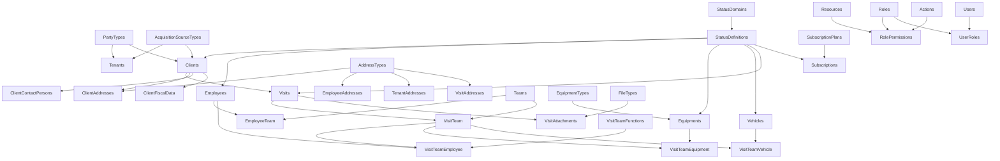

# API → Web: readiness matrix

Auditoria iniciada em 01/11/2026 e consolidada em 02/11/2026 (Europe/Lisbon). Documento para revisão humana, sem commit.

Develop SHA: **77f4a9bfc53264c6f5abf2d3d711524c99e19215**. Branch develop atualizada por fetch/prune e pull ff-only, com árvore inicialmente limpa.

Foram inventariados **45 módulos / 406 definições de operações HTTP** em todos os arquivos de Endpoints. Base/EndpointMapperAttribute é infraestrutura de descoberta, não recurso adicional. Isso não significa45 páginas nem406 operações homologadas em runtime.

> Certificação de UserPreferences em04/11/2026: **91→100%**. Ver [evidências e limites](#userpreferences-certification). Checkpoints anteriores preservados como histórico; demais recursos não foram reavaliados.

## Evidência e baseline

- Restore -warnaserror: PASS, exit0. Build Release --no-restore -warnaserror: PASS, exit0, zero warnings/erros.
- Testes -c Release --no-build --no-restore: **1.198 PASS / 0 FAIL / 6 SKIP / 1.204 total**, exit0. Os seis testes SQL condicionais não foram executados: não são PASS. A referência histórica1.204 PASS não descreve este ambiente.
- Análise estática da pilha inteira e testes do mesmo SHA; sem novo probe HTTP, SQL contra ambiente real ou jornada Web. Actions100 usa a referência funcional produtiva explicitamente fornecida no pedido/histórico; não é novo smoke. Prefetch404 fora do recurso não reduz esse score.
- Seeds são artefatos, não leitura da base instalada. Caps de autorização refletem incompatibilidade com o provisionamento versionado; grants manuais podem diferir, e não foram presumidos.
- Os scores são checklist ponderado, não probabilidade de ausência de bugs nem cobertura percentual. Busca por nomes e contagem de testes não certificam comportamento; os achados principais foram conferidos no código citado.
- Na auditoria inicial, a presença de AutoMapper não reduziu readiness funcional e nenhum código ou teste foi alterado. A correção posterior de Teams está registrada no follow-up; dependências, banco e mecanismos de mapping continuam inalterados.

## Método

A Read20 + B Mutations15 + C Lifecycle10 + D Validation/HTTP15 + E Authorization15 + F DTO10 + G Tests10 + H Locale5 =100. Final é o menor entre soma e todos os hard caps aplicáveis.

A20/F10: dados de leitura/edição/relacionamento recuperáveis; A8–17/F4–8: omissões concretas. B15: mutações próprias previsíveis; B8–14: semântica limitada ou bool não propagado. C10: lifecycle vigente com regressões; C9: persistência pode ser ocultada. D15: referência comprovada; D11–14: validação presente com inconsistências400/409/fallback SQL ou lacunas; D6–10: validação essencial incompleta. E15: roles/resource/actions coerentes com seeds/claims; E6–10: mismatch demonstrado. G4–5: transições compartilhadas sem CRUD/HTTP próprio; G6–8: testes adicionais por camada; G10: referência homologada. H5: contrato Accept-Language comprovado ponta a ponta, conforme o checklist de certificação abaixo; H2–4: marcadores crus ou política multilíngue incompleta.

Sem penalidade automática por operação que não faça sentido: vínculos e Auth não precisam de Update/Activate artificial. C10 em lifecycle não aplicável preserva denominador100 sem inventar API.

| Cap | Máximo | Condição |
|---|---:|---|
| ID75 | 75 | ID necessário à mutation ausente |
| PERM80 | 80 | action/permission ausente do seed |
| SQL80 | 80 | payload normal pode resultar500 por constraint |
| CRUD70 | 70 | CRUD essencial incompleto |
| AUTH70 | 70 | resource de autorização divergente |
| VALID85 | 85 | validação essencial de create/update incompleta |
| CONSUME75 | 75 | contrato impossível de consumir sem inferência/workaround |

SQL80 não foi aplicado apenas por existir constraint: GlobalExceptionMiddleware traduz DbUpdateException UNIQUE/duplicate para409, FK para400 e demais DbUpdateException para400. Dependência de SQL continua lacuna, mas não prova500. CRUD70 não foi aplicado por mera ausência de operação em associação. VALID85 foi aplicado às mutations de tradução sem validação essencial, não à simples ausência de WithValidation quando o domínio valida. Caps acima da soma continuam registrados, sem aumentar score.

## Tiers

| Tier | Quantidade |
|---|---:|
| A | 4 |
| B | 7 |
| C | 23 |
| D | 8 |
| NON-UI / PLATFORM | 3 |

Os três NON-UI têm score técnico, mas são contados separadamente dos quatro tiers de UI. TierA exige100; TierB não é certificação100. Actions (referência fornecida), Teams, EquipmentTypes e UserPreferences (certificações abaixo) estão nesse nível; os demais recursos não foram recertificados nesta execução. A [fila](API-WEB-IMPLEMENTATION-QUEUE.md) distingue candidatos cujo contrato já permite iniciar UI de certificação final e de dependências bloqueadas.

## Matriz principal — score final decrescente

| Rank | Resource | Category | Readiness % | Read /20 | Mutations /15 | Lifecycle /10 | Validation /15 | Authorization /15 | DTO /10 | Tests /10 | Locale /5 | Hard Cap | Business Value | Web Complexity | Dependencies | Mapper Migration Complexity | Blockers / gaps | Recommendation |
|---|---|---|---:|---:|---:|---:|---:|---:|---:|---:|---:|---|---|---|---|---|---|---|
| 1 | [Action](#action) | Identity/Admin | 100 | 20 | 15 | 10 | 15 | 15 | 10 | 10 | 5 | nenhum | needs product decision | Low | 0 — global/contexto auth | Low | Referência homologada fornecida no pedido; Name imutável, Description recuperável, transições repetidas200, delete repetido410. | Referência existente |
| 2 | [Team](#team) | Business CRUD | 100 | 20 | 15 | 10 | 15 | 15 | 10 | 10 | 5 | nenhum | needs product decision | Low | 1 — Tenants | Low | 91→99→100: Locale5/5 comprovado com Accept-Language em400/409/403/410, quatro culturas e fallback. Setenta regressões específicas PASS; zero novo diagnóstico de formatter. | Pronto para implementação no Web; sem iniciar outro recurso |
| 3 | [EquipmentType](#equipmenttype) | Catalog CRUD | 100 | 20 | 15 | 10 | 15 | 15 | 10 | 10 | 5 | nenhum | needs product decision | Low | 1 — Tenants | Low | 91→100: 409 consistente, persistência propagada, validators registrados, locale e 74 regressões específicas. | Pronto para Web no escopo local certificado; smoke produtivo após promoção/deploy |
| 5 | [Auth](#auth) | Authentication | 97 | 20 | 15 | 10 | 14 | 15 | 10 | 9 | 4 | nenhum | needs product decision | High | 1 — Tenants | Medium | NON-UI: login/register/refresh/logout. Lifecycle de entidade não aplicável. Testes claims/JWT presentes; não é CRUD/página adicional. | Plataforma, não página de negócio |
| 6 | [Job](#job) | Infrastructure/Job | 95 | 20 | 15 | 10 | 13 | 15 | 10 | 7 | 5 | nenhum | needs product decision | High | 0 — global/contexto auth | Medium | NON-UI: jobs têm efeitos/filas; Execute existe nos seeds. Não executar nem tratar como CRUD independente de negócio. | Plataforma, não página de negócio |
| 7 | [ClientAddress](#clientaddress) | Child/sub-resource | 92 | 20 | 15 | 10 | 12 | 15 | 10 | 5 | 5 | nenhum | needs product decision | Medium | 3 — Tenants, Clients, AddressTypes | High | IDs e pai encaminhados ao repository; validar primary/ownership/HTTP; não é página independente. | Início de UI em escopo explícito; fechar gates para100% |
| 8 | [ClientContactPerson](#clientcontactperson) | Child/sub-resource | 91 | 20 | 15 | 10 | 12 | 15 | 10 | 4 | 5 | nenhum | needs product decision | Low | 2 — Tenants, Clients | Medium | DTOs recuperáveis; listas recebem clientId. Aba de cliente existente, não certifica CRUD principal. | Início de UI em escopo explícito; fechar gates para100% |
| 9 | [EmployeeAddress](#employeeaddress) | Child/sub-resource | 91 | 20 | 15 | 10 | 12 | 15 | 10 | 4 | 5 | nenhum | needs product decision | Medium | 3 — Tenants, Employees, AddressTypes | High | Parent scope encaminhado; dados recuperáveis; falta jornada específica de primary/ownership/HTTP. | Início de UI em escopo explícito; fechar gates para100% |
| 10 | [EmployeeTeams](#employeeteams) | Child/sub-resource | 91 | 20 | 15 | 10 | 12 | 15 | 10 | 4 | 5 | nenhum | needs product decision | Medium | 3 — Tenants, Teams, Employees | Medium | IDs de vínculo, liderança e tempos expostos; testar intervalos e troca de relação; não exigir página global artificial. | Início de UI em escopo explícito; fechar gates para100% |
| 11 | [TenantFiscalData](#tenantfiscaldata) | Child/sub-resource | 91 | 20 | 15 | 10 | 12 | 15 | 10 | 4 | 5 | nenhum | needs product decision | Medium | 1 — Tenants | Low | Campos/pai recuperáveis; faltam regressões fiscais/HTTP; prontidão da aba não certifica aggregate Tenant. | Início de UI em escopo explícito; fechar gates para100% |
| 4 | [UserPreferences](#userpreferences) | Identity/Admin | 100 | 20 | 15 | 10 | 15 | 15 | 10 | 10 | 5 | nenhum | needs product decision | Medium | 2 — Tenants, Users | Medium | 91→100: ownership de User, horários estritos, flags de email, 409, persistência e locale comprovados por 38 regressões específicas. | Pronto para Web no escopo local certificado; smoke produtivo após promoção/deploy |
| 12 | [VisitAddress](#visitaddress) | Child/sub-resource | 91 | 20 | 15 | 10 | 12 | 15 | 10 | 4 | 5 | nenhum | needs product decision | Medium | 3 — Tenants, Visits, AddressTypes | High | Campos e pai expostos; faltam regressões de primary/ownership/HTTP; aba de visita. | Início de UI em escopo explícito; fechar gates para100% |
| 13 | [User](#user) | Identity/Admin | 90 | 18 | 15 | 10 | 11 | 15 | 9 | 7 | 5 | nenhum | needs product decision | High | 1 — Tenants | Medium | Create/senha/edição são operações diferentes; não retornar password. GetById sem guard410 explícito; jornada credenciais/grants requer evidência própria. | Início de UI em escopo explícito; fechar gates para100% |
| 14 | [VisitTeam](#visitteam) | Aggregate CRUD | 88 | 20 | 14 | 9 | 11 | 15 | 10 | 4 | 5 | nenhum | needs product decision | High | 2 — Visits, Teams | Medium | VisitId/TeamId expostos; Update sobrescreve tempos com UtcNow/null e domínio ignora bool; associação temporal exige UX própria. | Correções necessárias antes de priorizar |
| 15 | [ClientFiscalData](#clientfiscaldata) | Child/sub-resource | 87 | 20 | 15 | 10 | 11 | 15 | 10 | 4 | 2 | nenhum | needs product decision | Medium | 2 — Tenants, Clients | Medium | Validators emitem TaxNumber_Required e outros marcadores ausentes dos quatro dicionários; dados recuperáveis, mensagens inconsistentes. | Correções necessárias antes de priorizar |
| 16 | [EmployeeFiscalData](#employeefiscaldata) | Child/sub-resource | 87 | 20 | 15 | 10 | 11 | 15 | 10 | 4 | 2 | nenhum | needs product decision | Medium | 2 — Tenants, Employees | Medium | Validators fiscais usam marcadores literais ausentes dos dicionários; falta regressão específica. | Correções necessárias antes de priorizar |
| 17 | [VisitTeamFunction](#visitteamfunction) | Catalog CRUD | 86 | 17 | 14 | 10 | 11 | 15 | 10 | 4 | 5 | nenhum | needs product decision | Medium | 1 — Tenants | Medium | Rota aninhada recebe visitTeamId, mas tabela é catálogo por tenant sem FK VisitTeam. Serviço ignora pai; definir semântica, não inventar propriedade. | Correções necessárias antes de priorizar |
| 18 | [AcquisitionSourceType](#acquisitionsourcetype) | Catalog CRUD | 84 | 17 | 13 | 9 | 12 | 15 | 8 | 7 | 3 | nenhum | needs product decision | Low | 0 — global/contexto auth | High | Create multilíngue e detail localizado; PUT pt-PT; sem mutation por translationId, logo sem cap automático por ID não exigido. Domínio ignora bool de persistência. | Correções necessárias antes de priorizar |
| 19 | [FileType](#filetype) | Catalog CRUD | 82 | 17 | 13 | 9 | 12 | 15 | 8 | 5 | 3 | nenhum | needs product decision | Medium | 0 — global/contexto auth | High | MIME/Extension/Code e texto recuperáveis; sem editor público por translationId. Code deriva de extensão, não copiar canonical en-US. Domínio ignora bool. | Correções necessárias antes de priorizar |
| 20 | [JwtKey](#jwtkey) | Identity/Admin | 80 | 20 | 14 | 10 | 12 | 10 | 10 | 8 | 5 | PERM80:80 | needs product decision | High | 1 — Tenants | Low | NON-UI: Revoke ausente dos seeds; chaves são plataforma sensível. SQL/RLS ficou SKIP, sem rotação real nesta execução. | Plataforma, não página de negócio |
| 21 | [TenantContactPerson](#tenantcontactperson) | Child/sub-resource | 80 | 19 | 14 | 10 | 12 | 10 | 10 | 4 | 5 | PERM80:80 | needs product decision | Medium | 1 — Tenants | Low | GetPrimary/SetAsPrimary ausentes dos seeds; CRUD básico não substitui fluxo primary. Aba do tenant. | Remediar antes do fluxo completo |
| 22 | [VisitAttachment](#visitattachment) | Child/sub-resource | 80 | 20 | 14 | 10 | 11 | 10 | 10 | 4 | 5 | PERM80:80 | needs product decision | High | 3 — Tenants, FileTypes, Visits | High | SetPrimary ausente dos seeds. Metadados S3Key/PublicId não provam fluxo completo de upload/download; auditar storage antes da UX. | Remediar antes do fluxo completo |
| 23 | [AddressType](#addresstype) | Catalog CRUD | 79 | 17 | 11 | 9 | 9 | 15 | 8 | 7 | 3 | nenhum | needs product decision | Low | 0 — global/contexto auth | High | Update ExistsByName não exclui próprio ID: mesmo nome pode409. PUT pt-PT; sem endpoints por translationId; domínio ignora bool. | Correções necessárias antes de priorizar |
| 24 | [Client](#client) | Aggregate CRUD | 75 | 14 | 15 | 10 | 12 | 15 | 8 | 8 | 5 | CONSUME75:75 | needs product decision | High | 4 — Tenants, PartyTypes, StatusDefinitions, AcquisitionSourceTypes | High | Lookup StatusDefinitions não revela StatusDomainId necessário ao Create/Update. DTO opcional é convertido para0 enquanto EF exige FK. Não inferir par de IDs. | Remediar antes do fluxo completo |
| 25 | [Employee](#employee) | Aggregate CRUD | 75 | 14 | 15 | 10 | 13 | 15 | 8 | 5 | 5 | CONSUME75:75 | needs product decision | Medium | 2 — Tenants, StatusDefinitions | High | DTO próprio completo; criação exige par de status cuja relação não é retornada pelo lookup. | Remediar antes do fluxo completo |
| 26 | [EmployeeContactPerson](#employeecontactperson) | Child/sub-resource | 75 | 14 | 14 | 10 | 12 | 15 | 5 | 4 | 5 | CONSUME75:75 | needs product decision | Low | 2 — Tenants, Employees | Medium | Update permite Email/Phone/JobTitle/Department/IsCellPhoneWhatsapp que detail omite; não apagar ao editar. | Remediar antes do fluxo completo |
| 27 | [Equipment](#equipment) | Business CRUD | 75 | 14 | 15 | 10 | 13 | 15 | 8 | 7 | 5 | CONSUME75:75 | needs product decision | Medium | 3 — Tenants, StatusDefinitions, EquipmentTypes | High | EquipmentType é recuperável; lookup do par StatusDefinitionId/StatusDomainId está incompleto. | Remediar antes do fluxo completo |
| 28 | [Role](#role) | Identity/Admin | 75 | 15 | 15 | 10 | 14 | 15 | 6 | 6 | 5 | CONSUME75:75 | needs product decision | Low | 1 — Tenants | Low | Update.Description não é retornada por RoleDetailResponse; Name é identidade imutável. | Remediar antes do fluxo completo |
| 29 | [RolePermission](#rolepermission) | Child/sub-resource | 75 | 12 | 13 | 10 | 10 | 15 | 5 | 5 | 5 | ID75:75; CONSUME75:75 | needs product decision | High | 4 — Tenants, Roles, Resources, Actions | Medium | DELETE exige roleId/resourceId/actionId; DTO devolve nomes e Id da linha, não os três IDs. Sem Activate/Update por design não há penalidade automática. | Remediar antes do fluxo completo |
| 30 | [Subscription](#subscription) | Billing | 75 | 15 | 14 | 9 | 10 | 10 | 9 | 5 | 5 | PERM80:80; CONSUME75:75 | needs product decision | High | 3 — Tenants, StatusDefinitions, SubscriptionPlans | High | GetActivate diverge do seed GetActive; par de status necessário; GetById só mapeia retorno sem guard410 explícito; rotas sem WithValidation apesar de validadores/domínio existentes. | Remediar antes do fluxo completo |
| 31 | [Tenant](#tenant) | Aggregate CRUD | 75 | 10 | 14 | 10 | 12 | 15 | 5 | 6 | 5 | ID75:75; CONSUME75:75 | needs product decision | High | 2 — PartyTypes, AcquisitionSourceTypes | Low | Detail omite PartyTypeId, AcquisitionSourceTypeId, Email, Website, UrlImage e Note aceitos no Update. GetAll ainda serve como lookup de IDs. | Remediar antes do fluxo completo |
| 32 | [UserRole](#userrole) | Child/sub-resource | 75 | 12 | 14 | 10 | 11 | 15 | 5 | 5 | 5 | ID75:75; CONSUME75:75 | needs product decision | Medium | 3 — Tenants, Users, Roles | Medium | DELETE exige userId/roleId; detail traz nomes e Id da associação, sem par de IDs. Não inferir por nome/posição. | Remediar antes do fluxo completo |
| 33 | [Vehicle](#vehicle) | Business CRUD | 75 | 14 | 15 | 10 | 12 | 15 | 8 | 6 | 5 | CONSUME75:75 | needs product decision | Medium | 2 — Tenants, StatusDefinitions | High | Detalhe completo; criação exige par de status sem relação recuperável. Duplicado400 é erro controlado, não500. | Remediar antes do fluxo completo |
| 34 | [Visit](#visit) | Aggregate CRUD | 75 | 14 | 15 | 10 | 13 | 15 | 8 | 5 | 5 | CONSUME75:75 | needs product decision | High | 3 — Tenants, Clients, StatusDefinitions | High | Contrato principal rico; depende de Client e do par de status não recuperável; não prontificar todo aggregate por contagem de rotas. | Remediar antes do fluxo completo |
| 35 | [VisitContactPerson](#visitcontactperson) | Child/sub-resource | 75 | 14 | 14 | 10 | 12 | 15 | 5 | 4 | 5 | CONSUME75:75 | needs product decision | Low | 2 — Tenants, Visits | Low | Detail omite vários campos editáveis, como contatos de Employee; edição segura exige leitura completa. | Remediar antes do fluxo completo |
| 36 | [VisitTeamEquipments](#visitteamequipments) | Child/sub-resource | 75 | 12 | 14 | 9 | 11 | 15 | 10 | 4 | 5 | CONSUME75:75 | needs product decision | Medium | 2 — VisitTeam, Equipments | Medium | Listas ignoram visitTeamId, detail/mutations verificam pai. Não filtrar no browser como workaround. Domínio ignora bool. | Remediar antes do fluxo completo |
| 37 | [VisitTeamVehicles](#visitteamvehicles) | Child/sub-resource | 75 | 12 | 14 | 9 | 11 | 15 | 10 | 4 | 5 | CONSUME75:75 | needs product decision | Medium | 2 — VisitTeam, Vehicles | Medium | Listas ignoram visitTeamId, detail/mutations verificam pai. Domínio ignora bool; contrato contextual incompleto. | Remediar antes do fluxo completo |
| 38 | [Plan](#plan) | Billing | 70 | 17 | 13 | 10 | 12 | 6 | 8 | 7 | 3 | AUTH70:70 | needs product decision | Medium | 0 — global/contexto auth | High | Rotas exigem Plans, seeds definem SubscriptionPlans; detail localizado, Update usa cultura corrente e fallback; sem CRUD público de todas as traduções/file-rules. | Remediar antes do fluxo completo |
| 39 | [Resource](#resource) | Identity/Admin | 70 | 15 | 15 | 10 | 14 | 9 | 6 | 6 | 5 | AUTH70:70; CONSUME75:75 | needs product decision | Low | 0 — global/contexto auth | Medium | Description editável omitida do detail; Deactivate usa Resource no singular, seeds usam Resources. | Remediar antes do fluxo completo |
| 40 | [TenantAddress](#tenantaddress) | Child/sub-resource | 70 | 20 | 15 | 10 | 12 | 6 | 10 | 4 | 5 | AUTH70:70 | needs product decision | Medium | 2 — Tenants, AddressTypes | High | TenantAddress diverge do seed TenantAddresses; DTO/contexto pai utilizáveis, mas autorização bloqueia. Aba do tenant. | Remediar antes do fluxo completo |
| 41 | [VisitTeamEmployee](#visitteamemployee) | Child/sub-resource | 70 | 15 | 14 | 10 | 11 | 6 | 10 | 4 | 5 | AUTH70:70; CONSUME75:75 | needs product decision | High | 3 — VisitTeam, Employees, VisitTeamFunctions | Medium | VisitTeamEmployees diverge do seed VisitTeamEmployee; GetAll filtra pai, GetPaged ignora visitTeamId. Não declarar vazamento entre tenants sem prova. | Remediar antes do fluxo completo |
| 42 | [PartyType](#partytype) | Aggregate CRUD | 60 | 10 | 10 | 9 | 7 | 9 | 5 | 7 | 3 | ID75:75; PERM80:80; VALID85:85; CONSUME75:75 | needs product decision | Medium | 0 — global/contexto auth | High | Sem Translations/IDs no detail; actions de tradução ausentes; sem validators/prechecks nos sub-recursos; en-US removível; PUT raiz pt-PT; domínio ignora bool. SQL de IDs ficou SKIP. | Remediar antes do fluxo completo |
| 43 | [StatusDomain](#statusdomain) | Aggregate CRUD | 59 | 10 | 10 | 9 | 7 | 9 | 5 | 6 | 3 | ID75:75; PERM80:80; VALID85:85; CONSUME75:75 | needs product decision | Medium | 0 — global/contexto auth | High | Sem coleção/IDs; actions de tradução ausentes; sub-recursos sem validators/prechecks; PUT pt-PT e domínio ignora bool. | Remediar antes do fluxo completo |
| 44 | [StatusDefinition](#statusdefinition) | Aggregate CRUD | 56 | 8 | 10 | 9 | 7 | 9 | 4 | 6 | 3 | ID75:75; PERM80:80; VALID85:85; CONSUME75:75 | needs product decision | High | 2 — Tenants, StatusDomains | High | Sem translations/IDs e sem StatusDomainId na lista/detail; bloqueia consumidores de FK composta. Actions/validação de tradução faltantes. PUT só DisplayOrder/IsSystem. | Remediar antes do fluxo completo |
| 45 | [DocumentType](#documenttype) | Aggregate CRUD | 55 | 10 | 8 | 9 | 6 | 9 | 5 | 5 | 3 | ID75:75; PERM80:80; VALID85:85; CONSUME75:75 | needs product decision | Medium | 0 — global/contexto auth | High | Sem translations/IDs, actions e validação específica; PUT raiz recebe DTO vazio e só marca auditoria; edição textual depende do sub-recurso bloqueado. | Remediar antes do fluxo completo |

## Translations — oito aggregates

Todas as oito tabelas de tradução têm surrogate Id, LanguageCode, Name e Description no modelo. Nenhum detalhe expõe a coleção completa com IDs; isso só recebe cap ID75 quando há mutation que exige o identificador ausente. Não aplicar a regra canônica en-US a FileTypes, cujo Code deriva de extensão.

| Aggregate | Tables | Detail coleção/IDs | Detail LanguageCode/Name/Description | Sub-resource Create/Update/Delete | Validação/duplicidades | Semântica de Update/canonical | Auth |
|---|---|---|---|---|---|---|---|
| Plan | SubscriptionPlans + SubscriptionPlanTranslations | não/não | sim/sim/sim | não/não/não | checks de Create e constraints | Update cultura atual; detail pode usar fallback; Code estável | Plans versus SubscriptionPlans |
| AcquisitionSourceType | AcquisitionSourceTypes + AcquisitionSourceTypeTranslations | não/não | sim/sim/sim | não/não/não | Create checa Code/traduções; Update não administra aggregate inteiro | PUT pt-PT; Code de en-US; sem delete público de tradução | CRUD principal coerente |
| AddressType | AddressTypes + AddressTypeTranslations | não/não | sim/sim/sim | não/não/não | Create controlado; Update pode colidir com próprio nome | PUT pt-PT; Code de en-US | CRUD principal coerente |
| DocumentType | DocumentTypes + DocumentTypeTranslations | não/não | sim/sim/sim | sim/sim/sim | mesmo padrão sem validators/prechecks | PUT raiz vazio; textos só no sub-recurso; canonical sem proteção | actions de tradução ausentes |
| FileType | FileTypes + FileTypeTranslations | não/não | sim/sim/sim | não/não/não | checks por Code/Extension; sem mutations por translationId | Code de extensão; texto localizado | CRUD principal coerente |
| PartyType | PartyTypes + PartyTypeTranslations | não/não | sim/sim/sim | sim/sim/sim | sem validators/prechecks específicos nas mutations; constraints e middleware | PUT pt-PT; Code no Create en-US; canonical não protegida contra delete | actions de tradução ausentes |
| StatusDefinition | StatusDefinitions + StatusDefinitionTranslations | não/não | sim/sim/não | sim/sim/sim | constraints tenant/domínio/idioma; sub-recurso sem validators/prechecks | PUT DisplayOrder/IsSystem; StatusDomainId omitido do read | actions de tradução ausentes |
| StatusDomain | StatusDomains + StatusDomainTranslations | não/não | sim/sim/sim | sim/sim/sim | mesmo padrão sem validators/prechecks | PUT pt-PT; Code de en-US; canonical sem proteção | actions de tradução ausentes |

Exclusão de tradução sobre aggregate AsNoTracking seguido de Update precisa de SQL real para provar remoção persistida. Foi registrada como hipótese a testar, não bug comprovado nesta execução. A política de excluir en-US não é inventada pela auditoria: a implementação atual não a protege nos quatro recursos com sub-recursos. Sem alterar fallback de idioma.

## Dependências funcionais

Seta significa é referenciado por/desbloqueia. TenantId do contexto não exige implementar administração de tenants para abrir cada CRUD simples. FKs compostas de status impõem dependência funcional adicional ao lookup.

## Evidência transversal

- StatusDefinitionResponse e DetailResponse omitem StatusDomainId; Create o conhece, e PagedFilterRequest não oferece filtro por domínio. Isso bloqueia seleção correta do par nos seis consumidores capados; não parear por Name.
- Initial_BackOffice.sql e v2 concordam nos nomes canônicos usados na comparação de auth. BackOffice recebe cross join de Resources/Actions ativos; Manager recebe subconjunto. Nada cria automaticamente ações inexistentes. AuthAppService gera permissions por recurso; AuthorizationFilter exige role E permissão, inclusive para Admin. Não presumir superadmin bypass.
- Roles/Resources omitem Description editável. Tenant omite FKs/campos do Update. Contatos de Employee/Visit omitem textos editáveis. Um default vazio no Web não resolve isso.
- VisitTeamEquipment/Vehicle ignoram parentId nas listas; VisitTeamEmployee ignora em GetPaged. Mistura de pais no mesmo tenant não prova bypass RLS. VisitTeamFunctions é catálogo por tenant apesar da rota aninhada: clarificar semântica antes de impor FK inexistente.
- Validação essencial e validação HTTP de fronteira são complementares. O registro efetivo está em RouteValidatorSetup; localizar classe não prova que o endpoint a executa. O apêndice registra número de WithValidation e validadores relacionados.
- Domain bool propagation falha em alguns catálogos e associações, não em todos. Existem testes compartilhados de lifecycle, mas não regressão repository=false para todos os casos.
- Fiscais usam marcadores underscore crus. Índice de literais ausentes abaixo é achado estático, não uma jornada multilíngue executada.

## Pilha e operações por módulo

Os DTOs abaixo listam propriedades declaradas; bases compartilhadas podem acrescentar paginação/filtros. Não usar o índice textual como codegen de tipos. Tests relacionados incluem referências compartilhadas; quantidade não é cobertura nem HTTP.

Infra comum: [DI](../src/VianaHub.Global.Gerit.Infra.IoC/DependencyInjection.cs), [RouteValidatorSetup](../src/VianaHub.Global.Gerit.Api/Configuration/RouteValidatorSetup.cs), [AuthorizationFilter](../src/VianaHub.Global.Gerit.Api/Filters/AuthorizationFilter.cs), [ValidationFilter](../src/VianaHub.Global.Gerit.Api/Filters/ValidationFilter.cs), [NotifyExtensions](../src/VianaHub.Global.Gerit.Api/Helpers/NotifyExtensions.cs), [GlobalExceptionMiddleware](../src/VianaHub.Global.Gerit.Api/Middleware/GlobalExceptionMiddleware.cs), [schema](sql/Create-Tables.sql), [seed](sql/Initial_BackOffice.sql), [seed v2](sql/Initial_BackOffice-v2.sql).

### Action — 100% (A)

Referência homologada fornecida no pedido; Name imutável, Description recuperável, transições repetidas200, delete repetido410.

- A/B/C/D/E/F/G/H: `20/15/10/15/15/10/10/5`; soma=100; cap=100; final=100. Caps: nenhum.
- Category: Identity/Admin; Web complexity: Low; Business value: needs product decision.
- Dependencies:  (0); módulos dependentes diretos=1.
- Endpoint: [ActionEndpoint.cs](../src/VianaHub.Global.Gerit.Api/Endpoints/Identity/ActionEndpoint.cs); base `/v1/actions`.
- AppService: [ActionAppService.cs](../src/VianaHub.Global.Gerit.Application/Services/Identity/ActionAppService.cs).
- DomainService: [ActionDomainService.cs](../src/VianaHub.Global.Gerit.Domain/Services/Identity/ActionDomainService.cs).
- Repositories: [ActionDataRepository.cs](../src/VianaHub.Global.Gerit.Infra.Data/Repository/Identity/ActionDataRepository.cs). Interfaces: `IActionDataRepository`.
- Entities: [ActionEntity.cs](../src/VianaHub.Global.Gerit.Domain/Entities/Identity/ActionEntity.cs).
- EF Mapping: [ActionMapping.cs](../src/VianaHub.Global.Gerit.Infra.Data/Mappings/Identity/ActionMapping.cs). SQL tables: `Actions`.
- Route validators: [CreateActionRouteValidator.cs](../src/VianaHub.Global.Gerit.Api/Validators/Identity/Action/CreateActionRouteValidator.cs); [UpdateActionRouteValidator.cs](../src/VianaHub.Global.Gerit.Api/Validators/Identity/Action/UpdateActionRouteValidator.cs). WithValidation no módulo=2; conferir registro DI.
- Domain validators: [ActionValidator.cs](../src/VianaHub.Global.Gerit.Domain/Validators/Identity/Action/ActionValidator.cs); [ActivateActionValidator.cs](../src/VianaHub.Global.Gerit.Domain/Validators/Identity/Action/ActivateActionValidator.cs); [CreateActionValidator.cs](../src/VianaHub.Global.Gerit.Domain/Validators/Identity/Action/CreateActionValidator.cs); [DeactivateActionValidator.cs](../src/VianaHub.Global.Gerit.Domain/Validators/Identity/Action/DeactivateActionValidator.cs); [DeleteActionValidator.cs](../src/VianaHub.Global.Gerit.Domain/Validators/Identity/Action/DeleteActionValidator.cs); [UpdateActionValidator.cs](../src/VianaHub.Global.Gerit.Domain/Validators/Identity/Action/UpdateActionValidator.cs).
- Tests: [EndpointsRegistrationTests.cs](../tests/VianaHub.Global.Gerit.Tests/Api/Endpoints/EndpointsRegistrationTests.cs); [AuthorizationIdentityTests.cs](../tests/VianaHub.Global.Gerit.Tests/AuthorizationIdentityTests.cs); [AuthPermissionTokenTests.cs](../tests/VianaHub.Global.Gerit.Tests/AuthPermissionTokenTests.cs); [CanonicalCatalogCreationTests.cs](../tests/VianaHub.Global.Gerit.Tests/CanonicalCatalogCreationTests.cs); [IdempotentActionTests.cs](../tests/VianaHub.Global.Gerit.Tests/IdempotentActionTests.cs); [IdempotentStateTransitionTests.cs](../tests/VianaHub.Global.Gerit.Tests/IdempotentStateTransitionTests.cs); [JwtBearerPipelineTests.cs](../tests/VianaHub.Global.Gerit.Tests/JwtBearerPipelineTests.cs); [SecurityLogInjectionTests.cs](../tests/VianaHub.Global.Gerit.Tests/SecurityLogInjectionTests.cs).
- Mapping: AutoMapper sim; complexidade Low; culture-sensitive/resolver não identificado. [ActionMappingProfile.cs](../src/VianaHub.Global.Gerit.Application/Mappings/Identity/ActionMappingProfile.cs).
- Locale: 28 literais auditados; ausentes por locale: pt-PT=0, en-US=0, pt-BR=0, es-ES=0.

Operações, DTOs, grants e constraints

| HTTP | Relative endpoint | Operação/handler | Status declarados ou explícitos |
|---|---|---|---|
| GET | / | GetAllActions; GetAllAsync | 200, 401, 403, 500 |
| GET | /{id} | GetActionById; GetByIdAsync | 200, 401, 403, 410, 404, 500 |
| GET | /paged | GetActionsPaged; GetPagedAsync | 200, 401, 403, 500 |
| POST | / | CreateAction; CreateAsync | 201, 401, 403, 409, 400, 500 |
| PUT | /{id} | UpdateAction; UpdateAsync | 200, 401, 403, 410, 400, 404, 500 |
| PATCH | /{id}/activate | ActivateAction; ActivateAsync | 401, 403, 410, 200, 404, 500 |
| PATCH | /{id}/deactivate | DeactivateAction; DeactivateAsync | 401, 403, 410, 200, 404, 500 |
| DELETE | /{id} | DeleteAction; DeleteAsync | 401, 403, 410, 200, 404, 500 |
| POST | /bulk-upload | BulkUploadAction; BulkUploadAsync | 409, 401, 403, 200, 400, 500 |

DTOs:

- [ActionResponse.cs](../src/VianaHub.Global.Gerit.Application/Dtos/Response/Identity/Action/ActionResponse.cs): `Id:int; Name:string?; IsActive:bool`.
- [ActionDetailResponse.cs](../src/VianaHub.Global.Gerit.Application/Dtos/Response/Identity/Action/ActionDetailResponse.cs): `Id:int; Name:string?; Description:string?; IsActive:bool; IsDeleted:bool; CreatedBy:int; CreatedAt:DateTime; ModifiedBy:int?; ModifiedAt:DateTime?`.
- [PagedFilterRequest.cs](../src/VianaHub.Global.Gerit.Application/Dtos/Base/PagedFilterRequest.cs): `Search:string?; IsActive:bool?`.
- [ListPageResponse.cs](../src/VianaHub.Global.Gerit.Application/Dtos/Base/ListPageResponse.cs): `Items:IEnumerable<T>; PageNumber:int; PageSize:int; TotalItems:int; TotalPages:int`.
- [CreateActionRequest.cs](../src/VianaHub.Global.Gerit.Application/Dtos/Request/Identity/Action/CreateActionRequest.cs): `Name:string?; Description:string?`.
- [UpdateActionRequest.cs](../src/VianaHub.Global.Gerit.Application/Dtos/Request/Identity/Action/UpdateActionRequest.cs): `Description:string?`.

Authorization:

- Roles `Admin,BackOffice,Manager,Operator`; resource `Actions`; action `GetAll`.
- Roles `Admin,BackOffice,Manager,Operator`; resource `Actions`; action `GetBy`.
- Roles `Admin,BackOffice,Manager,Operator`; resource `Actions`; action `GetPaged`.
- Roles `Admin,BackOffice`; resource `Actions`; action `Create`.
- Roles `Admin,BackOffice`; resource `Actions`; action `Update`.
- Roles `Admin,BackOffice`; resource `Actions`; action `Activate`.
- Roles `Admin,BackOffice`; resource `Actions`; action `Deactivate`.
- Roles `Admin,BackOffice`; resource `Actions`; action `Delete`.
- Roles `Admin,BackOffice,Manager`; resource `Actions`; action `BulkUpload`.

Schema SQL (sem execução):

- `Actions`: FKs para nenhuma.
  - `CREATE UNIQUE INDEX UX_Actions_Name ON dbo.Actions (Name) WHERE IsDeleted = 0;`
  - `CONSTRAINT CK_Actions_Active_Deleted CHECK (NOT (IsActive = 1 AND IsDeleted = 1))`

### Auth — 97% (NON-UI / PLATFORM)

NON-UI: login/register/refresh/logout. Lifecycle de entidade não aplicável. Testes claims/JWT presentes; não é CRUD/página adicional.

- A/B/C/D/E/F/G/H: `20/15/10/14/15/10/9/4`; soma=97; cap=100; final=97. Caps: nenhum.
- Category: Authentication; Web complexity: High; Business value: needs product decision.
- Dependencies: Tenants (1); módulos dependentes diretos=2.
- Endpoint: [AuthEndpoint.cs](../src/VianaHub.Global.Gerit.Api/Endpoints/Identity/AuthEndpoint.cs); base `/v1/auth`.
- AppService: [AuthAppService.cs](../src/VianaHub.Global.Gerit.Application/Services/Identity/AuthAppService.cs).
- DomainService: [SubscriptionDomainService.cs](../src/VianaHub.Global.Gerit.Domain/Services/Billing/SubscriptionDomainService.cs).
- Repositories: [RolePermissionDataRepository.cs](../src/VianaHub.Global.Gerit.Infra.Data/Repository/Identity/RolePermissionDataRepository.cs); [RefreshTokenDataRepository.cs](../src/VianaHub.Global.Gerit.Infra.Data/Repository/Identity/RefreshTokenDataRepository.cs); [UserDataRepository.cs](../src/VianaHub.Global.Gerit.Infra.Data/Repository/Identity/UserDataRepository.cs); [UserRoleDataRepository.cs](../src/VianaHub.Global.Gerit.Infra.Data/Repository/Identity/UserRoleDataRepository.cs); [TenantDataRepository.cs](../src/VianaHub.Global.Gerit.Infra.Data/Repository/Billing/TenantDataRepository.cs); [JwtKeyDataRepository.cs](../src/VianaHub.Global.Gerit.Infra.Data/Repository/Identity/JwtKeyDataRepository.cs); [SubscriptionDataRepository.cs](../src/VianaHub.Global.Gerit.Infra.Data/Repository/Billing/SubscriptionDataRepository.cs). Interfaces: `IRolePermissionDataRepository, IRefreshTokenDataRepository, IUserDataRepository, IUserRoleDataRepository, ITenantDataRepository, IJwtKeyDataRepository, ISubscriptionDataRepository`.
- Entities: [UserEntity.cs](../src/VianaHub.Global.Gerit.Domain/Entities/Identity/UserEntity.cs).
- EF Mapping: [UserMapping.cs](../src/VianaHub.Global.Gerit.Infra.Data/Mappings/Identity/UserMapping.cs). SQL tables: `Users`.
- Route validators: [LoginRouteValidator.cs](../src/VianaHub.Global.Gerit.Api/Validators/Identity/Auth/LoginRouteValidator.cs); [RefreshRouteValidator.cs](../src/VianaHub.Global.Gerit.Api/Validators/Identity/Auth/RefreshRouteValidator.cs); [RegisterRouteValidator.cs](../src/VianaHub.Global.Gerit.Api/Validators/Identity/Auth/RegisterRouteValidator.cs). WithValidation no módulo=4; conferir registro DI.
- Domain validators: [ActivateUserValidator.cs](../src/VianaHub.Global.Gerit.Domain/Validators/Identity/User/ActivateUserValidator.cs); [CreateUserValidator.cs](../src/VianaHub.Global.Gerit.Domain/Validators/Identity/User/CreateUserValidator.cs); [DeactivateUserValidator.cs](../src/VianaHub.Global.Gerit.Domain/Validators/Identity/User/DeactivateUserValidator.cs); [DeleteUserValidator.cs](../src/VianaHub.Global.Gerit.Domain/Validators/Identity/User/DeleteUserValidator.cs); [UpdateUserValidator.cs](../src/VianaHub.Global.Gerit.Domain/Validators/Identity/User/UpdateUserValidator.cs); [UserValidator.cs](../src/VianaHub.Global.Gerit.Domain/Validators/Identity/User/UserValidator.cs).
- Tests: [EndpointsRegistrationTests.cs](../tests/VianaHub.Global.Gerit.Tests/Api/Endpoints/EndpointsRegistrationTests.cs); [AuthPermissionTokenTests.cs](../tests/VianaHub.Global.Gerit.Tests/AuthPermissionTokenTests.cs); [JwtBearerPipelineTests.cs](../tests/VianaHub.Global.Gerit.Tests/JwtBearerPipelineTests.cs); [JwtKeySigningTests.cs](../tests/VianaHub.Global.Gerit.Tests/JwtKeySigningTests.cs); [IdempotentStateTransitionTests.cs](../tests/VianaHub.Global.Gerit.Tests/IdempotentStateTransitionTests.cs).
- Mapping: AutoMapper sim; complexidade Medium; culture-sensitive/resolver não identificado. [UserMappingProfile.cs](../src/VianaHub.Global.Gerit.Application/Mappings/Identity/UserMappingProfile.cs).
- Locale: 46 literais auditados; ausentes por locale: pt-PT=9, en-US=9, pt-BR=9, es-ES=9. Ausentes: `Application.Service.Auth.Register.EmailRequired, Application.Service.Auth.Login.EmailRequired, Application.Service.Auth.Login.EmailInvalid, Application.Service.Auth.Login.PasswordRequired, Application.Service.Auth.Refresh.TokenRequired, Application.Service.Auth.Register.NameRequired, Application.Service.Auth.Register.EmailInvalid, Application.Service.Auth.Register.PasswordRequired, Application.Service.Auth.Register.PasswordTooShort`.

Operações, DTOs, grants e constraints

| HTTP | Relative endpoint | Operação/handler | Status declarados ou explícitos |
|---|---|---|---|
| POST | /register | Auth.Register; RegisterAsync | 500, 200, 400, 409 |
| POST | /login | Auth.Login; LoginAsync | 403, 200, 400, 401 |
| POST | /refresh | Auth.Refresh; RefreshAsync | 410, 403, 200, 400, 401 |
| GET | /tenants | Auth.Tenant; GetLoginAsync | 200, 400, 401 |

DTOs:

- [RegisterRequest.cs](../src/VianaHub.Global.Gerit.Application/Dtos/Request/Identity/Auth/RegisterRequest.cs): `TenantId:int; Name:string?; Email:string?; Password:string?; PhoneNumber:string?`.
- [AuthResponse.cs](../src/VianaHub.Global.Gerit.Application/Dtos/Response/Identity/Auth/AuthResponse.cs): `AccessToken:string?; RefreshToken:string?; AccessTokenExpiresAt:DateTime; RefreshTokenExpiresAt:DateTime; RoleId:int; RoleName:string?; TenantId:int; TenantName:string?; UserId:int; UserName:string?; Email:string?`.
- [LoginRequest.cs](../src/VianaHub.Global.Gerit.Application/Dtos/Request/Identity/Auth/LoginRequest.cs): `Email:string?; Password:string?`.
- [RefreshRequest.cs](../src/VianaHub.Global.Gerit.Application/Dtos/Request/Identity/Auth/RefreshRequest.cs): `TenantId:int; RefreshToken:string?`.
- [TenantLoginResponse.cs](../src/VianaHub.Global.Gerit.Application/Dtos/Response/Billing/Tenant/TenantLoginResponse.cs): `Id:int; Name:string?`.

Authorization:

- Sem CustomAuthorize CRUD; conferir AllowAnonymous/RequireAuthorization específico de Auth.

Schema SQL (sem execução):

- `Users`: FKs para Tenants.
  - `CREATE UNIQUE INDEX UX_Users_Tenant_NormalizedEmail ON dbo.Users (TenantId, NormalizedEmail) WHERE IsDeleted = 0;`
  - `CONSTRAINT CK_Users_Active_Deleted CHECK (NOT (IsActive = 1 AND IsDeleted = 1)),`
  - `CONSTRAINT UQ_Users_Id_Tenant UNIQUE (Id, TenantId),`

### Job — 95% (NON-UI / PLATFORM)

NON-UI: jobs têm efeitos/filas; Execute existe nos seeds. Não executar nem tratar como CRUD independente de negócio.

- A/B/C/D/E/F/G/H: `20/15/10/13/15/10/7/5`; soma=95; cap=100; final=95. Caps: nenhum.
- Category: Infrastructure/Job; Web complexity: High; Business value: needs product decision.
- Dependencies:  (0); módulos dependentes diretos=0.
- Endpoint: [JobEndpoint.cs](../src/VianaHub.Global.Gerit.Api/Endpoints/Job/JobEndpoint.cs); base `/v1/admin/job-definition`.
- AppService: [JobAppService.cs](../src/VianaHub.Global.Gerit.Application/Services/Job/JobAppService.cs).
- DomainService: Não identificado por tipo no índice; conferir DI/contratos compartilhados antes de concluir ausência..
- Repositories: [JobDefinitionDataRepository.cs](../src/VianaHub.Global.Gerit.Infra.Data/Repository/Job/JobDefinitionDataRepository.cs). Interfaces: `IJobDefinitionDataRepository`.
- Entities: [JobDefinitionsEntity.cs](../src/VianaHub.Global.Gerit.Domain/Entities/Job/JobDefinitionsEntity.cs).
- EF Mapping: [JobDefinitionsMapping.cs](../src/VianaHub.Global.Gerit.Infra.Data/Mappings/Job/JobDefinitionsMapping.cs). SQL tables: `JobDefinitions`.
- Route validators: Não identificado por tipo no índice; conferir DI/contratos compartilhados antes de concluir ausência.. WithValidation no módulo=2; conferir registro DI.
- Domain validators: [JobDefinitionCreateValidator.cs](../src/VianaHub.Global.Gerit.Domain/Validators/Job/JobDefinitionCreateValidator.cs); [JobDefinitionUpdateValidator.cs](../src/VianaHub.Global.Gerit.Domain/Validators/Job/JobDefinitionUpdateValidator.cs); [JobDefinitionValidator.cs](../src/VianaHub.Global.Gerit.Domain/Validators/Job/JobDefinitionValidator.cs).
- Tests: [EndpointsRegistrationTests.cs](../tests/VianaHub.Global.Gerit.Tests/Api/Endpoints/EndpointsRegistrationTests.cs); [IdempotentStateTransitionTests.cs](../tests/VianaHub.Global.Gerit.Tests/IdempotentStateTransitionTests.cs); [JwtKeyJobTests.cs](../tests/VianaHub.Global.Gerit.Tests/JwtKeyJobTests.cs); [JwtSystemJobRlsIntegrationTests.cs](../tests/VianaHub.Global.Gerit.Tests/JwtSystemJobRlsIntegrationTests.cs); [SecurityLogInjectionTests.cs](../tests/VianaHub.Global.Gerit.Tests/SecurityLogInjectionTests.cs).
- Mapping: AutoMapper sim; complexidade Medium; culture-sensitive/resolver não identificado. [JobMappingProfile.cs](../src/VianaHub.Global.Gerit.Application/Mappings/Job/JobMappingProfile.cs).
- Locale: 27 literais auditados; ausentes por locale: pt-PT=0, en-US=0, pt-BR=0, es-ES=0.

Operações, DTOs, grants e constraints

| HTTP | Relative endpoint | Operação/handler | Status declarados ou explícitos |
|---|---|---|---|
| GET | /{id} | GetJobById; GetByIdAsync | 200, 401, 403, 410, 404, 500 |
| GET | /paged | GetPagedJobs; GetPagedAsync | 200, 401, 403, 500 |
| POST | / | CreateJob; CreateAsync | 201, 401, 403, 409, 400, 500 |
| PUT | /{id} | UpdateJob; UpdateAsync | 200, 401, 403, 410, 400, 404, 500 |
| PATCH | /{id}/activate | ActivateJob; ActivateAsync | 401, 403, 410, 400, 200, 404, 500 |
| PATCH | /{id}/deactivate | DeactivateJob; DeactivateAsync | 401, 403, 410, 400, 200, 404, 500 |
| POST | /{id}/execute | ExecuteJob; ExecuteAsync | 401, 403, 410, 200, 400, 404, 500 |
| DELETE | /{id} | DeleteJob; DeleteAsync | 401, 403, 410, 400, 200, 404, 500 |

DTOs:

- [JobDetailResponse.cs](../src/VianaHub.Global.Gerit.Application/Dtos/Response/Job/JobDetailResponse.cs): `Id:int; JobCategory:string?; JobName:string?; Description:string?; JobPurpose:string?; JobType:string?; JobMethod:string?; CronExpression:string?; TimeZoneId:string?; ExecuteOnlyOnce:bool; TimeoutMinutes:int; Priority:int; Queue:string?; MaxRetries:int; JobConfiguration:string?; IsSystemJob:bool; HangfireJobId:string?; LastRegisteredAt:DateTime?; Status:int; IsActive:bool; IsDeleted:bool; CreatedBy:int; CreatedAt:DateTime; ModifiedBy:int?; ModifiedAt:DateTime?; UpdatedAt:DateTime?; NextExecution:DateTime?; LastExecution:DateTime?; LastExecutionStatus:string?`.
- [ListPageResponse.cs](../src/VianaHub.Global.Gerit.Application/Dtos/Base/ListPageResponse.cs): `Items:IEnumerable<T>; PageNumber:int; PageSize:int; TotalItems:int; TotalPages:int`.
- [JobResponse.cs](../src/VianaHub.Global.Gerit.Application/Dtos/Response/Job/JobResponse.cs): `Id:int; JobCategory:string?; JobName:string?; Description:string?; JobPurpose:string?; JobType:string?; JobMethod:string?; CronExpression:string?; TimeZoneId:string?; ExecuteOnlyOnce:bool; TimeoutMinutes:int; Priority:int; Queue:string?; MaxRetries:int; JobConfiguration:string?; IsSystemJob:bool; HangfireJobId:string?; LastRegisteredAt:DateTime?; Status:int; IsActive:bool; IsDeleted:bool; CreatedAt:DateTime; UpdatedAt:DateTime?; NextExecution:DateTime?; LastExecution:DateTime?; LastExecutionStatus:string?`.
- [CreateJobRequest.cs](../src/VianaHub.Global.Gerit.Application/Dtos/Request/Job/CreateJobRequest.cs): `JobCategory:string?; JobName:string?; Description:string?; JobPurpose:string?; JobType:string?; JobMethod:string?; CronExpression:string?; TimeZoneId:string?; ExecuteOnlyOnce:bool; TimeoutMinutes:int; Priority:int; Queue:string?; MaxRetries:int; JobConfiguration:string?; IsSystemJob:bool`.
- [UpdateJobRequest.cs](../src/VianaHub.Global.Gerit.Application/Dtos/Request/Job/UpdateJobRequest.cs): `Description:string?; JobPurpose:string?; CronExpression:string?; TimeZoneId:string?; TimeoutMinutes:int; Priority:int; Queue:string?; MaxRetries:int; JobConfiguration:string?; IsActive:bool`.

Authorization:

- Roles `Admin`; resource `JobDefinitions`; action `GetBy`.
- Roles `Admin`; resource `JobDefinitions`; action `GetPaged`.
- Roles `Admin`; resource `JobDefinitions`; action `Create`.
- Roles `Admin`; resource `JobDefinitions`; action `Update`.
- Roles `Admin`; resource `JobDefinitions`; action `Activate`.
- Roles `Admin`; resource `JobDefinitions`; action `Deactivate`.
- Roles `Admin`; resource `JobDefinitions`; action `Execute`.
- Roles `Admin`; resource `JobDefinitions`; action `Delete`.

Schema SQL (sem execução):

- `JobDefinitions`: FKs para nenhuma.
  - `CREATE UNIQUE INDEX UX_JobDefinitions_JobName ON dbo.JobDefinitions (JobName) WHERE IsDeleted = 0;`
  - `CONSTRAINT CK_JobDefinitions_Active_Deleted CHECK (NOT (IsActive = 1 AND IsDeleted = 1)),`
  - `CONSTRAINT CK_JobDefinitions_Priority CHECK (Priority BETWEEN 1 AND 10),`
  - `CONSTRAINT CK_JobDefinitions_TimeoutMinutes CHECK (TimeoutMinutes > 0),`
  - `CONSTRAINT CK_JobDefinitions_MaxRetries CHECK (MaxRetries >= 0)`

### ClientAddress — 92% (B)

IDs e pai encaminhados ao repository; validar primary/ownership/HTTP; não é página independente.

- A/B/C/D/E/F/G/H: `20/15/10/12/15/10/5/5`; soma=92; cap=100; final=92. Caps: nenhum.
- Category: Child/sub-resource; Web complexity: Medium; Business value: needs product decision.
- Dependencies: Tenants, Clients, AddressTypes (3); módulos dependentes diretos=0.
- Endpoint: [ClientAddressEndpoint.cs](../src/VianaHub.Global.Gerit.Api/Endpoints/Business/ClientAddressEndpoint.cs); base `/v1/clients`.
- AppService: [ClientAddressAppService.cs](../src/VianaHub.Global.Gerit.Application/Services/Business/ClientAddressAppService.cs).
- DomainService: [ClientAddressDomainService.cs](../src/VianaHub.Global.Gerit.Domain/Services/Business/ClientAddressDomainService.cs).
- Repositories: [ClientAddressRepository.cs](../src/VianaHub.Global.Gerit.Infra.Data/Repository/Business/ClientAddressRepository.cs); [ClientRepository.cs](../src/VianaHub.Global.Gerit.Infra.Data/Repository/Business/ClientRepository.cs). Interfaces: `IClientAddressDataRepository, IClientRepository`.
- Entities: [ClientAddressesEntity.cs](../src/VianaHub.Global.Gerit.Domain/Entities/Business/ClientAddressesEntity.cs).
- EF Mapping: [ClientAddressesMapping.cs](../src/VianaHub.Global.Gerit.Infra.Data/Mappings/Business/ClientAddressesMapping.cs). SQL tables: `ClientAddresses`.
- Route validators: [CreateClientAddressRouteValidator.cs](../src/VianaHub.Global.Gerit.Api/Validators/Business/ClientAddress/CreateClientAddressRouteValidator.cs); [UpdateClientAddressRouteValidator.cs](../src/VianaHub.Global.Gerit.Api/Validators/Business/ClientAddress/UpdateClientAddressRouteValidator.cs). WithValidation no módulo=2; conferir registro DI.
- Domain validators: [ActivateClientAddressValidator.cs](../src/VianaHub.Global.Gerit.Domain/Validators/Business/ClientAddress/ActivateClientAddressValidator.cs); [ClientAddressValidator.cs](../src/VianaHub.Global.Gerit.Domain/Validators/Business/ClientAddress/ClientAddressValidator.cs); [CreateClientAddressValidator.cs](../src/VianaHub.Global.Gerit.Domain/Validators/Business/ClientAddress/CreateClientAddressValidator.cs); [DeactivateClientAddressValidator.cs](../src/VianaHub.Global.Gerit.Domain/Validators/Business/ClientAddress/DeactivateClientAddressValidator.cs); [DeleteClientAddressValidator.cs](../src/VianaHub.Global.Gerit.Domain/Validators/Business/ClientAddress/DeleteClientAddressValidator.cs); [UpdateClientAddressValidator.cs](../src/VianaHub.Global.Gerit.Domain/Validators/Business/ClientAddress/UpdateClientAddressValidator.cs).
- Tests: [ClientEntityTests.cs](../tests/VianaHub.Global.Gerit.Tests/Domain/Entities/Business/ClientEntityTests.cs); [IdempotentStateTransitionTests.cs](../tests/VianaHub.Global.Gerit.Tests/IdempotentStateTransitionTests.cs).
- Mapping: AutoMapper sim; complexidade High; culture-sensitive/resolver sim. [ClientAddressMappingProfile.cs](../src/VianaHub.Global.Gerit.Application/Mappings/Business/ClientAddressMappingProfile.cs).
- Locale: 70 literais auditados; ausentes por locale: pt-PT=0, en-US=0, pt-BR=0, es-ES=0.

Operações, DTOs, grants e constraints

| HTTP | Relative endpoint | Operação/handler | Status declarados ou explícitos |
|---|---|---|---|
| GET | /{clientId}/addresses | GetClientAddresses; GetAllAsync | 200, 401, 403, 500 |
| GET | /{clientId}/addresses/{id} | GetClientAddressById; GetByIdAsync | 200, 401, 403, 410, 500 |
| GET | /{clientId}/addresses/paged | GetClientAddressesPaged; GetPagedAsync | 200, 401, 403, 500 |
| POST | /{clientId}/addresses | CreateClientAddress; CreateAsync | 201, 401, 403, 400, 409, 500 |
| PUT | /{clientId}/addresses/{id} | UpdateClientAddress; UpdateAsync | 200, 401, 403, 400, 410, 500 |
| PATCH | /{clientId}/addresses/{id}/activate | ActivateClientAddress; ActivateAsync | 401, 403, 200, 410, 500 |
| PATCH | /{clientId}/addresses/{id}/deactivate | DeactivateClientAddress; DeactivateAsync | 401, 403, 200, 410, 500 |
| DELETE | /{clientId}/addresses/{id} | DeleteClientAddress; DeleteAsync | 401, 403, 200, 410, 500 |
| POST | /{clientId}/addresses/bulk-upload | BulkUploadClientAddresses; BulkUploadAsync | 401, 403, 200, 400, 500 |

DTOs:

- [ClientAddressResponse.cs](../src/VianaHub.Global.Gerit.Application/Dtos/Response/Business/ClientAddress/ClientAddressResponse.cs): `Id:int; AddressTypeName:string?; CountryCode:string?; Street:string?; IsPrimary:bool; IsActive:bool`.
- [ClientAddressDetailResponse.cs](../src/VianaHub.Global.Gerit.Application/Dtos/Response/Business/ClientAddress/ClientAddressDetailResponse.cs): `Id:int; TenantId:int; TenantName:string?; ClientId:int; ClientName:string?; AddressTypeId:int; AddressTypeName:string?; CountryCode:string?; Street:string?; StreetNumber:string?; Complement:string?; Neighborhood:string?; City:string?; District:string?; PostalCode:string?; Latitude:decimal?; Longitude:decimal?; Note:string?; IsPrimary:bool; IsActive:bool; CreatedAt:DateTime`.
- [PagedFilterRequest.cs](../src/VianaHub.Global.Gerit.Application/Dtos/Base/PagedFilterRequest.cs): `Search:string?; IsActive:bool?`.
- [ListPageResponse.cs](../src/VianaHub.Global.Gerit.Application/Dtos/Base/ListPageResponse.cs): `Items:IEnumerable<T>; PageNumber:int; PageSize:int; TotalItems:int; TotalPages:int`.
- [CreateClientAddressRequest.cs](../src/VianaHub.Global.Gerit.Application/Dtos/Request/Business/ClientAddress/CreateClientAddressRequest.cs): `AddressTypeId:int; CountryCode:string?; Street:string?; StreetNumber:string?; Complement:string?; Neighborhood:string?; City:string?; District:string?; PostalCode:string?; Latitude:decimal?; Longitude:decimal?; Note:string?; IsPrimary:bool`.
- [UpdateClientAddressRequest.cs](../src/VianaHub.Global.Gerit.Application/Dtos/Request/Business/ClientAddress/UpdateClientAddressRequest.cs): `AddressTypeId:int; CountryCode:string?; Street:string?; StreetNumber:string?; Complement:string?; Neighborhood:string?; City:string?; District:string?; PostalCode:string?; Latitude:decimal?; Longitude:decimal?; Note:string?; IsPrimary:bool`.

Authorization:

- Roles `Admin,BackOffice,Manager`; resource `ClientAddresses`; action `GetAll`.
- Roles `Admin,BackOffice,Manager`; resource `ClientAddresses`; action `GetBy`.
- Roles `Admin,BackOffice,Manager`; resource `ClientAddresses`; action `GetPaged`.
- Roles `Admin,BackOffice,Manager`; resource `ClientAddresses`; action `Create`.
- Roles `Admin,BackOffice,Manager`; resource `ClientAddresses`; action `Update`.
- Roles `Admin,BackOffice,Manager`; resource `ClientAddresses`; action `Activate`.
- Roles `Admin,BackOffice,Manager`; resource `ClientAddresses`; action `Deactivate`.
- Roles `Admin,BackOffice,Manager`; resource `ClientAddresses`; action `Delete`.
- Roles `Admin,BackOffice,Manager`; resource `ClientAddresses`; action `BulkUpload`.

Schema SQL (sem execução):

- `ClientAddresses`: FKs para Tenants, Clients, AddressTypes.
  - `CREATE UNIQUE INDEX UX_ClientAddresses_Primary ON dbo.ClientAddresses (TenantId, ClientId) WHERE IsPrimary = 1 AND IsActive = 1 AND IsDeleted = 0;`
  - `CONSTRAINT UQ_ClientAddresses_Id_Tenant UNIQUE (Id, TenantId),`
  - `CONSTRAINT CK_ClientAddresses_Primary_Active CHECK (IsPrimary = 0 OR IsActive = 1),`
  - `CONSTRAINT CK_ClientAddresses_Active_Deleted CHECK (NOT (IsActive = 1 AND IsDeleted = 1)),`
  - `CONSTRAINT CK_ClientAddresses_Modification CHECK ((ModifiedAt IS NULL AND ModifiedBy IS NULL) OR (ModifiedAt IS NOT NULL AND ModifiedBy IS NOT NULL)),`
  - `CONSTRAINT CK_ClientAddresses_Latitude CHECK (Latitude IS NULL OR Latitude BETWEEN -90 AND 90),`
  - `CONSTRAINT CK_ClientAddresses_Longitude CHECK (Longitude IS NULL OR Longitude BETWEEN -180 AND 180),`
  - `CONSTRAINT CK_ClientAddresses_Coordinates CHECK ((Latitude IS NULL AND Longitude IS NULL) OR (Latitude IS NOT NULL AND Longitude IS NOT NULL)),`

### ClientContactPerson — 91% (B)

DTOs recuperáveis; listas recebem clientId. Aba de cliente existente, não certifica CRUD principal.

- A/B/C/D/E/F/G/H: `20/15/10/12/15/10/4/5`; soma=91; cap=100; final=91. Caps: nenhum.
- Category: Child/sub-resource; Web complexity: Low; Business value: needs product decision.
- Dependencies: Tenants, Clients (2); módulos dependentes diretos=0.
- Endpoint: [ClientContactPersonEndpoint.cs](../src/VianaHub.Global.Gerit.Api/Endpoints/Business/ClientContactPersonEndpoint.cs); base `/v1/clients`.
- AppService: [ClientContactPersonAppService.cs](../src/VianaHub.Global.Gerit.Application/Services/Business/ClientContactPersonAppService.cs).
- DomainService: [ClientContactPersonDomainService.cs](../src/VianaHub.Global.Gerit.Domain/Services/Business/ClientContactPersonDomainService.cs).
- Repositories: [ClientContactPersonRepository.cs](../src/VianaHub.Global.Gerit.Infra.Data/Repository/Business/ClientContactPersonRepository.cs). Interfaces: `IClientContactPersonDataRepository`.
- Entities: [ClientContactPersonsEntity.cs](../src/VianaHub.Global.Gerit.Domain/Entities/Business/ClientContactPersonsEntity.cs).
- EF Mapping: [ClientContactPersonsMapping.cs](../src/VianaHub.Global.Gerit.Infra.Data/Mappings/Business/ClientContactPersonsMapping.cs). SQL tables: `ClientContactPersons`.
- Route validators: [CreateClientContactPersonRouteValidator.cs](../src/VianaHub.Global.Gerit.Api/Validators/Business/ClientContactPerson/CreateClientContactPersonRouteValidator.cs); [UpdateClientContactPersonRouteValidator.cs](../src/VianaHub.Global.Gerit.Api/Validators/Business/ClientContactPerson/UpdateClientContactPersonRouteValidator.cs). WithValidation no módulo=2; conferir registro DI.
- Domain validators: [ActivateClientContactPersonValidator.cs](../src/VianaHub.Global.Gerit.Domain/Validators/Business/ClientContactPerson/ActivateClientContactPersonValidator.cs); [ClientContactPersonValidator.cs](../src/VianaHub.Global.Gerit.Domain/Validators/Business/ClientContactPerson/ClientContactPersonValidator.cs); [CreateClientContactPersonValidator.cs](../src/VianaHub.Global.Gerit.Domain/Validators/Business/ClientContactPerson/CreateClientContactPersonValidator.cs); [DeactivateClientContactPersonValidator.cs](../src/VianaHub.Global.Gerit.Domain/Validators/Business/ClientContactPerson/DeactivateClientContactPersonValidator.cs); [DeleteClientContactPersonValidator.cs](../src/VianaHub.Global.Gerit.Domain/Validators/Business/ClientContactPerson/DeleteClientContactPersonValidator.cs); [UpdateClientContactPersonValidator.cs](../src/VianaHub.Global.Gerit.Domain/Validators/Business/ClientContactPerson/UpdateClientContactPersonValidator.cs).
- Tests: [IdempotentStateTransitionTests.cs](../tests/VianaHub.Global.Gerit.Tests/IdempotentStateTransitionTests.cs); [ClientEntityTests.cs](../tests/VianaHub.Global.Gerit.Tests/Domain/Entities/Business/ClientEntityTests.cs).
- Mapping: AutoMapper sim; complexidade Medium; culture-sensitive/resolver não identificado. [ClientContactPersonMappingProfile.cs](../src/VianaHub.Global.Gerit.Application/Mappings/Business/ClientContactPersonMappingProfile.cs).
- Locale: 45 literais auditados; ausentes por locale: pt-PT=0, en-US=0, pt-BR=0, es-ES=0.

Operações, DTOs, grants e constraints

| HTTP | Relative endpoint | Operação/handler | Status declarados ou explícitos |
|---|---|---|---|
| GET | /{clientId}/contacts | GetClientContacts; GetAllAsync | 200, 401, 403, 500 |
| GET | /{clientId}/contacts/{id} | GetClientContactById; GetByIdAsync | 200, 401, 403, 410, 500 |
| GET | /{clientId}/contacts/paged | GetClientContactsPaged; GetPagedAsync | 200, 401, 403, 500 |
| POST | /{clientId}/contacts | CreateClientContact; CreateAsync | 201, 401, 403, 400, 409, 500 |
| PUT | /{clientId}/contacts/{id} | UpdateClientContact; UpdateAsync | 200, 401, 403, 400, 409, 410, 500 |
| PATCH | /{clientId}/contacts/{id}/activate | ActivateClientContact; ActivateAsync | 401, 403, 200, 410, 500 |
| PATCH | /{clientId}/contacts/{id}/deactivate | DeactivateClientContact; DeactivateAsync | 401, 403, 200, 410, 500 |
| DELETE | /{clientId}/contacts/{id} | DeleteClientContact; DeleteAsync | 401, 403, 200, 410, 500 |
| POST | /{clientId}/contacts/bulk-upload | BulkUploadClientContacts; BulkUploadAsync | 401, 403, 200, 400, 500 |

DTOs:

- [ClientContactPersonResponse.cs](../src/VianaHub.Global.Gerit.Application/Dtos/Response/Business/ClientContactPerson/ClientContactPersonResponse.cs): `Id:int; Name:string?; CellPhoneNumber:string?; IsPrimary:bool; IsActive:bool`.
- [ClientContactPersonDetailResponse.cs](../src/VianaHub.Global.Gerit.Application/Dtos/Response/Business/ClientContactPerson/ClientContactPersonDetailResponse.cs): `Id:int; TenantId:int; ClientId:int; Client:string?; Name:string?; PhoneNumber:string?; CellPhoneNumber:string?; IsWhatsapp:bool; JobTitle:string?; Department:string?; IsCellPhoneWhatsapp:bool; Email:string?; IsPrimary:bool; IsActive:bool; CreatedAt:DateTime`.
- [PagedFilterRequest.cs](../src/VianaHub.Global.Gerit.Application/Dtos/Base/PagedFilterRequest.cs): `Search:string?; IsActive:bool?`.
- [ListPageResponse.cs](../src/VianaHub.Global.Gerit.Application/Dtos/Base/ListPageResponse.cs): `Items:IEnumerable<T>; PageNumber:int; PageSize:int; TotalItems:int; TotalPages:int`.
- [CreateClientContactPersonRequest.cs](../src/VianaHub.Global.Gerit.Application/Dtos/Request/Business/ClientContactPerson/CreateClientContactPersonRequest.cs): `Name:string?; PhoneNumber:string?; CellPhoneNumber:string?; IsWhatsapp:bool; JobTitle:string?; Department:string?; IsCellPhoneWhatsapp:bool; Email:string?; IsPrimary:bool`.
- [UpdateClientContactPersonRequest.cs](../src/VianaHub.Global.Gerit.Application/Dtos/Request/Business/ClientContactPerson/UpdateClientContactPersonRequest.cs): `Name:string?; Email:string?; PhoneNumber:string?; CellPhoneNumber:string?; IsWhatsapp:bool; JobTitle:string?; Department:string?; IsCellPhoneWhatsapp:bool; IsPrimary:bool`.

Authorization:

- Roles `Admin,BackOffice,Manager`; resource `ClientContactPersons`; action `GetAll`.
- Roles `Admin,BackOffice,Manager`; resource `ClientContactPersons`; action `GetBy`.
- Roles `Admin,BackOffice,Manager`; resource `ClientContactPersons`; action `GetPaged`.
- Roles `Admin,BackOffice,Manager`; resource `ClientContactPersons`; action `Create`.
- Roles `Admin,BackOffice,Manager`; resource `ClientContactPersons`; action `Update`.
- Roles `Admin,BackOffice,Manager`; resource `ClientContactPersons`; action `Activate`.
- Roles `Admin,BackOffice,Manager`; resource `ClientContactPersons`; action `Deactivate`.
- Roles `Admin,BackOffice,Manager`; resource `ClientContactPersons`; action `Delete`.
- Roles `Admin,BackOffice,Manager`; resource `ClientContactPersons`; action `BulkUpload`.

Schema SQL (sem execução):

- `ClientContactPersons`: FKs para Tenants, Clients.
  - `CREATE UNIQUE INDEX UX_ClientContactPersons_Email ON dbo.ClientContactPersons (TenantId, ClientId, Email) WHERE Email IS NOT NULL AND IsActive = 1 AND IsDeleted = 0;`
  - `CREATE UNIQUE INDEX UX_ClientContactPersons_Primary ON dbo.ClientContactPersons (TenantId, ClientId) WHERE IsPrimary = 1 AND IsActive = 1 AND IsDeleted = 0;`
  - `CONSTRAINT CK_ClientContactPersons_Primary_Active CHECK (IsPrimary = 0 OR IsActive = 1),`
  - `CONSTRAINT CK_ClientContactPersons_Active_Deleted CHECK (NOT (IsActive = 1 AND IsDeleted = 1)),`
  - `CONSTRAINT CK_ClientContactPersons_CellPhoneWhatsapp CHECK (IsCellPhoneWhatsapp = 0 OR NULLIF(LTRIM(RTRIM(CellPhoneNumber)), N'') IS NOT NULL),`
  - `CONSTRAINT CK_ClientContactPersons_Modification CHECK ((ModifiedAt IS NULL AND ModifiedBy IS NULL) OR (ModifiedAt IS NOT NULL AND ModifiedBy IS NOT NULL)),`

### EmployeeAddress — 91% (B)

Parent scope encaminhado; dados recuperáveis; falta jornada específica de primary/ownership/HTTP.

- A/B/C/D/E/F/G/H: `20/15/10/12/15/10/4/5`; soma=91; cap=100; final=91. Caps: nenhum.
- Category: Child/sub-resource; Web complexity: Medium; Business value: needs product decision.
- Dependencies: Tenants, Employees, AddressTypes (3); módulos dependentes diretos=0.
- Endpoint: [EmployeeAddressEndpoint.cs](../src/VianaHub.Global.Gerit.Api/Endpoints/Business/EmployeeAddressEndpoint.cs); base `/v1/employees`.
- AppService: [EmployeeAddressAppService.cs](../src/VianaHub.Global.Gerit.Application/Services/Business/EmployeeAddressAppService.cs).
- DomainService: [EmployeeAddressDomainService.cs](../src/VianaHub.Global.Gerit.Domain/Services/Business/EmployeeAddressDomainService.cs).
- Repositories: [EmployeeAddressDataRepository.cs](../src/VianaHub.Global.Gerit.Infra.Data/Repository/Business/EmployeeAddressDataRepository.cs). Interfaces: `IEmployeeAddressDataRepository`.
- Entities: [EmployeeAddressesEntity.cs](../src/VianaHub.Global.Gerit.Domain/Entities/Business/EmployeeAddressesEntity.cs).
- EF Mapping: [EmployeeAddressesMapping.cs](../src/VianaHub.Global.Gerit.Infra.Data/Mappings/Business/EmployeeAddressesMapping.cs). SQL tables: `EmployeeAddresses`.
- Route validators: [CreateEmployeeAddressRouteValidator.cs](../src/VianaHub.Global.Gerit.Api/Validators/Business/EmployeeAddress/CreateEmployeeAddressRouteValidator.cs); [UpdateEmployeeAddressRouteValidator.cs](../src/VianaHub.Global.Gerit.Api/Validators/Business/EmployeeAddress/UpdateEmployeeAddressRouteValidator.cs). WithValidation no módulo=2; conferir registro DI.
- Domain validators: [ActivateEmployeeAddressValidator.cs](../src/VianaHub.Global.Gerit.Domain/Validators/Business/EmployeeAddress/ActivateEmployeeAddressValidator.cs); [CreateEmployeeAddressValidator.cs](../src/VianaHub.Global.Gerit.Domain/Validators/Business/EmployeeAddress/CreateEmployeeAddressValidator.cs); [DeactivateEmployeeAddressValidator.cs](../src/VianaHub.Global.Gerit.Domain/Validators/Business/EmployeeAddress/DeactivateEmployeeAddressValidator.cs); [DeleteEmployeeAddressValidator.cs](../src/VianaHub.Global.Gerit.Domain/Validators/Business/EmployeeAddress/DeleteEmployeeAddressValidator.cs); [EmployeeAddressValidator.cs](../src/VianaHub.Global.Gerit.Domain/Validators/Business/EmployeeAddress/EmployeeAddressValidator.cs); [UpdateEmployeeAddressValidator.cs](../src/VianaHub.Global.Gerit.Domain/Validators/Business/EmployeeAddress/UpdateEmployeeAddressValidator.cs).
- Tests: [IdempotentStateTransitionTests.cs](../tests/VianaHub.Global.Gerit.Tests/IdempotentStateTransitionTests.cs); [NullablePersistenceContractTests.cs](../tests/VianaHub.Global.Gerit.Tests/NullablePersistenceContractTests.cs).
- Mapping: AutoMapper sim; complexidade High; culture-sensitive/resolver sim. [EmployeeAddressMappingProfile.cs](../src/VianaHub.Global.Gerit.Application/Mappings/Business/EmployeeAddressMappingProfile.cs).
- Locale: 55 literais auditados; ausentes por locale: pt-PT=0, en-US=0, pt-BR=0, es-ES=0.

Operações, DTOs, grants e constraints

| HTTP | Relative endpoint | Operação/handler | Status declarados ou explícitos |
|---|---|---|---|
| GET | /{employeeId}/addresses | GetEmployeeAddresses; GetAllAsync | 200, 401, 403, 500 |
| GET | /{employeeId}/addresses/{id} | GetEmployeeAddressById; GetByIdAsync | 200, 401, 403, 410, 500 |
| GET | /{employeeId}/addresses/paged | GetEmployeeAddressesPaged; GetPagedAsync | 200, 401, 403, 500 |
| POST | /{employeeId}/addresses | CreateEmployeeAddress; CreateAsync | 201, 401, 403, 400, 409, 500 |
| PUT | /{employeeId}/addresses/{id} | UpdateEmployeeAddress; UpdateAsync | 200, 401, 403, 400, 410, 500 |
| PATCH | /{employeeId}/addresses/{id}/activate | ActivateEmployeeAddress; ActivateAsync | 401, 403, 200, 410, 500 |
| PATCH | /{employeeId}/addresses/{id}/deactivate | DeactivateEmployeeAddress; DeactivateAsync | 401, 403, 200, 410, 500 |
| DELETE | /{employeeId}/addresses/{id} | DeleteEmployeeAddress; DeleteAsync | 401, 403, 200, 410, 500 |
| POST | /{employeeId}/addresses/bulk-upload | BulkUploadEmployeeAddresses; BulkUploadAsync | 401, 403, 200, 400, 500 |

DTOs:

- [EmployeeAddressResponse.cs](../src/VianaHub.Global.Gerit.Application/Dtos/Response/Business/EmployeeAddress/EmployeeAddressResponse.cs): `Id:int; AddressTypeName:string?; CountryCode:string?; Street:string?; IsPrimary:bool; IsActive:bool`.
- [EmployeeAddressDetailResponse.cs](../src/VianaHub.Global.Gerit.Application/Dtos/Response/Business/EmployeeAddress/EmployeeAddressDetailResponse.cs): `Id:int; TenantId:int; EmployeeId:int; Employee:string?; AddressTypeId:int; AddressType:string?; Street:string?; StreetNumber:string?; Complement:string?; Neighborhood:string?; City:string?; District:string?; PostalCode:string?; CountryCode:string?; Latitude:decimal?; Longitude:decimal?; Note:string?; IsPrimary:bool; IsActive:bool; CreatedAt:DateTime`.
- [PagedFilterRequest.cs](../src/VianaHub.Global.Gerit.Application/Dtos/Base/PagedFilterRequest.cs): `Search:string?; IsActive:bool?`.
- [ListPageResponse.cs](../src/VianaHub.Global.Gerit.Application/Dtos/Base/ListPageResponse.cs): `Items:IEnumerable<T>; PageNumber:int; PageSize:int; TotalItems:int; TotalPages:int`.
- [CreateEmployeeAddressRequest.cs](../src/VianaHub.Global.Gerit.Application/Dtos/Request/Business/EmployeeAddress/CreateEmployeeAddressRequest.cs): `AddressTypeId:int; CountryCode:string?; Street:string?; StreetNumber:string?; Complement:string?; Neighborhood:string?; City:string?; District:string?; PostalCode:string?; Latitude:decimal?; Longitude:decimal?; Note:string?; IsPrimary:bool`.
- [UpdateEmployeeAddressRequest.cs](../src/VianaHub.Global.Gerit.Application/Dtos/Request/Business/EmployeeAddress/UpdateEmployeeAddressRequest.cs): `AddressTypeId:int; CountryCode:string?; Street:string?; StreetNumber:string?; Complement:string?; Neighborhood:string?; City:string?; PostalCode:string?; District:string?; Latitude:decimal?; Longitude:decimal?; Note:string?`.

Authorization:

- Roles `Admin,BackOffice,Manager`; resource `EmployeeAddresses`; action `GetAll`.
- Roles `Admin,BackOffice,Manager`; resource `EmployeeAddresses`; action `GetBy`.
- Roles `Admin,BackOffice,Manager`; resource `EmployeeAddresses`; action `GetPaged`.
- Roles `Admin,BackOffice,Manager`; resource `EmployeeAddresses`; action `Create`.
- Roles `Admin,BackOffice,Manager`; resource `EmployeeAddresses`; action `Update`.
- Roles `Admin,BackOffice,Manager`; resource `EmployeeAddresses`; action `Activate`.
- Roles `Admin,BackOffice,Manager`; resource `EmployeeAddresses`; action `Deactivate`.
- Roles `Admin,BackOffice,Manager`; resource `EmployeeAddresses`; action `Delete`.
- Roles `Admin,BackOffice,Manager`; resource `EmployeeAddresses`; action `BulkUpload`.

Schema SQL (sem execução):

- `EmployeeAddresses`: FKs para Tenants, Employees, AddressTypes.
  - `CREATE UNIQUE INDEX UX_EmployeeAddresses_Primary ON dbo.EmployeeAddresses (TenantId, EmployeeId) WHERE IsPrimary = 1 AND IsActive = 1 AND IsDeleted = 0;`
  - `CONSTRAINT UQ_EmployeeAddresses_Id_Tenant UNIQUE (Id, TenantId),`
  - `CONSTRAINT CK_EmployeeAddresses_Primary_Active CHECK (IsPrimary = 0 OR IsActive = 1),`
  - `CONSTRAINT CK_EmployeeAddresses_Active_Deleted CHECK (NOT (IsActive = 1 AND IsDeleted = 1)),`
  - `CONSTRAINT CK_EmployeeAddresses_Modification CHECK ((ModifiedAt IS NULL AND ModifiedBy IS NULL) OR (ModifiedAt IS NOT NULL AND ModifiedBy IS NOT NULL)),`
  - `CONSTRAINT CK_EmployeeAddresses_Latitude CHECK (Latitude IS NULL OR Latitude BETWEEN -90 AND 90),`
  - `CONSTRAINT CK_EmployeeAddresses_Longitude CHECK (Longitude IS NULL OR Longitude BETWEEN -180 AND 180),`
  - `CONSTRAINT CK_EmployeeAddresses_Coordinates CHECK ((Latitude IS NULL AND Longitude IS NULL) OR (Latitude IS NOT NULL AND Longitude IS NOT NULL)),`

### EmployeeTeams — 91% (B)

IDs de vínculo, liderança e tempos expostos; testar intervalos e troca de relação; não exigir página global artificial.

- A/B/C/D/E/F/G/H: `20/15/10/12/15/10/4/5`; soma=91; cap=100; final=91. Caps: nenhum.
- Category: Child/sub-resource; Web complexity: Medium; Business value: needs product decision.
- Dependencies: Tenants, Teams, Employees (3); módulos dependentes diretos=0.
- Endpoint: [EmployeeTeamsEndpoint.cs](../src/VianaHub.Global.Gerit.Api/Endpoints/Business/EmployeeTeamsEndpoint.cs); base `/v1/employees`.
- AppService: [EmployeeTeamAppService.cs](../src/VianaHub.Global.Gerit.Application/Services/Business/EmployeeTeamAppService.cs).
- DomainService: [EmployeeTeamDomainService.cs](../src/VianaHub.Global.Gerit.Domain/Services/Business/EmployeeTeamDomainService.cs).
- Repositories: [EmployeeTeamDataRepository.cs](../src/VianaHub.Global.Gerit.Infra.Data/Repository/Business/EmployeeTeamDataRepository.cs). Interfaces: `IEmployeeTeamDataRepository`.
- Entities: [EmployeeTeamEntity.cs](../src/VianaHub.Global.Gerit.Domain/Entities/Business/EmployeeTeamEntity.cs).
- EF Mapping: [EmployeeTeamMapping.cs](../src/VianaHub.Global.Gerit.Infra.Data/Mappings/Business/EmployeeTeamMapping.cs). SQL tables: `EmployeeTeam`.
- Route validators: [CreateEmployeeTeamRouteValidator.cs](../src/VianaHub.Global.Gerit.Api/Validators/Business/EmployeeTeams/CreateEmployeeTeamRouteValidator.cs); [UpdateEmployeeTeamRouteValidator.cs](../src/VianaHub.Global.Gerit.Api/Validators/Business/EmployeeTeams/UpdateEmployeeTeamRouteValidator.cs). WithValidation no módulo=2; conferir registro DI.
- Domain validators: [ActivateEmployeeTeamValidator.cs](../src/VianaHub.Global.Gerit.Domain/Validators/Business/EmployeeTeam/ActivateEmployeeTeamValidator.cs); [CreateEmployeeTeamValidator.cs](../src/VianaHub.Global.Gerit.Domain/Validators/Business/EmployeeTeam/CreateEmployeeTeamValidator.cs); [DeactivateEmployeeTeamValidator.cs](../src/VianaHub.Global.Gerit.Domain/Validators/Business/EmployeeTeam/DeactivateEmployeeTeamValidator.cs); [DeleteEmployeeTeamValidator.cs](../src/VianaHub.Global.Gerit.Domain/Validators/Business/EmployeeTeam/DeleteEmployeeTeamValidator.cs); [EmployeeTeamValidator.cs](../src/VianaHub.Global.Gerit.Domain/Validators/Business/EmployeeTeam/EmployeeTeamValidator.cs); [UpdateEmployeeTeamValidator.cs](../src/VianaHub.Global.Gerit.Domain/Validators/Business/EmployeeTeam/UpdateEmployeeTeamValidator.cs).
- Tests: [IdempotentStateTransitionTests.cs](../tests/VianaHub.Global.Gerit.Tests/IdempotentStateTransitionTests.cs).
- Mapping: AutoMapper sim; complexidade Medium; culture-sensitive/resolver não identificado. [EmployeeTeamMappingProfile.cs](../src/VianaHub.Global.Gerit.Application/Mappings/Business/EmployeeTeamMappingProfile.cs).
- Locale: 19 literais auditados; ausentes por locale: pt-PT=0, en-US=0, pt-BR=0, es-ES=0.

Operações, DTOs, grants e constraints

| HTTP | Relative endpoint | Operação/handler | Status declarados ou explícitos |
|---|---|---|---|
| GET | /{employeeId}/teams | GetEmployeeTeams; GetAllAsync | 200, 401, 403, 500 |
| GET | /{employeeId}/teams/{id} | GetEmployeeTeamById; GetByIdAsync | 200, 401, 403, 410, 500 |
| GET | /{employeeId}/teams/paged | GetEmployeeTeamsPaged; GetPagedAsync | 200, 401, 403, 500 |
| POST | /{employeeId}/teams | CreateEmployeeTeam; CreateAsync | 201, 401, 403, 400, 409, 500 |
| PUT | /{employeeId}/teams/{id} | UpdateEmployeeTeam; UpdateAsync | 200, 401, 403, 400, 410, 500 |
| PATCH | /{employeeId}/teams/{id}/activate | ActivateEmployeeTeam; ActivateAsync | 401, 403, 200, 410, 500 |
| PATCH | /{employeeId}/teams/{id}/deactivate | DeactivateEmployeeTeam; DeactivateAsync | 401, 403, 200, 410, 500 |
| DELETE | /{employeeId}/teams/{id} | DeleteEmployeeTeam; DeleteAsync | 401, 403, 200, 410, 500 |
| POST | /{employeeId}/teams/bulk-upload | BulkUploadEmployeeTeams; BulkUploadAsync | 401, 403, 200, 400, 500 |

DTOs:

- [EmployeeTeamResponse.cs](../src/VianaHub.Global.Gerit.Application/Dtos/Response/Business/EmployeeTeams/EmployeeTeamResponse.cs): `Id:int; Team:string?; Employee:string?; IsLeader:bool; IsActive:bool`.
- [EmployeeTeamDetailResponse.cs](../src/VianaHub.Global.Gerit.Application/Dtos/Response/Business/EmployeeTeams/EmployeeTeamDetailResponse.cs): `Id:int; TenantId:int; TeamId:int; Team:string?; EmployeeId:int; Employee:string?; IsLeader:bool; StartDateTime:DateTime; EndDateTime:DateTime?; IsActive:bool; CreatedAt:DateTime`.
- [PagedFilterRequest.cs](../src/VianaHub.Global.Gerit.Application/Dtos/Base/PagedFilterRequest.cs): `Search:string?; IsActive:bool?`.
- [ListPageResponse.cs](../src/VianaHub.Global.Gerit.Application/Dtos/Base/ListPageResponse.cs): `Items:IEnumerable<T>; PageNumber:int; PageSize:int; TotalItems:int; TotalPages:int`.
- [CreateEmployeeTeamRequest.cs](../src/VianaHub.Global.Gerit.Application/Dtos/Request/Business/EmployeeTeams/CreateEmployeeTeamRequest.cs): `TeamId:int; IsLeader:bool`.
- [UpdateEmployeeTeamRequest.cs](../src/VianaHub.Global.Gerit.Application/Dtos/Request/Business/EmployeeTeams/UpdateEmployeeTeamRequest.cs): `TeamId:int; EmployeeId:int; IsLeader:bool`.

Authorization:

- Roles `Admin,BackOffice,Manager`; resource `EmployeeTeam`; action `GetAll`.
- Roles `Admin,BackOffice,Manager`; resource `EmployeeTeam`; action `GetBy`.
- Roles `Admin,BackOffice,Manager`; resource `EmployeeTeam`; action `GetPaged`.
- Roles `Admin,BackOffice,Manager`; resource `EmployeeTeam`; action `Create`.
- Roles `Admin,BackOffice,Manager`; resource `EmployeeTeam`; action `Update`.
- Roles `Admin,BackOffice,Manager`; resource `EmployeeTeam`; action `Activate`.
- Roles `Admin,BackOffice,Manager`; resource `EmployeeTeam`; action `Deactivate`.
- Roles `Admin,BackOffice,Manager`; resource `EmployeeTeam`; action `Delete`.
- Roles `Admin,BackOffice,Manager`; resource `EmployeeTeam`; action `BulkUpload`.

Schema SQL (sem execução):

- `EmployeeTeam`: FKs para Tenants, Teams, Employees.
  - `CREATE UNIQUE INDEX UX_EmployeeTeam_Active ON dbo.EmployeeTeam (TenantId, TeamId, EmployeeId) WHERE EndDateTime IS NULL AND IsDeleted = 0;`
  - `CONSTRAINT CK_EmployeeTeam_Active_Deleted CHECK (NOT (IsActive = 1 AND IsDeleted = 1)),`
  - `CONSTRAINT CK_EmployeeTeam_EndDateTime CHECK (EndDateTime IS NULL OR EndDateTime >= StartDateTime),`

### EquipmentType — 100% (A)

Certificação local atual: [evidências 91→100](#equipmenttype-certification). O texto de auditoria e score 91 abaixo é histórico preservado.

CRUD simples completo; duplicate Create400, Update sem precheck; UNIQUE coberto pelo middleware409; falta regressão dedicada de CRUD/HTTP.

- A/B/C/D/E/F/G/H: `20/15/10/12/15/10/4/5`; soma=91; cap=100; final=91. Caps: nenhum.
- Category: Catalog CRUD; Web complexity: Low; Business value: needs product decision.
- Dependencies: Tenants (1); módulos dependentes diretos=1.
- Endpoint: [EquipmentTypeEndpoint.cs](../src/VianaHub.Global.Gerit.Api/Endpoints/Business/EquipmentTypeEndpoint.cs); base `/v1/equipment-types`.
- AppService: [EquipmentTypeAppService.cs](../src/VianaHub.Global.Gerit.Application/Services/Business/EquipmentTypeAppService.cs).
- DomainService: [EquipmentTypeDomainService.cs](../src/VianaHub.Global.Gerit.Domain/Services/Business/EquipmentTypeDomainService.cs).
- Repositories: [EquipmentTypeDataRepository.cs](../src/VianaHub.Global.Gerit.Infra.Data/Repository/Business/EquipmentTypeDataRepository.cs). Interfaces: `IEquipmentTypeDataRepository`.
- Entities: [EquipmentTypeEntity.cs](../src/VianaHub.Global.Gerit.Domain/Entities/Business/EquipmentTypeEntity.cs).
- EF Mapping: [EquipmentTypeMapping.cs](../src/VianaHub.Global.Gerit.Infra.Data/Mappings/Business/EquipmentTypeMapping.cs). SQL tables: `EquipmentTypes`.
- Route validators: [CreateEquipmentTypeRouteValidator.cs](../src/VianaHub.Global.Gerit.Api/Validators/Business/EquipmentType/CreateEquipmentTypeRouteValidator.cs); [UpdateEquipmentTypeRouteValidator.cs](../src/VianaHub.Global.Gerit.Api/Validators/Business/EquipmentType/UpdateEquipmentTypeRouteValidator.cs). WithValidation no módulo=2; conferir registro DI.
- Domain validators: [ActivateEquipmentTypeValidator.cs](../src/VianaHub.Global.Gerit.Domain/Validators/Business/EquipmentType/ActivateEquipmentTypeValidator.cs); [CreateEquipmentTypeValidator.cs](../src/VianaHub.Global.Gerit.Domain/Validators/Business/EquipmentType/CreateEquipmentTypeValidator.cs); [DeactivateEquipmentTypeValidator.cs](../src/VianaHub.Global.Gerit.Domain/Validators/Business/EquipmentType/DeactivateEquipmentTypeValidator.cs); [DeleteEquipmentTypeValidator.cs](../src/VianaHub.Global.Gerit.Domain/Validators/Business/EquipmentType/DeleteEquipmentTypeValidator.cs); [EquipmentTypeValidator.cs](../src/VianaHub.Global.Gerit.Domain/Validators/Business/EquipmentType/EquipmentTypeValidator.cs); [UpdateEquipmentTypeValidator.cs](../src/VianaHub.Global.Gerit.Domain/Validators/Business/EquipmentType/UpdateEquipmentTypeValidator.cs).
- Tests: [IdempotentStateTransitionTests.cs](../tests/VianaHub.Global.Gerit.Tests/IdempotentStateTransitionTests.cs).
- Mapping: AutoMapper sim; complexidade Low; culture-sensitive/resolver não identificado. [EquipmentTypeMappingProfile.cs](../src/VianaHub.Global.Gerit.Application/Mappings/Business/EquipmentTypeMappingProfile.cs).
- Locale: 25 literais auditados; ausentes por locale: pt-PT=0, en-US=0, pt-BR=0, es-ES=0.

Operações, DTOs, grants e constraints

| HTTP | Relative endpoint | Operação/handler | Status declarados ou explícitos |
|---|---|---|---|
| GET | / | GetAllEquipmentTypes; GetAllAsync | 200, 401, 403, 500 |
| GET | /{id} | GetEquipmentTypeById; GetByIdAsync | 200, 401, 403, 410, 404, 500 |
| GET | /paged | GetPagedEquipmentTypes; GetPagedAsync | 200, 401, 403, 500 |
| POST | / | CreateEquipmentType; CreateAsync | 201, 401, 403, 400, 500 |
| PUT | /{id} | UpdateEquipmentType; UpdateAsync | 401, 403, 410, 204, 400, 500 |
| PATCH | /{id}/activate | ActivateEquipmentType; ActivateAsync | 401, 403, 410, 200, 404, 500 |
| PATCH | /{id}/deactivate | DeactivateEquipmentType; DeactivateAsync | 401, 403, 410, 200, 404, 500 |
| DELETE | /{id} | DeleteEquipmentType; DeleteAsync | 401, 403, 410, 200, 404, 500 |
| POST | /bulk-upload | BulkUploadEquipmentTypes; ReadFormAsync, BulkUploadAsync | 401, 403, 200, 400, 500 |

DTOs:

- [EquipmentTypeResponse.cs](../src/VianaHub.Global.Gerit.Application/Dtos/Response/Business/EquipmentType/EquipmentTypeResponse.cs): `Id:int; Name:string?; IsActive:bool`.
- [EquipmentTypeDetailResponse.cs](../src/VianaHub.Global.Gerit.Application/Dtos/Response/Business/EquipmentType/EquipmentTypeDetailResponse.cs): `Id:int; TenantId:int; Name:string?; Description:string?; IsActive:bool; CreatedAt:DateTime`.
- [PagedFilterRequest.cs](../src/VianaHub.Global.Gerit.Application/Dtos/Base/PagedFilterRequest.cs): `Search:string?; IsActive:bool?`.
- [ListPageResponse.cs](../src/VianaHub.Global.Gerit.Application/Dtos/Base/ListPageResponse.cs): `Items:IEnumerable<T>; PageNumber:int; PageSize:int; TotalItems:int; TotalPages:int`.
- [CreateEquipmentTypeRequest.cs](../src/VianaHub.Global.Gerit.Application/Dtos/Request/Business/EquipmentType/CreateEquipmentTypeRequest.cs): `Name:string?; Description:string?`.
- [UpdateEquipmentTypeRequest.cs](../src/VianaHub.Global.Gerit.Application/Dtos/Request/Business/EquipmentType/UpdateEquipmentTypeRequest.cs): `Name:string?; Description:string?`.

Authorization:

- Roles `Admin,BackOffice,Manager,Operator`; resource `EquipmentTypes`; action `GetAll`.
- Roles `Admin,BackOffice,Manager,Operator`; resource `EquipmentTypes`; action `GetBy`.
- Roles `Admin,BackOffice,Manager,Operator`; resource `EquipmentTypes`; action `GetPaged`.
- Roles `Admin,BackOffice,Manager`; resource `EquipmentTypes`; action `Create`.
- Roles `Admin,BackOffice,Manager`; resource `EquipmentTypes`; action `Update`.
- Roles `Admin,BackOffice,Manager`; resource `EquipmentTypes`; action `Activate`.
- Roles `Admin,BackOffice,Manager`; resource `EquipmentTypes`; action `Deactivate`.
- Roles `Admin,BackOffice,Manager`; resource `EquipmentTypes`; action `Delete`.
- Roles `Admin,BackOffice,Manager`; resource `EquipmentTypes`; action `BulkUpload`.

Schema SQL (sem execução):

- `EquipmentTypes`: FKs para Tenants.
  - `CREATE UNIQUE INDEX UX_EquipmentTypes_Tenant_Name ON dbo.EquipmentTypes (TenantId, Name) WHERE IsDeleted = 0;`
  - `CONSTRAINT CK_EquipmentTypes_Active_Deleted CHECK (NOT (IsActive = 1 AND IsDeleted = 1)),`
  - `CONSTRAINT UQ_EquipmentTypes_Id_Tenant UNIQUE (Id, TenantId),`

### Team — 100% (A)

91→99→100: Locale5/5 comprovado com Accept-Language em400/409/403/410, quatro culturas e fallback. Setenta regressões específicas PASS; zero novo diagnóstico de formatter.

- A/B/C/D/E/F/G/H: `20/15/10/15/15/10/10/5`; soma=100; cap=100; final=100. Caps: nenhum.
- Category: Business CRUD; Web complexity: Low; Business value: needs product decision.
- Dependencies: Tenants (1); módulos dependentes diretos=2.
- Endpoint: [TeamEndpoint.cs](../src/VianaHub.Global.Gerit.Api/Endpoints/Business/TeamEndpoint.cs); base `/v1/teams`.
- AppService: [TeamAppService.cs](../src/VianaHub.Global.Gerit.Application/Services/Business/TeamAppService.cs).
- DomainService: [TeamDomainService.cs](../src/VianaHub.Global.Gerit.Domain/Services/Business/TeamDomainService.cs).
- Repositories: [TeamDataRepository.cs](../src/VianaHub.Global.Gerit.Infra.Data/Repository/Business/TeamDataRepository.cs). Interfaces: `ITeamDataRepository`.
- Entities: [TeamEntity.cs](../src/VianaHub.Global.Gerit.Domain/Entities/Business/TeamEntity.cs).
- EF Mapping: [TeamMapping.cs](../src/VianaHub.Global.Gerit.Infra.Data/Mappings/Business/TeamMapping.cs). SQL tables: `Teams`.
- Route validators: [CreateTeamRouteValidator.cs](../src/VianaHub.Global.Gerit.Api/Validators/Business/Team/CreateTeamRouteValidator.cs); [UpdateTeamRouteValidator.cs](../src/VianaHub.Global.Gerit.Api/Validators/Business/Team/UpdateTeamRouteValidator.cs). WithValidation no módulo=2; conferir registro DI.
- Domain validators: [ActivateTeamValidator.cs](../src/VianaHub.Global.Gerit.Domain/Validators/Business/Team/ActivateTeamValidator.cs); [CreateTeamValidator.cs](../src/VianaHub.Global.Gerit.Domain/Validators/Business/Team/CreateTeamValidator.cs); [DeactivateTeamValidator.cs](../src/VianaHub.Global.Gerit.Domain/Validators/Business/Team/DeactivateTeamValidator.cs); [DeleteTeamValidator.cs](../src/VianaHub.Global.Gerit.Domain/Validators/Business/Team/DeleteTeamValidator.cs); [TeamValidator.cs](../src/VianaHub.Global.Gerit.Domain/Validators/Business/Team/TeamValidator.cs); [UpdateTeamValidator.cs](../src/VianaHub.Global.Gerit.Domain/Validators/Business/Team/UpdateTeamValidator.cs).
- Tests específicos novos: [TeamAppServiceTests](../tests/VianaHub.Global.Gerit.Tests/Teams/TeamAppServiceTests.cs), [TeamRepositoryTests](../tests/VianaHub.Global.Gerit.Tests/Teams/TeamRepositoryTests.cs), [TeamHttpIntegrationTests](../tests/VianaHub.Global.Gerit.Tests/Teams/TeamHttpIntegrationTests.cs), [support](../tests/VianaHub.Global.Gerit.Tests/Teams/TeamTestSupport.cs). Mantidos também os IdempotentStateTransitionTests existentes.
- Mapping: AutoMapper sim; complexidade Low; culture-sensitive/resolver não identificado. [TeamMappingProfile.cs](../src/VianaHub.Global.Gerit.Application/Mappings/Business/TeamMappingProfile.cs).
- Locale: 28 literais auditados; ausentes por locale: pt-PT=0, en-US=0, pt-BR=0, es-ES=0.

Operações, DTOs, grants e constraints

| HTTP | Relative endpoint | Operação/handler | Status declarados ou explícitos |
|---|---|---|---|
| GET | / | GetTeams; GetAllAsync | 200, 401, 403, 500 |
| GET | /{id} | GetTeamById; GetByIdAsync | 200, 401, 403, 410, 404, 500 |
| GET | /paged | GetTeamsPaged; GetPagedAsync | 200, 401, 403, 500 |
| POST | / | CreateTeam; CreateAsync | 201, 401, 403, 400, 500, 409 |
| PUT | /{id} | UpdateTeam; UpdateAsync | 401, 403, 410, 204, 400, 500, 409 |
| PATCH | /{id}/activate | ActivateTeam; ActivateAsync | 401, 403, 410, 200, 404, 500, 400 |
| PATCH | /{id}/deactivate | DeactivateTeam; DeactivateAsync | 401, 403, 410, 200, 404, 500, 400 |
| DELETE | /{id} | DeleteTeam; DeleteAsync | 401, 403, 410, 200, 404, 500, 400 |
| POST | /bulk-upload | BulkUploadTeams; BulkUploadAsync | 401, 403, 200, 400, 500 |

DTOs:

- [TeamResponse.cs](../src/VianaHub.Global.Gerit.Application/Dtos/Response/Business/Team/TeamResponse.cs): `Id:int; Name:string?; IsActive:bool`.
- [TeamDetailResponse.cs](../src/VianaHub.Global.Gerit.Application/Dtos/Response/Business/Team/TeamDetailResponse.cs): `Id:int; TenantId:int; Name:string?; Description:string?; IsActive:bool; CreatedAt:DateTime`.
- [PagedFilterRequest.cs](../src/VianaHub.Global.Gerit.Application/Dtos/Base/PagedFilterRequest.cs): `Search:string?; IsActive:bool?`.
- [ListPageResponse.cs](../src/VianaHub.Global.Gerit.Application/Dtos/Base/ListPageResponse.cs): `Items:IEnumerable<T>; PageNumber:int; PageSize:int; TotalItems:int; TotalPages:int`.
- [CreateTeamRequest.cs](../src/VianaHub.Global.Gerit.Application/Dtos/Request/Business/Team/CreateTeamRequest.cs): `Name:string?; Description:string?`.
- [UpdateTeamRequest.cs](../src/VianaHub.Global.Gerit.Application/Dtos/Request/Business/Team/UpdateTeamRequest.cs): `Name:string?; Description:string?`.

Authorization:

- Roles `Admin,BackOffice,Manager`; resource `Teams`; action `GetAll`.
- Roles `Admin,BackOffice,Manager`; resource `Teams`; action `GetBy`.
- Roles `Admin,BackOffice,Manager`; resource `Teams`; action `GetPaged`.
- Roles `Admin,BackOffice,Manager`; resource `Teams`; action `Create`.
- Roles `Admin,BackOffice,Manager`; resource `Teams`; action `Update`.
- Roles `Admin,BackOffice,Manager`; resource `Teams`; action `Activate`.
- Roles `Admin,BackOffice,Manager`; resource `Teams`; action `Deactivate`.
- Roles `Admin,BackOffice,Manager`; resource `Teams`; action `Delete`.
- Roles `Admin,BackOffice,Manager`; resource `Teams`; action `BulkUpload`.

Schema SQL (sem execução):

- `Teams`: FKs para Tenants.
  - `CREATE UNIQUE INDEX UX_Teams_Tenant_Name ON dbo.Teams (TenantId, Name) WHERE IsDeleted = 0;`
  - `CONSTRAINT CK_Teams_Active_Deleted CHECK (NOT (IsActive = 1 AND IsDeleted = 1)),`
  - `CONSTRAINT UQ_Teams_Id_Tenant UNIQUE (Id, TenantId),`

### TenantFiscalData — 91% (B)

Campos/pai recuperáveis; faltam regressões fiscais/HTTP; prontidão da aba não certifica aggregate Tenant.

- A/B/C/D/E/F/G/H: `20/15/10/12/15/10/4/5`; soma=91; cap=100; final=91. Caps: nenhum.
- Category: Child/sub-resource; Web complexity: Medium; Business value: needs product decision.
- Dependencies: Tenants (1); módulos dependentes diretos=0.
- Endpoint: [TenantFiscalDataEndpoint.cs](../src/VianaHub.Global.Gerit.Api/Endpoints/Billing/TenantFiscalDataEndpoint.cs); base `/v1/tenants`.
- AppService: [TenantFiscalDataAppService.cs](../src/VianaHub.Global.Gerit.Application/Services/Billing/TenantFiscalDataAppService.cs).
- DomainService: [TenantFiscalDataDomainService.cs](../src/VianaHub.Global.Gerit.Domain/Services/Billing/TenantFiscalDataDomainService.cs).
- Repositories: [TenantFiscalDataDataRepository.cs](../src/VianaHub.Global.Gerit.Infra.Data/Repository/Billing/TenantFiscalDataDataRepository.cs). Interfaces: `ITenantFiscalDataDataRepository`.
- Entities: [TenantFiscalDataEntity.cs](../src/VianaHub.Global.Gerit.Domain/Entities/Billing/TenantFiscalDataEntity.cs).
- EF Mapping: [TenantFiscalDataMapping.cs](../src/VianaHub.Global.Gerit.Infra.Data/Mappings/Billing/TenantFiscalDataMapping.cs). SQL tables: `TenantFiscalData`.
- Route validators: [CreateTenantFiscalDataRouteValidator.cs](../src/VianaHub.Global.Gerit.Api/Validators/Billing/TenantFiscalData/CreateTenantFiscalDataRouteValidator.cs); [UpdateTenantFiscalDataRouteValidator.cs](../src/VianaHub.Global.Gerit.Api/Validators/Billing/TenantFiscalData/UpdateTenantFiscalDataRouteValidator.cs). WithValidation no módulo=2; conferir registro DI.
- Domain validators: [ActivateTenantFiscalDataValidator.cs](../src/VianaHub.Global.Gerit.Domain/Validators/Billing/TenantFiscalData/ActivateTenantFiscalDataValidator.cs); [CreateTenantFiscalDataValidator.cs](../src/VianaHub.Global.Gerit.Domain/Validators/Billing/TenantFiscalData/CreateTenantFiscalDataValidator.cs); [DeactivateTenantFiscalDataValidator.cs](../src/VianaHub.Global.Gerit.Domain/Validators/Billing/TenantFiscalData/DeactivateTenantFiscalDataValidator.cs); [DeleteTenantFiscalDataValidator.cs](../src/VianaHub.Global.Gerit.Domain/Validators/Billing/TenantFiscalData/DeleteTenantFiscalDataValidator.cs); [TenantFiscalDataValidator.cs](../src/VianaHub.Global.Gerit.Domain/Validators/Billing/TenantFiscalData/TenantFiscalDataValidator.cs); [UpdateTenantFiscalDataValidator.cs](../src/VianaHub.Global.Gerit.Domain/Validators/Billing/TenantFiscalData/UpdateTenantFiscalDataValidator.cs).
- Tests: [IdempotentStateTransitionTests.cs](../tests/VianaHub.Global.Gerit.Tests/IdempotentStateTransitionTests.cs).
- Mapping: AutoMapper sim; complexidade Low; culture-sensitive/resolver não identificado. [TenantFiscalDataMappingProfile.cs](../src/VianaHub.Global.Gerit.Application/Mappings/Billing/TenantFiscalDataMappingProfile.cs).
- Locale: 38 literais auditados; ausentes por locale: pt-PT=0, en-US=0, pt-BR=0, es-ES=0.

Operações, DTOs, grants e constraints

| HTTP | Relative endpoint | Operação/handler | Status declarados ou explícitos |
|---|---|---|---|
| GET | /{tenantId}/fiscal-data | GetTenantFiscalData; GetByTenantIdAsync | 200, 401, 403, 500 |
| GET | /{tenantId}/fiscal-data/{id} | GetTenantFiscalDataById; GetByIdAsync | 200, 401, 403, 410, 500 |
| GET | /{tenantId}/fiscal-data/paged | GetTenantFiscalDataPaged; GetPagedAsync | 200, 401, 403, 500 |
| POST | /{tenantId}/fiscal-data | CreateTenantFiscalData; CreateAsync | 201, 401, 403, 400, 409, 500 |
| PUT | /{tenantId}/fiscal-data/{id} | UpdateTenantFiscalData; UpdateAsync | 204, 401, 403, 400, 409, 410, 500 |
| PATCH | /{tenantId}/fiscal-data/{id}/activate | ActivateTenantFiscalData; ActivateAsync | 204, 401, 403, 410, 500 |
| PATCH | /{tenantId}/fiscal-data/{id}/deactivate | DeactivateTenantFiscalData; DeactivateAsync | 204, 401, 403, 410, 500 |
| DELETE | /{tenantId}/fiscal-data/{id} | DeleteTenantFiscalData; DeleteAsync | 204, 401, 403, 410, 500 |

DTOs:

- [TenantFiscalDataResponse.cs](../src/VianaHub.Global.Gerit.Application/Dtos/Response/Billing/TenantFiscalData/TenantFiscalDataResponse.cs): `Id:int; TenantId:int; TaxNumber:string?; IsActive:bool`.
- [TenantFiscalDataDetailResponse.cs](../src/VianaHub.Global.Gerit.Application/Dtos/Response/Billing/TenantFiscalData/TenantFiscalDataDetailResponse.cs): `Id:int; TenantId:int; TaxNumber:string?; VatNumber:string?; FiscalCountry:string?; IsVatRegistered:bool; IBAN:string?; FiscalEmail:string?; IsActive:bool; CreatedAt:DateTime`.
- [PagedFilterRequest.cs](../src/VianaHub.Global.Gerit.Application/Dtos/Base/PagedFilterRequest.cs): `Search:string?; IsActive:bool?`.
- [ListPageResponse.cs](../src/VianaHub.Global.Gerit.Application/Dtos/Base/ListPageResponse.cs): `Items:IEnumerable<T>; PageNumber:int; PageSize:int; TotalItems:int; TotalPages:int`.
- [CreateTenantFiscalDataRequest.cs](../src/VianaHub.Global.Gerit.Application/Dtos/Request/Billing/TenantFiscalData/CreateTenantFiscalDataRequest.cs): `TaxNumber:string?; VatNumber:string?; FiscalCountry:string?; IsVatRegistered:bool; IBAN:string?; FiscalEmail:string?`.
- [UpdateTenantFiscalDataRequest.cs](../src/VianaHub.Global.Gerit.Application/Dtos/Request/Billing/TenantFiscalData/UpdateTenantFiscalDataRequest.cs): `TaxNumber:string?; VatNumber:string?; FiscalCountry:string?; IsVatRegistered:bool; IBAN:string?; FiscalEmail:string?`.

Authorization:

- Roles `Admin,BackOffice,Manager`; resource `TenantFiscalData`; action `GetAll`.
- Roles `Admin,BackOffice,Manager`; resource `TenantFiscalData`; action `GetBy`.
- Roles `Admin,BackOffice,Manager`; resource `TenantFiscalData`; action `GetPaged`.
- Roles `Admin,BackOffice,Manager`; resource `TenantFiscalData`; action `Create`.
- Roles `Admin,BackOffice,Manager`; resource `TenantFiscalData`; action `Update`.
- Roles `Admin,BackOffice,Manager`; resource `TenantFiscalData`; action `Activate`.
- Roles `Admin,BackOffice,Manager`; resource `TenantFiscalData`; action `Deactivate`.
- Roles `Admin,BackOffice,Manager`; resource `TenantFiscalData`; action `Delete`.

Schema SQL (sem execução):

- `TenantFiscalData`: FKs para Tenants.
  - `CREATE UNIQUE INDEX UX_TenantFiscalData_TaxNumber ON dbo.TenantFiscalData (TenantId, FiscalCountry, TaxNumber) WHERE IsDeleted = 0;`
  - `CREATE UNIQUE INDEX UX_TenantFiscalData_Active ON dbo.TenantFiscalData(TenantId) WHERE IsActive = 1 AND IsDeleted = 0;`
  - `CONSTRAINT CK_TenantFiscalData_Active_Deleted CHECK (NOT (IsActive = 1 AND IsDeleted = 1)),`
  - `CONSTRAINT CK_TenantFiscalData_VatNumber CHECK (IsVatRegistered = 0 OR NULLIF(LTRIM(RTRIM(VatNumber)), N'') IS NOT NULL),`

### UserPreferences — 91% (B) — histórico

Certificação local atual: [evidências 91→100](#userpreferences-certification). O texto de auditoria e score 91 abaixo é histórico preservado.

- A/B/C/D/E/F/G/H: `20/15/10/12/15/10/4/5`; soma=91; cap=100; final=91. Caps: nenhum.
- Category: Identity/Admin; Web complexity: Medium; Business value: needs product decision.
- Dependencies: Tenants, Users (2); módulos dependentes diretos=0.
- Endpoint: [UserPreferencesEndpoint.cs](../src/VianaHub.Global.Gerit.Api/Endpoints/Identity/UserPreferencesEndpoint.cs); base `/v1/user-preferences`.
- AppService: [UserPreferencesAppService.cs](../src/VianaHub.Global.Gerit.Application/Services/Identity/UserPreferencesAppService.cs).
- DomainService: [UserPreferencesDomainService.cs](../src/VianaHub.Global.Gerit.Domain/Services/Identity/UserPreferencesDomainService.cs).
- Repositories: [UserPreferencesDataRepository.cs](../src/VianaHub.Global.Gerit.Infra.Data/Repository/Identity/UserPreferencesDataRepository.cs). Interfaces: `IUserPreferencesDataRepository`.
- Entities: [UserPreferencesEntity.cs](../src/VianaHub.Global.Gerit.Domain/Entities/Identity/UserPreferencesEntity.cs).
- EF Mapping: [UserPreferencesMapping.cs](../src/VianaHub.Global.Gerit.Infra.Data/Mappings/Identity/UserPreferencesMapping.cs). SQL tables: `UserPreferences`.
- Route validators: [CreateUserPreferencesRouteValidator.cs](../src/VianaHub.Global.Gerit.Api/Validators/Identity/UserPreferences/CreateUserPreferencesRouteValidator.cs); [UpdateUserPreferencesRouteValidator.cs](../src/VianaHub.Global.Gerit.Api/Validators/Identity/UserPreferences/UpdateUserPreferencesRouteValidator.cs). WithValidation no módulo=2; conferir registro DI.
- Domain validators: [ActivateUserPreferencesValidator.cs](../src/VianaHub.Global.Gerit.Domain/Validators/Identity/UserPreferences/ActivateUserPreferencesValidator.cs); [CreateUserPreferencesValidator.cs](../src/VianaHub.Global.Gerit.Domain/Validators/Identity/UserPreferences/CreateUserPreferencesValidator.cs); [DeactivateUserPreferencesValidator.cs](../src/VianaHub.Global.Gerit.Domain/Validators/Identity/UserPreferences/DeactivateUserPreferencesValidator.cs); [DeleteUserPreferencesValidator.cs](../src/VianaHub.Global.Gerit.Domain/Validators/Identity/UserPreferences/DeleteUserPreferencesValidator.cs); [UpdateUserPreferencesValidator.cs](../src/VianaHub.Global.Gerit.Domain/Validators/Identity/UserPreferences/UpdateUserPreferencesValidator.cs); [UserPreferencesValidator.cs](../src/VianaHub.Global.Gerit.Domain/Validators/Identity/UserPreferences/UserPreferencesValidator.cs).
- Tests: [IdempotentStateTransitionTests.cs](../tests/VianaHub.Global.Gerit.Tests/IdempotentStateTransitionTests.cs).
- Mapping: AutoMapper sim; complexidade Medium; culture-sensitive/resolver não identificado. [UserMappingProfile.cs](../src/VianaHub.Global.Gerit.Application/Mappings/Identity/UserMappingProfile.cs); [UserPreferencesMappingProfile.cs](../src/VianaHub.Global.Gerit.Application/Mappings/Identity/UserPreferencesMappingProfile.cs).
- Locale: 42 literais auditados; ausentes por locale: pt-PT=0, en-US=0, pt-BR=0, es-ES=0.

Operações, DTOs, grants e constraints

| HTTP | Relative endpoint | Operação/handler | Status declarados ou explícitos |
|---|---|---|---|
| GET | / | GetAllUserPreferences; GetAllAsync | 200, 401, 403, 500 |
| GET | /{id} | GetUserPreferencesById; GetByIdAsync | 200, 401, 403, 410, 404, 500 |
| GET | /user/{userId} | GetUserPreferencesByUser; GetByUserAsync | 200, 401, 403, 410, 404, 500 |
| GET | /paged | GetUserPreferencesPaged; GetPagedAsync | 200, 401, 403, 500 |
| POST | / | CreateUserPreferences; CreateAsync | 201, 401, 403, 400, 500 |
| PUT | /{id} | UpdateUserPreferences; UpdateAsync | 200, 401, 403, 410, 400, 404, 500 |
| PATCH | /{id}/activate | ActivateUserPreferences; ActivateAsync | 401, 403, 410, 200, 404, 500 |
| PATCH | /{id}/deactivate | DeactivateUserPreferences; DeactivateAsync | 401, 403, 410, 200, 404, 500 |
| DELETE | /{id} | DeleteUserPreferences; DeleteAsync | 401, 403, 410, 200, 404, 500 |

DTOs:

- [UserPreferencesResponse.cs](../src/VianaHub.Global.Gerit.Application/Dtos/Response/Identity/UserPreferences/UserPreferencesResponse.cs): `Id:int; TenantId:int; Tenant:string?; UserId:int; User:string?; Appearance:string?; CurrencyCode:string?; Locale:string?; Timezone:string?; DateFormat:string?; TimeFormat:string?; DayStart:string?; DayEnd:string?; EmailNewsletter:bool; EmailWeeklyReport:bool; EmailApproval:bool; EmailAlerts:bool; EmailReminders:bool; EmailPlanner:bool; IsActive:bool`.
- [UserPreferencesDetailResponse.cs](../src/VianaHub.Global.Gerit.Application/Dtos/Response/Identity/UserPreferences/UserPreferencesDetailResponse.cs): `Id:int; TenantId:int; Tenant:string?; UserId:int; User:string?; Appearance:string?; CurrencyCode:string?; Locale:string?; Timezone:string?; DateFormat:string?; TimeFormat:string?; DayStart:string?; DayEnd:string?; EmailNewsletter:bool; EmailWeeklyReport:bool; EmailApproval:bool; EmailAlerts:bool; EmailReminders:bool; EmailPlanner:bool; IsActive:bool; IsDeleted:bool; CreatedBy:int; CreatedAt:DateTime; ModifiedBy:int?; ModifiedAt:DateTime?`.
- [PagedFilterRequest.cs](../src/VianaHub.Global.Gerit.Application/Dtos/Base/PagedFilterRequest.cs): `Search:string?; IsActive:bool?`.
- [ListPageResponse.cs](../src/VianaHub.Global.Gerit.Application/Dtos/Base/ListPageResponse.cs): `Items:IEnumerable<T>; PageNumber:int; PageSize:int; TotalItems:int; TotalPages:int`.
- [CreateUserPreferencesRequest.cs](../src/VianaHub.Global.Gerit.Application/Dtos/Request/Identity/UserPreferences/CreateUserPreferencesRequest.cs): `Appearance:string?; CurrencyCode:string?; Locale:string?; Timezone:string?; DateFormat:string?; TimeFormat:string?; DayStart:string?; DayEnd:string?; EmailNewsletter:bool; EmailWeeklyReport:bool; EmailApproval:bool; EmailAlerts:bool; EmailReminders:bool; EmailPlanner:bool`.
- [UpdateUserPreferencesRequest.cs](../src/VianaHub.Global.Gerit.Application/Dtos/Request/Identity/UserPreferences/UpdateUserPreferencesRequest.cs): `Appearance:string?; CurrencyCode:string?; Locale:string?; Timezone:string?; DateFormat:string?; TimeFormat:string?; DayStart:string?; DayEnd:string?; EmailNewsletter:bool; EmailWeeklyReport:bool; EmailApproval:bool; EmailAlerts:bool; EmailReminders:bool; EmailPlanner:bool`.

Authorization:

- Roles `Admin,BackOffice,Manager,Operator,User`; resource `UserPreferences`; action `GetAll`.
- Roles `Admin,BackOffice,Manager,Operator,User`; resource `UserPreferences`; action `GetBy`.
- Roles `Admin,BackOffice,Manager,Operator,User`; resource `UserPreferences`; action `GetPaged`.
- Roles `Admin,BackOffice,Manager,Operator,User`; resource `UserPreferences`; action `Create`.
- Roles `Admin,BackOffice,Manager,Operator,User`; resource `UserPreferences`; action `Update`.
- Roles `Admin,BackOffice,Manager,Operator,User`; resource `UserPreferences`; action `Activate`.
- Roles `Admin,BackOffice,Manager,Operator,User`; resource `UserPreferences`; action `Deactivate`.
- Roles `Admin,BackOffice,Manager,Operator,User`; resource `UserPreferences`; action `Delete`.

Schema SQL (sem execução):

- `UserPreferences`: FKs para Tenants, Users.
  - `CREATE UNIQUE INDEX UX_UserPreferences_Tenant_User_Active ON dbo.UserPreferences (TenantId, UserId) WHERE IsActive = 1 AND IsDeleted = 0;`
  - `CONSTRAINT CK_UserPreferences_Active_Deleted CHECK (NOT (IsActive = 1 AND IsDeleted = 1)),`
  - `CONSTRAINT CK_UserPreferences_Appearance CHECK (Appearance IN ('light', 'dark')),`
  - `CONSTRAINT CK_UserPreferences_TimeFormat CHECK (TimeFormat IN ('24h', '12h')),`

### VisitAddress — 91% (B)

Campos e pai expostos; faltam regressões de primary/ownership/HTTP; aba de visita.

- A/B/C/D/E/F/G/H: `20/15/10/12/15/10/4/5`; soma=91; cap=100; final=91. Caps: nenhum.
- Category: Child/sub-resource; Web complexity: Medium; Business value: needs product decision.
- Dependencies: Tenants, Visits, AddressTypes (3); módulos dependentes diretos=0.
- Endpoint: [VisitAddressEndpoint.cs](../src/VianaHub.Global.Gerit.Api/Endpoints/Business/VisitAddressEndpoint.cs); base `/v1/visits`.
- AppService: [VisitAddressAppService.cs](../src/VianaHub.Global.Gerit.Application/Services/Business/VisitAddressAppService.cs).
- DomainService: [VisitAddressDomainService.cs](../src/VianaHub.Global.Gerit.Domain/Services/Business/VisitAddressDomainService.cs).
- Repositories: [VisitAddressDataRepository.cs](../src/VianaHub.Global.Gerit.Infra.Data/Repository/Business/VisitAddressDataRepository.cs). Interfaces: `IVisitAddressDataRepository`.
- Entities: [VisitAddressesEntity.cs](../src/VianaHub.Global.Gerit.Domain/Entities/Business/VisitAddressesEntity.cs).
- EF Mapping: [VisitAddressesMapping.cs](../src/VianaHub.Global.Gerit.Infra.Data/Mappings/Business/VisitAddressesMapping.cs). SQL tables: `VisitAddresses`.
- Route validators: [CreateVisitAddressRouteValidator.cs](../src/VianaHub.Global.Gerit.Api/Validators/Business/VisitAddress/CreateVisitAddressRouteValidator.cs); [UpdateVisitAddressRouteValidator.cs](../src/VianaHub.Global.Gerit.Api/Validators/Business/VisitAddress/UpdateVisitAddressRouteValidator.cs). WithValidation no módulo=2; conferir registro DI.
- Domain validators: [ActivateVisitAddressValidator.cs](../src/VianaHub.Global.Gerit.Domain/Validators/Business/VisitAddress/ActivateVisitAddressValidator.cs); [CreateVisitAddressValidator.cs](../src/VianaHub.Global.Gerit.Domain/Validators/Business/VisitAddress/CreateVisitAddressValidator.cs); [DeactivateVisitAddressValidator.cs](../src/VianaHub.Global.Gerit.Domain/Validators/Business/VisitAddress/DeactivateVisitAddressValidator.cs); [DeleteVisitAddressValidator.cs](../src/VianaHub.Global.Gerit.Domain/Validators/Business/VisitAddress/DeleteVisitAddressValidator.cs); [UpdateVisitAddressValidator.cs](../src/VianaHub.Global.Gerit.Domain/Validators/Business/VisitAddress/UpdateVisitAddressValidator.cs); [VisitAddressValidator.cs](../src/VianaHub.Global.Gerit.Domain/Validators/Business/VisitAddress/VisitAddressValidator.cs).
- Tests: [IdempotentStateTransitionTests.cs](../tests/VianaHub.Global.Gerit.Tests/IdempotentStateTransitionTests.cs).
- Mapping: AutoMapper sim; complexidade High; culture-sensitive/resolver sim. [VisitAddressMappingProfile.cs](../src/VianaHub.Global.Gerit.Application/Mappings/Business/VisitAddressMappingProfile.cs).
- Locale: 49 literais auditados; ausentes por locale: pt-PT=0, en-US=0, pt-BR=0, es-ES=0.

Operações, DTOs, grants e constraints

| HTTP | Relative endpoint | Operação/handler | Status declarados ou explícitos |
|---|---|---|---|
| GET | /{visitId}/addresses | GetVisitAddresses; GetAllAsync | 200, 401, 403, 500 |
| GET | /{visitId}/addresses/{id} | GetVisitAddressById; GetByIdAsync | 200, 401, 403, 410, 500 |
| GET | /{visitId}/addresses/paged | GetVisitAddressesPaged; GetPagedAsync | 200, 401, 403, 500 |
| POST | /{visitId}/addresses | CreateVisitAddress; CreateAsync | 201, 401, 403, 400, 409, 500 |
| PUT | /{visitId}/addresses/{id} | UpdateVisitAddress; UpdateAsync | 200, 401, 403, 400, 410, 500 |
| PATCH | /{visitId}/addresses/{id}/activate | ActivateVisitAddress; ActivateAsync | 401, 403, 200, 410, 500 |
| PATCH | /{visitId}/addresses/{id}/deactivate | DeactivateVisitAddress; DeactivateAsync | 401, 403, 200, 410, 500 |
| DELETE | /{visitId}/addresses/{id} | DeleteVisitAddress; DeleteAsync | 401, 403, 200, 410, 500 |
| POST | /{visitId}/addresses/bulk-upload | BulkUploadVisitAddresses; BulkUploadAsync | 401, 403, 200, 400, 500 |

DTOs:

- [VisitAddressResponse.cs](../src/VianaHub.Global.Gerit.Application/Dtos/Response/Business/VisitAddress/VisitAddressResponse.cs): `Id:int; AddressTypeName:string?; CountryCode:string?; Street:string?; IsPrimary:bool; IsActive:bool`.
- [VisitAddressDetailResponse.cs](../src/VianaHub.Global.Gerit.Application/Dtos/Response/Business/VisitAddress/VisitAddressDetailResponse.cs): `Id:int; TenantId:int; VisitId:int; Visit:string?; AddressTypeId:int; AddressType:string?; CountryCode:string?; Street:string?; StreetNumber:string?; Complement:string?; Neighborhood:string?; City:string?; District:string?; PostalCode:string?; Latitude:decimal?; Longitude:decimal?; Note:string?; IsPrimary:bool; IsActive:bool; CreatedAt:DateTime`.
- [PagedFilterRequest.cs](../src/VianaHub.Global.Gerit.Application/Dtos/Base/PagedFilterRequest.cs): `Search:string?; IsActive:bool?`.
- [ListPageResponse.cs](../src/VianaHub.Global.Gerit.Application/Dtos/Base/ListPageResponse.cs): `Items:IEnumerable<T>; PageNumber:int; PageSize:int; TotalItems:int; TotalPages:int`.
- [CreateVisitAddressRequest.cs](../src/VianaHub.Global.Gerit.Application/Dtos/Request/Business/VisitAddress/CreateVisitAddressRequest.cs): `AddressTypeId:int; CountryCode:string?; Street:string?; StreetNumber:string?; Complement:string?; Neighborhood:string?; City:string?; District:string?; PostalCode:string?; Latitude:decimal?; Longitude:decimal?; Note:string?; IsPrimary:bool`.
- [UpdateVisitAddressRequest.cs](../src/VianaHub.Global.Gerit.Application/Dtos/Request/Business/VisitAddress/UpdateVisitAddressRequest.cs): `AddressTypeId:int; CountryCode:string?; Street:string?; StreetNumber:string?; Complement:string?; Neighborhood:string?; City:string?; District:string?; PostalCode:string?; Latitude:decimal?; Longitude:decimal?; Note:string?`.

Authorization:

- Roles `Admin,BackOffice,Manager`; resource `VisitAddresses`; action `GetAll`.
- Roles `Admin,BackOffice,Manager`; resource `VisitAddresses`; action `GetBy`.
- Roles `Admin,BackOffice,Manager`; resource `VisitAddresses`; action `GetPaged`.
- Roles `Admin,BackOffice,Manager`; resource `VisitAddresses`; action `Create`.
- Roles `Admin,BackOffice,Manager`; resource `VisitAddresses`; action `Update`.
- Roles `Admin,BackOffice,Manager`; resource `VisitAddresses`; action `Activate`.
- Roles `Admin,BackOffice,Manager`; resource `VisitAddresses`; action `Deactivate`.
- Roles `Admin,BackOffice,Manager`; resource `VisitAddresses`; action `Delete`.
- Roles `Admin,BackOffice,Manager`; resource `VisitAddresses`; action `BulkUpload`.

Schema SQL (sem execução):

- `VisitAddresses`: FKs para Tenants, Visits, AddressTypes.
  - `CREATE UNIQUE INDEX UX_VisitAddresses_Primary ON dbo.VisitAddresses (TenantId, VisitId) WHERE IsPrimary = 1 AND IsActive = 1 AND IsDeleted = 0;`
  - `CONSTRAINT UQ_VisitAddresses_Id_Tenant UNIQUE (Id, TenantId),`
  - `CONSTRAINT CK_VisitAddresses_Primary_Active CHECK (IsPrimary = 0 OR IsActive = 1),`
  - `CONSTRAINT CK_VisitAddresses_Active_Deleted CHECK (NOT (IsActive = 1 AND IsDeleted = 1)),`
  - `CONSTRAINT CK_VisitAddresses_Modification CHECK ((ModifiedAt IS NULL AND ModifiedBy IS NULL) OR (ModifiedAt IS NOT NULL AND ModifiedBy IS NOT NULL)),`
  - `CONSTRAINT CK_VisitAddresses_Latitude CHECK (Latitude IS NULL OR Latitude BETWEEN -90 AND 90),`
  - `CONSTRAINT CK_VisitAddresses_Longitude CHECK (Longitude IS NULL OR Longitude BETWEEN -180 AND 180),`
  - `CONSTRAINT CK_VisitAddresses_Coordinates CHECK ((Latitude IS NULL AND Longitude IS NULL) OR (Latitude IS NOT NULL AND Longitude IS NOT NULL)),`

### User — 90% (B)

Create/senha/edição são operações diferentes; não retornar password. GetById sem guard410 explícito; jornada credenciais/grants requer evidência própria.

- A/B/C/D/E/F/G/H: `18/15/10/11/15/9/7/5`; soma=90; cap=100; final=90. Caps: nenhum.
- Category: Identity/Admin; Web complexity: High; Business value: needs product decision.
- Dependencies: Tenants (1); módulos dependentes diretos=2.
- Endpoint: [UserEndpoint.cs](../src/VianaHub.Global.Gerit.Api/Endpoints/Identity/UserEndpoint.cs); base `/v1/users`.
- AppService: [UserAppService.cs](../src/VianaHub.Global.Gerit.Application/Services/Identity/UserAppService.cs).
- DomainService: [UserDomainService.cs](../src/VianaHub.Global.Gerit.Domain/Services/Identity/UserDomainService.cs).
- Repositories: [UserDataRepository.cs](../src/VianaHub.Global.Gerit.Infra.Data/Repository/Identity/UserDataRepository.cs). Interfaces: `IUserDataRepository`.
- Entities: [UserEntity.cs](../src/VianaHub.Global.Gerit.Domain/Entities/Identity/UserEntity.cs).
- EF Mapping: [UserMapping.cs](../src/VianaHub.Global.Gerit.Infra.Data/Mappings/Identity/UserMapping.cs). SQL tables: `Users`.
- Route validators: [CreateUserRouteValidator.cs](../src/VianaHub.Global.Gerit.Api/Validators/Identity/User/CreateUserRouteValidator.cs); [UpdatePasswordRouteValidator.cs](../src/VianaHub.Global.Gerit.Api/Validators/Identity/User/UpdatePasswordRouteValidator.cs); [UpdateUserRouteValidator.cs](../src/VianaHub.Global.Gerit.Api/Validators/Identity/User/UpdateUserRouteValidator.cs). WithValidation no módulo=2; conferir registro DI.
- Domain validators: [ActivateUserValidator.cs](../src/VianaHub.Global.Gerit.Domain/Validators/Identity/User/ActivateUserValidator.cs); [CreateUserValidator.cs](../src/VianaHub.Global.Gerit.Domain/Validators/Identity/User/CreateUserValidator.cs); [DeactivateUserValidator.cs](../src/VianaHub.Global.Gerit.Domain/Validators/Identity/User/DeactivateUserValidator.cs); [DeleteUserValidator.cs](../src/VianaHub.Global.Gerit.Domain/Validators/Identity/User/DeleteUserValidator.cs); [UpdateUserValidator.cs](../src/VianaHub.Global.Gerit.Domain/Validators/Identity/User/UpdateUserValidator.cs); [UserValidator.cs](../src/VianaHub.Global.Gerit.Domain/Validators/Identity/User/UserValidator.cs).
- Tests: [AuthorizationIdentityTests.cs](../tests/VianaHub.Global.Gerit.Tests/AuthorizationIdentityTests.cs); [AuthPermissionTokenTests.cs](../tests/VianaHub.Global.Gerit.Tests/AuthPermissionTokenTests.cs); [IdempotentStateTransitionTests.cs](../tests/VianaHub.Global.Gerit.Tests/IdempotentStateTransitionTests.cs); [ClientRepositoryTests.cs](../tests/VianaHub.Global.Gerit.Tests/Infra/Data/Repository/Business/ClientRepositoryTests.cs); [JwtBearerPipelineTests.cs](../tests/VianaHub.Global.Gerit.Tests/JwtBearerPipelineTests.cs); [JwtKeySigningTests.cs](../tests/VianaHub.Global.Gerit.Tests/JwtKeySigningTests.cs); [JwtTenantContextTests.cs](../tests/VianaHub.Global.Gerit.Tests/JwtTenantContextTests.cs).
- Mapping: AutoMapper sim; complexidade Medium; culture-sensitive/resolver não identificado. [UserMappingProfile.cs](../src/VianaHub.Global.Gerit.Application/Mappings/Identity/UserMappingProfile.cs).
- Locale: 56 literais auditados; ausentes por locale: pt-PT=0, en-US=0, pt-BR=0, es-ES=0.

Operações, DTOs, grants e constraints

| HTTP | Relative endpoint | Operação/handler | Status declarados ou explícitos |
|---|---|---|---|
| GET | / | GetAllUsers; GetAllAsync | 200, 401, 403, 500 |
| GET | /{id} | GetUserById; GetByIdAsync | 200, 401, 403, 404, 500 |
| GET | /paged | GetUsersPaged; GetPagedAsync | 200, 401, 403, 500 |
| POST | / | CreateUser; CreateAsync | 201, 401, 403, 400, 500 |
| PUT | /{id} | UpdateUser; UpdateAsync | 200, 401, 403, 410, 400, 404, 500 |
| PATCH | /{id}/password | UpdateUserPassword; UpdatePasswordAsync | 401, 403, 410, 200, 400, 404, 500 |
| PATCH | /{id}/activate | ActivateUser; ActivateAsync | 401, 403, 410, 200, 404, 500 |
| PATCH | /{id}/deactivate | DeactivateUser; DeactivateAsync | 401, 403, 410, 200, 404, 500 |
| DELETE | /{id} | DeleteUser; DeleteAsync | 401, 403, 410, 200, 404, 500 |
| POST | /bulk-upload | BulkUploadUsers; BulkUploadAsync | 401, 403, 200, 400, 500 |

DTOs:

- [UserResponse.cs](../src/VianaHub.Global.Gerit.Application/Dtos/Response/Identity/User/UserResponse.cs): `Id:int; Name:string?; PhoneNumber:string?; LastAccessAt:DateTime?; IsActive:bool`.
- [UserDetailResponse.cs](../src/VianaHub.Global.Gerit.Application/Dtos/Response/Identity/User/UserDetailResponse.cs): `Id:int; Name:string?; PhoneNumber:string?; LastAccessAt:DateTime?; IsActive:bool; IsDeleted:bool; CreatedBy:int; CreatedAt:DateTime; ModifiedBy:int?; ModifiedAt:DateTime?`.
- [PagedFilterRequest.cs](../src/VianaHub.Global.Gerit.Application/Dtos/Base/PagedFilterRequest.cs): `Search:string?; IsActive:bool?`.
- [ListPageResponse.cs](../src/VianaHub.Global.Gerit.Application/Dtos/Base/ListPageResponse.cs): `Items:IEnumerable<T>; PageNumber:int; PageSize:int; TotalItems:int; TotalPages:int`.
- [CreateUserRequest.cs](../src/VianaHub.Global.Gerit.Application/Dtos/Request/Identity/User/CreateUserRequest.cs): `Name:string?; Email:string?; Password:string?; ConfirmPassword:string?`.
- [UpdateUserRequest.cs](../src/VianaHub.Global.Gerit.Application/Dtos/Request/Identity/User/UpdateUserRequest.cs): `Name:string?; PhoneNumber:string?`.
- [UpdatePasswordRequest.cs](../src/VianaHub.Global.Gerit.Application/Dtos/Request/Identity/User/UpdatePasswordRequest.cs): `CurrentPassword:string?; NewPassword:string?`.

Authorization:

- Roles `Admin,BackOffice,Manager,Operator`; resource `Users`; action `GetAll`.
- Roles `Admin,BackOffice,Manager,Operator`; resource `Users`; action `GetBy`.
- Roles `Admin,BackOffice,Manager,Operator`; resource `Users`; action `GetPaged`.
- Roles `Admin,BackOffice,Manager`; resource `Users`; action `Create`.
- Roles `Admin,BackOffice,Manager`; resource `Users`; action `Update`.
- Roles `Admin,BackOffice,Manager,User`; resource `Users`; action `Update`.
- Roles `Admin,BackOffice,Manager`; resource `Users`; action `Activate`.
- Roles `Admin,BackOffice,Manager`; resource `Users`; action `Deactivate`.
- Roles `Admin,BackOffice`; resource `Users`; action `Delete`.
- Roles `Admin,BackOffice`; resource `Users`; action `BulkUpload`.

Schema SQL (sem execução):

- `Users`: FKs para Tenants.
  - `CREATE UNIQUE INDEX UX_Users_Tenant_NormalizedEmail ON dbo.Users (TenantId, NormalizedEmail) WHERE IsDeleted = 0;`
  - `CONSTRAINT CK_Users_Active_Deleted CHECK (NOT (IsActive = 1 AND IsDeleted = 1)),`
  - `CONSTRAINT UQ_Users_Id_Tenant UNIQUE (Id, TenantId),`

### VisitTeam — 88% (C)

VisitId/TeamId expostos; Update sobrescreve tempos com UtcNow/null e domínio ignora bool; associação temporal exige UX própria.

- A/B/C/D/E/F/G/H: `20/14/9/11/15/10/4/5`; soma=88; cap=100; final=88. Caps: nenhum.
- Category: Aggregate CRUD; Web complexity: High; Business value: needs product decision.
- Dependencies: Visits, Teams (2); módulos dependentes diretos=3.
- Endpoint: [VisitTeamEndpoint.cs](../src/VianaHub.Global.Gerit.Api/Endpoints/Business/VisitTeamEndpoint.cs); base `/v1/visit-teams`.
- AppService: [VisitTeamAppService.cs](../src/VianaHub.Global.Gerit.Application/Services/Business/VisitTeamAppService.cs).
- DomainService: [VisitTeamDomainService.cs](../src/VianaHub.Global.Gerit.Domain/Services/Business/VisitTeamDomainService.cs).
- Repositories: [VisitTeamDataRepository.cs](../src/VianaHub.Global.Gerit.Infra.Data/Repository/Business/VisitTeamDataRepository.cs). Interfaces: `IVisitTeamDataRepository`.
- Entities: [VisitTeamEntity.cs](../src/VianaHub.Global.Gerit.Domain/Entities/Business/VisitTeamEntity.cs).
- EF Mapping: [VisitTeamMapping.cs](../src/VianaHub.Global.Gerit.Infra.Data/Mappings/Business/VisitTeamMapping.cs). SQL tables: `VisitTeam`.
- Route validators: [CreateVisitTeamRouteValidator.cs](../src/VianaHub.Global.Gerit.Api/Validators/Business/VisitTeams/CreateVisitTeamRouteValidator.cs); [UpdateVisitTeamRouteValidator.cs](../src/VianaHub.Global.Gerit.Api/Validators/Business/VisitTeams/UpdateVisitTeamRouteValidator.cs). WithValidation no módulo=2; conferir registro DI.
- Domain validators: [ActivateVisitTeamValidator.cs](../src/VianaHub.Global.Gerit.Domain/Validators/Business/VisitTeam/ActivateVisitTeamValidator.cs); [CreateVisitTeamValidator.cs](../src/VianaHub.Global.Gerit.Domain/Validators/Business/VisitTeam/CreateVisitTeamValidator.cs); [DeactivateVisitTeamValidator.cs](../src/VianaHub.Global.Gerit.Domain/Validators/Business/VisitTeam/DeactivateVisitTeamValidator.cs); [DeleteVisitTeamValidator.cs](../src/VianaHub.Global.Gerit.Domain/Validators/Business/VisitTeam/DeleteVisitTeamValidator.cs); [UpdateVisitTeamValidator.cs](../src/VianaHub.Global.Gerit.Domain/Validators/Business/VisitTeam/UpdateVisitTeamValidator.cs); [VisitTeamValidator.cs](../src/VianaHub.Global.Gerit.Domain/Validators/Business/VisitTeam/VisitTeamValidator.cs).
- Tests: [IdempotentStateTransitionTests.cs](../tests/VianaHub.Global.Gerit.Tests/IdempotentStateTransitionTests.cs).
- Mapping: AutoMapper sim; complexidade Medium; culture-sensitive/resolver não identificado. [VisitTeamMappingProfile.cs](../src/VianaHub.Global.Gerit.Application/Mappings/Business/VisitTeamMappingProfile.cs).
- Locale: 24 literais auditados; ausentes por locale: pt-PT=0, en-US=0, pt-BR=0, es-ES=0.

Operações, DTOs, grants e constraints

| HTTP | Relative endpoint | Operação/handler | Status declarados ou explícitos |
|---|---|---|---|
| GET | / | GetVisitTeams; GetAllAsync | 200, 401, 403, 500 |
| GET | /{id} | GetVisitTeamById; GetByIdAsync | 200, 401, 403, 410, 500 |
| GET | /paged | GetVisitTeamsPaged; GetPagedAsync | 200, 401, 403, 500 |
| POST | / | CreateVisitTeam; CreateAsync | 201, 401, 403, 400, 409, 500 |
| PUT | /{id} | UpdateVisitTeam; UpdateAsync | 200, 401, 403, 400, 410, 500 |
| PATCH | /{id}/activate | ActivateVisitTeam; ActivateAsync | 401, 403, 200, 410, 500 |
| PATCH | /{id}/deactivate | DeactivateVisitTeam; DeactivateAsync | 401, 403, 200, 410, 500 |
| DELETE | /{id} | DeleteVisitTeam; DeleteAsync | 401, 403, 200, 410, 500 |
| POST | /bulk-upload | BulkUploadVisitTeams; BulkUploadAsync | 401, 403, 200, 400, 500 |

DTOs:

- [VisitTeamResponse.cs](../src/VianaHub.Global.Gerit.Application/Dtos/Response/Business/VisitTeam/VisitTeamResponse.cs): `Id:int; Visit:string?; Team:string?; IsActive:bool`.
- [VisitTeamDetailResponse.cs](../src/VianaHub.Global.Gerit.Application/Dtos/Response/Business/VisitTeam/VisitTeamDetailResponse.cs): `Id:int; TenantId:int; VisitId:int; Visit:string?; TeamId:int; Team:string?; IsActive:bool; CreatedAt:DateTime`.
- [PagedFilterRequest.cs](../src/VianaHub.Global.Gerit.Application/Dtos/Base/PagedFilterRequest.cs): `Search:string?; IsActive:bool?`.
- [ListPageResponse.cs](../src/VianaHub.Global.Gerit.Application/Dtos/Base/ListPageResponse.cs): `Items:IEnumerable<T>; PageNumber:int; PageSize:int; TotalItems:int; TotalPages:int`.
- [CreateVisitTeamRequest.cs](../src/VianaHub.Global.Gerit.Application/Dtos/Request/Business/VisitTeams/CreateVisitTeamRequest.cs): `VisitId:int; TeamId:int`.
- [UpdateVisitTeamRequest.cs](../src/VianaHub.Global.Gerit.Application/Dtos/Request/Business/VisitTeams/UpdateVisitTeamRequest.cs): `VisitId:int; TeamId:int`.

Authorization:

- Roles `Admin,BackOffice,Manager`; resource `VisitTeams`; action `GetAll`.
- Roles `Admin,BackOffice,Manager`; resource `VisitTeams`; action `GetBy`.
- Roles `Admin,BackOffice,Manager`; resource `VisitTeams`; action `GetPaged`.
- Roles `Admin,BackOffice,Manager`; resource `VisitTeams`; action `Create`.
- Roles `Admin,BackOffice,Manager`; resource `VisitTeams`; action `Update`.
- Roles `Admin,BackOffice,Manager`; resource `VisitTeams`; action `Activate`.
- Roles `Admin,BackOffice,Manager`; resource `VisitTeams`; action `Deactivate`.
- Roles `Admin,BackOffice,Manager`; resource `VisitTeams`; action `Delete`.
- Roles `Admin,BackOffice,Manager`; resource `VisitTeams`; action `BulkUpload`.

Schema SQL (sem execução):

- `VisitTeam`: FKs para Visits, Teams.
  - `CREATE UNIQUE INDEX UX_VisitTeam_Active ON dbo.VisitTeam (TenantId, VisitId, TeamId) WHERE IsActive = 1 AND IsDeleted = 0;`
  - `CONSTRAINT UQ_VisitTeam_Id_Tenant UNIQUE (Id, TenantId),`
  - `CONSTRAINT CK_VisitTeam_Active_Deleted CHECK (NOT (IsActive = 1 AND IsDeleted = 1)),`
  - `CONSTRAINT CK_VisitTeam_EndDateTime CHECK ( EndDateTime IS NULL OR EndDateTime >= StartDateTime ),`

### ClientFiscalData — 87% (C)

Validators emitem TaxNumber_Required e outros marcadores ausentes dos quatro dicionários; dados recuperáveis, mensagens inconsistentes.

- A/B/C/D/E/F/G/H: `20/15/10/11/15/10/4/2`; soma=87; cap=100; final=87. Caps: nenhum.
- Category: Child/sub-resource; Web complexity: Medium; Business value: needs product decision.
- Dependencies: Tenants, Clients (2); módulos dependentes diretos=0.
- Endpoint: [ClientFiscalDataEndpoint.cs](../src/VianaHub.Global.Gerit.Api/Endpoints/Business/ClientFiscalDataEndpoint.cs); base `/v1/clients`.
- AppService: [ClientFiscalDataAppService.cs](../src/VianaHub.Global.Gerit.Application/Services/Business/ClientFiscalDataAppService.cs).
- DomainService: [ClientFiscalDataDomainService.cs](../src/VianaHub.Global.Gerit.Domain/Services/Business/ClientFiscalDataDomainService.cs).
- Repositories: [ClientFiscalDataDataRepository.cs](../src/VianaHub.Global.Gerit.Infra.Data/Repository/Business/ClientFiscalDataDataRepository.cs). Interfaces: `IClientFiscalDataDataRepository`.
- Entities: [ClientFiscalDataEntity.cs](../src/VianaHub.Global.Gerit.Domain/Entities/Business/ClientFiscalDataEntity.cs).
- EF Mapping: [ClientFiscalDataMapping.cs](../src/VianaHub.Global.Gerit.Infra.Data/Mappings/Business/ClientFiscalDataMapping.cs). SQL tables: `ClientFiscalData`.
- Route validators: [CreateClientFiscalDataRouteValidator.cs](../src/VianaHub.Global.Gerit.Api/Validators/Business/ClientFiscalData/CreateClientFiscalDataRouteValidator.cs); [UpdateClientFiscalDataRouteValidator.cs](../src/VianaHub.Global.Gerit.Api/Validators/Business/ClientFiscalData/UpdateClientFiscalDataRouteValidator.cs). WithValidation no módulo=2; conferir registro DI.
- Domain validators: [ActivateClientFiscalDataValidator.cs](../src/VianaHub.Global.Gerit.Domain/Validators/Business/ClientFiscalData/ActivateClientFiscalDataValidator.cs); [ClientFiscalDataValidator.cs](../src/VianaHub.Global.Gerit.Domain/Validators/Business/ClientFiscalData/ClientFiscalDataValidator.cs); [CreateClientFiscalDataValidator.cs](../src/VianaHub.Global.Gerit.Domain/Validators/Business/ClientFiscalData/CreateClientFiscalDataValidator.cs); [DeactivateClientFiscalDataValidator.cs](../src/VianaHub.Global.Gerit.Domain/Validators/Business/ClientFiscalData/DeactivateClientFiscalDataValidator.cs); [DeleteClientFiscalDataValidator.cs](../src/VianaHub.Global.Gerit.Domain/Validators/Business/ClientFiscalData/DeleteClientFiscalDataValidator.cs); [UpdateClientFiscalDataValidator.cs](../src/VianaHub.Global.Gerit.Domain/Validators/Business/ClientFiscalData/UpdateClientFiscalDataValidator.cs).
- Tests: [IdempotentStateTransitionTests.cs](../tests/VianaHub.Global.Gerit.Tests/IdempotentStateTransitionTests.cs).
- Mapping: AutoMapper sim; complexidade Medium; culture-sensitive/resolver não identificado. [ClientFiscalDataMappingProfile.cs](../src/VianaHub.Global.Gerit.Application/Mappings/Business/ClientFiscalDataMappingProfile.cs).
- Locale: 22 literais auditados; ausentes por locale: pt-PT=13, en-US=13, pt-BR=13, es-ES=13. Ausentes: `TaxNumber_Required, TaxNumber_MaxLength, ClientFiscalData_Deleted, ModifiedBy_Required, VatNumber_MaxLength, FiscalCountry_Required, FiscalCountry_Length, IBAN_MaxLength, FiscalEmail_MaxLength, FiscalEmail_Invalid, TenantId_Required, ClientId_Required, CreatedBy_Required`.

Operações, DTOs, grants e constraints

| HTTP | Relative endpoint | Operação/handler | Status declarados ou explícitos |
|---|---|---|---|
| GET | /{clientId}/fiscal-data | GetClientFiscalData; GetAllAsync | 401, 403, 200, 500 |
| GET | /{clientId}/fiscal-data/{id} | GetClientFiscalDataById; GetByIdAsync | 401, 403, 200, 410, 500 |
| GET | /{clientId}/fiscal-data/paged | GetClientFiscalDataPaged; GetPagedAsync | 401, 403, 200, 500 |
| POST | /{clientId}/fiscal-data | CreateClientFiscalData; CreateAsync | 201, 401, 403, 409, 400, 500 |
| PUT | /{clientId}/fiscal-data/{id} | UpdateClientFiscalData; UpdateAsync | 401, 403, 409, 200, 400, 410, 500 |
| PATCH | /{clientId}/fiscal-data/{id}/activate | ActivateClientFiscalData; ActivateAsync | 401, 403, 200, 410, 500 |
| PATCH | /{clientId}/fiscal-data/{id}/deactivate | DeactivateClientFiscalData; DeactivateAsync | 401, 403, 200, 410, 500 |
| DELETE | /{clientId}/fiscal-data/{id} | DeleteClientFiscalData; DeleteAsync | 401, 403, 200, 410, 500 |
| POST | /{clientId}/fiscal-data/bulk-upload | BulkUploadClientFiscalData; BulkUploadAsync | 501, 401, 403, 200, 400, 500 |

DTOs:

- [ClientFiscalDataResponse.cs](../src/VianaHub.Global.Gerit.Application/Dtos/Response/Business/ClientFiscalData/ClientFiscalDataResponse.cs): `Id:int; TaxNumber:string?; IsActive:bool`.
- [ClientFiscalDataDetailResponse.cs](../src/VianaHub.Global.Gerit.Application/Dtos/Response/Business/ClientFiscalData/ClientFiscalDataDetailResponse.cs): `Id:int; TenantId:int; ClientTypeId:int; ClientType:string?; ClientId:int; Client:string?; TaxNumber:string?; VatNumber:string?; FiscalCountry:string?; IsVatRegistered:bool; IBAN:string?; FiscalEmail:string?; IsActive:bool; CreatedAt:DateTime`.
- [PagedFilterRequest.cs](../src/VianaHub.Global.Gerit.Application/Dtos/Base/PagedFilterRequest.cs): `Search:string?; IsActive:bool?`.
- [ListPageResponse.cs](../src/VianaHub.Global.Gerit.Application/Dtos/Base/ListPageResponse.cs): `Items:IEnumerable<T>; PageNumber:int; PageSize:int; TotalItems:int; TotalPages:int`.
- [CreateClientFiscalDataRequest.cs](../src/VianaHub.Global.Gerit.Application/Dtos/Request/Business/ClientFiscalData/CreateClientFiscalDataRequest.cs): `TaxNumber:string?; VatNumber:string?; FiscalCountry:string?; IsVatRegistered:bool; IBAN:string?; FiscalEmail:string?`.
- [UpdateClientFiscalDataRequest.cs](../src/VianaHub.Global.Gerit.Application/Dtos/Request/Business/ClientFiscalData/UpdateClientFiscalDataRequest.cs): `TaxNumber:string?; VatNumber:string?; FiscalCountry:string?; IsVatRegistered:bool; IBAN:string?; FiscalEmail:string?`.

Authorization:

- Roles `Admin,BackOffice,Manager`; resource `ClientFiscalData`; action `GetAll`.
- Roles `Admin,BackOffice,Manager`; resource `ClientFiscalData`; action `GetBy`.
- Roles `Admin,BackOffice,Manager`; resource `ClientFiscalData`; action `GetPaged`.
- Roles `Admin,BackOffice,Manager`; resource `ClientFiscalData`; action `Create`.
- Roles `Admin,BackOffice,Manager`; resource `ClientFiscalData`; action `Update`.
- Roles `Admin,BackOffice,Manager`; resource `ClientFiscalData`; action `Activate`.
- Roles `Admin,BackOffice,Manager`; resource `ClientFiscalData`; action `Deactivate`.
- Roles `Admin,BackOffice,Manager`; resource `ClientFiscalData`; action `Delete`.
- Roles `Admin,BackOffice,Manager`; resource `ClientFiscalData`; action `BulkUpload`.

Schema SQL (sem execução):

- `ClientFiscalData`: FKs para Tenants, Clients.
  - `CREATE UNIQUE INDEX UX_ClientFiscalData_TaxNumber ON dbo.ClientFiscalData (TenantId, FiscalCountry, TaxNumber) WHERE IsDeleted = 0;`
  - `CREATE UNIQUE INDEX UX_ClientFiscalData_Active ON dbo.ClientFiscalData (TenantId, ClientId) WHERE IsActive = 1 AND IsDeleted = 0;`
  - `CONSTRAINT CK_ClientFiscalData_Active_Deleted CHECK (NOT (IsActive = 1 AND IsDeleted = 1)),`
  - `CONSTRAINT CK_ClientFiscalData_VatNumber CHECK (IsVatRegistered = 0 OR NULLIF(LTRIM(RTRIM(VatNumber)), N'') IS NOT NULL),`
  - `CONSTRAINT CK_ClientFiscalData_Modification CHECK ((ModifiedAt IS NULL AND ModifiedBy IS NULL) OR (ModifiedAt IS NOT NULL AND ModifiedBy IS NOT NULL)),`

### EmployeeFiscalData — 87% (C)

Validators fiscais usam marcadores literais ausentes dos dicionários; falta regressão específica.

- A/B/C/D/E/F/G/H: `20/15/10/11/15/10/4/2`; soma=87; cap=100; final=87. Caps: nenhum.
- Category: Child/sub-resource; Web complexity: Medium; Business value: needs product decision.
- Dependencies: Tenants, Employees (2); módulos dependentes diretos=0.
- Endpoint: [EmployeeFiscalDataEndpoint.cs](../src/VianaHub.Global.Gerit.Api/Endpoints/Business/EmployeeFiscalDataEndpoint.cs); base `/v1/employees`.
- AppService: [EmployeeFiscalDataAppService.cs](../src/VianaHub.Global.Gerit.Application/Services/Business/EmployeeFiscalDataAppService.cs).
- DomainService: [EmployeeFiscalDataDomainService.cs](../src/VianaHub.Global.Gerit.Domain/Services/Business/EmployeeFiscalDataDomainService.cs).
- Repositories: [EmployeeFiscalDataDataRepository.cs](../src/VianaHub.Global.Gerit.Infra.Data/Repository/Business/EmployeeFiscalDataDataRepository.cs). Interfaces: `IEmployeeFiscalDataDataRepository`.
- Entities: [EmployeeFiscalDataEntity.cs](../src/VianaHub.Global.Gerit.Domain/Entities/Business/EmployeeFiscalDataEntity.cs).
- EF Mapping: [EmployeeFiscalDataMapping.cs](../src/VianaHub.Global.Gerit.Infra.Data/Mappings/Business/EmployeeFiscalDataMapping.cs). SQL tables: `EmployeeFiscalData`.
- Route validators: [CreateEmployeeFiscalDataRouteValidator.cs](../src/VianaHub.Global.Gerit.Api/Validators/Business/EmployeeFiscalData/CreateEmployeeFiscalDataRouteValidator.cs); [UpdateEmployeeFiscalDataRouteValidator.cs](../src/VianaHub.Global.Gerit.Api/Validators/Business/EmployeeFiscalData/UpdateEmployeeFiscalDataRouteValidator.cs). WithValidation no módulo=2; conferir registro DI.
- Domain validators: [ActivateEmployeeFiscalDataValidator.cs](../src/VianaHub.Global.Gerit.Domain/Validators/Business/EmployeeFiscalData/ActivateEmployeeFiscalDataValidator.cs); [CreateEmployeeFiscalDataValidator.cs](../src/VianaHub.Global.Gerit.Domain/Validators/Business/EmployeeFiscalData/CreateEmployeeFiscalDataValidator.cs); [DeactivateEmployeeFiscalDataValidator.cs](../src/VianaHub.Global.Gerit.Domain/Validators/Business/EmployeeFiscalData/DeactivateEmployeeFiscalDataValidator.cs); [DeleteEmployeeFiscalDataValidator.cs](../src/VianaHub.Global.Gerit.Domain/Validators/Business/EmployeeFiscalData/DeleteEmployeeFiscalDataValidator.cs); [EmployeeFiscalDataValidator.cs](../src/VianaHub.Global.Gerit.Domain/Validators/Business/EmployeeFiscalData/EmployeeFiscalDataValidator.cs); [UpdateEmployeeFiscalDataValidator.cs](../src/VianaHub.Global.Gerit.Domain/Validators/Business/EmployeeFiscalData/UpdateEmployeeFiscalDataValidator.cs).
- Tests: [IdempotentStateTransitionTests.cs](../tests/VianaHub.Global.Gerit.Tests/IdempotentStateTransitionTests.cs).
- Mapping: AutoMapper sim; complexidade Medium; culture-sensitive/resolver não identificado. [EmployeeFiscalDataMappingProfile.cs](../src/VianaHub.Global.Gerit.Application/Mappings/Business/EmployeeFiscalDataMappingProfile.cs).
- Locale: 22 literais auditados; ausentes por locale: pt-PT=13, en-US=13, pt-BR=13, es-ES=13. Ausentes: `TaxNumber_Required, TaxNumber_MaxLength, EmployeeFiscalData_Deleted, ModifiedBy_Required, TenantId_Required, EmployeeId_Required, CreatedBy_Required, VatNumber_MaxLength, FiscalCountry_Required, FiscalCountry_Length, IBAN_MaxLength, FiscalEmail_MaxLength, FiscalEmail_Invalid`.

Operações, DTOs, grants e constraints

| HTTP | Relative endpoint | Operação/handler | Status declarados ou explícitos |
|---|---|---|---|
| GET | /{employeeId}/fiscal-data | GetEmployeeFiscalData; GetAllAsync | 401, 403, 200, 500 |
| GET | /{employeeId}/fiscal-data/{id} | GetEmployeeFiscalDataById; GetByIdAsync | 401, 403, 200, 410, 500 |
| GET | /{employeeId}/fiscal-data/paged | GetEmployeeFiscalDataPaged; GetPagedAsync | 401, 403, 200, 500 |
| POST | /{employeeId}/fiscal-data/ | CreateEmployeeFiscalData; CreateAsync | 201, 401, 403, 409, 400, 500 |
| PUT | /{employeeId}/fiscal-data/{id} | UpdateEmployeeFiscalData; UpdateAsync | 401, 403, 409, 200, 400, 410, 500 |
| PATCH | /{employeeId}/fiscal-data/{id}/activate | ActivateEmployeeFiscalData; ActivateAsync | 401, 403, 200, 410, 500 |
| PATCH | /{employeeId}/fiscal-data/{id}/deactivate | DeactivateEmployeeFiscalData; DeactivateAsync | 401, 403, 200, 410, 500 |
| DELETE | /{employeeId}/fiscal-data/{id} | DeleteEmployeeFiscalData; DeleteAsync | 401, 403, 200, 410, 500 |
| POST | /{employeeId}/fiscal-data/bulk-upload | BulkUploadEmployeeFiscalData; BulkUploadAsync | 501, 401, 403, 200, 400, 500 |

DTOs:

- [EmployeeFiscalDataResponse.cs](../src/VianaHub.Global.Gerit.Application/Dtos/Response/Business/EmployeeFiscalData/EmployeeFiscalDataResponse.cs): `Id:int; TaxNumber:string?; IsActive:bool`.
- [EmployeeFiscalDataDetailResponse.cs](../src/VianaHub.Global.Gerit.Application/Dtos/Response/Business/EmployeeFiscalData/EmployeeFiscalDataDetailResponse.cs): `Id:int; TenantId:int; EmployeeId:int; Employee:string?; TaxNumber:string?; VatNumber:string?; FiscalCountry:string?; IsVatRegistered:bool; IBAN:string?; FiscalEmail:string?; IsActive:bool; CreatedAt:DateTime`.
- [PagedFilterRequest.cs](../src/VianaHub.Global.Gerit.Application/Dtos/Base/PagedFilterRequest.cs): `Search:string?; IsActive:bool?`.
- [ListPageResponse.cs](../src/VianaHub.Global.Gerit.Application/Dtos/Base/ListPageResponse.cs): `Items:IEnumerable<T>; PageNumber:int; PageSize:int; TotalItems:int; TotalPages:int`.
- [CreateEmployeeFiscalDataRequest.cs](../src/VianaHub.Global.Gerit.Application/Dtos/Request/Business/EmployeeFiscalData/CreateEmployeeFiscalDataRequest.cs): `TaxNumber:string?; VatNumber:string?; FiscalCountry:string?; IsVatRegistered:bool; IBAN:string?; FiscalEmail:string?`.
- [UpdateEmployeeFiscalDataRequest.cs](../src/VianaHub.Global.Gerit.Application/Dtos/Request/Business/EmployeeFiscalData/UpdateEmployeeFiscalDataRequest.cs): `TaxNumber:string?; VatNumber:string?; FiscalCountry:string?; IsVatRegistered:bool; IBAN:string?; FiscalEmail:string?`.

Authorization:

- Roles `Admin,BackOffice,Manager`; resource `EmployeeFiscalData`; action `GetAll`.
- Roles `Admin,BackOffice,Manager`; resource `EmployeeFiscalData`; action `GetBy`.
- Roles `Admin,BackOffice,Manager`; resource `EmployeeFiscalData`; action `GetPaged`.
- Roles `Admin,BackOffice,Manager`; resource `EmployeeFiscalData`; action `Create`.
- Roles `Admin,BackOffice,Manager`; resource `EmployeeFiscalData`; action `Update`.
- Roles `Admin,BackOffice,Manager`; resource `EmployeeFiscalData`; action `Activate`.
- Roles `Admin,BackOffice,Manager`; resource `EmployeeFiscalData`; action `Deactivate`.
- Roles `Admin,BackOffice,Manager`; resource `EmployeeFiscalData`; action `Delete`.
- Roles `Admin,BackOffice,Manager`; resource `EmployeeFiscalData`; action `BulkUpload`.

Schema SQL (sem execução):

- `EmployeeFiscalData`: FKs para Tenants, Employees.
  - `CREATE UNIQUE INDEX UX_EmployeeFiscalData_TaxNumber ON dbo.EmployeeFiscalData (TenantId, FiscalCountry, TaxNumber) WHERE IsDeleted = 0;`
  - `CREATE UNIQUE INDEX UX_EmployeeFiscalData_Active ON dbo.EmployeeFiscalData (TenantId, EmployeeId) WHERE IsActive = 1 AND IsDeleted = 0;`
  - `CONSTRAINT CK_EmployeeFiscalData_Active_Deleted CHECK (NOT (IsActive = 1 AND IsDeleted = 1)),`
  - `CONSTRAINT CK_EmployeeFiscalData_Modification CHECK ((ModifiedAt IS NULL AND ModifiedBy IS NULL) OR (ModifiedAt IS NOT NULL AND ModifiedBy IS NOT NULL)),`

### VisitTeamFunction — 86% (C)

Rota aninhada recebe visitTeamId, mas tabela é catálogo por tenant sem FK VisitTeam. Serviço ignora pai; definir semântica, não inventar propriedade.

- A/B/C/D/E/F/G/H: `17/14/10/11/15/10/4/5`; soma=86; cap=100; final=86. Caps: nenhum.
- Category: Catalog CRUD; Web complexity: Medium; Business value: needs product decision.
- Dependencies: Tenants (1); módulos dependentes diretos=1.
- Endpoint: [VisitTeamFunctionEndpoint.cs](../src/VianaHub.Global.Gerit.Api/Endpoints/Business/VisitTeamFunctionEndpoint.cs); base `/v1/visit-teams`.
- AppService: [VisitTeamFunctionAppService.cs](../src/VianaHub.Global.Gerit.Application/Services/Business/VisitTeamFunctionAppService.cs).
- DomainService: [VisitTeamFunctionDomainService.cs](../src/VianaHub.Global.Gerit.Domain/Services/Business/VisitTeamFunctionDomainService.cs).
- Repositories: [VisitTeamFunctionDataRepository.cs](../src/VianaHub.Global.Gerit.Infra.Data/Repository/Business/VisitTeamFunctionDataRepository.cs). Interfaces: `IVisitTeamFunctionDataRepository`.
- Entities: [VisitTeamFunctionsEntity.cs](../src/VianaHub.Global.Gerit.Domain/Entities/Business/VisitTeamFunctionsEntity.cs).
- EF Mapping: [VisitTeamFunctionsMapping.cs](../src/VianaHub.Global.Gerit.Infra.Data/Mappings/Business/VisitTeamFunctionsMapping.cs). SQL tables: `VisitTeamFunctions`.
- Route validators: [CreateVisitTeamFunctionRouteValidator.cs](../src/VianaHub.Global.Gerit.Api/Validators/Business/Function/CreateVisitTeamFunctionRouteValidator.cs); [UpdateVisitTeamFunctionRouteValidator.cs](../src/VianaHub.Global.Gerit.Api/Validators/Business/Function/UpdateVisitTeamFunctionRouteValidator.cs). WithValidation no módulo=2; conferir registro DI.
- Domain validators: [ActivateVisitTeamFunctionValidator.cs](../src/VianaHub.Global.Gerit.Domain/Validators/Business/Function/ActivateVisitTeamFunctionValidator.cs); [CreateVisitTeamFunctionValidator.cs](../src/VianaHub.Global.Gerit.Domain/Validators/Business/Function/CreateVisitTeamFunctionValidator.cs); [DeactivateVisitTeamFunctionValidator.cs](../src/VianaHub.Global.Gerit.Domain/Validators/Business/Function/DeactivateVisitTeamFunctionValidator.cs); [DeleteVisitTeamFunctionValidator.cs](../src/VianaHub.Global.Gerit.Domain/Validators/Business/Function/DeleteVisitTeamFunctionValidator.cs); [UpdateVisitTeamFunctionValidator.cs](../src/VianaHub.Global.Gerit.Domain/Validators/Business/Function/UpdateVisitTeamFunctionValidator.cs); [VisitTeamFunctionValidator.cs](../src/VianaHub.Global.Gerit.Domain/Validators/Business/Function/VisitTeamFunctionValidator.cs).
- Tests: [IdempotentStateTransitionTests.cs](../tests/VianaHub.Global.Gerit.Tests/IdempotentStateTransitionTests.cs).
- Mapping: AutoMapper sim; complexidade Medium; culture-sensitive/resolver não identificado. [VisitTeamFunctionMappingProfile.cs](../src/VianaHub.Global.Gerit.Application/Mappings/Business/VisitTeamFunctionMappingProfile.cs).
- Locale: 29 literais auditados; ausentes por locale: pt-PT=0, en-US=0, pt-BR=0, es-ES=0.

Operações, DTOs, grants e constraints

| HTTP | Relative endpoint | Operação/handler | Status declarados ou explícitos |
|---|---|---|---|
| GET | /{visitTeamId}/functions | GetVisitTeamFunctions; GetAllAsync | 200, 401, 403, 500 |
| GET | /{visitTeamId}/functions/{id} | GetVisitTeamFunctionById; GetByIdAsync | 200, 401, 403, 410, 500 |
| GET | /{visitTeamId}/functions/paged | GetVisitTeamFunctionsPaged; GetPagedAsync | 200, 401, 403, 500 |
| POST | /{visitTeamId}/functions | CreateVisitTeamFunction; CreateAsync | 201, 401, 403, 400, 500 |
| PUT | /{visitTeamId}/functions/{id} | UpdateVisitTeamFunction; UpdateAsync | 401, 403, 410, 204, 400, 500 |
| PATCH | /{visitTeamId}/functions/{id}/activate | ActivateVisitTeamFunction; ActivateAsync | 401, 403, 200, 410, 500 |
| PATCH | /{visitTeamId}/functions/{id}/deactivate | DeactivateVisitTeamFunction; DeactivateAsync | 401, 403, 200, 410, 500 |
| DELETE | /{visitTeamId}/functions/{id} | DeleteVisitTeamFunction; DeleteAsync | 401, 403, 200, 410, 500 |
| POST | /{visitTeamId}/functions/bulk-upload | BulkUploadVisitTeamFunctions; BulkUploadAsync | 401, 403, 200, 400, 500 |

DTOs:

- [VisitTeamFunctionResponse.cs](../src/VianaHub.Global.Gerit.Application/Dtos/Response/Business/VisitTeamFunction/VisitTeamFunctionResponse.cs): `Id:int; VisitTeam:string?; Name:string?; IsActive:bool`.
- [VisitTeamFunctionDetailResponse.cs](../src/VianaHub.Global.Gerit.Application/Dtos/Response/Business/VisitTeamFunction/VisitTeamFunctionDetailResponse.cs): `Id:int; TenantId:int; Name:string?; Description:string?; IsActive:bool; CreatedAt:DateTime`.
- [PagedFilterRequest.cs](../src/VianaHub.Global.Gerit.Application/Dtos/Base/PagedFilterRequest.cs): `Search:string?; IsActive:bool?`.
- [ListPageResponse.cs](../src/VianaHub.Global.Gerit.Application/Dtos/Base/ListPageResponse.cs): `Items:IEnumerable<T>; PageNumber:int; PageSize:int; TotalItems:int; TotalPages:int`.
- [CreateVisitTeamFunctionRequest.cs](../src/VianaHub.Global.Gerit.Application/Dtos/Request/Business/Function/CreateVisitTeamFunctionRequest.cs): `Name:string?; Description:string?`.
- [UpdateVisitTeamFunctionRequest.cs](../src/VianaHub.Global.Gerit.Application/Dtos/Request/Business/Function/UpdateVisitTeamFunctionRequest.cs): `Name:string?; Description:string?`.

Authorization:

- Roles `Admin,BackOffice,Manager`; resource `VisitTeamFunctions`; action `GetAll`.
- Roles `Admin,BackOffice,Manager`; resource `VisitTeamFunctions`; action `GetBy`.
- Roles `Admin,BackOffice,Manager`; resource `VisitTeamFunctions`; action `GetPaged`.
- Roles `Admin,BackOffice,Manager`; resource `VisitTeamFunctions`; action `Create`.
- Roles `Admin,BackOffice,Manager`; resource `VisitTeamFunctions`; action `Update`.
- Roles `Admin,BackOffice,Manager`; resource `VisitTeamFunctions`; action `Activate`.
- Roles `Admin,BackOffice,Manager`; resource `VisitTeamFunctions`; action `Deactivate`.
- Roles `Admin,BackOffice,Manager`; resource `VisitTeamFunctions`; action `Delete`.
- Roles `Admin,BackOffice,Manager`; resource `VisitTeamFunctions`; action `BulkUpload`.

Schema SQL (sem execução):

- `VisitTeamFunctions`: FKs para Tenants.
  - `CONSTRAINT CK_VisitTeamFunctions_Active_Deleted CHECK (NOT (IsActive = 1 AND IsDeleted = 1)),`
  - `CONSTRAINT UQ_VisitTeamFunctions_Id_Tenant UNIQUE (Id, TenantId),`

### AcquisitionSourceType — 84% (C)

Create multilíngue e detail localizado; PUT pt-PT; sem mutation por translationId, logo sem cap automático por ID não exigido. Domínio ignora bool de persistência.

- A/B/C/D/E/F/G/H: `17/13/9/12/15/8/7/3`; soma=84; cap=100; final=84. Caps: nenhum.
- Category: Catalog CRUD; Web complexity: Low; Business value: needs product decision.
- Dependencies:  (0); módulos dependentes diretos=2.
- Endpoint: [AcquisitionSourceTypeEndpoint.cs](../src/VianaHub.Global.Gerit.Api/Endpoints/Business/AcquisitionSourceTypeEndpoint.cs); base `/v1/acquisition-source-types`.
- AppService: [AcquisitionSourceTypeAppService.cs](../src/VianaHub.Global.Gerit.Application/Services/Business/AcquisitionSourceTypeAppService.cs).
- DomainService: [AcquisitionSourceTypeDomainService.cs](../src/VianaHub.Global.Gerit.Domain/Services/Business/AcquisitionSourceTypeDomainService.cs).
- Repositories: [AcquisitionSourceTypeDataRepository.cs](../src/VianaHub.Global.Gerit.Infra.Data/Repository/Business/AcquisitionSourceTypeDataRepository.cs). Interfaces: `IAcquisitionSourceTypeDataRepository`.
- Entities: [AcquisitionSourceTypeEntity.cs](../src/VianaHub.Global.Gerit.Domain/Entities/Business/AcquisitionSourceTypeEntity.cs); [AcquisitionSourceTypeTranslationsEntity.cs](../src/VianaHub.Global.Gerit.Domain/Entities/Business/AcquisitionSourceTypeTranslationsEntity.cs).
- EF Mapping: [AcquisitionSourceTypeMapping.cs](../src/VianaHub.Global.Gerit.Infra.Data/Mappings/Business/AcquisitionSourceTypeMapping.cs); [AcquisitionSourceTypeTranslationsMapping.cs](../src/VianaHub.Global.Gerit.Infra.Data/Mappings/Business/AcquisitionSourceTypeTranslationsMapping.cs). SQL tables: `AcquisitionSourceTypes, AcquisitionSourceTypeTranslations`.
- Route validators: [CreateAcquisitionSourceTypeRouteValidator.cs](../src/VianaHub.Global.Gerit.Api/Validators/Business/AcquisitionSourceType/CreateAcquisitionSourceTypeRouteValidator.cs); [UpdateAcquisitionSourceTypeRouteValidator.cs](../src/VianaHub.Global.Gerit.Api/Validators/Business/AcquisitionSourceType/UpdateAcquisitionSourceTypeRouteValidator.cs). WithValidation no módulo=2; conferir registro DI.
- Domain validators: [AcquisitionSourceTypeValidator.cs](../src/VianaHub.Global.Gerit.Domain/Validators/Business/AcquisitionSourceType/AcquisitionSourceTypeValidator.cs); [ActivateAcquisitionSourceTypeValidator.cs](../src/VianaHub.Global.Gerit.Domain/Validators/Business/AcquisitionSourceType/ActivateAcquisitionSourceTypeValidator.cs); [CreateAcquisitionSourceTypeValidator.cs](../src/VianaHub.Global.Gerit.Domain/Validators/Business/AcquisitionSourceType/CreateAcquisitionSourceTypeValidator.cs); [DeactivateAcquisitionSourceTypeValidator.cs](../src/VianaHub.Global.Gerit.Domain/Validators/Business/AcquisitionSourceType/DeactivateAcquisitionSourceTypeValidator.cs); [DeleteAcquisitionSourceTypeValidator.cs](../src/VianaHub.Global.Gerit.Domain/Validators/Business/AcquisitionSourceType/DeleteAcquisitionSourceTypeValidator.cs); [UpdateAcquisitionSourceTypeValidator.cs](../src/VianaHub.Global.Gerit.Domain/Validators/Business/AcquisitionSourceType/UpdateAcquisitionSourceTypeValidator.cs).
- Tests: [EndpointsRegistrationTests.cs](../tests/VianaHub.Global.Gerit.Tests/Api/Endpoints/EndpointsRegistrationTests.cs); [AcquisitionSourceTypeMappingProfileTests.cs](../tests/VianaHub.Global.Gerit.Tests/Application/Mappings/Business/AcquisitionSourceTypeMappingProfileTests.cs); [AcquisitionSourceTypeAppServiceTests.cs](../tests/VianaHub.Global.Gerit.Tests/Application/Services/Business/AcquisitionSourceTypeAppServiceTests.cs); [CanonicalCatalogCreationTests.cs](../tests/VianaHub.Global.Gerit.Tests/CanonicalCatalogCreationTests.cs); [CatalogCodeGeneratorTests.cs](../tests/VianaHub.Global.Gerit.Tests/CatalogCodeGeneratorTests.cs); [IdempotentStateTransitionTests.cs](../tests/VianaHub.Global.Gerit.Tests/IdempotentStateTransitionTests.cs); [ClientRepositoryTests.cs](../tests/VianaHub.Global.Gerit.Tests/Infra/Data/Repository/Business/ClientRepositoryTests.cs).
- Mapping: AutoMapper sim; complexidade High; culture-sensitive/resolver sim. [AcquisitionSourceTypeMappingProfile.cs](../src/VianaHub.Global.Gerit.Application/Mappings/Business/AcquisitionSourceTypeMappingProfile.cs); [AcquisitionSourceTypeNameResolver.cs](../src/VianaHub.Global.Gerit.Application/Mappings/Resolvers/AcquisitionSourceTypeNameResolver.cs).
- Locale: 21 literais auditados; ausentes por locale: pt-PT=0, en-US=0, pt-BR=0, es-ES=0.

Operações, DTOs, grants e constraints

| HTTP | Relative endpoint | Operação/handler | Status declarados ou explícitos |
|---|---|---|---|
| GET | / | GetAcquisitionSourceTypes; GetAllAsync | 200, 401, 403, 500 |
| GET | /{id} | GetAcquisitionSourceTypeById; GetByIdAsync | 200, 401, 403, 410, 404, 500 |
| GET | /paged | GetAcquisitionSourceTypesPaged; GetPagedAsync | 200, 401, 403, 500 |
| POST | / | CreateAcquisitionSourceType; CreateAsync | 201, 401, 403, 409, 400, 500 |
| PUT | /{id} | UpdateAcquisitionSourceType; UpdateAsync | 200, 401, 403, 410, 400, 500 |
| PATCH | /{id}/activate | ActivateAcquisitionSourceType; ActivateAsync | 401, 403, 410, 200, 404, 500 |
| PATCH | /{id}/deactivate | DeactivateAcquisitionSourceType; DeactivateAsync | 401, 403, 410, 200, 404, 500 |
| DELETE | /{id} | DeleteAcquisitionSourceType; DeleteAsync | 401, 403, 410, 200, 404, 500 |
| POST | /bulk-upload | BulkUploadAcquisitionSourceTypes; BulkUploadAsync | 501, 401, 403, 200, 400, 500 |

DTOs:

- [AcquisitionSourceTypeResponse.cs](../src/VianaHub.Global.Gerit.Application/Dtos/Response/Business/AcquisitionSourceType/AcquisitionSourceTypeResponse.cs): `Id:int; LanguageCode:string?; Name:string?; IsActive:bool`.
- [AcquisitionSourceTypeDetailResponse.cs](../src/VianaHub.Global.Gerit.Application/Dtos/Response/Business/AcquisitionSourceType/AcquisitionSourceTypeDetailResponse.cs): `Id:int; Code:string?; LanguageCode:string?; Name:string?; Description:string?; IsActive:bool; CreatedAt:DateTime`.
- [PagedFilterRequest.cs](../src/VianaHub.Global.Gerit.Application/Dtos/Base/PagedFilterRequest.cs): `Search:string?; IsActive:bool?`.
- [ListPageResponse.cs](../src/VianaHub.Global.Gerit.Application/Dtos/Base/ListPageResponse.cs): `Items:IEnumerable<T>; PageNumber:int; PageSize:int; TotalItems:int; TotalPages:int`.
- [CreateAcquisitionSourceTypeRequest.cs](../src/VianaHub.Global.Gerit.Application/Dtos/Request/Business/AcquisitionSourceType/CreateAcquisitionSourceTypeRequest.cs): `Translations:List<CreateAcquisitionSourceTypeTranslationRequest>?`.
- [UpdateAcquisitionSourceTypeRequest.cs](../src/VianaHub.Global.Gerit.Application/Dtos/Request/Business/AcquisitionSourceType/UpdateAcquisitionSourceTypeRequest.cs): `Name:string?; Description:string?`.

Authorization:

- Roles `Admin,BackOffice,Manager`; resource `AcquisitionSourceTypes`; action `GetAll`.
- Roles `Admin,BackOffice,Manager`; resource `AcquisitionSourceTypes`; action `GetBy`.
- Roles `Admin,BackOffice,Manager`; resource `AcquisitionSourceTypes`; action `GetPaged`.
- Roles `Admin,BackOffice,Manager`; resource `AcquisitionSourceTypes`; action `Create`.
- Roles `Admin,BackOffice,Manager`; resource `AcquisitionSourceTypes`; action `Update`.
- Roles `Admin,BackOffice,Manager`; resource `AcquisitionSourceTypes`; action `Activate`.
- Roles `Admin,BackOffice,Manager`; resource `AcquisitionSourceTypes`; action `Deactivate`.
- Roles `Admin,BackOffice,Manager`; resource `AcquisitionSourceTypes`; action `Delete`.
- Roles `Admin,BackOffice,Manager`; resource `AcquisitionSourceTypes`; action `BulkUpload`.

Schema SQL (sem execução):

- `AcquisitionSourceTypes`: FKs para nenhuma.
  - `CREATE UNIQUE INDEX UX_AcquisitionSourceTypes_Code ON dbo.AcquisitionSourceTypes (Code) WHERE IsDeleted = 0;`
  - `CONSTRAINT CK_AcquisitionSourceTypes_Active_Deleted CHECK (NOT (IsActive = 1 AND IsDeleted = 1))`
- `AcquisitionSourceTypeTranslations`: FKs para AcquisitionSourceTypes.
  - `CONSTRAINT UQ_AcquisitionSourceTypeTranslations_AcquisitionSourceType_Language UNIQUE (AcquisitionSourceTypeId, LanguageCode),`
  - `CONSTRAINT UQ_AcquisitionSourceTypeTranslations_Language_Name UNIQUE (LanguageCode, Name)`

### FileType — 82% (C)

MIME/Extension/Code e texto recuperáveis; sem editor público por translationId. Code deriva de extensão, não copiar canonical en-US. Domínio ignora bool.

- A/B/C/D/E/F/G/H: `17/13/9/12/15/8/5/3`; soma=82; cap=100; final=82. Caps: nenhum.
- Category: Catalog CRUD; Web complexity: Medium; Business value: needs product decision.
- Dependencies:  (0); módulos dependentes diretos=1.
- Endpoint: [FileTypeEndpoint.cs](../src/VianaHub.Global.Gerit.Api/Endpoints/Business/FileTypeEndpoint.cs); base `/v1/file-types`.
- AppService: [FileTypeAppService.cs](../src/VianaHub.Global.Gerit.Application/Services/Business/FileTypeAppService.cs).
- DomainService: [FileTypeDomainService.cs](../src/VianaHub.Global.Gerit.Domain/Services/Business/FileTypeDomainService.cs).
- Repositories: [FileTypeDataRepository.cs](../src/VianaHub.Global.Gerit.Infra.Data/Repository/Business/FileTypeDataRepository.cs). Interfaces: `IFileTypeDataRepository`.
- Entities: [FileTypeEntity.cs](../src/VianaHub.Global.Gerit.Domain/Entities/Business/FileTypeEntity.cs); [FileTypeTranslationsEntity.cs](../src/VianaHub.Global.Gerit.Domain/Entities/Business/FileTypeTranslationsEntity.cs).
- EF Mapping: [FileTypeMapping.cs](../src/VianaHub.Global.Gerit.Infra.Data/Mappings/Business/FileTypeMapping.cs); [FileTypeTranslationsMapping.cs](../src/VianaHub.Global.Gerit.Infra.Data/Mappings/Business/FileTypeTranslationsMapping.cs). SQL tables: `FileTypes, FileTypeTranslations`.
- Route validators: [CreateFileTypeRouteValidator.cs](../src/VianaHub.Global.Gerit.Api/Validators/Business/FileType/CreateFileTypeRouteValidator.cs); [UpdateFileTypeRouteValidator.cs](../src/VianaHub.Global.Gerit.Api/Validators/Business/FileType/UpdateFileTypeRouteValidator.cs). WithValidation no módulo=2; conferir registro DI.
- Domain validators: [ActivateFileTypeValidator.cs](../src/VianaHub.Global.Gerit.Domain/Validators/Business/FileType/ActivateFileTypeValidator.cs); [CreateFileTypeValidator.cs](../src/VianaHub.Global.Gerit.Domain/Validators/Business/FileType/CreateFileTypeValidator.cs); [DeactivateFileTypeValidator.cs](../src/VianaHub.Global.Gerit.Domain/Validators/Business/FileType/DeactivateFileTypeValidator.cs); [DeleteFileTypeValidator.cs](../src/VianaHub.Global.Gerit.Domain/Validators/Business/FileType/DeleteFileTypeValidator.cs); [FileTypeValidator.cs](../src/VianaHub.Global.Gerit.Domain/Validators/Business/FileType/FileTypeValidator.cs); [UpdateFileTypeValidator.cs](../src/VianaHub.Global.Gerit.Domain/Validators/Business/FileType/UpdateFileTypeValidator.cs).
- Tests: [CatalogCodeGeneratorTests.cs](../tests/VianaHub.Global.Gerit.Tests/CatalogCodeGeneratorTests.cs); [IdempotentStateTransitionTests.cs](../tests/VianaHub.Global.Gerit.Tests/IdempotentStateTransitionTests.cs).
- Mapping: AutoMapper sim; complexidade High; culture-sensitive/resolver sim. [FileTypeMappingProfile.cs](../src/VianaHub.Global.Gerit.Application/Mappings/Business/FileTypeMappingProfile.cs); [FileTypeNameResolver.cs](../src/VianaHub.Global.Gerit.Application/Mappings/Resolvers/FileTypeNameResolver.cs).
- Locale: 35 literais auditados; ausentes por locale: pt-PT=0, en-US=0, pt-BR=0, es-ES=0.

Operações, DTOs, grants e constraints

| HTTP | Relative endpoint | Operação/handler | Status declarados ou explícitos |
|---|---|---|---|
| GET | / | GetFileTypes; GetAllAsync | 200, 401, 403, 500 |
| GET | /{id} | GetFileTypeById; GetByIdAsync | 200, 401, 403, 410, 404, 500 |
| GET | /paged | GetFileTypesPaged; GetPagedAsync | 200, 401, 403, 500 |
| POST | / | CreateFileType; CreateAsync | 201, 401, 403, 409, 400, 500 |
| PUT | /{id} | UpdateFileType; UpdateAsync | 200, 401, 403, 410, 409, 400, 500 |
| PATCH | /{id}/activate | ActivateFileType; ActivateAsync | 401, 403, 410, 200, 404, 500 |
| PATCH | /{id}/deactivate | DeactivateFileType; DeactivateAsync | 401, 403, 410, 200, 404, 500 |
| DELETE | /{id} | DeleteFileType; DeleteAsync | 401, 403, 410, 200, 404, 500 |
| POST | /bulk-upload | BulkUploadFileTypes; BulkUploadAsync | 409, 401, 403, 200, 400, 500 |

DTOs:

- [FileTypeResponse.cs](../src/VianaHub.Global.Gerit.Application/Dtos/Response/Business/FileType/FileTypeResponse.cs): `Id:int; LanguageCode:string?; Name:string?; IsActive:bool`.
- [FileTypeDetailResponse.cs](../src/VianaHub.Global.Gerit.Application/Dtos/Response/Business/FileType/FileTypeDetailResponse.cs): `Id:int; MimeType:string?; Extension:string?; Code:string?; Name:string?; Description:string?; LanguageCode:string?; IsActive:bool; CreatedAt:DateTime`.
- [PagedFilterRequest.cs](../src/VianaHub.Global.Gerit.Application/Dtos/Base/PagedFilterRequest.cs): `Search:string?; IsActive:bool?`.
- [ListPageResponse.cs](../src/VianaHub.Global.Gerit.Application/Dtos/Base/ListPageResponse.cs): `Items:IEnumerable<T>; PageNumber:int; PageSize:int; TotalItems:int; TotalPages:int`.
- [CreateFileTypeRequest.cs](../src/VianaHub.Global.Gerit.Application/Dtos/Request/Business/FileType/CreateFileTypeRequest.cs): `MimeType:string?; Extension:string?`.
- [UpdateFileTypeRequest.cs](../src/VianaHub.Global.Gerit.Application/Dtos/Request/Business/FileType/UpdateFileTypeRequest.cs): `MimeType:string?; Extension:string?`.

Authorization:

- Roles `Admin,BackOffice,Manager`; resource `FileTypes`; action `GetAll`.
- Roles `Admin,BackOffice,Manager`; resource `FileTypes`; action `GetBy`.
- Roles `Admin,BackOffice,Manager`; resource `FileTypes`; action `GetPaged`.
- Roles `Admin,BackOffice,Manager`; resource `FileTypes`; action `Create`.
- Roles `Admin,BackOffice,Manager`; resource `FileTypes`; action `Update`.
- Roles `Admin,BackOffice,Manager`; resource `FileTypes`; action `Activate`.
- Roles `Admin,BackOffice,Manager`; resource `FileTypes`; action `Deactivate`.
- Roles `Admin,BackOffice,Manager`; resource `FileTypes`; action `Delete`.
- Roles `Admin,BackOffice,Manager`; resource `FileTypes`; action `BulkUpload`.

Schema SQL (sem execução):

- `FileTypes`: FKs para nenhuma.
  - `CREATE UNIQUE INDEX UX_FileTypes_MimeType_Extension ON dbo.FileTypes (MimeType, Extension) WHERE IsDeleted = 0;`
  - `CREATE UNIQUE INDEX UX_FileTypes_Code ON dbo.FileTypes (Code) WHERE IsDeleted = 0;`
  - `CONSTRAINT CK_FileTypes_Active_Deleted CHECK (NOT (IsActive = 1 AND IsDeleted = 1))`
- `FileTypeTranslations`: FKs para FileTypes.
  - `CONSTRAINT UQ_FileTypeTranslations_FileType_Language UNIQUE (FileTypeId, LanguageCode),`
  - `CONSTRAINT UQ_FileTypeTranslations_Language_Name UNIQUE (LanguageCode, Name)`

### JwtKey — 80% (NON-UI / PLATFORM)

NON-UI: Revoke ausente dos seeds; chaves são plataforma sensível. SQL/RLS ficou SKIP, sem rotação real nesta execução.

- A/B/C/D/E/F/G/H: `20/14/10/12/10/10/8/5`; soma=89; cap=80; final=80. Caps: PERM80.
- Category: Identity/Admin; Web complexity: High; Business value: needs product decision.
- Dependencies: Tenants (1); módulos dependentes diretos=0.
- Endpoint: [JwtKeyEndpoint.cs](../src/VianaHub.Global.Gerit.Api/Endpoints/Identity/JwtKeyEndpoint.cs); base `/v1/admin/jwtkeys`.
- AppService: [JwtKeyAppService.cs](../src/VianaHub.Global.Gerit.Application/Services/Identity/JwtKeyAppService.cs).
- DomainService: [JwtKeyDomainService.cs](../src/VianaHub.Global.Gerit.Domain/Services/Identity/JwtKeyDomainService.cs).
- Repositories: [JwtKeyDataRepository.cs](../src/VianaHub.Global.Gerit.Infra.Data/Repository/Identity/JwtKeyDataRepository.cs); [TenantDataRepository.cs](../src/VianaHub.Global.Gerit.Infra.Data/Repository/Billing/TenantDataRepository.cs). Interfaces: `IJwtKeyDataRepository, ITenantDataRepository`.
- Entities: [JwtKeysEntity.cs](../src/VianaHub.Global.Gerit.Domain/Entities/Identity/JwtKeysEntity.cs).
- EF Mapping: [JwtKeysMapping.cs](../src/VianaHub.Global.Gerit.Infra.Data/Mappings/Identity/JwtKeysMapping.cs). SQL tables: `JwtKeys`.
- Route validators: Não identificado por tipo no índice; conferir DI/contratos compartilhados antes de concluir ausência.. WithValidation no módulo=0; conferir registro DI.
- Domain validators: [JwtKeyValidator.cs](../src/VianaHub.Global.Gerit.Domain/Validators/Identity/Jwt/JwtKeyValidator.cs).
- Tests: [EndpointsRegistrationTests.cs](../tests/VianaHub.Global.Gerit.Tests/Api/Endpoints/EndpointsRegistrationTests.cs); [JwtKeyDomainLifecycleTests.cs](../tests/VianaHub.Global.Gerit.Tests/JwtKeyDomainLifecycleTests.cs); [JwtKeySigningTests.cs](../tests/VianaHub.Global.Gerit.Tests/JwtKeySigningTests.cs); [JwtSystemJobRlsIntegrationTests.cs](../tests/VianaHub.Global.Gerit.Tests/JwtSystemJobRlsIntegrationTests.cs); [AuthPermissionTokenTests.cs](../tests/VianaHub.Global.Gerit.Tests/AuthPermissionTokenTests.cs); [JwtBearerPipelineTests.cs](../tests/VianaHub.Global.Gerit.Tests/JwtBearerPipelineTests.cs); [JwtKeyJobTests.cs](../tests/VianaHub.Global.Gerit.Tests/JwtKeyJobTests.cs).
- Mapping: AutoMapper sim; complexidade Low; culture-sensitive/resolver não identificado. [ActionMappingProfile.cs](../src/VianaHub.Global.Gerit.Application/Mappings/Identity/ActionMappingProfile.cs).
- Locale: 21 literais auditados; ausentes por locale: pt-PT=0, en-US=0, pt-BR=0, es-ES=0.

Operações, DTOs, grants e constraints

| HTTP | Relative endpoint | Operação/handler | Status declarados ou explícitos |
|---|---|---|---|
| GET | /{tenantId} | GetJwtKeysByTenant; GetByTenantAsync | 200, 401, 403, 500 |
| GET | /{tenantId}/active | GetActiveJwtKey; GetActiveKeyAsync | 204, 200, 401, 403, 500 |
| POST | /{tenantId}/create-initial | CreateInitialJwtKey; CreateInitialIfNotExistsAsync | 201, 401, 403, 200, 500 |
| PATCH | /{id}/revoke | RevokeJwtKey; RevokeAsync | 200, 401, 403, 410, 400, 500 |

DTOs:

- [JwtKeyResponse.cs](../src/VianaHub.Global.Gerit.Application/Dtos/Response/Identity/Jwt/JwtKeyResponse.cs): `Id:int; TenantId:int; KeyId:Guid; PublicKey:string?; Algorithm:string?; KeySize:int; KeyType:string?; RevokedReason:string?; UsageCount:long; ActivatedAt:DateTime?; ExpiresAt:DateTime; LastUsedAt:DateTime?; NextRotationAt:DateTime; RevokedAt:DateTime?; LastValidatedAt:DateTime?; ValidationCount:long; RotationPolicyDays:int; OverlapPeriodDays:int; MaxTokenLifetimeMinutes:int; IsActive:bool; IsDeleted:bool; CreatedAt:DateTime`.
- [RevokeRequest.cs](../src/VianaHub.Global.Gerit.Application/Dtos/Request/Identity/Auth/RevokeRequest.cs): `Reason:string?`.

Authorization:

- Roles `Admin,BackOffice`; resource `JwtKeys`; action `GetBy`.
- Roles `Admin,BackOffice`; resource `JwtKeys`; action `GetActive`.
- Roles `Admin,BackOffice`; resource `JwtKeys`; action `Create`.
- Roles `Admin,BackOffice`; resource `JwtKeys`; action `Revoke`.

Schema SQL (sem execução):

- `JwtKeys`: FKs para Tenants.
  - `CREATE UNIQUE INDEX UX_JwtKeys_Active ON dbo.JwtKeys (TenantId) WHERE IsActive = 1 AND IsDeleted = 0;`
  - `CONSTRAINT UQ_JwtKeys_KeyId UNIQUE (TenantId, KeyId),`
  - `CONSTRAINT CK_JwtKeys_Active_Deleted CHECK (NOT (IsActive = 1 AND IsDeleted = 1)),`
  - `CONSTRAINT CK_JwtKeys_UsageCount CHECK (UsageCount >= 0),`
  - `CONSTRAINT CK_JwtKeys_ValidationCount CHECK (ValidationCount >= 0),`
  - `CONSTRAINT CK_JwtKeys_ActivationExpiration CHECK (ActivatedAt IS NULL OR ExpiresAt > ActivatedAt),`
  - `CONSTRAINT CK_JwtKeys_Revocation CHECK (RevokedAt IS NULL OR ActivatedAt IS NULL OR RevokedAt >= ActivatedAt),`
  - `CONSTRAINT CK_JwtKeys_RotationPolicy CHECK (RotationPolicyDays BETWEEN 30 AND 365),`
  - `CONSTRAINT CK_JwtKeys_OverlapPeriod CHECK (OverlapPeriodDays BETWEEN 1 AND 30),`
  - `CONSTRAINT CK_JwtKeys_MaxTokenLifetime CHECK (MaxTokenLifetimeMinutes BETWEEN 5 AND 1440),`

### TenantContactPerson — 80% (C)

GetPrimary/SetAsPrimary ausentes dos seeds; CRUD básico não substitui fluxo primary. Aba do tenant.

- A/B/C/D/E/F/G/H: `19/14/10/12/10/10/4/5`; soma=84; cap=80; final=80. Caps: PERM80.
- Category: Child/sub-resource; Web complexity: Medium; Business value: needs product decision.
- Dependencies: Tenants (1); módulos dependentes diretos=0.
- Endpoint: [TenantContactPersonEndpoint.cs](../src/VianaHub.Global.Gerit.Api/Endpoints/Billing/TenantContactPersonEndpoint.cs); base `/v1/tenants`.
- AppService: [TenantContactPersonAppService.cs](../src/VianaHub.Global.Gerit.Application/Services/Billing/TenantContactPersonAppService.cs).
- DomainService: [TenantContactPersonDomainService.cs](../src/VianaHub.Global.Gerit.Domain/Services/Billing/TenantContactPersonDomainService.cs).
- Repositories: [TenantContactPersonDataRepository.cs](../src/VianaHub.Global.Gerit.Infra.Data/Repository/Billing/TenantContactPersonDataRepository.cs). Interfaces: `ITenantContactPersonDataRepository`.
- Entities: [TenantContactPersonsEntity.cs](../src/VianaHub.Global.Gerit.Domain/Entities/Billing/TenantContactPersonsEntity.cs).
- EF Mapping: [TenantContactPersonsMapping.cs](../src/VianaHub.Global.Gerit.Infra.Data/Mappings/Billing/TenantContactPersonsMapping.cs). SQL tables: `TenantContactPersons`.
- Route validators: [CreateTenantContactPersonRouteValidator.cs](../src/VianaHub.Global.Gerit.Api/Validators/Billing/TenantContactPerson/CreateTenantContactPersonRouteValidator.cs); [UpdateTenantContactPersonRouteValidator.cs](../src/VianaHub.Global.Gerit.Api/Validators/Billing/TenantContactPerson/UpdateTenantContactPersonRouteValidator.cs). WithValidation no módulo=2; conferir registro DI.
- Domain validators: [ActivateTenantContactPersonValidator.cs](../src/VianaHub.Global.Gerit.Domain/Validators/Billing/TenantContactPerson/ActivateTenantContactPersonValidator.cs); [CreateTenantContactPersonValidator.cs](../src/VianaHub.Global.Gerit.Domain/Validators/Billing/TenantContactPerson/CreateTenantContactPersonValidator.cs); [DeactivateTenantContactPersonValidator.cs](../src/VianaHub.Global.Gerit.Domain/Validators/Billing/TenantContactPerson/DeactivateTenantContactPersonValidator.cs); [DeleteTenantContactPersonValidator.cs](../src/VianaHub.Global.Gerit.Domain/Validators/Billing/TenantContactPerson/DeleteTenantContactPersonValidator.cs); [TenantContactPersonValidator.cs](../src/VianaHub.Global.Gerit.Domain/Validators/Billing/TenantContactPerson/TenantContactPersonValidator.cs); [UpdateTenantContactPersonValidator.cs](../src/VianaHub.Global.Gerit.Domain/Validators/Billing/TenantContactPerson/UpdateTenantContactPersonValidator.cs).
- Tests: [EndpointsRegistrationTests.cs](../tests/VianaHub.Global.Gerit.Tests/Api/Endpoints/EndpointsRegistrationTests.cs); [IdempotentStateTransitionTests.cs](../tests/VianaHub.Global.Gerit.Tests/IdempotentStateTransitionTests.cs).
- Mapping: AutoMapper sim; complexidade Low; culture-sensitive/resolver não identificado. [TenantContactPersonMappingProfile.cs](../src/VianaHub.Global.Gerit.Application/Mappings/Billing/TenantContactPersonMappingProfile.cs).
- Locale: 36 literais auditados; ausentes por locale: pt-PT=0, en-US=0, pt-BR=0, es-ES=0.

Operações, DTOs, grants e constraints

| HTTP | Relative endpoint | Operação/handler | Status declarados ou explícitos |
|---|---|---|---|
| GET | /{tenantId}/contacts | GetTenantContacts; GetByTenantIdAsync | 200, 401, 403, 500 |
| GET | /{tenantId}/contacts/{id} | GetTenantContactById; GetByIdAsync | 200, 401, 403, 410, 500 |
| GET | /{tenantId}/contacts/primary | GetPrimaryTenantContact; GetPrimaryByTenantIdAsync | 200, 401, 403, 404, 500 |
| GET | /{tenantId}/contacts/paged | GetTenantContactsPaged; GetPagedAsync | 200, 401, 403, 500 |
| POST | /{tenantId}/contacts | CreateTenantContact; CreateAsync | 201, 401, 403, 400, 409, 500 |
| PUT | /{tenantId}/contacts/{id} | UpdateTenantContact; UpdateAsync | 204, 401, 403, 400, 410, 500 |
| PATCH | /{tenantId}/contacts/{id}/set-primary | SetPrimaryTenantContact; SetAsPrimaryAsync | 204, 401, 403, 410, 500 |
| PATCH | /{tenantId}/contacts/{id}/activate | ActivateTenantContact; ActivateAsync | 204, 401, 403, 410, 500 |
| PATCH | /{tenantId}/contacts/{id}/deactivate | DeactivateTenantContact; DeactivateAsync | 204, 401, 403, 410, 500 |
| DELETE | /{tenantId}/contacts/{id} | DeleteTenantContact; DeleteAsync | 204, 401, 403, 410, 500 |

DTOs:

- [TenantContactPersonResponse.cs](../src/VianaHub.Global.Gerit.Application/Dtos/Response/Billing/TenantContactPerson/TenantContactPersonResponse.cs): `Id:int; Name:string?; CellPhoneNumber:string?; IsPrimary:bool; IsActive:bool`.
- [TenantContactPersonDetailResponse.cs](../src/VianaHub.Global.Gerit.Application/Dtos/Response/Billing/TenantContactPerson/TenantContactPersonDetailResponse.cs): `Id:int; TenantId:int; Name:string?; Email:string?; Phone:string?; JobTitle:string?; Department:string?; CellPhoneNumber:string?; IsCellPhoneWhatsapp:bool; IsPrimary:bool; IsActive:bool; CreatedAt:DateTime`.
- [PagedFilterRequest.cs](../src/VianaHub.Global.Gerit.Application/Dtos/Base/PagedFilterRequest.cs): `Search:string?; IsActive:bool?`.
- [ListPageResponse.cs](../src/VianaHub.Global.Gerit.Application/Dtos/Base/ListPageResponse.cs): `Items:IEnumerable<T>; PageNumber:int; PageSize:int; TotalItems:int; TotalPages:int`.
- [CreateTenantContactPersonRequest.cs](../src/VianaHub.Global.Gerit.Application/Dtos/Request/Billing/TenantContactPerson/CreateTenantContactPersonRequest.cs): `Name:string?; Email:string?; Phone:string?; JobTitle:string?; Department:string?; CellPhoneNumber:string?; IsCellPhoneWhatsapp:bool; IsPrimary:bool`.
- [UpdateTenantContactPersonRequest.cs](../src/VianaHub.Global.Gerit.Application/Dtos/Request/Billing/TenantContactPerson/UpdateTenantContactPersonRequest.cs): `Name:string?; Email:string?; Phone:string?; JobTitle:string?; Department:string?; CellPhoneNumber:string?; IsCellPhoneWhatsapp:bool`.

Authorization:

- Roles `Admin,BackOffice,Manager`; resource `TenantContactPersons`; action `GetAll`.
- Roles `Admin,BackOffice,Manager`; resource `TenantContactPersons`; action `GetBy`.
- Roles `Admin,BackOffice,Manager`; resource `TenantContactPersons`; action `GetPrimary`.
- Roles `Admin,BackOffice,Manager`; resource `TenantContactPersons`; action `GetPaged`.
- Roles `Admin,BackOffice,Manager`; resource `TenantContactPersons`; action `Create`.
- Roles `Admin,BackOffice,Manager`; resource `TenantContactPersons`; action `Update`.
- Roles `Admin,BackOffice,Manager`; resource `TenantContactPersons`; action `SetAsPrimary`.
- Roles `Admin,BackOffice,Manager`; resource `TenantContactPersons`; action `Activate`.
- Roles `Admin,BackOffice,Manager`; resource `TenantContactPersons`; action `Deactivate`.
- Roles `Admin,BackOffice,Manager`; resource `TenantContactPersons`; action `Delete`.

Schema SQL (sem execução):

- `TenantContactPersons`: FKs para Tenants.
  - `CREATE UNIQUE INDEX UX_TenantContactPersons_Email_Active ON dbo.TenantContactPersons (TenantId, Email) WHERE Email IS NOT NULL AND IsActive = 1 AND IsDeleted = 0;`
  - `CREATE UNIQUE INDEX UX_TenantContactPersons_Primary ON dbo.TenantContactPersons (TenantId) WHERE IsPrimary = 1 AND IsActive = 1 AND IsDeleted = 0;`
  - `CONSTRAINT CK_TenantContactPersons_Primary_Active CHECK (IsPrimary = 0 OR IsActive = 1),`
  - `CONSTRAINT CK_TenantContactPersons_Active_Deleted CHECK (NOT (IsActive = 1 AND IsDeleted = 1)),`
  - `CONSTRAINT CK_TenantContactPersons_CellPhoneWhatsapp CHECK (IsCellPhoneWhatsapp = 0 OR NULLIF(LTRIM(RTRIM(CellPhoneNumber)), N'') IS NOT NULL),`
  - `CONSTRAINT CK_TenantContactPersons_Modification CHECK ((ModifiedAt IS NULL AND ModifiedBy IS NULL) OR (ModifiedAt IS NOT NULL AND ModifiedBy IS NOT NULL)),`

### VisitAttachment — 80% (C)

SetPrimary ausente dos seeds. Metadados S3Key/PublicId não provam fluxo completo de upload/download; auditar storage antes da UX.

- A/B/C/D/E/F/G/H: `20/14/10/11/10/10/4/5`; soma=84; cap=80; final=80. Caps: PERM80.
- Category: Child/sub-resource; Web complexity: High; Business value: needs product decision.
- Dependencies: Tenants, FileTypes, Visits (3); módulos dependentes diretos=0.
- Endpoint: [VisitAttachmentEndpoint.cs](../src/VianaHub.Global.Gerit.Api/Endpoints/Business/VisitAttachmentEndpoint.cs); base `/v1/visits`.
- AppService: [VisitAttachmentAppService.cs](../src/VianaHub.Global.Gerit.Application/Services/Business/VisitAttachmentAppService.cs).
- DomainService: [VisitAttachmentDomainService.cs](../src/VianaHub.Global.Gerit.Domain/Services/Business/VisitAttachmentDomainService.cs).
- Repositories: [VisitAttachmentDataRepository.cs](../src/VianaHub.Global.Gerit.Infra.Data/Repository/Business/VisitAttachmentDataRepository.cs); [FileTypeDataRepository.cs](../src/VianaHub.Global.Gerit.Infra.Data/Repository/Business/FileTypeDataRepository.cs); [VisitDataRepository.cs](../src/VianaHub.Global.Gerit.Infra.Data/Repository/Business/VisitDataRepository.cs). Interfaces: `IVisitAttachmentDataRepository, IFileTypeDataRepository, IVisitDataRepository`.
- Entities: [VisitAttachmentsEntity.cs](../src/VianaHub.Global.Gerit.Domain/Entities/Business/VisitAttachmentsEntity.cs).
- EF Mapping: [VisitAttachmentsMapping.cs](../src/VianaHub.Global.Gerit.Infra.Data/Mappings/Business/VisitAttachmentsMapping.cs). SQL tables: `VisitAttachments`.
- Route validators: Não identificado por tipo no índice; conferir DI/contratos compartilhados antes de concluir ausência.. WithValidation no módulo=2; conferir registro DI.
- Domain validators: [VisitAttachmentValidator.cs](../src/VianaHub.Global.Gerit.Domain/Validators/Business/VisitAttachment/VisitAttachmentValidator.cs).
- Tests: [IdempotentStateTransitionTests.cs](../tests/VianaHub.Global.Gerit.Tests/IdempotentStateTransitionTests.cs).
- Mapping: AutoMapper sim; complexidade High; culture-sensitive/resolver sim. [VisitAttachmentMappingProfile.cs](../src/VianaHub.Global.Gerit.Application/Mappings/Business/VisitAttachmentMappingProfile.cs).
- Locale: 11 literais auditados; ausentes por locale: pt-PT=0, en-US=0, pt-BR=0, es-ES=0.

Operações, DTOs, grants e constraints

| HTTP | Relative endpoint | Operação/handler | Status declarados ou explícitos |
|---|---|---|---|
| GET | /{visitId}/attachments | GetVisitAttachments; GetAllAsync | 200, 401, 403, 500 |
| GET | /{visitId}/attachments/{id} | GetVisitAttachmentById; GetByIdAsync | 200, 401, 403, 410, 500 |
| GET | /{visitId}/attachments/paged | GetVisitAttachmentsPaged; GetPagedAsync | 200, 401, 403, 500 |
| GET | /{visitId}/attachments/primary | GetPrimaryVisitAttachment; GetPrimaryByVisitIdAsync | 200, 401, 403, 410, 500 |
| POST | /{visitId}/attachments | CreateVisitAttachment; CreateAsync | 201, 401, 403, 409, 400, 500 |
| PUT | /{visitId}/attachments/{id} | UpdateVisitAttachment; UpdateAsync | 200, 401, 403, 410, 400, 500 |
| PATCH | /{visitId}/attachments/{id}/set-primary | SetVisitAttachmentAsPrimary; SetAsPrimaryAsync | 401, 403, 200, 410, 500 |
| PATCH | /{visitId}/attachments/{id}/activate | ActivateVisitAttachment; ActivateAsync | 401, 403, 200, 410, 500 |
| PATCH | /{visitId}/attachments/{id}/deactivate | DeactivateVisitAttachment; DeactivateAsync | 401, 403, 200, 410, 500 |
| DELETE | /{visitId}/attachments/{id} | DeleteVisitAttachment; DeleteAsync | 401, 403, 200, 410, 500 |
| GET | /attachments/public/{publicId} | GetVisitAttachmentByPublicId; GetByPublicIdAsync | 200, 401, 403, 410, 500 |

DTOs:

- [VisitAttachmentResponse.cs](../src/VianaHub.Global.Gerit.Application/Dtos/Response/Business/VisitAttachment/VisitAttachmentResponse.cs): `Id:int; FileTypeName:string?; MimeType:string?; FileName:string?; IsPrimary:bool; IsActive:bool`.
- [VisitAttachmentDetailResponse.cs](../src/VianaHub.Global.Gerit.Application/Dtos/Response/Business/VisitAttachment/VisitAttachmentDetailResponse.cs): `Id:int; TenantId:int; FileTypeId:int; FileTypeName:string?; MimeType:string?; VisitId:int; PublicId:Guid; S3Key:string?; FileName:string?; FileSizeBytes:long; FormattedFileSize:string?; DisplayOrder:int; IsPrimary:bool; IsActive:bool; IsDeleted:bool; CreatedBy:int; CreatedAt:DateTime; ModifiedBy:int?; ModifiedAt:DateTime?`.
- [PagedFilterRequest.cs](../src/VianaHub.Global.Gerit.Application/Dtos/Base/PagedFilterRequest.cs): `Search:string?; IsActive:bool?`.
- [ListPageResponse.cs](../src/VianaHub.Global.Gerit.Application/Dtos/Base/ListPageResponse.cs): `Items:IEnumerable<T>; PageNumber:int; PageSize:int; TotalItems:int; TotalPages:int`.
- [CreateVisitAttachmentRequest.cs](../src/VianaHub.Global.Gerit.Application/Dtos/Request/Business/VisitAttachment/CreateVisitAttachmentRequest.cs): `FileTypeId:int; S3Key:string?; FileName:string?; FileSizeBytes:long; DisplayOrder:int; IsPrimary:bool`.
- [UpdateVisitAttachmentRequest.cs](../src/VianaHub.Global.Gerit.Application/Dtos/Request/Business/VisitAttachment/UpdateVisitAttachmentRequest.cs): `FileName:string?; DisplayOrder:int; IsPrimary:bool`.

Authorization:

- Roles `Admin,BackOffice,Manager`; resource `VisitAttachments`; action `GetAll`.
- Roles `Admin,BackOffice,Manager`; resource `VisitAttachments`; action `GetBy`.
- Roles `Admin,BackOffice,Manager`; resource `VisitAttachments`; action `GetPaged`.
- Roles `Admin,BackOffice,Manager`; resource `VisitAttachments`; action `Create`.
- Roles `Admin,BackOffice,Manager`; resource `VisitAttachments`; action `Update`.
- Roles `Admin,BackOffice,Manager`; resource `VisitAttachments`; action `SetPrimary`.
- Roles `Admin,BackOffice,Manager`; resource `VisitAttachments`; action `Activate`.
- Roles `Admin,BackOffice,Manager`; resource `VisitAttachments`; action `Deactivate`.
- Roles `Admin,BackOffice,Manager`; resource `VisitAttachments`; action `Delete`.

Schema SQL (sem execução):

- `VisitAttachments`: FKs para Tenants, FileTypes, Visits.
  - `CREATE UNIQUE INDEX UX_VisitAttachments_Primary ON dbo.VisitAttachments (TenantId, VisitId) WHERE IsPrimary = 1 AND IsActive = 1 AND IsDeleted = 0;`
  - `CREATE UNIQUE INDEX UX_VisitAttachments_PublicId ON dbo.VisitAttachments (TenantId, PublicId);`
  - `CREATE UNIQUE INDEX UX_VisitAttachments_S3Key ON dbo.VisitAttachments (TenantId, S3Key) WHERE IsDeleted = 0;`
  - `CONSTRAINT UQ_VisitAttachments_Id_Tenant UNIQUE (Id, TenantId),`
  - `CONSTRAINT CK_VisitAttachments_Active_Deleted CHECK (NOT (IsActive = 1 AND IsDeleted = 1)),`

### AddressType — 79% (C)

Update ExistsByName não exclui próprio ID: mesmo nome pode409. PUT pt-PT; sem endpoints por translationId; domínio ignora bool.

- A/B/C/D/E/F/G/H: `17/11/9/9/15/8/7/3`; soma=79; cap=100; final=79. Caps: nenhum.
- Category: Catalog CRUD; Web complexity: Low; Business value: needs product decision.
- Dependencies:  (0); módulos dependentes diretos=4.
- Endpoint: [AddressTypeEndpoint.cs](../src/VianaHub.Global.Gerit.Api/Endpoints/Business/AddressTypeEndpoint.cs); base `/v1/address-types`.
- AppService: [AddressTypeAppService.cs](../src/VianaHub.Global.Gerit.Application/Services/Business/AddressTypeAppService.cs).
- DomainService: [AddressTypeDomainService.cs](../src/VianaHub.Global.Gerit.Domain/Services/Business/AddressTypeDomainService.cs).
- Repositories: [AddressTypeDataRepository.cs](../src/VianaHub.Global.Gerit.Infra.Data/Repository/Business/AddressTypeDataRepository.cs). Interfaces: `IAddressTypeDataRepository`.
- Entities: [AddressTypeEntity.cs](../src/VianaHub.Global.Gerit.Domain/Entities/Business/AddressTypeEntity.cs); [AddressTypeTranslationsEntity.cs](../src/VianaHub.Global.Gerit.Domain/Entities/Business/AddressTypeTranslationsEntity.cs).
- EF Mapping: [AddressTypeMapping.cs](../src/VianaHub.Global.Gerit.Infra.Data/Mappings/Business/AddressTypeMapping.cs); [AddressTypeTranslationsMapping.cs](../src/VianaHub.Global.Gerit.Infra.Data/Mappings/Business/AddressTypeTranslationsMapping.cs). SQL tables: `AddressTypes, AddressTypeTranslations`.
- Route validators: [CreateAddressTypeRouteValidator.cs](../src/VianaHub.Global.Gerit.Api/Validators/Business/AddressType/CreateAddressTypeRouteValidator.cs); [UpdateAddressTypeRouteValidator.cs](../src/VianaHub.Global.Gerit.Api/Validators/Business/AddressType/UpdateAddressTypeRouteValidator.cs). WithValidation no módulo=2; conferir registro DI.
- Domain validators: [ActivateAddressTypeValidator.cs](../src/VianaHub.Global.Gerit.Domain/Validators/Business/AddressType/ActivateAddressTypeValidator.cs); [AddressTypeValidator.cs](../src/VianaHub.Global.Gerit.Domain/Validators/Business/AddressType/AddressTypeValidator.cs); [CreateAddressTypeValidator.cs](../src/VianaHub.Global.Gerit.Domain/Validators/Business/AddressType/CreateAddressTypeValidator.cs); [DeactivateAddressTypeValidator.cs](../src/VianaHub.Global.Gerit.Domain/Validators/Business/AddressType/DeactivateAddressTypeValidator.cs); [DeleteAddressTypeValidator.cs](../src/VianaHub.Global.Gerit.Domain/Validators/Business/AddressType/DeleteAddressTypeValidator.cs); [UpdateAddressTypeValidator.cs](../src/VianaHub.Global.Gerit.Domain/Validators/Business/AddressType/UpdateAddressTypeValidator.cs).
- Tests: [EndpointsRegistrationTests.cs](../tests/VianaHub.Global.Gerit.Tests/Api/Endpoints/EndpointsRegistrationTests.cs); [AddressTypeAppServiceTests.cs](../tests/VianaHub.Global.Gerit.Tests/Application/Services/Business/AddressTypeAppServiceTests.cs); [CanonicalCatalogBulkTests.cs](../tests/VianaHub.Global.Gerit.Tests/CanonicalCatalogBulkTests.cs); [CanonicalCatalogCreationTests.cs](../tests/VianaHub.Global.Gerit.Tests/CanonicalCatalogCreationTests.cs); [CatalogCodeGeneratorTests.cs](../tests/VianaHub.Global.Gerit.Tests/CatalogCodeGeneratorTests.cs); [IdempotentStateTransitionTests.cs](../tests/VianaHub.Global.Gerit.Tests/IdempotentStateTransitionTests.cs); [NullablePersistenceContractTests.cs](../tests/VianaHub.Global.Gerit.Tests/NullablePersistenceContractTests.cs).
- Mapping: AutoMapper sim; complexidade High; culture-sensitive/resolver sim. [AddressTypeMappingProfile.cs](../src/VianaHub.Global.Gerit.Application/Mappings/Business/AddressTypeMappingProfile.cs); [AddressTypeNameResolver.cs](../src/VianaHub.Global.Gerit.Application/Mappings/Resolvers/AddressTypeNameResolver.cs).
- Locale: 29 literais auditados; ausentes por locale: pt-PT=0, en-US=0, pt-BR=0, es-ES=0.

Operações, DTOs, grants e constraints

| HTTP | Relative endpoint | Operação/handler | Status declarados ou explícitos |
|---|---|---|---|
| GET | / | GetAddressTypes; GetAllAsync | 200, 401, 403, 500 |
| GET | /{id} | GetAddressTypeById; GetByIdAsync | 200, 401, 403, 410, 404, 500 |
| GET | /paged | GetAddressTypesPaged; GetPagedAsync | 200, 401, 403, 500 |
| POST | / | CreateAddressType; CreateAsync | 201, 401, 403, 409, 400, 500 |
| PUT | /{id} | UpdateAddressType; UpdateAsync | 200, 401, 403, 410, 409, 400, 500 |
| PATCH | /{id}/activate | ActivateAddressType; ActivateAsync | 401, 403, 410, 200, 404, 500 |
| PATCH | /{id}/deactivate | DeactivateAddressType; DeactivateAsync | 401, 403, 410, 200, 404, 500 |
| DELETE | /{id} | DeleteAddressType; DeleteAsync | 401, 403, 410, 200, 404, 500 |
| POST | /bulk-upload | BulkUploadAddressTypes; BulkUploadAsync | 409, 401, 403, 200, 400, 500 |

DTOs:

- [AddressTypeResponse.cs](../src/VianaHub.Global.Gerit.Application/Dtos/Response/Business/AddressType/AddressTypeResponse.cs): `Id:int; LanguageCode:string?; Name:string?; IsActive:bool`.
- [AddressTypeDetailResponse.cs](../src/VianaHub.Global.Gerit.Application/Dtos/Response/Business/AddressType/AddressTypeDetailResponse.cs): `Id:int; TenantId:int; LanguageCode:string?; Code:string?; Name:string?; Description:string?; IsActive:bool; CreatedAt:DateTime`.
- [PagedFilterRequest.cs](../src/VianaHub.Global.Gerit.Application/Dtos/Base/PagedFilterRequest.cs): `Search:string?; IsActive:bool?`.
- [ListPageResponse.cs](../src/VianaHub.Global.Gerit.Application/Dtos/Base/ListPageResponse.cs): `Items:IEnumerable<T>; PageNumber:int; PageSize:int; TotalItems:int; TotalPages:int`.
- [CreateAddressTypeRequest.cs](../src/VianaHub.Global.Gerit.Application/Dtos/Request/Business/AddressType/CreateAddressTypeRequest.cs): `Translations:List<CreateAddressTypeTranslationRequest>?`.
- [UpdateAddressTypeRequest.cs](../src/VianaHub.Global.Gerit.Application/Dtos/Request/Business/AddressType/UpdateAddressTypeRequest.cs): `Name:string?; Description:string?`.

Authorization:

- Roles `Admin,BackOffice,Manager`; resource `AddressTypes`; action `GetAll`.
- Roles `Admin,BackOffice,Manager`; resource `AddressTypes`; action `GetBy`.
- Roles `Admin,BackOffice,Manager`; resource `AddressTypes`; action `GetPaged`.
- Roles `Admin,BackOffice,Manager`; resource `AddressTypes`; action `Create`.
- Roles `Admin,BackOffice,Manager`; resource `AddressTypes`; action `Update`.
- Roles `Admin,BackOffice,Manager`; resource `AddressTypes`; action `Activate`.
- Roles `Admin,BackOffice,Manager`; resource `AddressTypes`; action `Deactivate`.
- Roles `Admin,BackOffice,Manager`; resource `AddressTypes`; action `Delete`.
- Roles `Admin,BackOffice,Manager`; resource `AddressTypes`; action `BulkUpload`.

Schema SQL (sem execução):

- `AddressTypes`: FKs para nenhuma.
  - `CREATE UNIQUE INDEX UX_AddressTypes_Code ON dbo.AddressTypes (Code) WHERE IsDeleted = 0;`
  - `CONSTRAINT CK_AddressTypes_Active_Deleted CHECK (NOT (IsActive = 1 AND IsDeleted = 1))`
- `AddressTypeTranslations`: FKs para AddressTypes.
  - `CONSTRAINT UQ_AddressTypeTranslations_AddressType_Language UNIQUE (AddressTypeId, LanguageCode),`
  - `CONSTRAINT UQ_AddressTypeTranslations_Language_Name UNIQUE (LanguageCode, Name)`

### Client — 75% (C)

Lookup StatusDefinitions não revela StatusDomainId necessário ao Create/Update. DTO opcional é convertido para0 enquanto EF exige FK. Não inferir par de IDs.

- A/B/C/D/E/F/G/H: `14/15/10/12/15/8/8/5`; soma=87; cap=75; final=75. Caps: CONSUME75.
- Category: Aggregate CRUD; Web complexity: High; Business value: needs product decision.
- Dependencies: Tenants, PartyTypes, StatusDefinitions, AcquisitionSourceTypes (4); módulos dependentes diretos=4.
- Endpoint: [ClientEndpoint.cs](../src/VianaHub.Global.Gerit.Api/Endpoints/Business/ClientEndpoint.cs); base `/v1/clients`.
- AppService: [ClientAppService.cs](../src/VianaHub.Global.Gerit.Application/Services/Business/ClientAppService.cs).
- DomainService: [ClientDomainService.cs](../src/VianaHub.Global.Gerit.Domain/Services/Business/ClientDomainService.cs).
- Repositories: [ClientRepository.cs](../src/VianaHub.Global.Gerit.Infra.Data/Repository/Business/ClientRepository.cs). Interfaces: `IClientRepository`.
- Entities: [ClientEntity.cs](../src/VianaHub.Global.Gerit.Domain/Entities/Business/ClientEntity.cs).
- EF Mapping: [ClientMapping.cs](../src/VianaHub.Global.Gerit.Infra.Data/Mappings/Business/ClientMapping.cs). SQL tables: `Clients`.
- Route validators: [CreateClientRouteValidator.cs](../src/VianaHub.Global.Gerit.Api/Validators/Business/Client/CreateClientRouteValidator.cs); [UpdateClientRouteValidator.cs](../src/VianaHub.Global.Gerit.Api/Validators/Business/Client/UpdateClientRouteValidator.cs). WithValidation no módulo=2; conferir registro DI.
- Domain validators: [ActivateClientValidator.cs](../src/VianaHub.Global.Gerit.Domain/Validators/Business/Client/ActivateClientValidator.cs); [ClientValidator.cs](../src/VianaHub.Global.Gerit.Domain/Validators/Business/Client/ClientValidator.cs); [CreateClientValidator.cs](../src/VianaHub.Global.Gerit.Domain/Validators/Business/Client/CreateClientValidator.cs); [DeactivateClientValidator.cs](../src/VianaHub.Global.Gerit.Domain/Validators/Business/Client/DeactivateClientValidator.cs); [DeleteClientValidator.cs](../src/VianaHub.Global.Gerit.Domain/Validators/Business/Client/DeleteClientValidator.cs); [UpdateClientValidator.cs](../src/VianaHub.Global.Gerit.Domain/Validators/Business/Client/UpdateClientValidator.cs).
- Tests: [ClientAppServiceTests.cs](../tests/VianaHub.Global.Gerit.Tests/Application/Services/Business/ClientAppServiceTests.cs); [ClientEntityTests.cs](../tests/VianaHub.Global.Gerit.Tests/Domain/Entities/Business/ClientEntityTests.cs); [IdempotentStateTransitionTests.cs](../tests/VianaHub.Global.Gerit.Tests/IdempotentStateTransitionTests.cs); [ClientRepositoryTests.cs](../tests/VianaHub.Global.Gerit.Tests/Infra/Data/Repository/Business/ClientRepositoryTests.cs); [JwtBearerPipelineTests.cs](../tests/VianaHub.Global.Gerit.Tests/JwtBearerPipelineTests.cs).
- Mapping: AutoMapper sim; complexidade High; culture-sensitive/resolver sim. [ClientMappingProfile.cs](../src/VianaHub.Global.Gerit.Application/Mappings/Business/ClientMappingProfile.cs); [AcquisitionSourceTypeNameResolver.cs](../src/VianaHub.Global.Gerit.Application/Mappings/Resolvers/AcquisitionSourceTypeNameResolver.cs); [PartyTypeNameResolver.cs](../src/VianaHub.Global.Gerit.Application/Mappings/Resolvers/PartyTypeNameResolver.cs).
- Locale: 29 literais auditados; ausentes por locale: pt-PT=0, en-US=0, pt-BR=0, es-ES=0.

Operações, DTOs, grants e constraints

| HTTP | Relative endpoint | Operação/handler | Status declarados ou explícitos |
|---|---|---|---|
| GET | / | GetClients; GetAllAsync | 200, 401, 403, 500 |
| GET | /{id} | GetClientById; GetByIdAsync | 200, 410, 401, 403, 500 |
| GET | /paged | GetClientsPaged; GetPagedAsync | 200, 401, 403, 500 |
| POST | / | CreateClient; CreateAsync | 201, 401, 403, 400, 409, 500 |
| PUT | /{id} | UpdateClient; UpdateAsync | 200, 400, 401, 403, 410, 500 |
| PATCH | /{id}/activate | ActivateClient; ActivateAsync | 200, 400, 401, 403, 410, 500 |
| PATCH | /{id}/deactivate | DeactivateClient; DeactivateAsync | 200, 400, 401, 403, 410, 500 |
| DELETE | /{id} | DeleteClient; DeleteAsync | 200, 400, 401, 403, 410, 500 |
| POST | /bulk-upload | BulkUploadClients; BulkUploadAsync | 401, 403, 200, 400, 409, 500 |

DTOs:

- [ClientResponse.cs](../src/VianaHub.Global.Gerit.Application/Dtos/Response/Business/Client/ClientResponse.cs): `Id:int; PartyTypeName:string?; Name:string?; PhoneNumber:string?; IsActive:bool`.
- [ClientDetailResponse.cs](../src/VianaHub.Global.Gerit.Application/Dtos/Response/Business/Client/ClientDetailResponse.cs): `Id:int; TenantId:int; Tenant:string?; PartyTypeId:int; PartyType:string?; AcquisitionSourceTypeId:int; AcquisitionSourceType:string?; UrlImage:string?; Note:string?; Name:string?; PhoneNumber:string?; CellPhoneNumber:string?; IsCellPhoneWhatsapp:bool; Email:string?; WebsiteUrl:string?; BirthDate:DateTime?; Gender:string?; Nationality:string?; CompanyRegistrationNumber:string?; EconomicActivityCode:string?; NumberOfEmployees:int?; StatusDefinitionId:int?; StatusDefinitionName:string?; StatusDomainId:int?; StatusDomainName:string?; IsActive:bool; CreatedAt:DateTime`.
- [PagedFilterRequest.cs](../src/VianaHub.Global.Gerit.Application/Dtos/Base/PagedFilterRequest.cs): `Search:string?; IsActive:bool?`.
- [ListPageResponse.cs](../src/VianaHub.Global.Gerit.Application/Dtos/Base/ListPageResponse.cs): `Items:IEnumerable<T>; PageNumber:int; PageSize:int; TotalItems:int; TotalPages:int`.
- [CreateClientRequest.cs](../src/VianaHub.Global.Gerit.Application/Dtos/Request/Business/Client/CreateClientRequest.cs): `PartyTypeId:byte; AcquisitionSourceTypeId:int; UrlImage:string?; Note:string?; Name:string?; PhoneNumber:string?; CellPhoneNumber:string?; IsCellPhoneWhatsapp:bool; Email:string?; WebsiteUrl:string?; BirthDate:DateTime?; Gender:string?; Nationality:string?; CompanyRegistrationNumber:string?; EconomicActivityCode:string?; NumberOfEmployees:int?; StatusDefinitionId:int?; StatusDomainId:int?`.
- [UpdateClientRequest.cs](../src/VianaHub.Global.Gerit.Application/Dtos/Request/Business/Client/UpdateClientRequest.cs): `PartyTypeId:byte; AcquisitionSourceTypeId:int; UrlImage:string?; Note:string?; Name:string?; PhoneNumber:string?; CellPhoneNumber:string?; IsCellPhoneWhatsapp:bool; Email:string?; WebsiteUrl:string?; BirthDate:DateTime?; Gender:string?; Nationality:string?; CompanyRegistrationNumber:string?; EconomicActivityCode:string?; NumberOfEmployees:int?; StatusDefinitionId:int?; StatusDomainId:int?`.

Authorization:

- Roles `Admin,BackOffice,Manager`; resource `Clients`; action `GetAll`.
- Roles `Admin,BackOffice,Manager`; resource `Clients`; action `GetBy`.
- Roles `Admin,BackOffice,Manager`; resource `Clients`; action `GetPaged`.
- Roles `Admin,BackOffice,Manager`; resource `Clients`; action `Create`.
- Roles `Admin,BackOffice,Manager`; resource `Clients`; action `Update`.
- Roles `Admin,BackOffice,Manager`; resource `Clients`; action `Activate`.
- Roles `Admin,BackOffice,Manager`; resource `Clients`; action `Deactivate`.
- Roles `Admin,BackOffice,Manager`; resource `Clients`; action `Delete`.
- Roles `Admin,BackOffice,Manager`; resource `Clients`; action `BulkUpload`.

Schema SQL (sem execução):

- `Clients`: FKs para Tenants, PartyTypes, StatusDefinitions, AcquisitionSourceTypes.
  - `CONSTRAINT UQ_Clients_Id_Tenant UNIQUE (Id, TenantId),`
  - `CONSTRAINT CK_Clients_Active_Deleted CHECK (NOT (IsActive = 1 AND IsDeleted = 1)),`
  - `CONSTRAINT CK_Clients_CellPhoneWhatsapp CHECK (IsCellPhoneWhatsapp = 0 OR NULLIF(LTRIM(RTRIM(CellPhoneNumber)), N'') IS NOT NULL),`
  - `CONSTRAINT CK_Clients_Modification CHECK ((ModifiedAt IS NULL AND ModifiedBy IS NULL) OR (ModifiedAt IS NOT NULL AND ModifiedBy IS NOT NULL)),`
  - `CONSTRAINT CK_Clients_NumberOfEmployees CHECK (NumberOfEmployees IS NULL OR NumberOfEmployees >= 0),`
  - `CONSTRAINT CK_Clients_BirthDate CHECK (BirthDate IS NULL OR BirthDate <= CAST(SYSUTCDATETIME() AS DATE)),`

### Employee — 75% (C)

DTO próprio completo; criação exige par de status cuja relação não é retornada pelo lookup.

- A/B/C/D/E/F/G/H: `14/15/10/13/15/8/5/5`; soma=85; cap=75; final=75. Caps: CONSUME75.
- Category: Aggregate CRUD; Web complexity: Medium; Business value: needs product decision.
- Dependencies: Tenants, StatusDefinitions (2); módulos dependentes diretos=5.
- Endpoint: [EmployeeEndpoint.cs](../src/VianaHub.Global.Gerit.Api/Endpoints/Business/EmployeeEndpoint.cs); base `/v1/employees`.
- AppService: [EmployeeAppService.cs](../src/VianaHub.Global.Gerit.Application/Services/Business/EmployeeAppService.cs).
- DomainService: [EmployeeDomainService.cs](../src/VianaHub.Global.Gerit.Domain/Services/Business/EmployeeDomainService.cs).
- Repositories: [EmployeeDataRepository.cs](../src/VianaHub.Global.Gerit.Infra.Data/Repository/Business/EmployeeDataRepository.cs). Interfaces: `IEmployeeDataRepository`.
- Entities: [EmployeeEntity.cs](../src/VianaHub.Global.Gerit.Domain/Entities/Business/EmployeeEntity.cs).
- EF Mapping: [EmployeeMapping.cs](../src/VianaHub.Global.Gerit.Infra.Data/Mappings/Business/EmployeeMapping.cs). SQL tables: `Employees`.
- Route validators: [CreateEmployeeRouteValidator.cs](../src/VianaHub.Global.Gerit.Api/Validators/Business/Employee/CreateEmployeeRouteValidator.cs); [UpdateEmployeeRouteValidator.cs](../src/VianaHub.Global.Gerit.Api/Validators/Business/Employee/UpdateEmployeeRouteValidator.cs). WithValidation no módulo=2; conferir registro DI.
- Domain validators: [ActivateEmployeeValidator.cs](../src/VianaHub.Global.Gerit.Domain/Validators/Business/Employee/ActivateEmployeeValidator.cs); [CreateEmployeeValidator.cs](../src/VianaHub.Global.Gerit.Domain/Validators/Business/Employee/CreateEmployeeValidator.cs); [DeactivateEmployeeValidator.cs](../src/VianaHub.Global.Gerit.Domain/Validators/Business/Employee/DeactivateEmployeeValidator.cs); [DeleteEmployeeValidator.cs](../src/VianaHub.Global.Gerit.Domain/Validators/Business/Employee/DeleteEmployeeValidator.cs); [EmployeeValidator.cs](../src/VianaHub.Global.Gerit.Domain/Validators/Business/Employee/EmployeeValidator.cs); [UpdateEmployeeValidator.cs](../src/VianaHub.Global.Gerit.Domain/Validators/Business/Employee/UpdateEmployeeValidator.cs).
- Tests: [IdempotentStateTransitionTests.cs](../tests/VianaHub.Global.Gerit.Tests/IdempotentStateTransitionTests.cs); [NullablePersistenceContractTests.cs](../tests/VianaHub.Global.Gerit.Tests/NullablePersistenceContractTests.cs).
- Mapping: AutoMapper sim; complexidade High; culture-sensitive/resolver sim. [EmployeeMappingProfile.cs](../src/VianaHub.Global.Gerit.Application/Mappings/Business/EmployeeMappingProfile.cs).
- Locale: 48 literais auditados; ausentes por locale: pt-PT=0, en-US=0, pt-BR=0, es-ES=0.

Operações, DTOs, grants e constraints

| HTTP | Relative endpoint | Operação/handler | Status declarados ou explícitos |
|---|---|---|---|
| GET | / | GetEmployees; GetAllAsync | 200, 401, 403, 500 |
| GET | /{id} | GetEmployeeById; GetByIdAsync | 200, 401, 403, 410, 404, 500 |
| GET | /paged | GetEmployeesPaged; GetPagedAsync | 200, 401, 403, 500 |
| POST | / | CreateEmployee; CreateAsync | 201, 401, 403, 409, 400, 500 |
| PUT | /{id} | UpdateEmployee; UpdateAsync | 200, 401, 403, 410, 400, 500 |
| PATCH | /{id}/activate | ActivateEmployee; ActivateAsync | 401, 403, 410, 200, 404, 500 |
| PATCH | /{id}/deactivate | DeactivateEmployee; DeactivateAsync | 401, 403, 410, 200, 404, 500 |
| DELETE | /{id} | DeleteEmployee; DeleteAsync | 401, 403, 410, 200, 404, 500 |
| POST | /bulk-upload | BulkUploadEmployees; BulkUploadAsync | 401, 403, 200, 400, 500 |

DTOs:

- [EmployeeResponse.cs](../src/VianaHub.Global.Gerit.Application/Dtos/Response/Business/Employee/EmployeeResponse.cs): `Id:int; Name:string?; CellPhoneNumber:string?; IsActive:bool`.
- [EmployeeDetailResponse.cs](../src/VianaHub.Global.Gerit.Application/Dtos/Response/Business/Employee/EmployeeDetailResponse.cs): `Id:int; TenantId:int; StatusDefinitionId:int; StatusDefinitionName:string?; StatusDomainId:int; StatusDomainName:string?; Name:string?; PhoneNumber:string?; CellPhoneNumber:string?; IsCellPhoneWhatsapp:bool; Email:string?; ImageUrl:string?; IsActive:bool; IsDeleted:bool; CreatedBy:int; CreatedAt:DateTime; ModifiedBy:int?; ModifiedAt:DateTime?`.
- [PagedFilterRequest.cs](../src/VianaHub.Global.Gerit.Application/Dtos/Base/PagedFilterRequest.cs): `Search:string?; IsActive:bool?`.
- [ListPageResponse.cs](../src/VianaHub.Global.Gerit.Application/Dtos/Base/ListPageResponse.cs): `Items:IEnumerable<T>; PageNumber:int; PageSize:int; TotalItems:int; TotalPages:int`.
- [CreateEmployeeRequest.cs](../src/VianaHub.Global.Gerit.Application/Dtos/Request/Business/Employee/CreateEmployeeRequest.cs): `StatusDefinitionId:int; StatusDomainId:int; Name:string?; PhoneNumber:string?; CellPhoneNumber:string?; IsCellPhoneWhatsapp:bool; Email:string?; ImageUrl:string?`.
- [UpdateEmployeeRequest.cs](../src/VianaHub.Global.Gerit.Application/Dtos/Request/Business/Employee/UpdateEmployeeRequest.cs): `StatusDefinitionId:int; StatusDomainId:int; Name:string?; PhoneNumber:string?; CellPhoneNumber:string?; IsCellPhoneWhatsapp:bool; Email:string?; ImageUrl:string?`.

Authorization:

- Roles `Admin,BackOffice,Manager`; resource `Employees`; action `GetAll`.
- Roles `Admin,BackOffice,Manager`; resource `Employees`; action `GetBy`.
- Roles `Admin,BackOffice,Manager`; resource `Employees`; action `GetPaged`.
- Roles `Admin,BackOffice,Manager`; resource `Employees`; action `Create`.
- Roles `Admin,BackOffice,Manager`; resource `Employees`; action `Update`.
- Roles `Admin,BackOffice,Manager`; resource `Employees`; action `Activate`.
- Roles `Admin,BackOffice,Manager`; resource `Employees`; action `Deactivate`.
- Roles `Admin,BackOffice,Manager`; resource `Employees`; action `Delete`.
- Roles `Admin,BackOffice,Manager`; resource `Employees`; action `BulkUpload`.

Schema SQL (sem execução):

- `Employees`: FKs para Tenants, StatusDefinitions.
  - `CONSTRAINT UQ_Employees_Id_Tenant UNIQUE (Id, TenantId),`
  - `CONSTRAINT CK_Employees_Active_Deleted CHECK (NOT (IsActive = 1 AND IsDeleted = 1)),`
  - `CONSTRAINT CK_Employees_CellPhoneWhatsapp CHECK (IsCellPhoneWhatsapp = 0 OR NULLIF(LTRIM(RTRIM(CellPhoneNumber)), N'') IS NOT NULL),`
  - `CONSTRAINT CK_Employees_Modification CHECK ((ModifiedAt IS NULL AND ModifiedBy IS NULL) OR (ModifiedAt IS NOT NULL AND ModifiedBy IS NOT NULL)),`

### EmployeeContactPerson — 75% (C)

Update permite Email/Phone/JobTitle/Department/IsCellPhoneWhatsapp que detail omite; não apagar ao editar.

- A/B/C/D/E/F/G/H: `14/14/10/12/15/5/4/5`; soma=79; cap=75; final=75. Caps: CONSUME75.
- Category: Child/sub-resource; Web complexity: Low; Business value: needs product decision.
- Dependencies: Tenants, Employees (2); módulos dependentes diretos=0.
- Endpoint: [EmployeeContactPersonEndpoint.cs](../src/VianaHub.Global.Gerit.Api/Endpoints/Business/EmployeeContactPersonEndpoint.cs); base `/v1/employees`.
- AppService: [EmployeeContactPersonAppService.cs](../src/VianaHub.Global.Gerit.Application/Services/Business/EmployeeContactPersonAppService.cs).
- DomainService: [EmployeeContactPersonDomainService.cs](../src/VianaHub.Global.Gerit.Domain/Services/Business/EmployeeContactPersonDomainService.cs).
- Repositories: [EmployeeContactPersonDataRepository.cs](../src/VianaHub.Global.Gerit.Infra.Data/Repository/Business/EmployeeContactPersonDataRepository.cs). Interfaces: `IEmployeeContactPersonDataRepository`.
- Entities: [EmployeeContactPersonsEntity.cs](../src/VianaHub.Global.Gerit.Domain/Entities/Business/EmployeeContactPersonsEntity.cs).
- EF Mapping: [EmployeeContactPersonsMapping.cs](../src/VianaHub.Global.Gerit.Infra.Data/Mappings/Business/EmployeeContactPersonsMapping.cs). SQL tables: `EmployeeContactPersons`.
- Route validators: [CreateEmployeeContactPersonRouteValidator.cs](../src/VianaHub.Global.Gerit.Api/Validators/Business/EmployeeContactPerson/CreateEmployeeContactPersonRouteValidator.cs); [UpdateEmployeeContactPersonRouteValidator.cs](../src/VianaHub.Global.Gerit.Api/Validators/Business/EmployeeContactPerson/UpdateEmployeeContactPersonRouteValidator.cs). WithValidation no módulo=2; conferir registro DI.
- Domain validators: [ActivateEmployeeContactPersonValidator.cs](../src/VianaHub.Global.Gerit.Domain/Validators/Business/EmployeeContactPerson/ActivateEmployeeContactPersonValidator.cs); [CreateEmployeeContactPersonValidator.cs](../src/VianaHub.Global.Gerit.Domain/Validators/Business/EmployeeContactPerson/CreateEmployeeContactPersonValidator.cs); [DeactivateEmployeeContactPersonValidator.cs](../src/VianaHub.Global.Gerit.Domain/Validators/Business/EmployeeContactPerson/DeactivateEmployeeContactPersonValidator.cs); [DeleteEmployeeContactPersonValidator.cs](../src/VianaHub.Global.Gerit.Domain/Validators/Business/EmployeeContactPerson/DeleteEmployeeContactPersonValidator.cs); [EmployeeContactPersonValidator.cs](../src/VianaHub.Global.Gerit.Domain/Validators/Business/EmployeeContactPerson/EmployeeContactPersonValidator.cs); [UpdateEmployeeContactPersonValidator.cs](../src/VianaHub.Global.Gerit.Domain/Validators/Business/EmployeeContactPerson/UpdateEmployeeContactPersonValidator.cs).
- Tests: [IdempotentStateTransitionTests.cs](../tests/VianaHub.Global.Gerit.Tests/IdempotentStateTransitionTests.cs).
- Mapping: AutoMapper sim; complexidade Medium; culture-sensitive/resolver não identificado. [EmployeeContactPersonMappingProfile.cs](../src/VianaHub.Global.Gerit.Application/Mappings/Business/EmployeeContactPersonMappingProfile.cs).
- Locale: 49 literais auditados; ausentes por locale: pt-PT=0, en-US=0, pt-BR=0, es-ES=0.

Operações, DTOs, grants e constraints

| HTTP | Relative endpoint | Operação/handler | Status declarados ou explícitos |
|---|---|---|---|
| GET | /{employeeId}/contacts | GetEmployeeContacts; GetAllAsync | 200, 401, 403, 500 |
| GET | /{employeeId}/contacts/{id} | GetEmployeeContactById; GetByIdAsync | 200, 401, 403, 410, 500 |
| GET | /{employeeId}/contacts/paged | GetEmployeeContactsPaged; GetPagedAsync | 200, 401, 403, 500 |
| POST | /{employeeId}/contacts | CreateEmployeeContact; CreateAsync | 201, 401, 403, 400, 409, 500 |
| PUT | /{employeeId}/contacts/{id} | UpdateEmployeeContact; UpdateAsync | 200, 401, 403, 400, 409, 410, 500 |
| PATCH | /{employeeId}/contacts/{id}/activate | ActivateEmployeeContact; ActivateAsync | 401, 403, 200, 410, 500 |
| PATCH | /{employeeId}/contacts/{id}/deactivate | DeactivateEmployeeContact; DeactivateAsync | 401, 403, 200, 410, 500 |
| DELETE | /{employeeId}/contacts/{id} | DeleteEmployeeContact; DeleteAsync | 401, 403, 200, 410, 500 |
| POST | /{employeeId}/contacts/bulk-upload | BulkUploadEmployeeContacts; BulkUploadAsync | 401, 403, 200, 400, 500 |

DTOs:

- [EmployeeContactPersonResponse.cs](../src/VianaHub.Global.Gerit.Application/Dtos/Response/Business/EmployeeContactPerson/EmployeeContactPersonResponse.cs): `Id:int; Name:string?; CellPhoneNumber:string?; IsPrimary:bool; IsActive:bool`.
- [EmployeeContactPersonDetailResponse.cs](../src/VianaHub.Global.Gerit.Application/Dtos/Response/Business/EmployeeContactPerson/EmployeeContactPersonDetailResponse.cs): `Id:int; Name:string?; CellPhoneNumber:string?; IsPrimary:bool; IsActive:bool; IsDeleted:bool; CreatedBy:int; CreatedAt:DateTime; ModifiedBy:int?; ModifiedAt:DateTime?`.
- [PagedFilterRequest.cs](../src/VianaHub.Global.Gerit.Application/Dtos/Base/PagedFilterRequest.cs): `Search:string?; IsActive:bool?`.
- [ListPageResponse.cs](../src/VianaHub.Global.Gerit.Application/Dtos/Base/ListPageResponse.cs): `Items:IEnumerable<T>; PageNumber:int; PageSize:int; TotalItems:int; TotalPages:int`.
- [CreateEmployeeContactPersonRequest.cs](../src/VianaHub.Global.Gerit.Application/Dtos/Request/Business/EmployeeContactPerson/CreateEmployeeContactPersonRequest.cs): `Name:string?; Email:string?; Phone:string?; JobTitle:string?; Department:string?; CellPhoneNumber:string?; IsCellPhoneWhatsapp:bool; IsPrimary:bool`.
- [UpdateEmployeeContactPersonRequest.cs](../src/VianaHub.Global.Gerit.Application/Dtos/Request/Business/EmployeeContactPerson/UpdateEmployeeContactPersonRequest.cs): `Name:string?; Email:string?; Phone:string?; JobTitle:string?; Department:string?; CellPhoneNumber:string?; IsCellPhoneWhatsapp:bool; IsPrimary:bool`.

Authorization:

- Roles `Admin,BackOffice,Manager`; resource `EmployeeContactPersons`; action `GetAll`.
- Roles `Admin,BackOffice,Manager`; resource `EmployeeContactPersons`; action `GetBy`.
- Roles `Admin,BackOffice,Manager`; resource `EmployeeContactPersons`; action `GetPaged`.
- Roles `Admin,BackOffice,Manager`; resource `EmployeeContactPersons`; action `Create`.
- Roles `Admin,BackOffice,Manager`; resource `EmployeeContactPersons`; action `Update`.
- Roles `Admin,BackOffice,Manager`; resource `EmployeeContactPersons`; action `Activate`.
- Roles `Admin,BackOffice,Manager`; resource `EmployeeContactPersons`; action `Deactivate`.
- Roles `Admin,BackOffice,Manager`; resource `EmployeeContactPersons`; action `Delete`.
- Roles `Admin,BackOffice,Manager`; resource `EmployeeContactPersons`; action `BulkUpload`.

Schema SQL (sem execução):

- `EmployeeContactPersons`: FKs para Tenants, Employees.
  - `CONSTRAINT CK_EmployeeContactPersons_Primary_Active CHECK (IsPrimary = 0 OR IsActive = 1),`
  - `CONSTRAINT CK_EmployeeContactPersons_Active_Deleted CHECK (NOT (IsActive = 1 AND IsDeleted = 1)),`
  - `CONSTRAINT CK_EmployeeContactPersons_CellPhoneWhatsapp CHECK (IsCellPhoneWhatsapp = 0 OR NULLIF(LTRIM(RTRIM(CellPhoneNumber)), N'') IS NOT NULL),`
  - `CONSTRAINT CK_EmployeeContactPersons_Modification CHECK ((ModifiedAt IS NULL AND ModifiedBy IS NULL) OR (ModifiedAt IS NOT NULL AND ModifiedBy IS NOT NULL)),`

### Equipment — 75% (C)

EquipmentType é recuperável; lookup do par StatusDefinitionId/StatusDomainId está incompleto.

- A/B/C/D/E/F/G/H: `14/15/10/13/15/8/7/5`; soma=87; cap=75; final=75. Caps: CONSUME75.
- Category: Business CRUD; Web complexity: Medium; Business value: needs product decision.
- Dependencies: Tenants, StatusDefinitions, EquipmentTypes (3); módulos dependentes diretos=1.
- Endpoint: [EquipmentEndpoint.cs](../src/VianaHub.Global.Gerit.Api/Endpoints/Business/EquipmentEndpoint.cs); base `/v1/equipments`.
- AppService: [EquipmentAppService.cs](../src/VianaHub.Global.Gerit.Application/Services/Business/EquipmentAppService.cs).
- DomainService: [EquipmentDomainService.cs](../src/VianaHub.Global.Gerit.Domain/Services/Business/EquipmentDomainService.cs).
- Repositories: [EquipmentTypeDataRepository.cs](../src/VianaHub.Global.Gerit.Infra.Data/Repository/Business/EquipmentTypeDataRepository.cs); [EquipmentDataRepository.cs](../src/VianaHub.Global.Gerit.Infra.Data/Repository/Business/EquipmentDataRepository.cs). Interfaces: `IEquipmentTypeDataRepository, IEquipmentDataRepository`.
- Entities: [EquipmentEntity.cs](../src/VianaHub.Global.Gerit.Domain/Entities/Business/EquipmentEntity.cs).
- EF Mapping: [EquipmentMapping.cs](../src/VianaHub.Global.Gerit.Infra.Data/Mappings/Business/EquipmentMapping.cs). SQL tables: `Equipments`.
- Route validators: [CreateEquipmentRouteValidator.cs](../src/VianaHub.Global.Gerit.Api/Validators/Business/Equipment/CreateEquipmentRouteValidator.cs); [UpdateEquipmentRouteValidator.cs](../src/VianaHub.Global.Gerit.Api/Validators/Business/Equipment/UpdateEquipmentRouteValidator.cs). WithValidation no módulo=2; conferir registro DI.
- Domain validators: [ActivateEquipmentValidator.cs](../src/VianaHub.Global.Gerit.Domain/Validators/Business/Equipment/ActivateEquipmentValidator.cs); [CreateEquipmentValidator.cs](../src/VianaHub.Global.Gerit.Domain/Validators/Business/Equipment/CreateEquipmentValidator.cs); [DeactivateEquipmentValidator.cs](../src/VianaHub.Global.Gerit.Domain/Validators/Business/Equipment/DeactivateEquipmentValidator.cs); [DeleteEquipmentValidator.cs](../src/VianaHub.Global.Gerit.Domain/Validators/Business/Equipment/DeleteEquipmentValidator.cs); [EquipmentValidator.cs](../src/VianaHub.Global.Gerit.Domain/Validators/Business/Equipment/EquipmentValidator.cs); [UpdateEquipmentValidator.cs](../src/VianaHub.Global.Gerit.Domain/Validators/Business/Equipment/UpdateEquipmentValidator.cs).
- Tests: [EquipmentAppServiceTests.cs](../tests/VianaHub.Global.Gerit.Tests/Application/Services/Business/EquipmentAppServiceTests.cs); [IdempotentStateTransitionTests.cs](../tests/VianaHub.Global.Gerit.Tests/IdempotentStateTransitionTests.cs); [NullablePersistenceContractTests.cs](../tests/VianaHub.Global.Gerit.Tests/NullablePersistenceContractTests.cs).
- Mapping: AutoMapper sim; complexidade High; culture-sensitive/resolver sim. [EquipmentMappingProfile.cs](../src/VianaHub.Global.Gerit.Application/Mappings/Business/EquipmentMappingProfile.cs).
- Locale: 38 literais auditados; ausentes por locale: pt-PT=0, en-US=0, pt-BR=0, es-ES=0.

Operações, DTOs, grants e constraints

| HTTP | Relative endpoint | Operação/handler | Status declarados ou explícitos |
|---|---|---|---|
| GET | / | GetEquipments; GetAllAsync | 200, 401, 403, 500 |
| GET | /{id} | GetEquipmentById; GetByIdAsync | 200, 401, 403, 410, 404, 500 |
| GET | /paged | GetEquipmentsPaged; GetPagedAsync | 200, 401, 403, 500 |
| POST | / | CreateEquipment; CreateAsync | 201, 401, 403, 400, 500 |
| PUT | /{id} | UpdateEquipment; UpdateAsync | 401, 403, 410, 204, 400, 500 |
| PATCH | /{id}/activate | ActivateEquipment; ActivateAsync | 401, 403, 410, 200, 404, 500 |
| PATCH | /{id}/deactivate | DeactivateEquipment; DeactivateAsync | 401, 403, 410, 200, 404, 500 |
| DELETE | /{id} | DeleteEquipment; DeleteAsync | 401, 403, 410, 200, 404, 500 |
| POST | /bulk-upload | BulkUploadEquipments; ReadFormAsync, BulkUploadAsync | 401, 403, 200, 400, 500 |

DTOs:

- [EquipmentResponse.cs](../src/VianaHub.Global.Gerit.Application/Dtos/Response/Business/Equipment/EquipmentResponse.cs): `Id:int; EquipmentType:string?; Name:string?; IsActive:bool`.
- [EquipmentDetailResponse.cs](../src/VianaHub.Global.Gerit.Application/Dtos/Response/Business/Equipment/EquipmentDetailResponse.cs): `Id:int; TenantId:int; EquipmentTypeId:int; EquipmentType:string?; StatusDefinitionId:int; StatusDefinitionName:string?; StatusDomainId:int; StatusDomainName:string?; StatusDefinition:string?; Name:string?; SerialNumber:string?; UrlImage:string?; IsActive:bool; CreatedAt:DateTime`.
- [PagedFilterRequest.cs](../src/VianaHub.Global.Gerit.Application/Dtos/Base/PagedFilterRequest.cs): `Search:string?; IsActive:bool?`.
- [ListPageResponse.cs](../src/VianaHub.Global.Gerit.Application/Dtos/Base/ListPageResponse.cs): `Items:IEnumerable<T>; PageNumber:int; PageSize:int; TotalItems:int; TotalPages:int`.
- [CreateEquipmentRequest.cs](../src/VianaHub.Global.Gerit.Application/Dtos/Request/Business/Equipment/CreateEquipmentRequest.cs): `EquipmentTypeId:int; StatusDefinitionId:int; StatusDomainId:int; Name:string?; SerialNumber:string?; UrlImage:string?`.
- [UpdateEquipmentRequest.cs](../src/VianaHub.Global.Gerit.Application/Dtos/Request/Business/Equipment/UpdateEquipmentRequest.cs): `EquipmentTypeId:int; StatusDefinitionId:int; StatusDomainId:int; Name:string?; SerialNumber:string?; UrlImage:string?`.

Authorization:

- Roles `Admin,BackOffice,Manager`; resource `Equipments`; action `GetAll`.
- Roles `Admin,BackOffice,Manager`; resource `Equipments`; action `GetBy`.
- Roles `Admin,BackOffice,Manager`; resource `Equipments`; action `GetPaged`.
- Roles `Admin,BackOffice,Manager`; resource `Equipments`; action `Create`.
- Roles `Admin,BackOffice,Manager`; resource `Equipments`; action `Update`.
- Roles `Admin,BackOffice,Manager`; resource `Equipments`; action `Activate`.
- Roles `Admin,BackOffice,Manager`; resource `Equipments`; action `Deactivate`.
- Roles `Admin,BackOffice,Manager`; resource `Equipments`; action `Delete`.
- Roles `Admin,BackOffice,Manager`; resource `Equipments`; action `BulkUpload`.

Schema SQL (sem execução):

- `Equipments`: FKs para Tenants, StatusDefinitions, EquipmentTypes.
  - `CONSTRAINT CK_Equipments_Active_Deleted CHECK (NOT (IsActive = 1 AND IsDeleted = 1)),`
  - `CONSTRAINT UQ_Equipments_Id_Tenant UNIQUE (Id, TenantId),`

### Role — 75% (C)

Update.Description não é retornada por RoleDetailResponse; Name é identidade imutável.

- A/B/C/D/E/F/G/H: `15/15/10/14/15/6/6/5`; soma=86; cap=75; final=75. Caps: CONSUME75.
- Category: Identity/Admin; Web complexity: Low; Business value: needs product decision.
- Dependencies: Tenants (1); módulos dependentes diretos=2.
- Endpoint: [RoleEndpoint.cs](../src/VianaHub.Global.Gerit.Api/Endpoints/Identity/RoleEndpoint.cs); base `/v1/roles`.
- AppService: [RoleAppService.cs](../src/VianaHub.Global.Gerit.Application/Services/Identity/RoleAppService.cs).
- DomainService: [RoleDomainService.cs](../src/VianaHub.Global.Gerit.Domain/Services/Identity/RoleDomainService.cs).
- Repositories: [RoleDataRepository.cs](../src/VianaHub.Global.Gerit.Infra.Data/Repository/Identity/RoleDataRepository.cs). Interfaces: `IRoleDataRepository`.
- Entities: [RoleEntity.cs](../src/VianaHub.Global.Gerit.Domain/Entities/Identity/RoleEntity.cs).
- EF Mapping: [RoleMapping.cs](../src/VianaHub.Global.Gerit.Infra.Data/Mappings/Identity/RoleMapping.cs). SQL tables: `Roles`.
- Route validators: [CreateRoleRouteValidator.cs](../src/VianaHub.Global.Gerit.Api/Validators/Identity/Role/CreateRoleRouteValidator.cs); [UpdateRoleRouteValidator.cs](../src/VianaHub.Global.Gerit.Api/Validators/Identity/Role/UpdateRoleRouteValidator.cs). WithValidation no módulo=2; conferir registro DI.
- Domain validators: [ActivateRoleValidator.cs](../src/VianaHub.Global.Gerit.Domain/Validators/Identity/Role/ActivateRoleValidator.cs); [CreateRoleValidator.cs](../src/VianaHub.Global.Gerit.Domain/Validators/Identity/Role/CreateRoleValidator.cs); [DeactivateRoleValidator.cs](../src/VianaHub.Global.Gerit.Domain/Validators/Identity/Role/DeactivateRoleValidator.cs); [DeleteRoleValidator.cs](../src/VianaHub.Global.Gerit.Domain/Validators/Identity/Role/DeleteRoleValidator.cs); [RoleValidator.cs](../src/VianaHub.Global.Gerit.Domain/Validators/Identity/Role/RoleValidator.cs); [UpdateRoleValidator.cs](../src/VianaHub.Global.Gerit.Domain/Validators/Identity/Role/UpdateRoleValidator.cs).
- Tests: [EndpointsRegistrationTests.cs](../tests/VianaHub.Global.Gerit.Tests/Api/Endpoints/EndpointsRegistrationTests.cs); [AuthorizationIdentityTests.cs](../tests/VianaHub.Global.Gerit.Tests/AuthorizationIdentityTests.cs); [AuthPermissionTokenTests.cs](../tests/VianaHub.Global.Gerit.Tests/AuthPermissionTokenTests.cs); [IdempotentStateTransitionTests.cs](../tests/VianaHub.Global.Gerit.Tests/IdempotentStateTransitionTests.cs); [JwtBearerPipelineTests.cs](../tests/VianaHub.Global.Gerit.Tests/JwtBearerPipelineTests.cs).
- Mapping: AutoMapper sim; complexidade Low; culture-sensitive/resolver não identificado. [RoleMappingProfile.cs](../src/VianaHub.Global.Gerit.Application/Mappings/Identity/RoleMappingProfile.cs).
- Locale: 28 literais auditados; ausentes por locale: pt-PT=0, en-US=0, pt-BR=0, es-ES=0.

Operações, DTOs, grants e constraints

| HTTP | Relative endpoint | Operação/handler | Status declarados ou explícitos |
|---|---|---|---|
| GET | / | GetAllRoles; GetAllAsync | 403, 200, 401, 500 |
| GET | /{id} | GetRoleById; GetByIdAsync | 401, 403, 200, 404, 500 |
| GET | /paged | GetPagedRoles; GetPagedAsync | 403, 200, 401, 500 |
| POST | / | CreateRole; CreateAsync | 201, 401, 403, 409, 400, 500 |
| PUT | /{id} | UpdateRole; UpdateAsync | 401, 403, 410, 200, 404, 500 |
| PATCH | /{id}/activate | ActivateRole; ActivateAsync | 401, 403, 410, 200, 404, 500 |
| PATCH | /{id}/deactivate | DeactivateRole; DeactivateAsync | 401, 403, 410, 200, 404, 500 |
| DELETE | /{id} | DeleteRole; DeleteAsync | 401, 403, 410, 200, 404, 500 |
| POST | /bulk-upload | BulkUploadRoles; BulkUploadAsync | 409, 401, 403, 200, 400, 500 |

DTOs:

- [RoleResponse.cs](../src/VianaHub.Global.Gerit.Application/Dtos/Response/Identity/Role/RoleResponse.cs): `Id:int; Name:string?; IsActive:bool`.
- [RoleDetailResponse.cs](../src/VianaHub.Global.Gerit.Application/Dtos/Response/Identity/Role/RoleDetailResponse.cs): `Id:int; Name:string?; IsActive:bool; IsDeleted:bool; CreatedBy:int; CreatedAt:DateTime; ModifiedBy:int?; ModifiedAt:DateTime?`.
- [PagedFilterRequest.cs](../src/VianaHub.Global.Gerit.Application/Dtos/Base/PagedFilterRequest.cs): `Search:string?; IsActive:bool?`.
- [ListPageResponse.cs](../src/VianaHub.Global.Gerit.Application/Dtos/Base/ListPageResponse.cs): `Items:IEnumerable<T>; PageNumber:int; PageSize:int; TotalItems:int; TotalPages:int`.
- [CreateRoleRequest.cs](../src/VianaHub.Global.Gerit.Application/Dtos/Request/Identity/Role/CreateRoleRequest.cs): `Name:string?; Description:string?`.
- [UpdateRoleRequest.cs](../src/VianaHub.Global.Gerit.Application/Dtos/Request/Identity/Role/UpdateRoleRequest.cs): `Description:string?`.

Authorization:

- Roles `Admin,BackOffice,Manager`; resource `Roles`; action `GetAll`.
- Roles `Admin,BackOffice,Manager`; resource `Roles`; action `GetBy`.
- Roles `Admin,BackOffice,Manager`; resource `Roles`; action `GetPaged`.
- Roles `Admin,BackOffice,Manager`; resource `Roles`; action `Create`.
- Roles `Admin,BackOffice,Manager`; resource `Roles`; action `Update`.
- Roles `Admin,BackOffice,Manager`; resource `Roles`; action `Activate`.
- Roles `Admin,BackOffice,Manager`; resource `Roles`; action `Deactivate`.
- Roles `Admin,BackOffice,Manager`; resource `Roles`; action `Delete`.
- Roles `Admin,BackOffice,Manager`; resource `Roles`; action `BulkUpload`.

Schema SQL (sem execução):

- `Roles`: FKs para Tenants.
  - `CREATE UNIQUE INDEX UX_Roles_Tenant_Name ON dbo.Roles (TenantId, Name) WHERE IsDeleted = 0;`
  - `CONSTRAINT CK_Roles_Active_Deleted CHECK (NOT (IsActive = 1 AND IsDeleted = 1)),`
  - `CONSTRAINT UQ_Roles_Id_Tenant UNIQUE (Id, TenantId),`

### RolePermission — 75% (C)

DELETE exige roleId/resourceId/actionId; DTO devolve nomes e Id da linha, não os três IDs. Sem Activate/Update por design não há penalidade automática.

- A/B/C/D/E/F/G/H: `12/13/10/10/15/5/5/5`; soma=75; cap=75; final=75. Caps: ID75, CONSUME75.
- Category: Child/sub-resource; Web complexity: High; Business value: needs product decision.
- Dependencies: Tenants, Roles, Resources, Actions (4); módulos dependentes diretos=0.
- Endpoint: [RolePermissionEndpoint.cs](../src/VianaHub.Global.Gerit.Api/Endpoints/Identity/RolePermissionEndpoint.cs); base `/v1/role-permissions`.
- AppService: [RolePermissionAppService.cs](../src/VianaHub.Global.Gerit.Application/Services/Identity/RolePermissionAppService.cs).
- DomainService: [RolePermissionDomainService.cs](../src/VianaHub.Global.Gerit.Domain/Services/Identity/RolePermissionDomainService.cs).
- Repositories: [RolePermissionDataRepository.cs](../src/VianaHub.Global.Gerit.Infra.Data/Repository/Identity/RolePermissionDataRepository.cs); [RoleDataRepository.cs](../src/VianaHub.Global.Gerit.Infra.Data/Repository/Identity/RoleDataRepository.cs); [ResourceDataRepository.cs](../src/VianaHub.Global.Gerit.Infra.Data/Repository/Identity/ResourceDataRepository.cs); [ActionDataRepository.cs](../src/VianaHub.Global.Gerit.Infra.Data/Repository/Identity/ActionDataRepository.cs). Interfaces: `IRolePermissionDataRepository, IRoleDataRepository, IResourceDataRepository, IActionDataRepository`.
- Entities: [RolePermissionsEntity.cs](../src/VianaHub.Global.Gerit.Domain/Entities/Identity/RolePermissionsEntity.cs).
- EF Mapping: [RolePermissionsMapping.cs](../src/VianaHub.Global.Gerit.Infra.Data/Mappings/Identity/RolePermissionsMapping.cs). SQL tables: `RolePermissions`.
- Route validators: Não identificado por tipo no índice; conferir DI/contratos compartilhados antes de concluir ausência.. WithValidation no módulo=0; conferir registro DI.
- Domain validators: [RolePermissionValidator.cs](../src/VianaHub.Global.Gerit.Domain/Validators/Identity/RolePermission/RolePermissionValidator.cs).
- Tests: [EndpointsRegistrationTests.cs](../tests/VianaHub.Global.Gerit.Tests/Api/Endpoints/EndpointsRegistrationTests.cs); [AuthorizationIdentityTests.cs](../tests/VianaHub.Global.Gerit.Tests/AuthorizationIdentityTests.cs); [AuthPermissionTokenTests.cs](../tests/VianaHub.Global.Gerit.Tests/AuthPermissionTokenTests.cs); [JwtBearerPipelineTests.cs](../tests/VianaHub.Global.Gerit.Tests/JwtBearerPipelineTests.cs).
- Mapping: AutoMapper sim; complexidade Medium; culture-sensitive/resolver não identificado. [RolePermissionMappingProfile.cs](../src/VianaHub.Global.Gerit.Application/Mappings/Identity/RolePermissionMappingProfile.cs).
- Locale: 21 literais auditados; ausentes por locale: pt-PT=0, en-US=0, pt-BR=0, es-ES=0.

Operações, DTOs, grants e constraints

| HTTP | Relative endpoint | Operação/handler | Status declarados ou explícitos |
|---|---|---|---|
| GET | / | GetAllRolePermissions; GetAllAsync | 200, 401, 403, 500 |
| GET | /roles/{roleId}/resources/{resourceId}/actions/{actionId} | GetRolePermissionById; GetByIdAsync | 401, 403, 200, 404, 500 |
| GET | /role/{roleId} | GetRolePermissionsByRole; GetByRoleAsync | 200, 401, 403, 500 |
| GET | /resource/{resourceId} | GetRolePermissionsByResource; GetByResourceAsync | 200, 401, 403, 500 |
| POST | / | CreateRolePermission; CreateAsync | 201, 401, 403, 404, 400, 500 |
| DELETE | /roles/{roleId}/resources/{resourceId}/actions/{actionId} | DeleteRolePermission; DeleteAsync | 401, 403, 410, 200, 404, 500 |
| POST | /bulk-upload | BulkUploadRolePermission; BulkUploadAsync | 401, 403, 200, 400, 500 |

DTOs:

- [RolePermissionResponse.cs](../src/VianaHub.Global.Gerit.Application/Dtos/Response/Identity/RolePermission/RolePermissionResponse.cs): `Id:int; RoleName:string?; ResourceName:string?; ActionName:string?`.
- [RolePermissionDetailResponse.cs](../src/VianaHub.Global.Gerit.Application/Dtos/Response/Identity/RolePermission/RolePermissionDetailResponse.cs): `Id:int; RoleName:string?; ResourceName:string?; ActionName:string?; IsDeleted:bool; CreatedBy:int; CreatedAt:DateTime; ModifiedBy:int?; ModifiedAt:DateTime?`.
- [CreateRolePermissionRequest.cs](../src/VianaHub.Global.Gerit.Application/Dtos/Request/Identity/RolePermission/CreateRolePermissionRequest.cs): `RoleId:int; ResourceId:int; ActionId:int`.

Authorization:

- Roles `Admin,BackOffice,Manager`; resource `RolePermissions`; action `GetAll`.
- Roles `Admin,BackOffice,Manager`; resource `RolePermissions`; action `GetBy`.
- Roles `Admin,BackOffice,Manager`; resource `RolePermissions`; action `Create`.
- Roles `Admin,BackOffice,Manager`; resource `RolePermissions`; action `Delete`.
- Roles `Admin,BackOffice,Manager`; resource `RolePermissions`; action `BulkUpload`.

Schema SQL (sem execução):

- `RolePermissions`: FKs para Tenants, Roles, Resources, Actions.
  - `CONSTRAINT UQ_RolePermissions UNIQUE (TenantId, RoleId, ResourceId, ActionId),`

### Subscription — 75% (C)

GetActivate diverge do seed GetActive; par de status necessário; GetById só mapeia retorno sem guard410 explícito; rotas sem WithValidation apesar de validadores/domínio existentes.

- A/B/C/D/E/F/G/H: `15/14/9/10/10/9/5/5`; soma=77; cap=75; final=75. Caps: PERM80, CONSUME75.
- Category: Billing; Web complexity: High; Business value: needs product decision.
- Dependencies: Tenants, StatusDefinitions, SubscriptionPlans (3); módulos dependentes diretos=0.
- Endpoint: [SubscriptionEndpoint.cs](../src/VianaHub.Global.Gerit.Api/Endpoints/Billing/SubscriptionEndpoint.cs); base `/v1/subscriptions`.
- AppService: [SubscriptionAppService.cs](../src/VianaHub.Global.Gerit.Application/Services/Billing/SubscriptionAppService.cs).
- DomainService: [SubscriptionDomainService.cs](../src/VianaHub.Global.Gerit.Domain/Services/Billing/SubscriptionDomainService.cs).
- Repositories: [SubscriptionDataRepository.cs](../src/VianaHub.Global.Gerit.Infra.Data/Repository/Billing/SubscriptionDataRepository.cs). Interfaces: `ISubscriptionDataRepository`.
- Entities: [SubscriptionEntity.cs](../src/VianaHub.Global.Gerit.Domain/Entities/Billing/SubscriptionEntity.cs).
- EF Mapping: [SubscriptionEntityMapping.cs](../src/VianaHub.Global.Gerit.Infra.Data/Mappings/Billing/SubscriptionEntityMapping.cs). SQL tables: `Subscriptions`.
- Route validators: [CreateSubscriptionRouteValidator.cs](../src/VianaHub.Global.Gerit.Api/Validators/Billing/Subscription/CreateSubscriptionRouteValidator.cs); [UpdateSubscriptionRouteValidator.cs](../src/VianaHub.Global.Gerit.Api/Validators/Billing/Subscription/UpdateSubscriptionRouteValidator.cs). WithValidation no módulo=0; conferir registro DI.
- Domain validators: [ActivateSubscriptionValidator.cs](../src/VianaHub.Global.Gerit.Domain/Validators/Billing/Subscription/ActivateSubscriptionValidator.cs); [CreateSubscriptionValidator.cs](../src/VianaHub.Global.Gerit.Domain/Validators/Billing/Subscription/CreateSubscriptionValidator.cs); [DeactivateSubscriptionValidator.cs](../src/VianaHub.Global.Gerit.Domain/Validators/Billing/Subscription/DeactivateSubscriptionValidator.cs); [DeleteSubscriptionValidator.cs](../src/VianaHub.Global.Gerit.Domain/Validators/Billing/Subscription/DeleteSubscriptionValidator.cs); [SubscriptionValidator.cs](../src/VianaHub.Global.Gerit.Domain/Validators/Billing/Subscription/SubscriptionValidator.cs); [UpdateSubscriptionValidator.cs](../src/VianaHub.Global.Gerit.Domain/Validators/Billing/Subscription/UpdateSubscriptionValidator.cs).
- Tests: [EndpointsRegistrationTests.cs](../tests/VianaHub.Global.Gerit.Tests/Api/Endpoints/EndpointsRegistrationTests.cs); [IdempotentStateTransitionTests.cs](../tests/VianaHub.Global.Gerit.Tests/IdempotentStateTransitionTests.cs).
- Mapping: AutoMapper sim; complexidade High; culture-sensitive/resolver sim. [SubscriptionMappingProfile.cs](../src/VianaHub.Global.Gerit.Application/Mappings/Billing/SubscriptionMappingProfile.cs).
- Locale: 62 literais auditados; ausentes por locale: pt-PT=0, en-US=0, pt-BR=0, es-ES=0.

Operações, DTOs, grants e constraints

| HTTP | Relative endpoint | Operação/handler | Status declarados ou explícitos |
|---|---|---|---|
| GET | / | GetAllSubscriptions; GetAllAsync | 200, 401, 403, 500 |
| GET | /{id} | GetSubscriptionById; GetByIdAsync | 200, 401, 403, 404, 500 |
| GET | /tenant/{tenantId} | GetSubscriptionByTenantId; GetByTenantIdAsync | 200, 401, 403, 404, 500 |
| GET | /active | GetActiveSubscriptions; GetActiveSubscriptionsAsync | 200, 401, 403, 500 |
| GET | /expiring/{days} | GetExpiringSubscriptions; GetExpiringSubscriptionsAsync | 200, 401, 403, 500 |
| GET | /paged | GetPagedSubscriptions; GetPagedAsync | 200, 401, 403, 500 |
| POST | / | CreateSubscription; CreateAsync | 201, 401, 403, 400, 500 |
| PUT | /{id} | UpdateSubscription; UpdateAsync | 401, 403, 200, 404, 400, 500 |
| PATCH | /{id}/activate | ; ActivateAsync | 401, 403, 200, 404, 500 |
| PATCH | /{id}/deactivate | DeactivateSubscription; DeactivateAsync | 401, 403, 200, 404, 500 |
| PATCH | /{id}/cancel | CancelSubscription; CancelAsync | 401, 403, 200, 404, 500 |
| PATCH | /{id}/renew | RenewSubscription; RenewAsync | 401, 403, 200, 404, 500 |
| DELETE | /{id} | DeleteSubscription; DeleteAsync | 401, 403, 200, 404, 500 |
| POST | /bulk-upload | BulkUploadSubscriptions; BulkUploadAsync | 401, 403, 200, 400, 500 |

DTOs:

- [SubscriptionResponse.cs](../src/VianaHub.Global.Gerit.Application/Dtos/Response/Billing/Subscription/SubscriptionResponse.cs): `Id:int; SubscriptionPlanName:string?; StatusDomainName:string?; IsActive:bool`.
- [SubscriptionDetailResponse.cs](../src/VianaHub.Global.Gerit.Application/Dtos/Response/Billing/Subscription/SubscriptionDetailResponse.cs): `Id:int; TenantId:int; SubscriptionPlanId:int; SubscriptionPlanName:string?; StatusDefinitionId:int; StatusDefinitionName:string?; StatusDomainId:int; StatusDomainName:string?; AgreedAmount:decimal; BillingInterval:string?; CurrencyCode:string?; StripeId:string?; CurrentPeriodStart:DateTime; CurrentPeriodEnd:DateTime; TrialStart:DateTime?; TrialEnd:DateTime?; CancelAtPeriodEnd:bool; CanceledAt:DateTime?; CancellationReason:string?; StripeCustomerId:string?; IsActive:bool; IsTrial:bool; DaysRemaining:int; CreatedAt:DateTime`.
- [PagedFilterRequest.cs](../src/VianaHub.Global.Gerit.Application/Dtos/Base/PagedFilterRequest.cs): `Search:string?; IsActive:bool?`.
- [ListPageResponse.cs](../src/VianaHub.Global.Gerit.Application/Dtos/Base/ListPageResponse.cs): `Items:IEnumerable<T>; PageNumber:int; PageSize:int; TotalItems:int; TotalPages:int`.
- [CreateSubscriptionRequest.cs](../src/VianaHub.Global.Gerit.Application/Dtos/Request/Billing/Subscription/CreateSubscriptionRequest.cs): `TenantId:int; SubscriptionPlanId:int; StatusDefinitionId:int; StatusDomainId:int; AgreedAmount:decimal; BillingInterval:string?; CurrencyCode:string?; CurrentPeriodStart:DateTime; CurrentPeriodEnd:DateTime; TrialStart:DateTime?; TrialEnd:DateTime?; StripeCustomerId:string?`.
- [UpdateSubscriptionRequest.cs](../src/VianaHub.Global.Gerit.Application/Dtos/Request/Billing/Subscription/UpdateSubscriptionRequest.cs): `SubscriptionPlanId:int; StatusDefinitionId:int; StatusDomainId:int; AgreedAmount:decimal; BillingInterval:string?; CurrencyCode:string?; CurrentPeriodStart:DateTime; CurrentPeriodEnd:DateTime; TrialStart:DateTime?; TrialEnd:DateTime?`.
- [CancelSubscriptionRequest.cs](../src/VianaHub.Global.Gerit.Application/Dtos/Request/Billing/Subscription/CancelSubscriptionRequest.cs): `CancellationReason:string?; CancelAtPeriodEnd:bool`.
- [RenewSubscriptionRequest.cs](../src/VianaHub.Global.Gerit.Application/Dtos/Request/Billing/Subscription/RenewSubscriptionRequest.cs): `NewPeriodEnd:DateTime`.

Authorization:

- Roles `Admin,BackOffice`; resource `Subscriptions`; action `GetAll`.
- Roles `Admin,BackOffice`; resource `Subscriptions`; action `GetBy`.
- Roles `Admin,BackOffice`; resource `Subscriptions`; action `GetActivate`.
- Roles `Admin,BackOffice`; resource `Subscriptions`; action `GetExpiring`.
- Roles `Admin,BackOffice`; resource `Subscriptions`; action `GetPaged`.
- Roles `Admin,BackOffice`; resource `Subscriptions`; action `Create`.
- Roles `Admin,BackOffice`; resource `Subscriptions`; action `Update`.
- Roles `Admin,BackOffice`; resource `Subscriptions`; action `Activate`.
- Roles `Admin,BackOffice`; resource `Subscriptions`; action `Deactivate`.
- Roles `Admin,BackOffice`; resource `Subscriptions`; action `Cancel`.
- Roles `Admin,BackOffice`; resource `Subscriptions`; action `Renew`.
- Roles `Admin,BackOffice`; resource `Subscriptions`; action `Delete`.
- Roles `Admin,BackOffice,Manager`; resource `Subscriptions`; action `BulkUpload`.

Schema SQL (sem execução):

- `Subscriptions`: FKs para Tenants, StatusDefinitions, SubscriptionPlans.
  - `CREATE UNIQUE INDEX UX_Subscriptions_Active ON dbo.Subscriptions(TenantId) WHERE IsActive = 1 AND IsDeleted = 0;`
  - `CREATE UNIQUE INDEX UX_Subscriptions_StripeId ON dbo.Subscriptions(StripeId) WHERE StripeId IS NOT NULL;`
  - `CONSTRAINT UQ_Subscriptions_TenantId_Id UNIQUE (TenantId, Id),`
  - `CONSTRAINT CK_Subscriptions_AgreedAmount CHECK (AgreedAmount >= 0),`
  - `CONSTRAINT CK_Subscriptions_CurrentPeriod CHECK (CurrentPeriodEnd > CurrentPeriodStart),`
  - `CONSTRAINT CK_Subscriptions_TrialPeriod CHECK (TrialStart IS NULL OR TrialEnd IS NULL OR TrialEnd >= TrialStart),`
  - `CONSTRAINT CK_Subscriptions_CanceledAt CHECK (CanceledAt IS NULL OR CanceledAt >= CurrentPeriodStart),`
  - `CONSTRAINT CK_Subscriptions_Active_Deleted CHECK (NOT (IsActive = 1 AND IsDeleted = 1)),`

### Tenant — 75% (C)

Detail omite PartyTypeId, AcquisitionSourceTypeId, Email, Website, UrlImage e Note aceitos no Update. GetAll ainda serve como lookup de IDs.

- A/B/C/D/E/F/G/H: `10/14/10/12/15/5/6/5`; soma=77; cap=75; final=75. Caps: ID75, CONSUME75.
- Category: Aggregate CRUD; Web complexity: High; Business value: needs product decision.
- Dependencies: PartyTypes, AcquisitionSourceTypes (2); módulos dependentes diretos=30.
- Endpoint: [TenantEndpoint.cs](../src/VianaHub.Global.Gerit.Api/Endpoints/Billing/TenantEndpoint.cs); base `/v1/tenants`.
- AppService: [TenantAppService.cs](../src/VianaHub.Global.Gerit.Application/Services/Billing/TenantAppService.cs).
- DomainService: [TenantDomainService.cs](../src/VianaHub.Global.Gerit.Domain/Services/Billing/TenantDomainService.cs).
- Repositories: [TenantDataRepository.cs](../src/VianaHub.Global.Gerit.Infra.Data/Repository/Billing/TenantDataRepository.cs). Interfaces: `ITenantDataRepository`.
- Entities: [TenantEntity.cs](../src/VianaHub.Global.Gerit.Domain/Entities/Billing/TenantEntity.cs).
- EF Mapping: [TenantMapping.cs](../src/VianaHub.Global.Gerit.Infra.Data/Mappings/Billing/TenantMapping.cs). SQL tables: `Tenants`.
- Route validators: [CreateTenantRouteValidator.cs](../src/VianaHub.Global.Gerit.Api/Validators/Billing/Tenant/CreateTenantRouteValidator.cs); [UpdateTenantRouteValidator.cs](../src/VianaHub.Global.Gerit.Api/Validators/Billing/Tenant/UpdateTenantRouteValidator.cs). WithValidation no módulo=2; conferir registro DI.
- Domain validators: [ActivateTenantValidator.cs](../src/VianaHub.Global.Gerit.Domain/Validators/Billing/Tenant/ActivateTenantValidator.cs); [CreateTenantValidator.cs](../src/VianaHub.Global.Gerit.Domain/Validators/Billing/Tenant/CreateTenantValidator.cs); [DeactivateTenantValidator.cs](../src/VianaHub.Global.Gerit.Domain/Validators/Billing/Tenant/DeactivateTenantValidator.cs); [DeleteTenantValidator.cs](../src/VianaHub.Global.Gerit.Domain/Validators/Billing/Tenant/DeleteTenantValidator.cs); [TenantValidator.cs](../src/VianaHub.Global.Gerit.Domain/Validators/Billing/Tenant/TenantValidator.cs); [UpdateTenantValidator.cs](../src/VianaHub.Global.Gerit.Domain/Validators/Billing/Tenant/UpdateTenantValidator.cs).
- Tests: [EndpointsRegistrationTests.cs](../tests/VianaHub.Global.Gerit.Tests/Api/Endpoints/EndpointsRegistrationTests.cs); [StatusDefinitionMappingProfileTests.cs](../tests/VianaHub.Global.Gerit.Tests/Application/Mappings/Business/StatusDefinitionMappingProfileTests.cs); [IdempotentStateTransitionTests.cs](../tests/VianaHub.Global.Gerit.Tests/IdempotentStateTransitionTests.cs); [ClientRepositoryTests.cs](../tests/VianaHub.Global.Gerit.Tests/Infra/Data/Repository/Business/ClientRepositoryTests.cs); [JwtBearerPipelineTests.cs](../tests/VianaHub.Global.Gerit.Tests/JwtBearerPipelineTests.cs); [JwtKeyDomainLifecycleTests.cs](../tests/VianaHub.Global.Gerit.Tests/JwtKeyDomainLifecycleTests.cs); [JwtKeyJobTests.cs](../tests/VianaHub.Global.Gerit.Tests/JwtKeyJobTests.cs); [JwtSystemJobRlsIntegrationTests.cs](../tests/VianaHub.Global.Gerit.Tests/JwtSystemJobRlsIntegrationTests.cs).
- Mapping: AutoMapper sim; complexidade Low; culture-sensitive/resolver não identificado. [TenantMappingProfile.cs](../src/VianaHub.Global.Gerit.Application/Mappings/Billing/TenantMappingProfile.cs).
- Locale: 25 literais auditados; ausentes por locale: pt-PT=0, en-US=0, pt-BR=0, es-ES=0.

Operações, DTOs, grants e constraints

| HTTP | Relative endpoint | Operação/handler | Status declarados ou explícitos |
|---|---|---|---|
| GET | / | GetAllTenants; GetAllAsync | 403, 200, 401, 500 |
| GET | /{id} | GetTenantById; GetByIdAsync | 401, 403, 200, 404, 500 |
| GET | /paged | GetPagedTenants; GetPagedAsync | 403, 200, 401, 500 |
| POST | / | CreateTenant; CreateAsync | 201, 401, 403, 400, 500 |
| PUT | /{id} | UpdateTenant; UpdateAsync | 401, 403, 410, 200, 404, 500 |
| PATCH | /{id}/activate | ActivateTenant; ActivateAsync | 401, 403, 410, 200, 404, 500 |
| PATCH | /{id}/deactivate | DeactivateTenant; DeactivateAsync | 401, 403, 410, 200, 404, 500 |
| DELETE | /{id} | DeleteTenant; DeleteAsync | 401, 403, 410, 200, 404, 500 |
| POST | /bulk-upload | BulkUploadTenants; ReadFormAsync, BulkUploadAsync | 401, 403, 200, 400, 500 |

DTOs:

- [TenantResponse.cs](../src/VianaHub.Global.Gerit.Application/Dtos/Response/Billing/Tenant/TenantResponse.cs): `Id:int; AcquisitionSourceTypeName:string?; Name:string?; IsActive:bool`.
- [TenantDetailResponse.cs](../src/VianaHub.Global.Gerit.Application/Dtos/Response/Billing/Tenant/TenantDetailResponse.cs): `Id:int; AcquisitionSourceTypeName:string?; Name:string?; IsActive:bool; IsDeleted:bool; CreatedBy:int; CreatedAt:DateTime; ModifiedBy:int?; ModifiedAt:DateTime?`.
- [PagedFilterRequest.cs](../src/VianaHub.Global.Gerit.Application/Dtos/Base/PagedFilterRequest.cs): `Search:string?; IsActive:bool?`.
- [ListPageResponse.cs](../src/VianaHub.Global.Gerit.Application/Dtos/Base/ListPageResponse.cs): `Items:IEnumerable<T>; PageNumber:int; PageSize:int; TotalItems:int; TotalPages:int`.
- [CreateTenantRequest.cs](../src/VianaHub.Global.Gerit.Application/Dtos/Request/Billing/Tenant/CreateTenantRequest.cs): `PartyTypeId:byte; AcquisitionSourceTypeId:int; Name:string?; Email:string?; Website:string?; UrlImage:string?; Note:string?`.
- [UpdateTenantRequest.cs](../src/VianaHub.Global.Gerit.Application/Dtos/Request/Billing/Tenant/UpdateTenantRequest.cs): `PartyTypeId:byte; AcquisitionSourceTypeId:int; Name:string?; Email:string?; Website:string?; UrlImage:string?; Note:string?`.

Authorization:

- Roles `Admin,BackOffice`; resource `Tenants`; action `GetAll`.
- Roles `Admin,BackOffice`; resource `Tenants`; action `GetBy`.
- Roles `Admin,BackOffice`; resource `Tenants`; action `GetPaged`.
- Roles `Admin,BackOffice`; resource `Tenants`; action `Create`.
- Roles `Admin,BackOffice`; resource `Tenants`; action `Update`.
- Roles `Admin,BackOffice`; resource `Tenants`; action `Activate`.
- Roles `Admin,BackOffice`; resource `Tenants`; action `Deactivate`.
- Roles `Admin,BackOffice`; resource `Tenants`; action `Delete`.
- Roles `Admin,BackOffice`; resource `Tenants`; action `BulkUpload`.

Schema SQL (sem execução):

- `Tenants`: FKs para PartyTypes, AcquisitionSourceTypes.
  - `CONSTRAINT CK_Tenants_Active_Deleted CHECK (NOT (IsActive = 1 AND IsDeleted = 1)),`

### UserRole — 75% (C)

DELETE exige userId/roleId; detail traz nomes e Id da associação, sem par de IDs. Não inferir por nome/posição.

- A/B/C/D/E/F/G/H: `12/14/10/11/15/5/5/5`; soma=77; cap=75; final=75. Caps: ID75, CONSUME75.
- Category: Child/sub-resource; Web complexity: Medium; Business value: needs product decision.
- Dependencies: Tenants, Users, Roles (3); módulos dependentes diretos=0.
- Endpoint: [UserRoleEndpoint.cs](../src/VianaHub.Global.Gerit.Api/Endpoints/Identity/UserRoleEndpoint.cs); base `/v1/user-roles`.
- AppService: [UserRoleAppService.cs](../src/VianaHub.Global.Gerit.Application/Services/Identity/UserRoleAppService.cs).
- DomainService: [UserRoleDomainService.cs](../src/VianaHub.Global.Gerit.Domain/Services/Identity/UserRoleDomainService.cs).
- Repositories: [UserRoleDataRepository.cs](../src/VianaHub.Global.Gerit.Infra.Data/Repository/Identity/UserRoleDataRepository.cs); [RoleDataRepository.cs](../src/VianaHub.Global.Gerit.Infra.Data/Repository/Identity/RoleDataRepository.cs). Interfaces: `IUserRoleDataRepository, IRoleDataRepository`.
- Entities: [UserRolesEntity.cs](../src/VianaHub.Global.Gerit.Domain/Entities/Identity/UserRolesEntity.cs).
- EF Mapping: [UserRolesMapping.cs](../src/VianaHub.Global.Gerit.Infra.Data/Mappings/Identity/UserRolesMapping.cs). SQL tables: `UserRoles`.
- Route validators: Não identificado por tipo no índice; conferir DI/contratos compartilhados antes de concluir ausência.. WithValidation no módulo=1; conferir registro DI.
- Domain validators: [UserRoleValidator.cs](../src/VianaHub.Global.Gerit.Domain/Validators/Identity/UserRole/UserRoleValidator.cs).
- Tests: [EndpointsRegistrationTests.cs](../tests/VianaHub.Global.Gerit.Tests/Api/Endpoints/EndpointsRegistrationTests.cs); [AuthPermissionTokenTests.cs](../tests/VianaHub.Global.Gerit.Tests/AuthPermissionTokenTests.cs); [JwtBearerPipelineTests.cs](../tests/VianaHub.Global.Gerit.Tests/JwtBearerPipelineTests.cs).
- Mapping: AutoMapper sim; complexidade Medium; culture-sensitive/resolver não identificado. [UserRoleMappingProfile.cs](../src/VianaHub.Global.Gerit.Application/Mappings/Identity/UserRoleMappingProfile.cs).
- Locale: 16 literais auditados; ausentes por locale: pt-PT=0, en-US=0, pt-BR=0, es-ES=0.

Operações, DTOs, grants e constraints

| HTTP | Relative endpoint | Operação/handler | Status declarados ou explícitos |
|---|---|---|---|
| GET | / | GetAllUserRoles; GetAllAsync | 200, 401, 403, 500 |
| GET | /users/{userId}/roles/{roleId} | GetUserRoleById; GetByIdAsync | 401, 403, 200, 404, 500 |
| GET | /user/{userId} | GetUserRolesByUser; GetByUserAsync | 200, 401, 403, 500 |
| GET | /role/{roleId} | GetUserRolesByRole; GetByRoleAsync | 200, 401, 403, 500 |
| POST | / | CreateUserRole; CreateAsync | 201, 401, 403, 404, 400, 500 |
| DELETE | /users/{userId}/roles/{roleId} | DeleteUserRole; DeleteAsync | 401, 403, 410, 200, 404, 500 |
| POST | /bulk-upload | BulkUploadUserRole; ReadFormAsync, BulkUploadAsync | 401, 403, 200, 400, 500 |

DTOs:

- [UserRoleResponse.cs](../src/VianaHub.Global.Gerit.Application/Dtos/Response/Identity/UserRole/UserRoleResponse.cs): `Id:int; UserName:string?; RoleName:string?`.
- [UserRoleDetailResponse.cs](../src/VianaHub.Global.Gerit.Application/Dtos/Response/Identity/UserRole/UserRoleDetailResponse.cs): `Id:int; UserName:string?; RoleName:string?; IsDeleted:bool; CreatedBy:int; CreatedAt:DateTime; ModifiedBy:int?; ModifiedAt:DateTime?`.
- [CreateUserRoleRequest.cs](../src/VianaHub.Global.Gerit.Application/Dtos/Request/Identity/UserRole/CreateUserRoleRequest.cs): `UserId:int; RoleId:int`.

Authorization:

- Roles `Admin,BackOffice,Manager`; resource `UserRoles`; action `GetAll`.
- Roles `Admin,BackOffice,Manager`; resource `UserRoles`; action `GetBy`.
- Roles `Admin,BackOffice,Manager,User`; resource `UserRoles`; action `GetBy`.
- Roles `Admin,BackOffice,Manager`; resource `UserRoles`; action `Create`.
- Roles `Admin,BackOffice,Manager`; resource `UserRoles`; action `Delete`.
- Roles `Admin,BackOffice`; resource `UserRoles`; action `BulkUpload`.

Schema SQL (sem execução):

- `UserRoles`: FKs para Tenants, Users, Roles.
  - `CONSTRAINT UQ_UserRoles UNIQUE (TenantId, UserId, RoleId),`

### Vehicle — 75% (C)

Detalhe completo; criação exige par de status sem relação recuperável. Duplicado400 é erro controlado, não500.

- A/B/C/D/E/F/G/H: `14/15/10/12/15/8/6/5`; soma=85; cap=75; final=75. Caps: CONSUME75.
- Category: Business CRUD; Web complexity: Medium; Business value: needs product decision.
- Dependencies: Tenants, StatusDefinitions (2); módulos dependentes diretos=1.
- Endpoint: [VehicleEndpoint.cs](../src/VianaHub.Global.Gerit.Api/Endpoints/Business/VehicleEndpoint.cs); base `/v1/vehicles`.
- AppService: [VehicleAppService.cs](../src/VianaHub.Global.Gerit.Application/Services/Business/VehicleAppService.cs).
- DomainService: [VehicleDomainService.cs](../src/VianaHub.Global.Gerit.Domain/Services/Business/VehicleDomainService.cs).
- Repositories: [VehicleDataRepository.cs](../src/VianaHub.Global.Gerit.Infra.Data/Repository/Business/VehicleDataRepository.cs). Interfaces: `IVehicleDataRepository`.
- Entities: [VehicleEntity.cs](../src/VianaHub.Global.Gerit.Domain/Entities/Business/VehicleEntity.cs).
- EF Mapping: [VehicleMapping.cs](../src/VianaHub.Global.Gerit.Infra.Data/Mappings/Business/VehicleMapping.cs). SQL tables: `Vehicles`.
- Route validators: [CreateVehicleRouteValidator.cs](../src/VianaHub.Global.Gerit.Api/Validators/Business/Vehicle/CreateVehicleRouteValidator.cs); [UpdateVehicleRouteValidator.cs](../src/VianaHub.Global.Gerit.Api/Validators/Business/Vehicle/UpdateVehicleRouteValidator.cs). WithValidation no módulo=2; conferir registro DI.
- Domain validators: [ActivateVehicleValidator.cs](../src/VianaHub.Global.Gerit.Domain/Validators/Business/Vehicle/ActivateVehicleValidator.cs); [CreateVehicleValidator.cs](../src/VianaHub.Global.Gerit.Domain/Validators/Business/Vehicle/CreateVehicleValidator.cs); [DeactivateVehicleValidator.cs](../src/VianaHub.Global.Gerit.Domain/Validators/Business/Vehicle/DeactivateVehicleValidator.cs); [DeleteVehicleValidator.cs](../src/VianaHub.Global.Gerit.Domain/Validators/Business/Vehicle/DeleteVehicleValidator.cs); [UpdateVehicleValidator.cs](../src/VianaHub.Global.Gerit.Domain/Validators/Business/Vehicle/UpdateVehicleValidator.cs); [VehicleValidator.cs](../src/VianaHub.Global.Gerit.Domain/Validators/Business/Vehicle/VehicleValidator.cs).
- Tests: [VehicleAppServiceTests.cs](../tests/VianaHub.Global.Gerit.Tests/Application/Services/Business/VehicleAppServiceTests.cs); [IdempotentStateTransitionTests.cs](../tests/VianaHub.Global.Gerit.Tests/IdempotentStateTransitionTests.cs).
- Mapping: AutoMapper sim; complexidade High; culture-sensitive/resolver sim. [VehicleMappingProfile.cs](../src/VianaHub.Global.Gerit.Application/Mappings/Business/VehicleMappingProfile.cs).
- Locale: 50 literais auditados; ausentes por locale: pt-PT=0, en-US=0, pt-BR=0, es-ES=0.

Operações, DTOs, grants e constraints

| HTTP | Relative endpoint | Operação/handler | Status declarados ou explícitos |
|---|---|---|---|
| GET | / | GetVehicles; GetAllAsync | 200, 401, 403, 500 |
| GET | /{id} | GetVehicleById; GetByIdAsync | 200, 401, 403, 410, 404, 500 |
| GET | /paged | GetVehiclesPaged; GetPagedAsync | 200, 401, 403, 500 |
| POST | / | CreateVehicle; CreateAsync | 201, 401, 403, 400, 500 |
| PUT | /{id} | UpdateVehicle; UpdateAsync | 200, 401, 403, 410, 400, 500 |
| PATCH | /{id}/activate | ActivateVehicle; ActivateAsync | 401, 403, 410, 200, 404, 500 |
| PATCH | /{id}/deactivate | DeactivateVehicle; DeactivateAsync | 401, 403, 410, 200, 404, 500 |
| DELETE | /{id} | DeleteVehicle; DeleteAsync | 401, 403, 410, 200, 404, 500 |
| POST | /bulk-upload | BulkUploadVehicles; BulkUploadAsync | 401, 403, 200, 400, 500 |

DTOs:

- [VehicleResponse.cs](../src/VianaHub.Global.Gerit.Application/Dtos/Response/Business/Vehicle/VehicleResponse.cs): `Id:int; Brand:string?; Model:string?; Plate:string?; Year:int; IsActive:bool`.
- [VehicleDetailResponse.cs](../src/VianaHub.Global.Gerit.Application/Dtos/Response/Business/Vehicle/VehicleDetailResponse.cs): `Id:int; TenantId:int; StatusDefinitionId:int; StatusDefinitionName:string?; StatusDomainId:int; StatusDomainName:string?; Plate:string?; Brand:string?; Model:string?; Year:int; Color:string?; FuelType:string?; IsActive:bool; CreatedAt:DateTime`.
- [PagedFilterRequest.cs](../src/VianaHub.Global.Gerit.Application/Dtos/Base/PagedFilterRequest.cs): `Search:string?; IsActive:bool?`.
- [ListPageResponse.cs](../src/VianaHub.Global.Gerit.Application/Dtos/Base/ListPageResponse.cs): `Items:IEnumerable<T>; PageNumber:int; PageSize:int; TotalItems:int; TotalPages:int`.
- [CreateVehicleRequest.cs](../src/VianaHub.Global.Gerit.Application/Dtos/Request/Business/Vehicle/CreateVehicleRequest.cs): `StatusDefinitionId:int; StatusDomainId:int; Plate:string?; Brand:string?; Model:string?; Year:int; Color:string?; FuelType:string?`.
- [UpdateVehicleRequest.cs](../src/VianaHub.Global.Gerit.Application/Dtos/Request/Business/Vehicle/UpdateVehicleRequest.cs): `StatusDefinitionId:int; StatusDomainId:int; Plate:string?; Brand:string?; Model:string?; Year:int; Color:string?; FuelType:string?`.

Authorization:

- Roles `Admin,BackOffice,Manager`; resource `Vehicles`; action `GetAll`.
- Roles `Admin,BackOffice,Manager`; resource `Vehicles`; action `GetBy`.
- Roles `Admin,BackOffice,Manager`; resource `Vehicles`; action `GetPaged`.
- Roles `Admin,BackOffice,Manager`; resource `Vehicles`; action `Create`.
- Roles `Admin,BackOffice,Manager`; resource `Vehicles`; action `Update`.
- Roles `Admin,BackOffice,Manager`; resource `Vehicles`; action `Activate`.
- Roles `Admin,BackOffice,Manager`; resource `Vehicles`; action `Deactivate`.
- Roles `Admin,BackOffice,Manager`; resource `Vehicles`; action `Delete`.
- Roles `Admin,BackOffice,Manager`; resource `Vehicles`; action `BulkUpload`.

Schema SQL (sem execução):

- `Vehicles`: FKs para Tenants, StatusDefinitions.
  - `CREATE UNIQUE INDEX UX_Vehicles_Tenant_Plate ON dbo.Vehicles (TenantId, Plate) WHERE IsDeleted = 0;`
  - `CONSTRAINT CK_Vehicles_Active_Deleted CHECK (NOT (IsActive = 1 AND IsDeleted = 1)),`
  - `CONSTRAINT UQ_Vehicles_Id_Tenant UNIQUE (Id, TenantId),`

### Visit — 75% (C)

Contrato principal rico; depende de Client e do par de status não recuperável; não prontificar todo aggregate por contagem de rotas.

- A/B/C/D/E/F/G/H: `14/15/10/13/15/8/5/5`; soma=85; cap=75; final=75. Caps: CONSUME75.
- Category: Aggregate CRUD; Web complexity: High; Business value: needs product decision.
- Dependencies: Tenants, Clients, StatusDefinitions (3); módulos dependentes diretos=4.
- Endpoint: [VisitEndpoint.cs](../src/VianaHub.Global.Gerit.Api/Endpoints/Business/VisitEndpoint.cs); base `/v1/visits`.
- AppService: [VisitAppService.cs](../src/VianaHub.Global.Gerit.Application/Services/Business/VisitAppService.cs).
- DomainService: [VisitDomainService.cs](../src/VianaHub.Global.Gerit.Domain/Services/Business/VisitDomainService.cs).
- Repositories: [VisitDataRepository.cs](../src/VianaHub.Global.Gerit.Infra.Data/Repository/Business/VisitDataRepository.cs). Interfaces: `IVisitDataRepository`.
- Entities: [VisitEntity.cs](../src/VianaHub.Global.Gerit.Domain/Entities/Business/VisitEntity.cs).
- EF Mapping: [VisitMapping.cs](../src/VianaHub.Global.Gerit.Infra.Data/Mappings/Business/VisitMapping.cs). SQL tables: `Visits`.
- Route validators: [CreateVisitRouteValidator.cs](../src/VianaHub.Global.Gerit.Api/Validators/Business/Visit/CreateVisitRouteValidator.cs); [UpdateVisitRouteValidator.cs](../src/VianaHub.Global.Gerit.Api/Validators/Business/Visit/UpdateVisitRouteValidator.cs). WithValidation no módulo=2; conferir registro DI.
- Domain validators: [ActivateVisitValidator.cs](../src/VianaHub.Global.Gerit.Domain/Validators/Business/Visit/ActivateVisitValidator.cs); [CreateVisitValidator.cs](../src/VianaHub.Global.Gerit.Domain/Validators/Business/Visit/CreateVisitValidator.cs); [DeactivateVisitValidator.cs](../src/VianaHub.Global.Gerit.Domain/Validators/Business/Visit/DeactivateVisitValidator.cs); [DeleteVisitValidator.cs](../src/VianaHub.Global.Gerit.Domain/Validators/Business/Visit/DeleteVisitValidator.cs); [UpdateVisitValidator.cs](../src/VianaHub.Global.Gerit.Domain/Validators/Business/Visit/UpdateVisitValidator.cs); [VisitValidator.cs](../src/VianaHub.Global.Gerit.Domain/Validators/Business/Visit/VisitValidator.cs).
- Tests: [StatusDefinitionMappingProfileTests.cs](../tests/VianaHub.Global.Gerit.Tests/Application/Mappings/Business/StatusDefinitionMappingProfileTests.cs); [StatusDomainAppServiceTests.cs](../tests/VianaHub.Global.Gerit.Tests/Application/Services/Business/StatusDomainAppServiceTests.cs); [IdempotentStateTransitionTests.cs](../tests/VianaHub.Global.Gerit.Tests/IdempotentStateTransitionTests.cs).
- Mapping: AutoMapper sim; complexidade High; culture-sensitive/resolver sim. [VisitMappingProfile.cs](../src/VianaHub.Global.Gerit.Application/Mappings/Business/VisitMappingProfile.cs).
- Locale: 64 literais auditados; ausentes por locale: pt-PT=0, en-US=0, pt-BR=0, es-ES=0.

Operações, DTOs, grants e constraints

| HTTP | Relative endpoint | Operação/handler | Status declarados ou explícitos |
|---|---|---|---|
| GET | / | GetVisits; GetAllAsync | 200, 401, 403, 500 |
| GET | /{id} | GetVisitById; GetByIdAsync | 200, 401, 403, 410, 500 |
| GET | /paged | GetVisitsPaged; GetPagedAsync | 200, 401, 403, 500 |
| POST | / | CreateVisit; CreateAsync | 201, 401, 403, 400, 409, 500 |
| PUT | /{id} | UpdateVisit; UpdateAsync | 200, 401, 403, 400, 409, 410, 500 |
| PATCH | /{id}/activate | ActivateVisit; ActivateAsync | 401, 403, 200, 410, 500 |
| PATCH | /{id}/deactivate | DeactivateVisit; DeactivateAsync | 401, 403, 200, 410, 500 |
| DELETE | /{id} | DeleteVisit; DeleteAsync | 401, 403, 200, 410, 500 |
| POST | /bulk-upload | BulkUploadVisits; BulkUploadAsync | 401, 403, 200, 400, 500 |

DTOs:

- [VisitResponse.cs](../src/VianaHub.Global.Gerit.Application/Dtos/Response/Business/Visit/VisitResponse.cs): `Id:int; ClientName:string?; Title:string?; StartDateTime:DateTime; IsActive:bool`.
- [VisitDetailResponse.cs](../src/VianaHub.Global.Gerit.Application/Dtos/Response/Business/Visit/VisitDetailResponse.cs): `Id:int; TenantId:int; ClientId:int; Client:string?; StatusDefinitionId:int; StatusDefinitionName:string?; StatusDomainId:int; StatusDomainName:string?; StatusDefinition:string?; CurrencyCode:string?; Title:string?; Description:string?; StartDateTime:DateTime; EndDateTime:DateTime?; EstimatedValue:decimal; RealValue:decimal?; IsActive:bool; CreatedAt:DateTime`.
- [PagedFilterRequest.cs](../src/VianaHub.Global.Gerit.Application/Dtos/Base/PagedFilterRequest.cs): `Search:string?; IsActive:bool?`.
- [ListPageResponse.cs](../src/VianaHub.Global.Gerit.Application/Dtos/Base/ListPageResponse.cs): `Items:IEnumerable<T>; PageNumber:int; PageSize:int; TotalItems:int; TotalPages:int`.
- [CreateVisitRequest.cs](../src/VianaHub.Global.Gerit.Application/Dtos/Request/Business/Vist/CreateVisitRequest.cs): `ClientId:int; StatusDefinitionId:int; StatusDomainId:int; CurrencyCode:string; Title:string?; Description:string?; StartDateTime:DateTime; EstimatedValue:decimal`.
- [UpdateVisitRequest.cs](../src/VianaHub.Global.Gerit.Application/Dtos/Request/Business/Vist/UpdateVisitRequest.cs): `ClientId:int; StatusDefinitionId:int; StatusDomainId:int; CurrencyCode:string; Title:string?; Description:string?; StartDateTime:DateTime; EndDateTime:DateTime?; EstimatedValue:decimal; RealValue:decimal?`.

Authorization:

- Roles `Admin,BackOffice,Manager,Technician`; resource `Visits`; action `GetAll`.
- Roles `Admin,BackOffice,Manager,Technician`; resource `Visits`; action `GetBy`.
- Roles `Admin,BackOffice,Manager,Technician`; resource `Visits`; action `GetPaged`.
- Roles `Admin,BackOffice,Manager`; resource `Visits`; action `Create`.
- Roles `Admin,BackOffice,Manager`; resource `Visits`; action `Update`.
- Roles `Admin,BackOffice,Manager`; resource `Visits`; action `Activate`.
- Roles `Admin,BackOffice,Manager`; resource `Visits`; action `Deactivate`.
- Roles `Admin,BackOffice,Manager`; resource `Visits`; action `Delete`.
- Roles `Admin,BackOffice,Manager`; resource `Visits`; action `BulkUpload`.

Schema SQL (sem execução):

- `Visits`: FKs para Tenants, Clients, StatusDefinitions.
  - `CONSTRAINT CK_Visits_Active_Deleted CHECK (NOT (IsActive = 1 AND IsDeleted = 1)),`
  - `CONSTRAINT UQ_Visits_Id_Tenant UNIQUE (Id, TenantId),`
  - `CONSTRAINT CK_Visits_EndDateTime CHECK ( EndDateTime IS NULL OR EndDateTime >= StartDateTime)`

### VisitContactPerson — 75% (C)

Detail omite vários campos editáveis, como contatos de Employee; edição segura exige leitura completa.

- A/B/C/D/E/F/G/H: `14/14/10/12/15/5/4/5`; soma=79; cap=75; final=75. Caps: CONSUME75.
- Category: Child/sub-resource; Web complexity: Low; Business value: needs product decision.
- Dependencies: Tenants, Visits (2); módulos dependentes diretos=0.
- Endpoint: [VisitContactPersonEndpoint.cs](../src/VianaHub.Global.Gerit.Api/Endpoints/Business/VisitContactPersonEndpoint.cs); base `/v1/visits`.
- AppService: [VisitContactPersonAppService.cs](../src/VianaHub.Global.Gerit.Application/Services/Business/VisitContactPersonAppService.cs).
- DomainService: [VisitContactPersonDomainService.cs](../src/VianaHub.Global.Gerit.Domain/Services/Business/VisitContactPersonDomainService.cs).
- Repositories: [VisitContactPersonDataRepository.cs](../src/VianaHub.Global.Gerit.Infra.Data/Repository/Business/VisitContactPersonDataRepository.cs). Interfaces: `IVisitContactDataRepository`.
- Entities: [VisitContactPersonsEntity.cs](../src/VianaHub.Global.Gerit.Domain/Entities/Business/VisitContactPersonsEntity.cs).
- EF Mapping: [VisitContactPersonsMapping.cs](../src/VianaHub.Global.Gerit.Infra.Data/Mappings/Business/VisitContactPersonsMapping.cs). SQL tables: `VisitContactPersons`.
- Route validators: [CreateVisitContactPersonRouteValidator.cs](../src/VianaHub.Global.Gerit.Api/Validators/Business/VisitContactPerson/CreateVisitContactPersonRouteValidator.cs); [UpdateVisitContactPersonRouteValidator.cs](../src/VianaHub.Global.Gerit.Api/Validators/Business/VisitContactPerson/UpdateVisitContactPersonRouteValidator.cs). WithValidation no módulo=2; conferir registro DI.
- Domain validators: [ActivateVisitContactPersonValidator.cs](../src/VianaHub.Global.Gerit.Domain/Validators/Business/VisitContactPerson/ActivateVisitContactPersonValidator.cs); [CreateVisitContactPersonValidator.cs](../src/VianaHub.Global.Gerit.Domain/Validators/Business/VisitContactPerson/CreateVisitContactPersonValidator.cs); [DeactivateVisitContactPersonValidator.cs](../src/VianaHub.Global.Gerit.Domain/Validators/Business/VisitContactPerson/DeactivateVisitContactPersonValidator.cs); [DeleteVisitContactPersonValidator.cs](../src/VianaHub.Global.Gerit.Domain/Validators/Business/VisitContactPerson/DeleteVisitContactPersonValidator.cs); [UpdateVisitContactPersonValidator.cs](../src/VianaHub.Global.Gerit.Domain/Validators/Business/VisitContactPerson/UpdateVisitContactPersonValidator.cs); [VisitContactPersonValidator.cs](../src/VianaHub.Global.Gerit.Domain/Validators/Business/VisitContactPerson/VisitContactPersonValidator.cs).
- Tests: [IdempotentStateTransitionTests.cs](../tests/VianaHub.Global.Gerit.Tests/IdempotentStateTransitionTests.cs).
- Mapping: AutoMapper sim; complexidade Low; culture-sensitive/resolver não identificado. [VisitContactPersonMappingProfile.cs](../src/VianaHub.Global.Gerit.Application/Mappings/Business/VisitContactPersonMappingProfile.cs).
- Locale: 47 literais auditados; ausentes por locale: pt-PT=0, en-US=0, pt-BR=0, es-ES=0.

Operações, DTOs, grants e constraints

| HTTP | Relative endpoint | Operação/handler | Status declarados ou explícitos |
|---|---|---|---|
| GET | /{visitId}/contacts | GetVisitContacts; GetAllAsync | 200, 401, 403, 500 |
| GET | /{visitId}/contacts/{id} | GetVisitContactById; GetByIdAsync | 200, 401, 403, 410, 500 |
| GET | /{visitId}/contacts/paged | GetVisitContactsPaged; GetPagedAsync | 200, 401, 403, 500 |
| POST | /{visitId}/contacts | CreateVisitContact; CreateAsync | 201, 401, 403, 400, 409, 500 |
| PUT | /{visitId}/contacts/{id} | UpdateVisitContact; UpdateAsync | 200, 401, 403, 400, 409, 410, 500 |
| PATCH | /{visitId}/contacts/{id}/activate | ActivateVisitContact; ActivateAsync | 401, 403, 200, 410, 500 |
| PATCH | /{visitId}/contacts/{id}/deactivate | DeactivateVisitContact; DeactivateAsync | 401, 403, 200, 410, 500 |
| DELETE | /{visitId}/contacts/{id} | DeleteVisitContact; DeleteAsync | 401, 403, 200, 410, 500 |
| POST | /{visitId}/contacts/bulk-upload | BulkUploadVisitContacts; BulkUploadAsync | 401, 403, 200, 400, 500 |

DTOs:

- [VisitContactPersonResponse.cs](../src/VianaHub.Global.Gerit.Application/Dtos/Response/Business/VisitContactPerson/VisitContactPersonResponse.cs): `Id:int; Name:string?; CellPhoneNumber:string?; IsPrimary:bool; IsActive:bool`.
- [VisitContactPersonDetailResponse.cs](../src/VianaHub.Global.Gerit.Application/Dtos/Response/Business/VisitContactPerson/VisitContactPersonDetailResponse.cs): `Id:int; Name:string?; CellPhoneNumber:string?; IsPrimary:bool; IsActive:bool; IsDeleted:bool; CreatedBy:int; CreatedAt:DateTime; ModifiedBy:int?; ModifiedAt:DateTime?`.
- [PagedFilterRequest.cs](../src/VianaHub.Global.Gerit.Application/Dtos/Base/PagedFilterRequest.cs): `Search:string?; IsActive:bool?`.
- [ListPageResponse.cs](../src/VianaHub.Global.Gerit.Application/Dtos/Base/ListPageResponse.cs): `Items:IEnumerable<T>; PageNumber:int; PageSize:int; TotalItems:int; TotalPages:int`.
- [CreateVisitContactPersonRequest.cs](../src/VianaHub.Global.Gerit.Application/Dtos/Request/Business/VisitContactPerson/CreateVisitContactPersonRequest.cs): `Name:string?; Email:string?; Phone:string?; JobTitle:string?; Department:string?; CellPhoneNumber:string?; IsCellPhoneWhatsapp:bool; IsPrimary:bool`.
- [UpdateVisitContactPersonRequest.cs](../src/VianaHub.Global.Gerit.Application/Dtos/Request/Business/VisitContactPerson/UpdateVisitContactPersonRequest.cs): `Name:string?; Email:string?; Phone:string?; JobTitle:string?; Department:string?; CellPhoneNumber:string?; IsCellPhoneWhatsapp:bool; IsPrimary:bool`.

Authorization:

- Roles `Admin,BackOffice,Manager`; resource `VisitContactPersons`; action `GetAll`.
- Roles `Admin,BackOffice,Manager`; resource `VisitContactPersons`; action `GetBy`.
- Roles `Admin,BackOffice,Manager`; resource `VisitContactPersons`; action `GetPaged`.
- Roles `Admin,BackOffice,Manager`; resource `VisitContactPersons`; action `Create`.
- Roles `Admin,BackOffice,Manager`; resource `VisitContactPersons`; action `Update`.
- Roles `Admin,BackOffice,Manager`; resource `VisitContactPersons`; action `Activate`.
- Roles `Admin,BackOffice,Manager`; resource `VisitContactPersons`; action `Deactivate`.
- Roles `Admin,BackOffice,Manager`; resource `VisitContactPersons`; action `Delete`.
- Roles `Admin,BackOffice,Manager`; resource `VisitContactPersons`; action `BulkUpload`.

Schema SQL (sem execução):

- `VisitContactPersons`: FKs para Tenants, Visits.
  - `CONSTRAINT CK_VisitContactPersons_Primary_Active CHECK (IsPrimary = 0 OR IsActive = 1),`
  - `CONSTRAINT CK_VisitContactPersons_Active_Deleted CHECK (NOT (IsActive = 1 AND IsDeleted = 1)),`
  - `CONSTRAINT CK_VisitContactPersons_CellPhoneWhatsapp CHECK (IsCellPhoneWhatsapp = 0 OR NULLIF(LTRIM(RTRIM(CellPhoneNumber)), N'') IS NOT NULL),`
  - `CONSTRAINT CK_VisitContactPersons_Modification CHECK ((ModifiedAt IS NULL AND ModifiedBy IS NULL) OR (ModifiedAt IS NOT NULL AND ModifiedBy IS NOT NULL)),`

### VisitTeamEquipments — 75% (C)

Listas ignoram visitTeamId, detail/mutations verificam pai. Não filtrar no browser como workaround. Domínio ignora bool.

- A/B/C/D/E/F/G/H: `12/14/9/11/15/10/4/5`; soma=80; cap=75; final=75. Caps: CONSUME75.
- Category: Child/sub-resource; Web complexity: Medium; Business value: needs product decision.
- Dependencies: VisitTeam, Equipments (2); módulos dependentes diretos=0.
- Endpoint: [VisitTeamEquipmentsEndpoint.cs](../src/VianaHub.Global.Gerit.Api/Endpoints/Business/VisitTeamEquipmentsEndpoint.cs); base `/v1/visit-teams`.
- AppService: [VisitTeamEquipmentAppService.cs](../src/VianaHub.Global.Gerit.Application/Services/Business/VisitTeamEquipmentAppService.cs).
- DomainService: [VisitTeamEquipmentDomainService.cs](../src/VianaHub.Global.Gerit.Domain/Services/Business/VisitTeamEquipmentDomainService.cs).
- Repositories: [VisitTeamEquipmentDataRepository.cs](../src/VianaHub.Global.Gerit.Infra.Data/Repository/Business/VisitTeamEquipmentDataRepository.cs). Interfaces: `IVisitTeamEquipmentDataRepository`.
- Entities: [VisitTeamEquipmentEntity.cs](../src/VianaHub.Global.Gerit.Domain/Entities/Business/VisitTeamEquipmentEntity.cs).
- EF Mapping: [VisitTeamEquipmentMapping.cs](../src/VianaHub.Global.Gerit.Infra.Data/Mappings/Business/VisitTeamEquipmentMapping.cs). SQL tables: `VisitTeamEquipment`.
- Route validators: Não identificado por tipo no índice; conferir DI/contratos compartilhados antes de concluir ausência.. WithValidation no módulo=2; conferir registro DI.
- Domain validators: [ActivateVisitTeamEquipmentValidator.cs](../src/VianaHub.Global.Gerit.Domain/Validators/Business/VisitTeamEquipment/ActivateVisitTeamEquipmentValidator.cs); [CreateVisitTeamEquipmentValidator.cs](../src/VianaHub.Global.Gerit.Domain/Validators/Business/VisitTeamEquipment/CreateVisitTeamEquipmentValidator.cs); [DeactivateVisitTeamEquipmentValidator.cs](../src/VianaHub.Global.Gerit.Domain/Validators/Business/VisitTeamEquipment/DeactivateVisitTeamEquipmentValidator.cs); [DeleteVisitTeamEquipmentValidator.cs](../src/VianaHub.Global.Gerit.Domain/Validators/Business/VisitTeamEquipment/DeleteVisitTeamEquipmentValidator.cs); [UpdateVisitTeamEquipmentValidator.cs](../src/VianaHub.Global.Gerit.Domain/Validators/Business/VisitTeamEquipment/UpdateVisitTeamEquipmentValidator.cs); [VisitTeamEquipmentValidator.cs](../src/VianaHub.Global.Gerit.Domain/Validators/Business/VisitTeamEquipment/VisitTeamEquipmentValidator.cs).
- Tests: [IdempotentStateTransitionTests.cs](../tests/VianaHub.Global.Gerit.Tests/IdempotentStateTransitionTests.cs).
- Mapping: AutoMapper sim; complexidade Medium; culture-sensitive/resolver não identificado. [VisitTeamEquipmentMappingProfile.cs](../src/VianaHub.Global.Gerit.Application/Mappings/Business/VisitTeamEquipmentMappingProfile.cs).
- Locale: 18 literais auditados; ausentes por locale: pt-PT=0, en-US=0, pt-BR=0, es-ES=0.

Operações, DTOs, grants e constraints

| HTTP | Relative endpoint | Operação/handler | Status declarados ou explícitos |
|---|---|---|---|
| GET | /{visitTeamId}/equipments | GetVisitTeamEquipments; GetAllAsync | 200, 401, 403, 500 |
| GET | /{visitTeamId}/equipments/{id} | GetVisitTeamEquipmentById; GetByIdAsync | 200, 401, 403, 410, 500 |
| GET | /{visitTeamId}/equipments/paged | GetVisitTeamEquipmentsPaged; GetPagedAsync | 200, 401, 403, 500 |
| POST | /{visitTeamId}/equipments | CreateVisitTeamEquipment; CreateAsync | 201, 401, 403, 400, 409, 500 |
| PUT | /{visitTeamId}/equipments/{id} | UpdateVisitTeamEquipment; UpdateAsync | 200, 401, 403, 400, 410, 500 |
| PATCH | /{visitTeamId}/equipments/{id}/activate | ActivateVisitTeamEquipment; ActivateAsync | 401, 403, 200, 410, 500 |
| PATCH | /{visitTeamId}/equipments/{id}/deactivate | DeactivateVisitTeamEquipment; DeactivateAsync | 401, 403, 200, 410, 500 |
| DELETE | /{visitTeamId}/equipments/{id} | DeleteVisitTeamEquipment; DeleteAsync | 401, 403, 200, 410, 500 |
| POST | /{visitTeamId}/equipments/bulk-upload | BulkUploadVisitTeamEquipments; BulkUploadAsync | 401, 403, 200, 400, 500 |

DTOs:

- [VisitTeamEquipmentResponse.cs](../src/VianaHub.Global.Gerit.Application/Dtos/Response/Business/VisitTeamEquipments/VisitTeamEquipmentResponse.cs): `Id:int; VisitTeam:string?; Equipment:string?; IsActive:bool`.
- [VisitTeamEquipmentDetailResponse.cs](../src/VianaHub.Global.Gerit.Application/Dtos/Response/Business/VisitTeamEquipments/VisitTeamEquipmentDetailResponse.cs): `Id:int; TenantId:int; VisitTeamId:int; VisitTeam:string?; EquipmentId:int; Equipment:string?; IsActive:bool; CreatedAt:DateTime`.
- [PagedFilterRequest.cs](../src/VianaHub.Global.Gerit.Application/Dtos/Base/PagedFilterRequest.cs): `Search:string?; IsActive:bool?`.
- [ListPageResponse.cs](../src/VianaHub.Global.Gerit.Application/Dtos/Base/ListPageResponse.cs): `Items:IEnumerable<T>; PageNumber:int; PageSize:int; TotalItems:int; TotalPages:int`.
- [CreateVisitTeamEquipmentRequest.cs](../src/VianaHub.Global.Gerit.Application/Dtos/Request/Business/VisitTeamEquipments/CreateVisitTeamEquipmentRequest.cs): `EquipmentId:int`.
- [UpdateVisitTeamEquipmentRequest.cs](../src/VianaHub.Global.Gerit.Application/Dtos/Request/Business/VisitTeamEquipments/UpdateVisitTeamEquipmentRequest.cs): `EquipmentId:int`.

Authorization:

- Roles `Admin,BackOffice,Manager`; resource `VisitTeamEquipments`; action `GetAll`.
- Roles `Admin,BackOffice,Manager`; resource `VisitTeamEquipments`; action `GetBy`.
- Roles `Admin,BackOffice,Manager`; resource `VisitTeamEquipments`; action `GetPaged`.
- Roles `Admin,BackOffice,Manager`; resource `VisitTeamEquipments`; action `Create`.
- Roles `Admin,BackOffice,Manager`; resource `VisitTeamEquipments`; action `Update`.
- Roles `Admin,BackOffice,Manager`; resource `VisitTeamEquipments`; action `Activate`.
- Roles `Admin,BackOffice,Manager`; resource `VisitTeamEquipments`; action `Deactivate`.
- Roles `Admin,BackOffice,Manager`; resource `VisitTeamEquipments`; action `Delete`.
- Roles `Admin,BackOffice,Manager`; resource `VisitTeamEquipments`; action `BulkUpload`.

Schema SQL (sem execução):

- `VisitTeamEquipment`: FKs para VisitTeam, Equipments.
  - `CREATE UNIQUE INDEX UX_VisitTeamEquipment_Unique ON dbo.VisitTeamEquipment (TenantId, VisitTeamId, EquipmentId) WHERE IsDeleted = 0;`
  - `CONSTRAINT UQ_VisitTeamEquipment_Id_Tenant UNIQUE (Id, TenantId),`
  - `CONSTRAINT CK_VisitTeamEquipment_Active_Deleted CHECK (NOT (IsActive = 1 AND IsDeleted = 1)),`

### VisitTeamVehicles — 75% (C)

Listas ignoram visitTeamId, detail/mutations verificam pai. Domínio ignora bool; contrato contextual incompleto.

- A/B/C/D/E/F/G/H: `12/14/9/11/15/10/4/5`; soma=80; cap=75; final=75. Caps: CONSUME75.
- Category: Child/sub-resource; Web complexity: Medium; Business value: needs product decision.
- Dependencies: VisitTeam, Vehicles (2); módulos dependentes diretos=0.
- Endpoint: [VisitTeamVehiclesEndpoint.cs](../src/VianaHub.Global.Gerit.Api/Endpoints/Business/VisitTeamVehiclesEndpoint.cs); base `/v1/visit-teams`.
- AppService: [VisitTeamVehicleAppService.cs](../src/VianaHub.Global.Gerit.Application/Services/Business/VisitTeamVehicleAppService.cs).
- DomainService: [VisitTeamVehicleDomainService.cs](../src/VianaHub.Global.Gerit.Domain/Services/Business/VisitTeamVehicleDomainService.cs).
- Repositories: [VisitTeamVehicleDataRepository.cs](../src/VianaHub.Global.Gerit.Infra.Data/Repository/Business/VisitTeamVehicleDataRepository.cs). Interfaces: `IVisitTeamVehicleDataRepository`.
- Entities: [VisitTeamVehicleEntity.cs](../src/VianaHub.Global.Gerit.Domain/Entities/Business/VisitTeamVehicleEntity.cs).
- EF Mapping: [VisitTeamVehicleMapping.cs](../src/VianaHub.Global.Gerit.Infra.Data/Mappings/Business/VisitTeamVehicleMapping.cs). SQL tables: `VisitTeamVehicle`.
- Route validators: [CreateVisitTeamVehicleRouteValidator.cs](../src/VianaHub.Global.Gerit.Api/Validators/Business/VisitTeamVehicles/CreateVisitTeamVehicleRouteValidator.cs); [UpdateVisitTeamVehicleRouteValidator.cs](../src/VianaHub.Global.Gerit.Api/Validators/Business/VisitTeamVehicles/UpdateVisitTeamVehicleRouteValidator.cs). WithValidation no módulo=2; conferir registro DI.
- Domain validators: [ActivateVisitTeamVehicleValidator.cs](../src/VianaHub.Global.Gerit.Domain/Validators/Business/VisitTeamVehicle/ActivateVisitTeamVehicleValidator.cs); [CreateVisitTeamVehicleValidator.cs](../src/VianaHub.Global.Gerit.Domain/Validators/Business/VisitTeamVehicle/CreateVisitTeamVehicleValidator.cs); [DeactivateVisitTeamVehicleValidator.cs](../src/VianaHub.Global.Gerit.Domain/Validators/Business/VisitTeamVehicle/DeactivateVisitTeamVehicleValidator.cs); [DeleteVisitTeamVehicleValidator.cs](../src/VianaHub.Global.Gerit.Domain/Validators/Business/VisitTeamVehicle/DeleteVisitTeamVehicleValidator.cs); [UpdateVisitTeamVehicleValidator.cs](../src/VianaHub.Global.Gerit.Domain/Validators/Business/VisitTeamVehicle/UpdateVisitTeamVehicleValidator.cs); [VisitTeamVehicleValidator.cs](../src/VianaHub.Global.Gerit.Domain/Validators/Business/VisitTeamVehicle/VisitTeamVehicleValidator.cs).
- Tests: [IdempotentStateTransitionTests.cs](../tests/VianaHub.Global.Gerit.Tests/IdempotentStateTransitionTests.cs).
- Mapping: AutoMapper sim; complexidade Medium; culture-sensitive/resolver não identificado. [VisitTeamVehicleMappingProfile.cs](../src/VianaHub.Global.Gerit.Application/Mappings/Business/VisitTeamVehicleMappingProfile.cs).
- Locale: 21 literais auditados; ausentes por locale: pt-PT=0, en-US=0, pt-BR=0, es-ES=0.

Operações, DTOs, grants e constraints

| HTTP | Relative endpoint | Operação/handler | Status declarados ou explícitos |
|---|---|---|---|
| GET | /{visitTeamId}/vehicles | GetVisitTeamVehicles; GetAllAsync | 200, 401, 403, 500 |
| GET | /{visitTeamId}/vehicles/{id} | GetVisitTeamVehicleById; GetByIdAsync | 200, 401, 403, 410, 500 |
| GET | /{visitTeamId}/vehicles/paged | GetVisitTeamVehiclesPaged; GetPagedAsync | 200, 401, 403, 500 |
| POST | /{visitTeamId}/vehicles | CreateVisitTeamVehicle; CreateAsync | 201, 401, 403, 400, 409, 500 |
| PUT | /{visitTeamId}/vehicles/{id} | UpdateVisitTeamVehicle; UpdateAsync | 200, 401, 403, 400, 410, 500 |
| PATCH | /{visitTeamId}/vehicles/{id}/activate | ActivateVisitTeamVehicle; ActivateAsync | 401, 403, 200, 410, 500 |
| PATCH | /{visitTeamId}/vehicles/{id}/deactivate | DeactivateVisitTeamVehicle; DeactivateAsync | 401, 403, 200, 410, 500 |
| DELETE | /{visitTeamId}/vehicles/{id} | DeleteVisitTeamVehicle; DeleteAsync | 401, 403, 200, 410, 500 |
| POST | /{visitTeamId}/vehicles/bulk-upload | BulkUploadVisitTeamVehicles; BulkUploadAsync | 401, 403, 200, 400, 500 |

DTOs:

- [VisitTeamVehicleResponse.cs](../src/VianaHub.Global.Gerit.Application/Dtos/Response/Business/VisitTeamVehicle/VisitTeamVehicleResponse.cs): `Id:int; VisitTeam:string?; Vehicle:string?; IsActive:bool`.
- [VisitTeamVehicleDetailResponse.cs](../src/VianaHub.Global.Gerit.Application/Dtos/Response/Business/VisitTeamVehicle/VisitTeamVehicleDetailResponse.cs): `Id:int; TenantId:int; VisitTeamId:int; VisitTeam:string?; VehicleId:int; Vehicle:string?; IsActive:bool; IsDeleted:bool; CreatedBy:int; CreatedAt:DateTime; ModifiedBy:int?; ModifiedAt:DateTime?`.
- [PagedFilterRequest.cs](../src/VianaHub.Global.Gerit.Application/Dtos/Base/PagedFilterRequest.cs): `Search:string?; IsActive:bool?`.
- [ListPageResponse.cs](../src/VianaHub.Global.Gerit.Application/Dtos/Base/ListPageResponse.cs): `Items:IEnumerable<T>; PageNumber:int; PageSize:int; TotalItems:int; TotalPages:int`.
- [CreateVisitTeamVehicleRequest.cs](../src/VianaHub.Global.Gerit.Application/Dtos/Request/Business/VisitTeamVehicles/CreateVisitTeamVehicleRequest.cs): `VehicleId:int`.
- [UpdateVisitnTeamVehicleRequest.cs](../src/VianaHub.Global.Gerit.Application/Dtos/Request/Business/VisitTeamVehicles/UpdateVisitnTeamVehicleRequest.cs): `VehicleId:int`.

Authorization:

- Roles `Admin,BackOffice,Manager`; resource `VisitTeamVehicles`; action `GetAll`.
- Roles `Admin,BackOffice,Manager`; resource `VisitTeamVehicles`; action `GetBy`.
- Roles `Admin,BackOffice,Manager`; resource `VisitTeamVehicles`; action `GetPaged`.
- Roles `Admin,BackOffice,Manager`; resource `VisitTeamVehicles`; action `Create`.
- Roles `Admin,BackOffice,Manager`; resource `VisitTeamVehicles`; action `Update`.
- Roles `Admin,BackOffice,Manager`; resource `VisitTeamVehicles`; action `Activate`.
- Roles `Admin,BackOffice,Manager`; resource `VisitTeamVehicles`; action `Deactivate`.
- Roles `Admin,BackOffice,Manager`; resource `VisitTeamVehicles`; action `Delete`.
- Roles `Admin,BackOffice,Manager`; resource `VisitTeamVehicles`; action `BulkUpload`.

Schema SQL (sem execução):

- `VisitTeamVehicle`: FKs para VisitTeam, Vehicles.
  - `CREATE UNIQUE INDEX UX_VisitTeamVehicle_Unique ON dbo.VisitTeamVehicle (TenantId, VisitTeamId, VehicleId) WHERE IsDeleted = 0;`
  - `CONSTRAINT UQ_VisitTeamVehicle_Id_Tenant UNIQUE (Id, TenantId),`
  - `CONSTRAINT CK_VisitTeamVehicle_Active_Deleted CHECK (NOT (IsActive = 1 AND IsDeleted = 1)),`

### Plan — 70% (D)

Rotas exigem Plans, seeds definem SubscriptionPlans; detail localizado, Update usa cultura corrente e fallback; sem CRUD público de todas as traduções/file-rules.

- A/B/C/D/E/F/G/H: `17/13/10/12/6/8/7/3`; soma=76; cap=70; final=70. Caps: AUTH70.
- Category: Billing; Web complexity: Medium; Business value: needs product decision.
- Dependencies:  (0); módulos dependentes diretos=1.
- Endpoint: [PlanEndpoint.cs](../src/VianaHub.Global.Gerit.Api/Endpoints/Billing/PlanEndpoint.cs); base `/v1/plans`.
- AppService: [PlanAppService.cs](../src/VianaHub.Global.Gerit.Application/Services/Billing/PlanAppService.cs).
- DomainService: [PlanDomainService.cs](../src/VianaHub.Global.Gerit.Domain/Services/Billing/PlanDomainService.cs).
- Repositories: [PlanDataRepository.cs](../src/VianaHub.Global.Gerit.Infra.Data/Repository/Billing/PlanDataRepository.cs). Interfaces: `IPlanDataRepository`.
- Entities: [SubscriptionPlanEntity.cs](../src/VianaHub.Global.Gerit.Domain/Entities/Billing/SubscriptionPlanEntity.cs); [SubscriptionPlanTranslationsEntity.cs](../src/VianaHub.Global.Gerit.Domain/Entities/Billing/SubscriptionPlanTranslationsEntity.cs).
- EF Mapping: [SubscriptionPlanEntityMapping.cs](../src/VianaHub.Global.Gerit.Infra.Data/Mappings/Billing/SubscriptionPlanEntityMapping.cs); [SubscriptionPlanTranslationsMapping.cs](../src/VianaHub.Global.Gerit.Infra.Data/Mappings/Billing/SubscriptionPlanTranslationsMapping.cs). SQL tables: `SubscriptionPlans, SubscriptionPlanTranslations`.
- Route validators: [CreatePlanRouteValidator.cs](../src/VianaHub.Global.Gerit.Api/Validators/Billing/Plan/CreatePlanRouteValidator.cs); [UpdatePlanRouteValidator.cs](../src/VianaHub.Global.Gerit.Api/Validators/Billing/Plan/UpdatePlanRouteValidator.cs). WithValidation no módulo=2; conferir registro DI.
- Domain validators: [ActivatePlanValidator.cs](../src/VianaHub.Global.Gerit.Domain/Validators/Billing/Plan/ActivatePlanValidator.cs); [CreatePlanValidator.cs](../src/VianaHub.Global.Gerit.Domain/Validators/Billing/Plan/CreatePlanValidator.cs); [DeactivatePlanValidator.cs](../src/VianaHub.Global.Gerit.Domain/Validators/Billing/Plan/DeactivatePlanValidator.cs); [DeletePlanValidator.cs](../src/VianaHub.Global.Gerit.Domain/Validators/Billing/Plan/DeletePlanValidator.cs); [PlanValidator.cs](../src/VianaHub.Global.Gerit.Domain/Validators/Billing/Plan/PlanValidator.cs); [UpdatePlanValidator.cs](../src/VianaHub.Global.Gerit.Domain/Validators/Billing/Plan/UpdatePlanValidator.cs).
- Tests: [EndpointsRegistrationTests.cs](../tests/VianaHub.Global.Gerit.Tests/Api/Endpoints/EndpointsRegistrationTests.cs); [CanonicalCatalogBulkTests.cs](../tests/VianaHub.Global.Gerit.Tests/CanonicalCatalogBulkTests.cs); [CanonicalCatalogCreationTests.cs](../tests/VianaHub.Global.Gerit.Tests/CanonicalCatalogCreationTests.cs); [CatalogCodeGeneratorTests.cs](../tests/VianaHub.Global.Gerit.Tests/CatalogCodeGeneratorTests.cs); [IdempotentStateTransitionTests.cs](../tests/VianaHub.Global.Gerit.Tests/IdempotentStateTransitionTests.cs).
- Mapping: AutoMapper sim; complexidade High; culture-sensitive/resolver sim. [PlanMappingProfile.cs](../src/VianaHub.Global.Gerit.Application/Mappings/Billing/PlanMappingProfile.cs); [SubscriptionPlanNameResolver.cs](../src/VianaHub.Global.Gerit.Application/Mappings/Resolvers/SubscriptionPlanNameResolver.cs).
- Locale: 49 literais auditados; ausentes por locale: pt-PT=0, en-US=0, pt-BR=0, es-ES=0.

Operações, DTOs, grants e constraints

| HTTP | Relative endpoint | Operação/handler | Status declarados ou explícitos |
|---|---|---|---|
| GET | / | GetAllPlans; GetAllAsync | 200, 401, 403, 500 |
| GET | /{id} | GetPlanById; GetByIdAsync | 200, 401, 403, 404, 500 |
| GET | /paged | GetPagedPlans; GetPagedAsync | 200, 401, 403, 500 |
| POST | / | CreatePlan; CreateAsync | 201, 409, 401, 403, 400, 500 |
| PUT | /{id} | UpdatePlan; UpdateAsync | 200, 401, 403, 410, 404, 500 |
| PATCH | /{id}/activate | ActivatePlan; ActivateAsync | 401, 403, 410, 200, 404, 500 |
| PATCH | /{id}/deactivate | DeactivatePlan; DeactivateAsync | 401, 403, 410, 200, 404, 500 |
| DELETE | /{id} | DeletePlan; DeleteAsync | 401, 403, 410, 200, 404, 500 |
| POST | /bulk-upload | BulkUploadPlans; BulkUploadAsync | 409, 401, 403, 200, 400, 500 |

DTOs:

- [PlanResponse.cs](../src/VianaHub.Global.Gerit.Application/Dtos/Response/Billing/Plan/PlanResponse.cs): `Id:int; LanguageCode:string?; Name:string?; PricePerMonth:decimal?; IsActive:bool`.
- [PlanDetailResponse.cs](../src/VianaHub.Global.Gerit.Application/Dtos/Response/Billing/Plan/PlanDetailResponse.cs): `Id:int; Code:string?; LanguageCode:string?; Name:string?; Description:string?; PricePerHour:decimal?; PricePerDay:decimal?; PricePerMonth:decimal?; PricePerYear:decimal?; Currency:string?; MaxUsers:int; MaxPhotosPerVisit:int; IsActive:bool; CreatedAt:DateTime`.
- [PagedFilterRequest.cs](../src/VianaHub.Global.Gerit.Application/Dtos/Base/PagedFilterRequest.cs): `Search:string?; IsActive:bool?`.
- [ListPageResponse.cs](../src/VianaHub.Global.Gerit.Application/Dtos/Base/ListPageResponse.cs): `Items:IEnumerable<T>; PageNumber:int; PageSize:int; TotalItems:int; TotalPages:int`.
- [CreatePlanRequest.cs](../src/VianaHub.Global.Gerit.Application/Dtos/Request/Billing/Plan/CreatePlanRequest.cs): `Translations:List<CreatePlanTranslationRequest>?; PricePerHour:decimal?; PricePerDay:decimal?; PricePerMonth:decimal?; PricePerYear:decimal?; Currency:string?; MaxUsers:int; MaxPhotosPerVisit:int`.
- [UpdatePlanRequest.cs](../src/VianaHub.Global.Gerit.Application/Dtos/Request/Billing/Plan/UpdatePlanRequest.cs): `Name:string?; Description:string?; PricePerHour:decimal?; PricePerDay:decimal?; PricePerMonth:decimal?; PricePerYear:decimal?; Currency:string?; MaxUsers:int; MaxPhotosPerVisit:int`.

Authorization:

- Roles `Admin,BackOffice,Manager,Operator`; resource `Plans`; action `GetAll`.
- Roles `Admin,BackOffice,Manager,Operator`; resource `Plans`; action `GetBy`.
- Roles `Admin,BackOffice,Manager,Operator`; resource `Plans`; action `GetPaged`.
- Roles `Admin,BackOffice,Manager`; resource `Plans`; action `Create`.
- Roles `Admin,BackOffice,Manager`; resource `Plans`; action `Update`.
- Roles `Admin,BackOffice,Manager`; resource `Plans`; action `Activate`.
- Roles `Admin,BackOffice,Manager`; resource `Plans`; action `Deactivate`.
- Roles `Admin,BackOffice,Manager`; resource `Plans`; action `Delete`.
- Roles `Admin,BackOffice,Manager`; resource `Plans`; action `BulkUpload`.

Schema SQL (sem execução):

- `SubscriptionPlans`: FKs para nenhuma.
  - `CREATE UNIQUE INDEX UX_SubscriptionPlans_Code ON dbo.SubscriptionPlans (Code) WHERE IsDeleted = 0;`
  - `CONSTRAINT CK_SubscriptionPlans_Active_Deleted CHECK (NOT (IsActive = 1 AND IsDeleted = 1)),`
- `SubscriptionPlanTranslations`: FKs para SubscriptionPlans.
  - `CONSTRAINT UQ_SubscriptionPlanTranslations_SubscriptionPlan_Language UNIQUE (SubscriptionPlanId, LanguageCode),`
  - `CONSTRAINT UQ_SubscriptionPlanTranslations_Language_Name UNIQUE (LanguageCode, Name)`

### Resource — 70% (D)

Description editável omitida do detail; Deactivate usa Resource no singular, seeds usam Resources.

- A/B/C/D/E/F/G/H: `15/15/10/14/9/6/6/5`; soma=80; cap=70; final=70. Caps: AUTH70, CONSUME75.
- Category: Identity/Admin; Web complexity: Low; Business value: needs product decision.
- Dependencies:  (0); módulos dependentes diretos=1.
- Endpoint: [ResourceEndpoint.cs](../src/VianaHub.Global.Gerit.Api/Endpoints/Identity/ResourceEndpoint.cs); base `/v1/resources`.
- AppService: [ResourceAppService.cs](../src/VianaHub.Global.Gerit.Application/Services/Identity/ResourceAppService.cs).
- DomainService: [ResourceDomainService.cs](../src/VianaHub.Global.Gerit.Domain/Services/Identity/ResourceDomainService.cs).
- Repositories: [ResourceDataRepository.cs](../src/VianaHub.Global.Gerit.Infra.Data/Repository/Identity/ResourceDataRepository.cs). Interfaces: `IResourceDataRepository`.
- Entities: [ResourceEntity.cs](../src/VianaHub.Global.Gerit.Domain/Entities/Identity/ResourceEntity.cs).
- EF Mapping: [ResourceMapping.cs](../src/VianaHub.Global.Gerit.Infra.Data/Mappings/Identity/ResourceMapping.cs). SQL tables: `Resources`.
- Route validators: [CreateResourceRouteValidator.cs](../src/VianaHub.Global.Gerit.Api/Validators/Identity/Resource/CreateResourceRouteValidator.cs); [UpdateResourceRouteValidator.cs](../src/VianaHub.Global.Gerit.Api/Validators/Identity/Resource/UpdateResourceRouteValidator.cs). WithValidation no módulo=2; conferir registro DI.
- Domain validators: [ActivateResourceValidator.cs](../src/VianaHub.Global.Gerit.Domain/Validators/Identity/Resource/ActivateResourceValidator.cs); [CreateResourceValidator.cs](../src/VianaHub.Global.Gerit.Domain/Validators/Identity/Resource/CreateResourceValidator.cs); [DeactivateResourceValidator.cs](../src/VianaHub.Global.Gerit.Domain/Validators/Identity/Resource/DeactivateResourceValidator.cs); [DeleteResourceValidator.cs](../src/VianaHub.Global.Gerit.Domain/Validators/Identity/Resource/DeleteResourceValidator.cs); [ResourceValidator.cs](../src/VianaHub.Global.Gerit.Domain/Validators/Identity/Resource/ResourceValidator.cs); [UpdateResourceValidator.cs](../src/VianaHub.Global.Gerit.Domain/Validators/Identity/Resource/UpdateResourceValidator.cs).
- Tests: [EndpointsRegistrationTests.cs](../tests/VianaHub.Global.Gerit.Tests/Api/Endpoints/EndpointsRegistrationTests.cs); [AuthorizationIdentityTests.cs](../tests/VianaHub.Global.Gerit.Tests/AuthorizationIdentityTests.cs); [AuthPermissionTokenTests.cs](../tests/VianaHub.Global.Gerit.Tests/AuthPermissionTokenTests.cs); [IdempotentStateTransitionTests.cs](../tests/VianaHub.Global.Gerit.Tests/IdempotentStateTransitionTests.cs); [JwtBearerPipelineTests.cs](../tests/VianaHub.Global.Gerit.Tests/JwtBearerPipelineTests.cs).
- Mapping: AutoMapper sim; complexidade Medium; culture-sensitive/resolver não identificado. [ResourceMappingProfile.cs](../src/VianaHub.Global.Gerit.Application/Mappings/Identity/ResourceMappingProfile.cs).
- Locale: 27 literais auditados; ausentes por locale: pt-PT=0, en-US=0, pt-BR=0, es-ES=0.

Operações, DTOs, grants e constraints

| HTTP | Relative endpoint | Operação/handler | Status declarados ou explícitos |
|---|---|---|---|
| GET | / | GetAllResources; GetAllAsync | 200, 401, 403, 500 |
| GET | /{id} | GetResourceById; GetByIdAsync | 200, 401, 403, 410, 404, 500 |
| GET | /paged | GetPagedResources; GetPagedAsync | 200, 401, 403, 500 |
| POST | / | CreateResource; CreateAsync | 201, 401, 403, 409, 400, 500 |
| PUT | /{id} | UpdateResource; UpdateAsync | 200, 401, 403, 410, 404, 500 |
| PATCH | /{id}/activate | ActivateResource; ActivateAsync | 401, 403, 410, 200, 404, 500 |
| PATCH | /{id}/deactivate | DeactivateResource; DeactivateAsync | 401, 403, 410, 200, 404, 500 |
| DELETE | /{id} | DeleteResource; DeleteAsync | 401, 403, 410, 200, 404, 500 |
| POST | /bulk-upload | BulkUploadResources; BulkUploadAsync | 409, 401, 403, 200, 400, 500 |

DTOs:

- [ResourceResponse.cs](../src/VianaHub.Global.Gerit.Application/Dtos/Response/Identity/Resource/ResourceResponse.cs): `Id:int; Name:string?; IsActive:bool`.
- [ResourceDetailResponse.cs](../src/VianaHub.Global.Gerit.Application/Dtos/Response/Identity/Resource/ResourceDetailResponse.cs): `Id:int; Name:string?; IsActive:bool; IsDeleted:bool; CreatedBy:int; CreatedAt:DateTime; ModifiedBy:int?; ModifiedAt:DateTime?`.
- [PagedFilterRequest.cs](../src/VianaHub.Global.Gerit.Application/Dtos/Base/PagedFilterRequest.cs): `Search:string?; IsActive:bool?`.
- [ListPageResponse.cs](../src/VianaHub.Global.Gerit.Application/Dtos/Base/ListPageResponse.cs): `Items:IEnumerable<T>; PageNumber:int; PageSize:int; TotalItems:int; TotalPages:int`.
- [CreateResourceRequest.cs](../src/VianaHub.Global.Gerit.Application/Dtos/Request/Identity/Resource/CreateResourceRequest.cs): `Name:string?; Description:string?`.
- [UpdateResourceRequest.cs](../src/VianaHub.Global.Gerit.Application/Dtos/Request/Identity/Resource/UpdateResourceRequest.cs): `Description:string?`.

Authorization:

- Roles `Admin,BackOffice,Manager`; resource `Resources`; action `GetAll`.
- Roles `Admin,BackOffice,Manager`; resource `Resources`; action `GetBy`.
- Roles `Admin,BackOffice,Manager`; resource `Resources`; action `GetPaged`.
- Roles `Admin,BackOffice,Manager`; resource `Resources`; action `Create`.
- Roles `Admin,BackOffice,Manager`; resource `Resources`; action `Update`.
- Roles `Admin,BackOffice,Manager`; resource `Resources`; action `Activate`.
- Roles `Admin,BackOffice,Manager`; resource `Resource`; action `Deactivate`.
- Roles `Admin,BackOffice,Manager`; resource `Resources`; action `Delete`.
- Roles `Admin,BackOffice,Manager`; resource `Resources`; action `BulkUpload`.

Schema SQL (sem execução):

- `Resources`: FKs para nenhuma.
  - `CREATE UNIQUE INDEX UX_Resources_Name ON dbo.Resources (Name) WHERE IsDeleted = 0;`
  - `CONSTRAINT CK_Resources_Active_Deleted CHECK (NOT (IsActive = 1 AND IsDeleted = 1))`

### TenantAddress — 70% (D)

TenantAddress diverge do seed TenantAddresses; DTO/contexto pai utilizáveis, mas autorização bloqueia. Aba do tenant.

- A/B/C/D/E/F/G/H: `20/15/10/12/6/10/4/5`; soma=82; cap=70; final=70. Caps: AUTH70.
- Category: Child/sub-resource; Web complexity: Medium; Business value: needs product decision.
- Dependencies: Tenants, AddressTypes (2); módulos dependentes diretos=0.
- Endpoint: [TenantAddressEndpoint.cs](../src/VianaHub.Global.Gerit.Api/Endpoints/Billing/TenantAddressEndpoint.cs); base `/v1/tenants`.
- AppService: [TenantAddressesAppService.cs](../src/VianaHub.Global.Gerit.Application/Services/Billing/TenantAddressesAppService.cs).
- DomainService: [TenantAddressesDomainService.cs](../src/VianaHub.Global.Gerit.Domain/Services/Billing/TenantAddressesDomainService.cs).
- Repositories: [TenantAddressesDataRepository.cs](../src/VianaHub.Global.Gerit.Infra.Data/Repository/Billing/TenantAddressesDataRepository.cs). Interfaces: `ITenantAddressesDataRepository`.
- Entities: [TenantAddressesEntity.cs](../src/VianaHub.Global.Gerit.Domain/Entities/Billing/TenantAddressesEntity.cs).
- EF Mapping: [TenantAddressesMapping.cs](../src/VianaHub.Global.Gerit.Infra.Data/Mappings/Billing/TenantAddressesMapping.cs). SQL tables: `TenantAddresses`.
- Route validators: [CreateTenantAddressRouteValidator.cs](../src/VianaHub.Global.Gerit.Api/Validators/Billing/TenantAddress/CreateTenantAddressRouteValidator.cs); [UpdateTenantAddressRouteValidator.cs](../src/VianaHub.Global.Gerit.Api/Validators/Billing/TenantAddress/UpdateTenantAddressRouteValidator.cs). WithValidation no módulo=2; conferir registro DI.
- Domain validators: [ActivateTenantAddressValidator.cs](../src/VianaHub.Global.Gerit.Domain/Validators/Billing/TenantAddress/ActivateTenantAddressValidator.cs); [CreateTenantAddressValidator.cs](../src/VianaHub.Global.Gerit.Domain/Validators/Billing/TenantAddress/CreateTenantAddressValidator.cs); [DeactivateTenantAddressValidator.cs](../src/VianaHub.Global.Gerit.Domain/Validators/Billing/TenantAddress/DeactivateTenantAddressValidator.cs); [DeleteTenantAddressValidator.cs](../src/VianaHub.Global.Gerit.Domain/Validators/Billing/TenantAddress/DeleteTenantAddressValidator.cs); [TenantAddressValidator.cs](../src/VianaHub.Global.Gerit.Domain/Validators/Billing/TenantAddress/TenantAddressValidator.cs); [UpdateTenantAddressValidator.cs](../src/VianaHub.Global.Gerit.Domain/Validators/Billing/TenantAddress/UpdateTenantAddressValidator.cs).
- Tests: [IdempotentStateTransitionTests.cs](../tests/VianaHub.Global.Gerit.Tests/IdempotentStateTransitionTests.cs).
- Mapping: AutoMapper sim; complexidade High; culture-sensitive/resolver sim. [TenantAddressMappingProfile.cs](../src/VianaHub.Global.Gerit.Application/Mappings/Billing/TenantAddressMappingProfile.cs).
- Locale: 63 literais auditados; ausentes por locale: pt-PT=0, en-US=0, pt-BR=0, es-ES=0.

Operações, DTOs, grants e constraints

| HTTP | Relative endpoint | Operação/handler | Status declarados ou explícitos |
|---|---|---|---|
| GET | /{tenantId}/addresses | GetTenantAddresses; GetByTenantIdAsync | 200, 401, 403, 500 |
| GET | /{tenantId}/addresses/{id} | GetTenantAddressById; GetByIdAsync | 200, 401, 403, 410, 500 |
| GET | /{tenantId}/addresses/paged | GetTenantAddressesPaged; GetPagedAsync | 200, 401, 403, 500 |
| POST | /{tenantId}/addresses | CreateTenantAddress; CreateAsync | 201, 401, 403, 400, 409, 500 |
| PUT | /{tenantId}/addresses/{id} | UpdateTenantAddress; UpdateAsync | 204, 401, 403, 400, 409, 410, 500 |
| PATCH | /{tenantId}/addresses/{id}/activate | ActivateTenantAddress; ActivateAsync | 204, 401, 403, 410, 500 |
| PATCH | /{tenantId}/addresses/{id}/deactivate | DeactivateTenantAddress; DeactivateAsync | 204, 401, 403, 410, 500 |
| DELETE | /{tenantId}/addresses/{id} | DeleteTenantAddress; DeleteAsync | 204, 401, 403, 410, 500 |

DTOs:

- [TenantAddressResponse.cs](../src/VianaHub.Global.Gerit.Application/Dtos/Response/Billing/TenantAddress/TenantAddressResponse.cs): `Id:int; AddressTypeName:string?; CountryCode:string?; Street:string?; IsPrimary:bool; IsActive:bool`.
- [TenantAddressDetailResponse.cs](../src/VianaHub.Global.Gerit.Application/Dtos/Response/Billing/TenantAddress/TenantAddressDetailResponse.cs): `Id:int; TenantId:int; AddressTypeId:int; AddressTypeName:string?; CountryCode:string?; Street:string?; Neighborhood:string?; City:string?; District:string?; PostalCode:string?; StreetNumber:string?; Complement:string?; Latitude:decimal?; Longitude:decimal?; Note:string?; IsPrimary:bool; IsActive:bool; CreatedAt:DateTime`.
- [PagedFilterRequest.cs](../src/VianaHub.Global.Gerit.Application/Dtos/Base/PagedFilterRequest.cs): `Search:string?; IsActive:bool?`.
- [ListPageResponse.cs](../src/VianaHub.Global.Gerit.Application/Dtos/Base/ListPageResponse.cs): `Items:IEnumerable<T>; PageNumber:int; PageSize:int; TotalItems:int; TotalPages:int`.
- [CreateTenantAddressRequest.cs](../src/VianaHub.Global.Gerit.Application/Dtos/Request/Billing/TenantAddress/CreateTenantAddressRequest.cs): `AddressTypeId:int; CountryCode:string?; Street:string?; Neighborhood:string?; City:string?; District:string?; PostalCode:string?; StreetNumber:string?; Complement:string?; Latitude:decimal?; Longitude:decimal?; Note:string?; IsPrimary:bool`.
- [UpdateTenantAddressRequest.cs](../src/VianaHub.Global.Gerit.Application/Dtos/Request/Billing/TenantAddress/UpdateTenantAddressRequest.cs): `AddressTypeId:int; CountryCode:string?; Street:string?; Neighborhood:string?; City:string?; District:string?; PostalCode:string?; StreetNumber:string?; Complement:string?; Latitude:decimal?; Longitude:decimal?; Note:string?`.

Authorization:

- Roles `Admin,BackOffice,Manager`; resource `TenantAddress`; action `GetAll`.
- Roles `Admin,BackOffice,Manager`; resource `TenantAddress`; action `GetBy`.
- Roles `Admin,BackOffice,Manager`; resource `TenantAddress`; action `GetPaged`.
- Roles `Admin,BackOffice,Manager`; resource `TenantAddress`; action `Create`.
- Roles `Admin,BackOffice,Manager`; resource `TenantAddress`; action `Update`.
- Roles `Admin,BackOffice,Manager`; resource `TenantAddress`; action `Activate`.
- Roles `Admin,BackOffice,Manager`; resource `TenantAddress`; action `Deactivate`.
- Roles `Admin,BackOffice,Manager`; resource `TenantAddress`; action `Delete`.

Schema SQL (sem execução):

- `TenantAddresses`: FKs para Tenants, AddressTypes.
  - `CREATE UNIQUE INDEX UX_TenantAddresses_Primary ON dbo.TenantAddresses (TenantId) WHERE IsPrimary = 1 AND IsActive = 1 AND IsDeleted = 0;`
  - `CONSTRAINT UQ_TenantAddresses_Id_Tenant UNIQUE (Id, TenantId),`
  - `CONSTRAINT CK_TenantAddresses_Primary_Active CHECK (IsPrimary = 0 OR IsActive = 1),`
  - `CONSTRAINT CK_TenantAddresses_Active_Deleted CHECK (NOT (IsActive = 1 AND IsDeleted = 1)),`
  - `CONSTRAINT CK_TenantAddresses_Modification CHECK ((ModifiedAt IS NULL AND ModifiedBy IS NULL) OR (ModifiedAt IS NOT NULL AND ModifiedBy IS NOT NULL)),`
  - `CONSTRAINT CK_TenantAddresses_Latitude CHECK (Latitude IS NULL OR Latitude BETWEEN -90 AND 90),`
  - `CONSTRAINT CK_TenantAddresses_Longitude CHECK (Longitude IS NULL OR Longitude BETWEEN -180 AND 180),`
  - `CONSTRAINT CK_TenantAddresses_Coordinates CHECK ((Latitude IS NULL AND Longitude IS NULL) OR (Latitude IS NOT NULL AND Longitude IS NOT NULL)),`

### VisitTeamEmployee — 70% (D)

VisitTeamEmployees diverge do seed VisitTeamEmployee; GetAll filtra pai, GetPaged ignora visitTeamId. Não declarar vazamento entre tenants sem prova.

- A/B/C/D/E/F/G/H: `15/14/10/11/6/10/4/5`; soma=75; cap=70; final=70. Caps: AUTH70, CONSUME75.
- Category: Child/sub-resource; Web complexity: High; Business value: needs product decision.
- Dependencies: VisitTeam, Employees, VisitTeamFunctions (3); módulos dependentes diretos=0.
- Endpoint: [VisitTeamEmployeeEndpoint.cs](../src/VianaHub.Global.Gerit.Api/Endpoints/Business/VisitTeamEmployeeEndpoint.cs); base `/v1/visit-teams`.
- AppService: [VisitTeamEmployeeAppService.cs](../src/VianaHub.Global.Gerit.Application/Services/Business/VisitTeamEmployeeAppService.cs).
- DomainService: [VisitTeamEmployeeDomainService.cs](../src/VianaHub.Global.Gerit.Domain/Services/Business/VisitTeamEmployeeDomainService.cs).
- Repositories: [VisitTeamEmployeeDataRepository.cs](../src/VianaHub.Global.Gerit.Infra.Data/Repository/Business/VisitTeamEmployeeDataRepository.cs); [EmployeeDataRepository.cs](../src/VianaHub.Global.Gerit.Infra.Data/Repository/Business/EmployeeDataRepository.cs); [VisitTeamFunctionDataRepository.cs](../src/VianaHub.Global.Gerit.Infra.Data/Repository/Business/VisitTeamFunctionDataRepository.cs). Interfaces: `IVisitTeamEmployeeDataRepository, IEmployeeDataRepository, IVisitTeamFunctionDataRepository`.
- Entities: [VisitTeamEmployeeEntity.cs](../src/VianaHub.Global.Gerit.Domain/Entities/Business/VisitTeamEmployeeEntity.cs).
- EF Mapping: [VisitTeamEmployeeMapping.cs](../src/VianaHub.Global.Gerit.Infra.Data/Mappings/Business/VisitTeamEmployeeMapping.cs). SQL tables: `VisitTeamEmployee`.
- Route validators: Não identificado por tipo no índice; conferir DI/contratos compartilhados antes de concluir ausência.. WithValidation no módulo=2; conferir registro DI.
- Domain validators: [VisitTeamEmployeeValidator.cs](../src/VianaHub.Global.Gerit.Domain/Validators/Business/VisitTeamEmployee/VisitTeamEmployeeValidator.cs).
- Tests: [IdempotentStateTransitionTests.cs](../tests/VianaHub.Global.Gerit.Tests/IdempotentStateTransitionTests.cs).
- Mapping: AutoMapper sim; complexidade Medium; culture-sensitive/resolver não identificado. [VisitTeamEmployeeMappingProfile.cs](../src/VianaHub.Global.Gerit.Application/Mappings/Business/VisitTeamEmployeeMappingProfile.cs).
- Locale: 10 literais auditados; ausentes por locale: pt-PT=0, en-US=0, pt-BR=0, es-ES=0.

Operações, DTOs, grants e constraints

| HTTP | Relative endpoint | Operação/handler | Status declarados ou explícitos |
|---|---|---|---|
| GET | /{visitTeamId}/employees | GetVisitTeamEmployees; GetAllAsync | 200, 401, 403, 500 |
| GET | /{visitTeamId}/employees/{id} | GetVisitTeamEmployeeById; GetByIdAsync | 200, 401, 403, 410, 500 |
| GET | /{visitTeamId}/employees/active | GetActiveVisitTeamEmployees; GetActiveAsync | 200, 401, 403, 500 |
| GET | /{visitTeamId}/employees/paged | GetVisitTeamEmployeesPaged; GetPagedAsync | 200, 401, 403, 500 |
| POST | /{visitTeamId}/employees | CreateVisitTeamEmployee; CreateAsync | 201, 401, 403, 400, 409, 500 |
| PUT | /{visitTeamId}/employees/{id} | UpdateVisitTeamEmployee; UpdateAsync | 401, 403, 204, 400, 410, 500 |
| PATCH | /{visitTeamId}/employees/{id}/activate | ActivateVisitTeamEmployee; ActivateAsync | 401, 403, 200, 410, 500 |
| PATCH | /{visitTeamId}/employees/{id}/deactivate | DeactivateVisitTeamEmployee; DeactivateAsync | 401, 403, 200, 410, 500 |
| DELETE | /{visitTeamId}/employees/{id} | DeleteVisitTeamEmployee; DeleteAsync | 401, 403, 200, 410, 500 |
| POST | /{visitTeamId}/employees/bulk-upload | BulkUploadVisitTeamEmployees; BulkUploadAsync | 501, 401, 403, 200, 400, 500 |

DTOs:

- [VisitTeamEmployeeResponse.cs](../src/VianaHub.Global.Gerit.Application/Dtos/Response/Business/VisitTeamEmployee/VisitTeamEmployeeResponse.cs): `Id:int; EmployeeName:string?; VisitTeamFunctionName:string?; IsLeader:bool; StartDateTime:DateTime; IsActive:bool`.
- [VisitTeamEmployeeDetailResponse.cs](../src/VianaHub.Global.Gerit.Application/Dtos/Response/Business/VisitTeamEmployee/VisitTeamEmployeeDetailResponse.cs): `Id:int; TenantId:int; VisitTeamId:int; EmployeeId:int; EmployeeName:string?; VisitTeamFunctionId:int; VisitTeamFunctionName:string?; IsLeader:bool; StartDateTime:DateTime; EndDateTime:DateTime?; IsActive:bool; CreatedAt:DateTime`.
- [PagedFilterRequest.cs](../src/VianaHub.Global.Gerit.Application/Dtos/Base/PagedFilterRequest.cs): `Search:string?; IsActive:bool?`.
- [ListPageResponse.cs](../src/VianaHub.Global.Gerit.Application/Dtos/Base/ListPageResponse.cs): `Items:IEnumerable<T>; PageNumber:int; PageSize:int; TotalItems:int; TotalPages:int`.
- [CreateVisitTeamEmployeeRequest.cs](../src/VianaHub.Global.Gerit.Application/Dtos/Request/Business/VisitTeamEmployee/CreateVisitTeamEmployeeRequest.cs): `EmployeeId:int; VisitTeamFunctionId:int; IsLeader:bool; StartDateTime:DateTime`.
- [UpdateVisitTeamEmployeeRequest.cs](../src/VianaHub.Global.Gerit.Application/Dtos/Request/Business/VisitTeamEmployee/UpdateVisitTeamEmployeeRequest.cs): `VisitTeamFunctionId:int; IsLeader:bool; StartDateTime:DateTime; EndDateTime:DateTime?`.

Authorization:

- Roles `Admin,BackOffice,Manager`; resource `VisitTeamEmployees`; action `GetAll`.
- Roles `Admin,BackOffice,Manager`; resource `VisitTeamEmployees`; action `GetBy`.
- Roles `Admin,BackOffice,Manager`; resource `VisitTeamEmployees`; action `GetActive`.
- Roles `Admin,BackOffice,Manager`; resource `VisitTeamEmployees`; action `GetPaged`.
- Roles `Admin,BackOffice,Manager`; resource `VisitTeamEmployees`; action `Create`.
- Roles `Admin,BackOffice,Manager`; resource `VisitTeamEmployees`; action `Update`.
- Roles `Admin,BackOffice,Manager`; resource `VisitTeamEmployees`; action `Activate`.
- Roles `Admin,BackOffice,Manager`; resource `VisitTeamEmployees`; action `Deactivate`.
- Roles `Admin,BackOffice,Manager`; resource `VisitTeamEmployees`; action `Delete`.
- Roles `Admin,BackOffice,Manager`; resource `VisitTeamEmployees`; action `BulkUpload`.

Schema SQL (sem execução):

- `VisitTeamEmployee`: FKs para VisitTeam, Employees, VisitTeamFunctions.
  - `CREATE UNIQUE INDEX UX_VisitTeamEmployee_Active ON dbo.VisitTeamEmployee (TenantId, VisitTeamId, EmployeeId) WHERE EndDateTime IS NULL AND IsDeleted = 0;`
  - `CONSTRAINT UQ_VisitTeamEmployee_Id_Tenant UNIQUE (Id, TenantId),`
  - `CONSTRAINT CK_VisitTeamEmployee_Active_Deleted CHECK (NOT (IsActive = 1 AND IsDeleted = 1)),`
  - `CONSTRAINT CK_VisitTeamEmployee_EndDateTime CHECK ( EndDateTime IS NULL OR EndDateTime >= StartDateTime),`

### PartyType — 60% (D)

Sem Translations/IDs no detail; actions de tradução ausentes; sem validators/prechecks nos sub-recursos; en-US removível; PUT raiz pt-PT; domínio ignora bool. SQL de IDs ficou SKIP.

- A/B/C/D/E/F/G/H: `10/10/9/7/9/5/7/3`; soma=60; cap=75; final=60. Caps: ID75, PERM80, VALID85, CONSUME75.
- Category: Aggregate CRUD; Web complexity: Medium; Business value: needs product decision.
- Dependencies:  (0); módulos dependentes diretos=2.
- Endpoint: [PartyTypeEndpoint.cs](../src/VianaHub.Global.Gerit.Api/Endpoints/Business/PartyTypeEndpoint.cs); base `/v1/party-types`.
- AppService: [PartyTypeAppService.cs](../src/VianaHub.Global.Gerit.Application/Services/Business/PartyTypeAppService.cs).
- DomainService: [PartyTypeDomainService.cs](../src/VianaHub.Global.Gerit.Domain/Services/Business/PartyTypeDomainService.cs).
- Repositories: [PartyTypeDataRepository.cs](../src/VianaHub.Global.Gerit.Infra.Data/Repository/Business/PartyTypeDataRepository.cs). Interfaces: `IPartyTypeDataRepository`.
- Entities: [PartyTypeEntity.cs](../src/VianaHub.Global.Gerit.Domain/Entities/Business/PartyTypeEntity.cs); [PartyTypeTranslationsEntity.cs](../src/VianaHub.Global.Gerit.Domain/Entities/Business/PartyTypeTranslationsEntity.cs).
- EF Mapping: [PartyTypeMapping.cs](../src/VianaHub.Global.Gerit.Infra.Data/Mappings/Business/PartyTypeMapping.cs); [PartyTypeTranslationsMapping.cs](../src/VianaHub.Global.Gerit.Infra.Data/Mappings/Business/PartyTypeTranslationsMapping.cs). SQL tables: `PartyTypes, PartyTypeTranslations`.
- Route validators: [CreatePartyTypeRouteValidator.cs](../src/VianaHub.Global.Gerit.Api/Validators/Business/PartyType/CreatePartyTypeRouteValidator.cs); [UpdatePartyTypeRouteValidator.cs](../src/VianaHub.Global.Gerit.Api/Validators/Business/PartyType/UpdatePartyTypeRouteValidator.cs). WithValidation no módulo=2; conferir registro DI.
- Domain validators: [ActivatePartyTypeValidator.cs](../src/VianaHub.Global.Gerit.Domain/Validators/Business/PartyType/ActivatePartyTypeValidator.cs); [CreatePartyTypeValidator.cs](../src/VianaHub.Global.Gerit.Domain/Validators/Business/PartyType/CreatePartyTypeValidator.cs); [DeactivatePartyTypeValidator.cs](../src/VianaHub.Global.Gerit.Domain/Validators/Business/PartyType/DeactivatePartyTypeValidator.cs); [DeletePartyTypeValidator.cs](../src/VianaHub.Global.Gerit.Domain/Validators/Business/PartyType/DeletePartyTypeValidator.cs); [PartyTypeValidator.cs](../src/VianaHub.Global.Gerit.Domain/Validators/Business/PartyType/PartyTypeValidator.cs); [UpdatePartyTypeValidator.cs](../src/VianaHub.Global.Gerit.Domain/Validators/Business/PartyType/UpdatePartyTypeValidator.cs).
- Tests: [EndpointsRegistrationTests.cs](../tests/VianaHub.Global.Gerit.Tests/Api/Endpoints/EndpointsRegistrationTests.cs); [PartyTypeAppServiceTests.cs](../tests/VianaHub.Global.Gerit.Tests/Application/Services/Business/PartyTypeAppServiceTests.cs); [CanonicalCatalogCreationTests.cs](../tests/VianaHub.Global.Gerit.Tests/CanonicalCatalogCreationTests.cs); [CatalogCodeGeneratorTests.cs](../tests/VianaHub.Global.Gerit.Tests/CatalogCodeGeneratorTests.cs); [IdempotentStateTransitionTests.cs](../tests/VianaHub.Global.Gerit.Tests/IdempotentStateTransitionTests.cs); [ClientRepositoryTests.cs](../tests/VianaHub.Global.Gerit.Tests/Infra/Data/Repository/Business/ClientRepositoryTests.cs); [PartyTypeRepositoryTests.cs](../tests/VianaHub.Global.Gerit.Tests/Infra/Data/Repository/Business/PartyTypeRepositoryTests.cs); [PartyTypeIdSqlIntegrationTests.cs](../tests/VianaHub.Global.Gerit.Tests/PartyTypeIdSqlIntegrationTests.cs).
- Mapping: AutoMapper sim; complexidade High; culture-sensitive/resolver sim. [PartyTypeMappingProfile.cs](../src/VianaHub.Global.Gerit.Application/Mappings/Business/PartyTypeMappingProfile.cs); [PartyTypeNameResolver.cs](../src/VianaHub.Global.Gerit.Application/Mappings/Resolvers/PartyTypeNameResolver.cs).
- Locale: 21 literais auditados; ausentes por locale: pt-PT=0, en-US=0, pt-BR=0, es-ES=0.

Operações, DTOs, grants e constraints

| HTTP | Relative endpoint | Operação/handler | Status declarados ou explícitos |
|---|---|---|---|
| GET | / | GetPartyTypes; GetAllAsync | 200, 401, 403, 500 |
| GET | /{id} | GetPartyTypeById; GetByIdAsync | 200, 401, 403, 410, 404, 500 |
| GET | /paged | GetPartyTypesPaged; GetPagedAsync | 200, 401, 403, 500 |
| POST | / | CreatePartyType; CreateAsync | 201, 401, 403, 400, 409, 500 |
| PUT | /{id} | UpdatePartyType; UpdateAsync | 200, 401, 403, 410, 400, 409, 500 |
| PATCH | /{id}/activate | ActivatePartyType; ActivateAsync | 401, 403, 410, 200, 404, 500 |
| PATCH | /{id}/deactivate | DeactivatePartyType; DeactivateAsync | 401, 403, 410, 200, 404, 500 |
| DELETE | /{id} | DeletePartyType; DeleteAsync | 401, 403, 410, 200, 404, 500 |
| POST | /{id}/translations | CreatePartyTypeTranslation; CreateTranslationAsync | 201, 401, 403, 410, 400, 404, 500 |
| PUT | /{id}/translations/{translationId} | UpdatePartyTypeTranslation; UpdateTranslationAsync | 200, 401, 403, 410, 400, 404, 500 |
| DELETE | /{id}/translations/{translationId} | DeletePartyTypeTranslation; DeleteTranslationAsync | 401, 403, 410, 200, 404, 500 |

DTOs:

- [PartyTypeResponse.cs](../src/VianaHub.Global.Gerit.Application/Dtos/Response/Business/PartyType/PartyTypeResponse.cs): `Id:byte; LanguageCode:string?; Name:string?; IsActive:bool`.
- [PartyTypeDetailResponse.cs](../src/VianaHub.Global.Gerit.Application/Dtos/Response/Business/PartyType/PartyTypeDetailResponse.cs): `Id:byte; Code:string?; LanguageCode:string?; Name:string?; Description:string?; IsActive:bool; CreatedAt:DateTime`.
- [PagedFilterRequest.cs](../src/VianaHub.Global.Gerit.Application/Dtos/Base/PagedFilterRequest.cs): `Search:string?; IsActive:bool?`.
- [ListPageResponse.cs](../src/VianaHub.Global.Gerit.Application/Dtos/Base/ListPageResponse.cs): `Items:IEnumerable<T>; PageNumber:int; PageSize:int; TotalItems:int; TotalPages:int`.
- [CreatePartyTypeRequest.cs](../src/VianaHub.Global.Gerit.Application/Dtos/Request/Business/PartyType/CreatePartyTypeRequest.cs): `Translations:List<CreatePartyTypeTranslationRequest>?`.
- [UpdatePartyTypeRequest.cs](../src/VianaHub.Global.Gerit.Application/Dtos/Request/Business/PartyType/UpdatePartyTypeRequest.cs): `Name:string?; Description:string?`.
- [CreatePartyTypeTranslationRequest.cs](../src/VianaHub.Global.Gerit.Application/Dtos/Request/Business/PartyType/CreatePartyTypeTranslationRequest.cs): `LanguageCode:string?; Name:string?; Description:string?`.
- [UpdatePartyTypeTranslationRequest.cs](../src/VianaHub.Global.Gerit.Application/Dtos/Request/Business/PartyType/UpdatePartyTypeTranslationRequest.cs): `Name:string?; Description:string?`.

Authorization:

- Roles `Admin,BackOffice,Manager`; resource `PartyTypes`; action `GetAll`.
- Roles `Admin,BackOffice,Manager`; resource `PartyTypes`; action `GetBy`.
- Roles `Admin,BackOffice,Manager`; resource `PartyTypes`; action `GetPaged`.
- Roles `Admin,BackOffice,Manager`; resource `PartyTypes`; action `Create`.
- Roles `Admin,BackOffice,Manager`; resource `PartyTypes`; action `Update`.
- Roles `Admin,BackOffice,Manager`; resource `PartyTypes`; action `Activate`.
- Roles `Admin,BackOffice,Manager`; resource `PartyTypes`; action `Deactivate`.
- Roles `Admin,BackOffice,Manager`; resource `PartyTypes`; action `Delete`.
- Roles `Admin,BackOffice,Manager`; resource `PartyTypes`; action `CreateTranslation`.
- Roles `Admin,BackOffice,Manager`; resource `PartyTypes`; action `UpdateTranslation`.
- Roles `Admin,BackOffice,Manager`; resource `PartyTypes`; action `DeleteTranslation`.

Schema SQL (sem execução):

- `PartyTypes`: FKs para nenhuma.
  - `CREATE UNIQUE INDEX UX_PartyTypes_Code ON dbo.PartyTypes (Code) WHERE IsDeleted = 0;`
  - `CONSTRAINT CK_PartyTypes_Active_Deleted CHECK (NOT (IsActive = 1 AND IsDeleted = 1))`
- `PartyTypeTranslations`: FKs para PartyTypes.
  - `CONSTRAINT UQ_PartyTypeTranslations_PartyType_Language UNIQUE (PartyTypeId, LanguageCode),`
  - `CONSTRAINT UQ_PartyTypeTranslations_Language_Name UNIQUE (LanguageCode, Name)`

### StatusDomain — 59% (D)

Sem coleção/IDs; actions de tradução ausentes; sub-recursos sem validators/prechecks; PUT pt-PT e domínio ignora bool.

- A/B/C/D/E/F/G/H: `10/10/9/7/9/5/6/3`; soma=59; cap=75; final=59. Caps: ID75, PERM80, VALID85, CONSUME75.
- Category: Aggregate CRUD; Web complexity: Medium; Business value: needs product decision.
- Dependencies:  (0); módulos dependentes diretos=1.
- Endpoint: [StatusDomainEndpoint.cs](../src/VianaHub.Global.Gerit.Api/Endpoints/Business/StatusDomainEndpoint.cs); base `/v1/status-domains`.
- AppService: [StatusDomainAppService.cs](../src/VianaHub.Global.Gerit.Application/Services/Business/StatusDomainAppService.cs).
- DomainService: [StatusDomainDomainService.cs](../src/VianaHub.Global.Gerit.Domain/Services/Business/StatusDomainDomainService.cs).
- Repositories: [StatusDomainDataRepository.cs](../src/VianaHub.Global.Gerit.Infra.Data/Repository/Business/StatusDomainDataRepository.cs). Interfaces: `IStatusDomainDataRepository`.
- Entities: [StatusDomainEntity.cs](../src/VianaHub.Global.Gerit.Domain/Entities/Business/StatusDomainEntity.cs); [StatusDomainTranslationsEntity.cs](../src/VianaHub.Global.Gerit.Domain/Entities/Business/StatusDomainTranslationsEntity.cs).
- EF Mapping: [StatusDomainMapping.cs](../src/VianaHub.Global.Gerit.Infra.Data/Mappings/Business/StatusDomainMapping.cs); [StatusDomainTranslationsMapping.cs](../src/VianaHub.Global.Gerit.Infra.Data/Mappings/Business/StatusDomainTranslationsMapping.cs). SQL tables: `StatusDomains, StatusDomainTranslations`.
- Route validators: [CreateStatusDomainRouteValidator.cs](../src/VianaHub.Global.Gerit.Api/Validators/Business/StatusDomain/CreateStatusDomainRouteValidator.cs). WithValidation no módulo=2; conferir registro DI.
- Domain validators: [ActivateStatusDomainValidator.cs](../src/VianaHub.Global.Gerit.Domain/Validators/Business/StatusDomain/ActivateStatusDomainValidator.cs); [CreateStatusDomainValidator.cs](../src/VianaHub.Global.Gerit.Domain/Validators/Business/StatusDomain/CreateStatusDomainValidator.cs); [DeactivateStatusDomainValidator.cs](../src/VianaHub.Global.Gerit.Domain/Validators/Business/StatusDomain/DeactivateStatusDomainValidator.cs); [DeleteStatusDomainValidator.cs](../src/VianaHub.Global.Gerit.Domain/Validators/Business/StatusDomain/DeleteStatusDomainValidator.cs); [StatusDomainValidator.cs](../src/VianaHub.Global.Gerit.Domain/Validators/Business/StatusDomain/StatusDomainValidator.cs); [UpdateStatusDomainValidator.cs](../src/VianaHub.Global.Gerit.Domain/Validators/Business/StatusDomain/UpdateStatusDomainValidator.cs).
- Tests: [EndpointsRegistrationTests.cs](../tests/VianaHub.Global.Gerit.Tests/Api/Endpoints/EndpointsRegistrationTests.cs); [StatusDefinitionMappingProfileTests.cs](../tests/VianaHub.Global.Gerit.Tests/Application/Mappings/Business/StatusDefinitionMappingProfileTests.cs); [StatusDomainAppServiceTests.cs](../tests/VianaHub.Global.Gerit.Tests/Application/Services/Business/StatusDomainAppServiceTests.cs); [CanonicalCatalogCreationTests.cs](../tests/VianaHub.Global.Gerit.Tests/CanonicalCatalogCreationTests.cs); [CatalogCodeGeneratorTests.cs](../tests/VianaHub.Global.Gerit.Tests/CatalogCodeGeneratorTests.cs); [IdempotentStateTransitionTests.cs](../tests/VianaHub.Global.Gerit.Tests/IdempotentStateTransitionTests.cs).
- Mapping: AutoMapper sim; complexidade High; culture-sensitive/resolver sim. [StatusDomainMappingProfile.cs](../src/VianaHub.Global.Gerit.Application/Mappings/Business/StatusDomainMappingProfile.cs); [StatusDomainNameResolver.cs](../src/VianaHub.Global.Gerit.Application/Mappings/Resolvers/StatusDomainNameResolver.cs).
- Locale: 19 literais auditados; ausentes por locale: pt-PT=0, en-US=0, pt-BR=0, es-ES=0.

Operações, DTOs, grants e constraints

| HTTP | Relative endpoint | Operação/handler | Status declarados ou explícitos |
|---|---|---|---|
| GET | / | GetStatusDomains; GetAllAsync | 200, 401, 403, 500 |
| GET | /{id} | GetStatusDomainById; GetByIdAsync | 200, 401, 403, 410, 404, 500 |
| GET | /paged | GetStatusDomainsPaged; GetPagedAsync | 200, 401, 403, 500 |
| POST | / | CreateStatusDomain; CreateAsync | 201, 401, 403, 400, 409, 500 |
| PUT | /{id} | UpdateStatusDomain; UpdateAsync | 200, 401, 403, 410, 400, 409, 500 |
| PATCH | /{id}/activate | ActivateStatusDomain; ActivateAsync | 401, 403, 410, 200, 404, 500 |
| PATCH | /{id}/deactivate | DeactivateStatusDomain; DeactivateAsync | 401, 403, 410, 200, 404, 500 |
| DELETE | /{id} | DeleteStatusDomain; DeleteAsync | 401, 403, 410, 200, 404, 500 |
| POST | /{id}/translations | CreateStatusDomainTranslation; CreateTranslationAsync | 201, 401, 403, 410, 400, 404, 500 |
| PUT | /{id}/translations/{translationId} | UpdateStatusDomainTranslation; UpdateTranslationAsync | 200, 401, 403, 410, 400, 404, 500 |
| DELETE | /{id}/translations/{translationId} | DeleteStatusDomainTranslation; DeleteTranslationAsync | 401, 403, 410, 200, 404, 500 |

DTOs:

- [StatusDomainResponse.cs](../src/VianaHub.Global.Gerit.Application/Dtos/Response/Business/StatusDomain/StatusDomainResponse.cs): `Id:int; LanguageCode:string?; Name:string?; IsActive:bool`.
- [StatusDomainDetailResponse.cs](../src/VianaHub.Global.Gerit.Application/Dtos/Response/Business/StatusDomain/StatusDomainDetailResponse.cs): `Id:int; Code:string?; LanguageCode:string?; Name:string?; Description:string?; IsActive:bool; CreatedAt:DateTime`.
- [PagedFilterRequest.cs](../src/VianaHub.Global.Gerit.Application/Dtos/Base/PagedFilterRequest.cs): `Search:string?; IsActive:bool?`.
- [ListPageResponse.cs](../src/VianaHub.Global.Gerit.Application/Dtos/Base/ListPageResponse.cs): `Items:IEnumerable<T>; PageNumber:int; PageSize:int; TotalItems:int; TotalPages:int`.
- [CreateStatusDomainRequest.cs](../src/VianaHub.Global.Gerit.Application/Dtos/Request/Business/StatusDomain/CreateStatusDomainRequest.cs): `Translations:List<CreateStatusDomainTranslationRequest>?`.
- [UpdateStatusDomainRequest.cs](../src/VianaHub.Global.Gerit.Application/Dtos/Request/Business/StatusDomain/UpdateStatusDomainRequest.cs): `Name:string?; Description:string?`.
- [CreateStatusDomainTranslationRequest.cs](../src/VianaHub.Global.Gerit.Application/Dtos/Request/Business/StatusDomain/CreateStatusDomainTranslationRequest.cs): `LanguageCode:string?; Name:string?; Description:string?`.
- [UpdateStatusDomainTranslationRequest.cs](../src/VianaHub.Global.Gerit.Application/Dtos/Request/Business/StatusDomain/UpdateStatusDomainTranslationRequest.cs): `Name:string?; Description:string?`.

Authorization:

- Roles `Admin,BackOffice,Manager`; resource `StatusDomains`; action `GetAll`.
- Roles `Admin,BackOffice,Manager`; resource `StatusDomains`; action `GetBy`.
- Roles `Admin,BackOffice,Manager`; resource `StatusDomains`; action `GetPaged`.
- Roles `Admin,BackOffice,Manager`; resource `StatusDomains`; action `Create`.
- Roles `Admin,BackOffice,Manager`; resource `StatusDomains`; action `Update`.
- Roles `Admin,BackOffice,Manager`; resource `StatusDomains`; action `Activate`.
- Roles `Admin,BackOffice,Manager`; resource `StatusDomains`; action `Deactivate`.
- Roles `Admin,BackOffice,Manager`; resource `StatusDomains`; action `Delete`.
- Roles `Admin,BackOffice,Manager`; resource `StatusDomains`; action `CreateTranslation`.
- Roles `Admin,BackOffice,Manager`; resource `StatusDomains`; action `UpdateTranslation`.
- Roles `Admin,BackOffice,Manager`; resource `StatusDomains`; action `DeleteTranslation`.

Schema SQL (sem execução):

- `StatusDomains`: FKs para nenhuma.
  - `CREATE UNIQUE INDEX UX_StatusDomains_Code ON dbo.StatusDomains (Code) WHERE IsDeleted = 0;`
  - `CONSTRAINT CK_StatusDomains_Active_Deleted CHECK (NOT (IsActive = 1 AND IsDeleted = 1))`
- `StatusDomainTranslations`: FKs para StatusDomains.
  - `CONSTRAINT UQ_StatusDomainTranslations_StatusDomain_Language UNIQUE (StatusDomainId, LanguageCode),`
  - `CONSTRAINT UQ_StatusDomainTranslations_Language_Name UNIQUE (LanguageCode, Name)`

### StatusDefinition — 56% (D)

Sem translations/IDs e sem StatusDomainId na lista/detail; bloqueia consumidores de FK composta. Actions/validação de tradução faltantes. PUT só DisplayOrder/IsSystem.

- A/B/C/D/E/F/G/H: `8/10/9/7/9/4/6/3`; soma=56; cap=75; final=56. Caps: ID75, PERM80, VALID85, CONSUME75.
- Category: Aggregate CRUD; Web complexity: High; Business value: needs product decision.
- Dependencies: Tenants, StatusDomains (2); módulos dependentes diretos=6.
- Endpoint: [StatusDefinitionEndpoint.cs](../src/VianaHub.Global.Gerit.Api/Endpoints/Business/StatusDefinitionEndpoint.cs); base `/v1/status-definitions`.
- AppService: [StatusDefinitionAppService.cs](../src/VianaHub.Global.Gerit.Application/Services/Business/StatusDefinitionAppService.cs).
- DomainService: [StatusDefinitionDomainService.cs](../src/VianaHub.Global.Gerit.Domain/Services/Business/StatusDefinitionDomainService.cs).
- Repositories: [StatusDefinitionDataRepository.cs](../src/VianaHub.Global.Gerit.Infra.Data/Repository/Business/StatusDefinitionDataRepository.cs). Interfaces: `IStatusDefinitionDataRepository`.
- Entities: [StatusDefinitionEntity.cs](../src/VianaHub.Global.Gerit.Domain/Entities/Business/StatusDefinitionEntity.cs); [StatusDefinitionTranslationsEntity.cs](../src/VianaHub.Global.Gerit.Domain/Entities/Business/StatusDefinitionTranslationsEntity.cs).
- EF Mapping: [StatusDefinitionMapping.cs](../src/VianaHub.Global.Gerit.Infra.Data/Mappings/Business/StatusDefinitionMapping.cs); [StatusDefinitionTranslationsMapping.cs](../src/VianaHub.Global.Gerit.Infra.Data/Mappings/Business/StatusDefinitionTranslationsMapping.cs). SQL tables: `StatusDefinitions, StatusDefinitionTranslations`.
- Route validators: [CreateStatusDefinitionRouteValidator.cs](../src/VianaHub.Global.Gerit.Api/Validators/Business/StatusDefinition/CreateStatusDefinitionRouteValidator.cs); [UpdateStatusDefinitionRouteValidator.cs](../src/VianaHub.Global.Gerit.Api/Validators/Business/StatusDefinition/UpdateStatusDefinitionRouteValidator.cs). WithValidation no módulo=2; conferir registro DI.
- Domain validators: [ActivateStatusDefinitionValidator.cs](../src/VianaHub.Global.Gerit.Domain/Validators/Business/StatusDefinition/ActivateStatusDefinitionValidator.cs); [CreateStatusDefinitionValidator.cs](../src/VianaHub.Global.Gerit.Domain/Validators/Business/StatusDefinition/CreateStatusDefinitionValidator.cs); [DeactivateStatusDefinitionValidator.cs](../src/VianaHub.Global.Gerit.Domain/Validators/Business/StatusDefinition/DeactivateStatusDefinitionValidator.cs); [DeleteStatusDefinitionValidator.cs](../src/VianaHub.Global.Gerit.Domain/Validators/Business/StatusDefinition/DeleteStatusDefinitionValidator.cs); [StatusDefinitionValidator.cs](../src/VianaHub.Global.Gerit.Domain/Validators/Business/StatusDefinition/StatusDefinitionValidator.cs); [UpdateStatusDefinitionValidator.cs](../src/VianaHub.Global.Gerit.Domain/Validators/Business/StatusDefinition/UpdateStatusDefinitionValidator.cs).
- Tests: [EndpointsRegistrationTests.cs](../tests/VianaHub.Global.Gerit.Tests/Api/Endpoints/EndpointsRegistrationTests.cs); [StatusDefinitionMappingProfileTests.cs](../tests/VianaHub.Global.Gerit.Tests/Application/Mappings/Business/StatusDefinitionMappingProfileTests.cs); [CatalogCodeGeneratorTests.cs](../tests/VianaHub.Global.Gerit.Tests/CatalogCodeGeneratorTests.cs); [CatalogCreationTests.cs](../tests/VianaHub.Global.Gerit.Tests/CatalogCreationTests.cs); [IdempotentStateTransitionTests.cs](../tests/VianaHub.Global.Gerit.Tests/IdempotentStateTransitionTests.cs).
- Mapping: AutoMapper sim; complexidade High; culture-sensitive/resolver sim. [StatusDefinitionMappingProfile.cs](../src/VianaHub.Global.Gerit.Application/Mappings/Business/StatusDefinitionMappingProfile.cs); [StatusDefinitionNameResolver.cs](../src/VianaHub.Global.Gerit.Application/Mappings/Resolvers/StatusDefinitionNameResolver.cs).
- Locale: 26 literais auditados; ausentes por locale: pt-PT=0, en-US=0, pt-BR=0, es-ES=0.

Operações, DTOs, grants e constraints

| HTTP | Relative endpoint | Operação/handler | Status declarados ou explícitos |
|---|---|---|---|
| GET | / | GetStatusDefinitions; GetAllAsync | 200, 401, 403, 500 |
| GET | /{id} | GetStatusDefinitionById; GetByIdAsync | 200, 401, 403, 410, 404, 500 |
| GET | /paged | GetStatusDefinitionsPaged; GetPagedAsync | 200, 401, 403, 500 |
| POST | / | CreateStatusDefinition; CreateAsync | 201, 401, 403, 400, 409, 500 |
| PUT | /{id} | UpdateStatusDefinition; UpdateAsync | 200, 401, 403, 410, 400, 409, 500 |
| PATCH | /{id}/activate | ActivateStatusDefinition; ActivateAsync | 401, 403, 410, 200, 404, 500 |
| PATCH | /{id}/deactivate | DeactivateStatusDefinition; DeactivateAsync | 401, 403, 410, 200, 404, 500 |
| DELETE | /{id} | DeleteStatusDefinition; DeleteAsync | 401, 403, 410, 200, 400, 404, 500 |
| POST | /{id}/translations | CreateStatusDefinitionTranslation; CreateTranslationAsync | 201, 401, 403, 410, 400, 404, 500 |
| PUT | /{id}/translations/{translationId} | UpdateStatusDefinitionTranslation; UpdateTranslationAsync | 200, 401, 403, 410, 400, 404, 500 |
| DELETE | /{id}/translations/{translationId} | DeleteStatusDefinitionTranslation; DeleteTranslationAsync | 401, 403, 410, 200, 404, 500 |

DTOs:

- [StatusDefinitionResponse.cs](../src/VianaHub.Global.Gerit.Application/Dtos/Response/Business/StatusDefinition/StatusDefinitionResponse.cs): `Id:int; LanguageCode:string?; Name:string?; IsActive:bool`.
- [StatusDefinitionDetailResponse.cs](../src/VianaHub.Global.Gerit.Application/Dtos/Response/Business/StatusDefinition/StatusDefinitionDetailResponse.cs): `Id:int; TenantId:int; TenantName:string?; Code:string?; LanguageCode:string?; Name:string?; DisplayOrder:int; IsSystem:bool; IsActive:bool; CreatedAt:DateTime`.
- [PagedFilterRequest.cs](../src/VianaHub.Global.Gerit.Application/Dtos/Base/PagedFilterRequest.cs): `Search:string?; IsActive:bool?`.
- [ListPageResponse.cs](../src/VianaHub.Global.Gerit.Application/Dtos/Base/ListPageResponse.cs): `Items:IEnumerable<T>; PageNumber:int; PageSize:int; TotalItems:int; TotalPages:int`.
- [CreateStatusDefinitionRequest.cs](../src/VianaHub.Global.Gerit.Application/Dtos/Request/Business/StatusDefinition/CreateStatusDefinitionRequest.cs): `StatusDomainId:int; DisplayOrder:int; IsSystem:bool; Translations:List<CreateStatusDefinitionTranslationRequest>?`.
- [UpdateStatusDefinitionRequest.cs](../src/VianaHub.Global.Gerit.Application/Dtos/Request/Business/StatusDefinition/UpdateStatusDefinitionRequest.cs): `DisplayOrder:int; IsSystem:bool`.
- [CreateStatusDefinitionTranslationRequest.cs](../src/VianaHub.Global.Gerit.Application/Dtos/Request/Business/StatusDefinition/CreateStatusDefinitionTranslationRequest.cs): `LanguageCode:string?; Name:string?; Description:string?`.
- [UpdateStatusDefinitionTranslationRequest.cs](../src/VianaHub.Global.Gerit.Application/Dtos/Request/Business/StatusDefinition/UpdateStatusDefinitionTranslationRequest.cs): `Name:string?; Description:string?`.

Authorization:

- Roles `Admin,BackOffice,Manager`; resource `StatusDefinitions`; action `GetAll`.
- Roles `Admin,BackOffice,Manager`; resource `StatusDefinitions`; action `GetBy`.
- Roles `Admin,BackOffice,Manager`; resource `StatusDefinitions`; action `GetPaged`.
- Roles `Admin,BackOffice,Manager`; resource `StatusDefinitions`; action `Create`.
- Roles `Admin,BackOffice,Manager`; resource `StatusDefinitions`; action `Update`.
- Roles `Admin,BackOffice,Manager`; resource `StatusDefinitions`; action `Activate`.
- Roles `Admin,BackOffice,Manager`; resource `StatusDefinitions`; action `Deactivate`.
- Roles `Admin,BackOffice,Manager`; resource `StatusDefinitions`; action `Delete`.
- Roles `Admin,BackOffice,Manager`; resource `StatusDefinitions`; action `CreateTranslation`.
- Roles `Admin,BackOffice,Manager`; resource `StatusDefinitions`; action `UpdateTranslation`.
- Roles `Admin,BackOffice,Manager`; resource `StatusDefinitions`; action `DeleteTranslation`.

Schema SQL (sem execução):

- `StatusDefinitions`: FKs para Tenants, StatusDomains.
  - `CREATE UNIQUE INDEX UX_StatusDefinitions_Tenant_Domain_Code ON dbo.StatusDefinitions (TenantId, StatusDomainId, Code) WHERE IsDeleted = 0;`
  - `CONSTRAINT UQ_StatusDefinitions_Id_Tenant UNIQUE (Id, TenantId),`
  - `CONSTRAINT UQ_StatusDefinitions_Id_Tenant_Domain UNIQUE (Id, TenantId, StatusDomainId),`
  - `CONSTRAINT CK_StatusDefinitions_Active_Deleted CHECK (NOT (IsActive = 1 AND IsDeleted = 1)),`
- `StatusDefinitionTranslations`: FKs para StatusDefinitions.
  - `CONSTRAINT UQ_StatusDefinitionTranslations_Status_Language UNIQUE (TenantId, StatusDefinitionId, LanguageCode),`
  - `CONSTRAINT UQ_StatusDefinitionTranslations_Tenant_Domain_Language_Name UNIQUE (TenantId, StatusDomainId, LanguageCode, Name)`

### DocumentType — 55% (D)

Sem translations/IDs, actions e validação específica; PUT raiz recebe DTO vazio e só marca auditoria; edição textual depende do sub-recurso bloqueado.

- A/B/C/D/E/F/G/H: `10/8/9/6/9/5/5/3`; soma=55; cap=75; final=55. Caps: ID75, PERM80, VALID85, CONSUME75.
- Category: Aggregate CRUD; Web complexity: Medium; Business value: needs product decision.
- Dependencies:  (0); módulos dependentes diretos=0.
- Endpoint: [DocumentTypeEndpoint.cs](../src/VianaHub.Global.Gerit.Api/Endpoints/Business/DocumentTypeEndpoint.cs); base `/v1/document-types`.
- AppService: [DocumentTypeAppService.cs](../src/VianaHub.Global.Gerit.Application/Services/Business/DocumentTypeAppService.cs).
- DomainService: [DocumentTypeDomainService.cs](../src/VianaHub.Global.Gerit.Domain/Services/Business/DocumentTypeDomainService.cs).
- Repositories: [DocumentTypeDataRepository.cs](../src/VianaHub.Global.Gerit.Infra.Data/Repository/Business/DocumentTypeDataRepository.cs). Interfaces: `IDocumentTypeDataRepository`.
- Entities: [DocumentTypeEntity.cs](../src/VianaHub.Global.Gerit.Domain/Entities/Business/DocumentTypeEntity.cs); [DocumentTypeTranslationsEntity.cs](../src/VianaHub.Global.Gerit.Domain/Entities/Business/DocumentTypeTranslationsEntity.cs).
- EF Mapping: [DocumentTypeMapping.cs](../src/VianaHub.Global.Gerit.Infra.Data/Mappings/Business/DocumentTypeMapping.cs); [DocumentTypeTranslationsMapping.cs](../src/VianaHub.Global.Gerit.Infra.Data/Mappings/Business/DocumentTypeTranslationsMapping.cs). SQL tables: `DocumentTypes, DocumentTypeTranslations`.
- Route validators: [CreateDocumentTypeRouteValidator.cs](../src/VianaHub.Global.Gerit.Api/Validators/Business/DocumentType/CreateDocumentTypeRouteValidator.cs); [UpdateDocumentTypeRouteValidator.cs](../src/VianaHub.Global.Gerit.Api/Validators/Business/DocumentType/UpdateDocumentTypeRouteValidator.cs). WithValidation no módulo=2; conferir registro DI.
- Domain validators: [ActivateDocumentTypeValidator.cs](../src/VianaHub.Global.Gerit.Domain/Validators/Business/DocumentType/ActivateDocumentTypeValidator.cs); [CreateDocumentTypeValidator.cs](../src/VianaHub.Global.Gerit.Domain/Validators/Business/DocumentType/CreateDocumentTypeValidator.cs); [DeactivateDocumentTypeValidator.cs](../src/VianaHub.Global.Gerit.Domain/Validators/Business/DocumentType/DeactivateDocumentTypeValidator.cs); [DeleteDocumentTypeValidator.cs](../src/VianaHub.Global.Gerit.Domain/Validators/Business/DocumentType/DeleteDocumentTypeValidator.cs); [DocumentTypeValidator.cs](../src/VianaHub.Global.Gerit.Domain/Validators/Business/DocumentType/DocumentTypeValidator.cs); [UpdateDocumentTypeValidator.cs](../src/VianaHub.Global.Gerit.Domain/Validators/Business/DocumentType/UpdateDocumentTypeValidator.cs).
- Tests: [EndpointsRegistrationTests.cs](../tests/VianaHub.Global.Gerit.Tests/Api/Endpoints/EndpointsRegistrationTests.cs); [CatalogCodeGeneratorTests.cs](../tests/VianaHub.Global.Gerit.Tests/CatalogCodeGeneratorTests.cs); [CatalogCreationTests.cs](../tests/VianaHub.Global.Gerit.Tests/CatalogCreationTests.cs); [IdempotentStateTransitionTests.cs](../tests/VianaHub.Global.Gerit.Tests/IdempotentStateTransitionTests.cs).
- Mapping: AutoMapper sim; complexidade High; culture-sensitive/resolver sim. [DocumentTypeMappingProfile.cs](../src/VianaHub.Global.Gerit.Application/Mappings/Business/DocumentTypeMappingProfile.cs); [DocumentTypeNameResolver.cs](../src/VianaHub.Global.Gerit.Application/Mappings/Resolvers/DocumentTypeNameResolver.cs).
- Locale: 20 literais auditados; ausentes por locale: pt-PT=0, en-US=0, pt-BR=0, es-ES=0.

Operações, DTOs, grants e constraints

| HTTP | Relative endpoint | Operação/handler | Status declarados ou explícitos |
|---|---|---|---|
| GET | / | GetDocumentTypes; GetAllAsync | 200, 401, 403, 500 |
| GET | /{id} | GetDocumentTypeById; GetByIdAsync | 200, 401, 403, 410, 404, 500 |
| GET | /paged | GetDocumentTypesPaged; GetPagedAsync | 200, 401, 403, 500 |
| POST | / | CreateDocumentType; CreateAsync | 201, 401, 403, 400, 409, 500 |
| PUT | /{id} | UpdateDocumentType; UpdateAsync | 200, 401, 403, 410, 400, 409, 500 |
| PATCH | /{id}/activate | ActivateDocumentType; ActivateAsync | 401, 403, 410, 200, 404, 500 |
| PATCH | /{id}/deactivate | DeactivateDocumentType; DeactivateAsync | 401, 403, 410, 200, 404, 500 |
| DELETE | /{id} | DeleteDocumentType; DeleteAsync | 401, 403, 410, 200, 404, 500 |
| POST | /{id}/translations | CreateDocumentTypeTranslation; CreateTranslationAsync | 201, 401, 403, 410, 400, 404, 500 |
| PUT | /{id}/translations/{translationId} | UpdateDocumentTypeTranslation; UpdateTranslationAsync | 200, 401, 403, 410, 400, 404, 500 |
| DELETE | /{id}/translations/{translationId} | DeleteDocumentTypeTranslation; DeleteTranslationAsync | 401, 403, 410, 200, 404, 500 |

DTOs:

- [DocumentTypeResponse.cs](../src/VianaHub.Global.Gerit.Application/Dtos/Response/Business/DocumentType/DocumentTypeResponse.cs): `Id:int; LanguageCode:string?; Name:string?; IsActive:bool`.
- [DocumentTypeDetailResponse.cs](../src/VianaHub.Global.Gerit.Application/Dtos/Response/Business/DocumentType/DocumentTypeDetailResponse.cs): `Id:int; Code:string?; LanguageCode:string?; Name:string?; Description:string?; IsActive:bool; CreatedAt:DateTime`.
- [PagedFilterRequest.cs](../src/VianaHub.Global.Gerit.Application/Dtos/Base/PagedFilterRequest.cs): `Search:string?; IsActive:bool?`.
- [ListPageResponse.cs](../src/VianaHub.Global.Gerit.Application/Dtos/Base/ListPageResponse.cs): `Items:IEnumerable<T>; PageNumber:int; PageSize:int; TotalItems:int; TotalPages:int`.
- [CreateDocumentTypeRequest.cs](../src/VianaHub.Global.Gerit.Application/Dtos/Request/Business/DocumentType/CreateDocumentTypeRequest.cs): `Translations:List<CreateDocumentTypeTranslationRequest>?`.
- [UpdateDocumentTypeRequest.cs](../src/VianaHub.Global.Gerit.Application/Dtos/Request/Business/DocumentType/UpdateDocumentTypeRequest.cs): `nenhuma propriedade declarada; conferir base/semântica`.
- [CreateDocumentTypeTranslationRequest.cs](../src/VianaHub.Global.Gerit.Application/Dtos/Request/Business/DocumentType/CreateDocumentTypeTranslationRequest.cs): `LanguageCode:string?; Name:string?; Description:string?`.
- [UpdateDocumentTypeTranslationRequest.cs](../src/VianaHub.Global.Gerit.Application/Dtos/Request/Business/DocumentType/UpdateDocumentTypeTranslationRequest.cs): `Name:string?; Description:string?`.

Authorization:

- Roles `Admin,BackOffice,Manager`; resource `DocumentTypes`; action `GetAll`.
- Roles `Admin,BackOffice,Manager`; resource `DocumentTypes`; action `GetBy`.
- Roles `Admin,BackOffice,Manager`; resource `DocumentTypes`; action `GetPaged`.
- Roles `Admin,BackOffice,Manager`; resource `DocumentTypes`; action `Create`.
- Roles `Admin,BackOffice,Manager`; resource `DocumentTypes`; action `Update`.
- Roles `Admin,BackOffice,Manager`; resource `DocumentTypes`; action `Activate`.
- Roles `Admin,BackOffice,Manager`; resource `DocumentTypes`; action `Deactivate`.
- Roles `Admin,BackOffice,Manager`; resource `DocumentTypes`; action `Delete`.
- Roles `Admin,BackOffice,Manager`; resource `DocumentTypes`; action `CreateTranslation`.
- Roles `Admin,BackOffice,Manager`; resource `DocumentTypes`; action `UpdateTranslation`.
- Roles `Admin,BackOffice,Manager`; resource `DocumentTypes`; action `DeleteTranslation`.

Schema SQL (sem execução):

- `DocumentTypes`: FKs para nenhuma.
  - `CREATE UNIQUE INDEX UX_DocumentTypes_Code ON dbo.DocumentTypes (Code) WHERE IsDeleted = 0;`
  - `CONSTRAINT CK_DocumentTypes_Active_Deleted CHECK (NOT (IsActive = 1 AND IsDeleted = 1))`
- `DocumentTypeTranslations`: FKs para DocumentTypes.
  - `CONSTRAINT UQ_DocumentTypeTranslations_DocumentType_Language UNIQUE (DocumentTypeId, LanguageCode),`
  - `CONSTRAINT UQ_DocumentTypeTranslations_Language_Name UNIQUE (LanguageCode, Name)`

## AutoMapper: inventário, sem migração

Versão16.1.1. Escopo src/**/*.cs excluindo bin/obj: 43 arquivos com classe derivada de Profile; 45 arquivos com IMapper; 8 arquivos com interfaces de resolver/converter. Não são contagens de objetos runtime nem os aproximados históricos de outros escopos. Low=map convencional; Medium=transformações/ForMember; High=resolução de cultura/relacionamento. Nenhuma penalidade por dependência AutoMapper nem código de Mapperly introduzido.

## Entrega da auditoria inicial — histórico

Na execução inicial da auditoria, somente os dois documentos foram criados, sem correção funcional, migration, SQL real, branch de feature, commit/push/PR/deploy. A working tree posterior também contém os arquivos da correção de Teams descritos a seguir, ainda sem commit.

## Tabelas persistidas sem módulo de endpoints próprio

No schema auditado, os seguintes nomes não têm módulo próprio no inventário: `SubscriptionPlanFileRules`, `TenantDocuments`, `RefreshTokens`, `ClientDocuments`. Exemplos: SubscriptionPlanFileRules, ClientDocuments e TenantDocuments não devem ser apresentados como CRUD público pronto apenas porque há tabela/entidade. RefreshTokens é interno a Auth. Esses itens não ampliam o denominador45 de recursos expostos e não recebem um score de endpoint inexistente.

Auth usa também chaves, refresh tokens, papéis/grants e tenant/subscription; a contagem de dependencies da matriz é de FKs diretas das tabelas principais declaradas, não um grafo completo de chamadas/runtime. Job depende do scheduler/executor Hangfire e JwtKey depende do lifecycle/segredos. Essas dependências de plataforma não são páginas de negócio adicionais.

## Teams: follow-up de readiness — checkpoint99 (histórico)

> Resultado anterior à correção compartilhada e à nova política de formatter. As pendências e o NO abaixo foram superados pela certificação100 registrada ao final.

Branch fix/team-api-readiness, base develop77f4a9bfc53264c6f5abf2d3d711524c99e19215. Nenhum schema, seed, migration, PartyType, Web ou AutoMapper foi alterado. O conteúdo anterior da auditoria foi preservado; a linha e a seção de Teams refletem a reavaliação atual.

| Dimensão | Auditoria inicial | Após correção | Evidência |
|---|---:|---:|---|
| Read |20|20| List/detail/paged pelo endpoint real; campos de formulário preservados |
| Mutations |15|15| Create201, Update204 e Delete200; falso retorno de SaveChanges resulta400 e não2xx |
| Lifecycle |10|10| Activate/Deactivate repetidos200, GET removido410 e Delete repetido410 |
| Validation |12|15| Duplicidade de identidade409 em Create/Update, próprio ID excluído; inválidos400; APIs e metadata409 explícitos |
| Authorization |15|15| Oito permissões Teams verificadas individualmente com JWT assinado, JwtBearer e CustomAuthorize reais, incluindo negações401/403 |
| DTO |10|10| Name e Description editáveis, ID persistido na fixture, TenantId do usuário e estado recuperáveis |
| Tests |4|10| 29 casos AppService/domínio,4 de repository e27 HTTP:60 PASS específicos, sem SKIP |
| Locale |5|4| Duplicidades localizadas nos quatro idiomas; título do ValidationFilter compartilhado permanece em português para en-US/es-ES |
| Total |91|99| Sem hard cap novo; não atribuir100 somente porque os testes passaram |

### Contrato de identidade e persistência

A identidade de negócio é Name no tenant autenticado, considerando a comparação/collation existente do banco e o filtro IsDeleted=0 de UX_Teams_Tenant_Name. Equipes inativas ainda reservam o nome; equipes soft-deleted não. Não houve normalização de nomes ou mudança de collation/schema. Create duplicado passa de400 para409; Update usa ExistsByNameExceptIdAsync com tenant corrente e exclusão do próprio registro, também409. Concorrência continua protegida pelo índice SQL e pelo tratamento de DbUpdateException já existente; testes InMemory não provam collation/constraints SQL.

A mensagem já existente Application.Service.Team.Create.ResourceAlreadyExists foi reutilizada por ser genérica à identidade da equipa e já estar localizada nos quatro dicionários. Nenhuma mensagem nova hard-coded ou chave incompleta foi adicionada.

TeamDomainService já propagava bool de Add/Update. As regressões agora provam esse caminho através do domínio real e da AppService. Os endpoints de estado/delete deixaram de ignorar false, e Create não responde201 com ID0. Uma gravação com zero linhas afetadas retorna400, sem notificação artificial de sucesso. Update mantém204 de sucesso; Name e Description continuam editáveis.

### Limites e evidência de HTTP

A fixture inicia Kestrel exclusivamente em loopback/porta efêmera, registra o endpoint, AppService, DomainService, validators, mapper e repository reais, usando EF InMemory isolado. Os tokens de teste têm assinatura efêmera e claims canônicas Teams:GetAll/GetBy/GetPaged/Create/Update/Activate/Deactivate/Delete, em formatos permission e permissions. Não há handler de autenticação fake nem bypass do CustomAuthorize. A chave HMAC existe apenas em memória; a fixture não é teste do emissor/login ou lifecycle JWT RS256 de produção, nem de RLS SQL. TenantId999 enviado no JSON é ignorado: o detalhe retorna tenant7 autenticado. As queries de duplicidade são testadas com dois tenants.

Persistência=false é injetada por SaveChangesInterceptor, sem trocar AppService/domínio/repository. As duas coleções de fixtures não acessam banco ou dados reais. As provas de isolation abrangem contexto autenticado e checks de unicidade; não declarar que a fixture InMemory comprova RLS.

Gates finais: restore PASS; build Release com warnings como erro PASS; suíte completa **1258 PASS /0 FAIL /6 SKIP /1264 total**. Os seis SKIP originais não viraram PASS. Foram preservados os testes existentes. Formatter dos oito arquivos C# alterados: PASS, exit0, com --verify-no-changes --no-restore --include. Formatter global solicitado: FAIL, exit2, sem reduzir seu escopo. git diff --check: PASS após atualizar a documentação.

### Bloqueios registrados no checkpoint99 — histórico

1. Locale: ValidationFilter<TRequest>, compartilhado por outros recursos, responde o título literal **Erro de validação** também em inglês/espanhol. O teste InvalidName_HasLocalizedFieldMessageAndRecordsSharedTitle prova a mensagem de campo localizada e registra o título sem transformá-lo em expectativa correta. Evidência observada: locale=en-US/es-ES, status400, title=Erro de validação. Esse título não foi introduzido nesta correção e o filtro compartilhado não foi modificado para não corrigir outros recursos.
2. Gate de entrega: dotnet format global --verify-no-changes --no-restore falha com188 diagnósticos em137 arquivos não alterados (WHITESPACE, FINALNEWLINE e CHARSET), sem diagnóstico nos arquivos do diff. Não fazer formatter corretivo em outros recursos para mascarar a falha.

Teams API ready for Gerit Web: **NO**, no critério solicitado de readiness100 e gates completos. TierA continua apenas Actions; NEXT1 não avança enquanto Teams não fecha o ponto de locale e a verificação global permanecer bloqueada. Essas pendências exigem etapa explicitamente delimitada para o componente compartilhado e higiene preexistente, não expansão silenciosa desta branch.

## Teams: certificação100 e contrato Accept-Language — 02/11/2026

Branch fix/team-api-readiness; base77f4a9bfc53264c6f5abf2d3d711524c99e19215. Histórico preservado:91% na auditoria,99% após CRUD/HTTP e100% após provar o contrato de locale. Nenhum score foi elevado apenas pelo aumento da quantidade de testes.

### Responsabilidade contratual Gerit.Web ↔ Gerit.Api

**Toda chamada do Gerit.Web à API deve enviar Accept-Language**, incluindo autenticação, validação e recursos sem tabelas de tradução. O Web deve injetar o header centralmente no cliente HTTP/autenticado e encaminhá-lo pelo BFF, evitando lógica independente por formulário. Isso é requisito para consumidores Gerit, não exigência técnica com rejeição automática no protocolo da API.

A API respeita o header usando RequestLocalizationMiddleware já existente, registrado em Program antes do tratamento global de exceções e de autenticação/autorização. Ele determina CurrentCulture e CurrentUICulture e grava HttpContext.Items[RequestCulture]. LocalizationService usa esse contexto e os dicionários existentes; TranslationResolver e mappings dependentes da cultura continuam usando a cultura corrente. Não foi criado um segundo mecanismo de idioma.

Idiomas suportados: pt-PT,pt-BR,en-US,es-ES. A ausência do header **não causa400**: usa o fallback atual **pt-PT**. fr-FR sem outra língua suportada também cai empt-PT. A negociação existente tenta correspondência exata, depois idioma neutro, seguindo a ordem do header; remove qualificadores q ao procurar o idioma, mas não foi modificada para reordenar preferências. Não houve mudança de fallback ou de política de negociação. Swagger, health checks, integrações externas e clientes legados continuam podendo omitir o header.

O contrato cobre títulos e mensagens de validação, erros de negócio, conflitos, not found/gone, autorização, warnings, informação e mensagens de sucesso **quando existirem**, além de dados de tabelas Translations quando o recurso as possuir. Não se adicionam textos de sucesso a respostas200/204 vazias só para cumprir a regra. Semântica HTTP e nomes estruturais dos campos permanecem estáveis.

### Correção transversal mínima

ValidationFilter passou a obter ILocalizationService do request e usar a chave existente **Api.Helpers.NotifyExtensions.Error.ValidationError**. Não houve nova chave ou alteração dos quatro dicionários. Preservados400 e o shape exato com title,errors,nomes dos campos e arrays de mensagens. Nenhum validator de outro módulo foi modificado. Program, RequestLocalizationMiddleware, LocalizationService, AuthorizationFilter, Notify/CustomResponse e GlobalExceptionMiddleware foram auditados e permaneceram inalterados.

| Accept-Language | CurrentCulture / CurrentUICulture observadas | Título400 conforme dicionário |
|---|---|---|
| pt-PT | pt-PT / pt-PT | Erro de validação |
| pt-BR | pt-BR / pt-BR | Erro de validação |
| en-US | en-US / en-US | Validation Error |
| es-ES | es-ES / es-ES | Error de validación |
| ausente | pt-PT / pt-PT | Erro de validação |
| fr-FR | pt-PT / pt-PT | Erro de validação |

### Novo critério Locale /5

Para5/5, exigir prova HTTP ponta a ponta de Accept-Language nos quatro idiomas: ambas as culturas corretas, títulos e mensagens de validação, conflitos, erros de autorização e not found/gone quando aplicáveis, notificações de negócio, nenhuma chave crua e nenhum texto hard-coded incompatível com a cultura. Warnings/informação/sucesso, quando houver mensagens, seguem a mesma regra. Dados traduzidos devem respeitar a cultura quando houver tabelas Translations. Teams não possui TeamTranslations; isso **não dispensa localizar suas mensagens**.

Os scores anteriores de outros recursos são históricos e não foram recertificados globalmente sob este novo checklist. Actions100 permanece a referência fornecida na auditoria. Não se iniciou uma auditoria global de mensagens ou correção de outros validators.

### Provas executadas de Teams

Fonte permanente: [TeamHttpIntegrationTests](../tests/VianaHub.Global.Gerit.Tests/Teams/TeamHttpIntegrationTests.cs).

- Jornada CRUD executada com Accept-Language explícito: list/detail/paged, Create201, Update próprio nome204 e rename, duplicados409, estados repetidos200, Delete200 e GET/Delete repetido410.
- Validation_AcceptLanguage_SetsBothCulturesAndPreservesErrorShape: quatro casos, cada um com POST e PUT inválidos. Mesma resposta400, exatamente title/errors e errors.Name como array, mensagem e título exatos dos dicionários, sem chave crua ou português emen-US/es-ES.
- As duas culturas são observadas no mesmo request por headers **somente da fixture**, lidos após o middleware real. O teste não define cultura por um caminho alternativo e a API de produção não ganhou esses headers.
- CreateAndUpdateDuplicatesUseSameLocalized409Message: conflitos de criação e edição nos quatro idiomas, título e notificação de negócio localizados.
- AuthorizationDenied_RespectsAcceptLanguage: quatro casos de usuário autenticado sem Teams:Create;403 com título/detalhe localizados. JwtBearer e CustomAuthorize reais, sem ampliar roles/grants.
- GoneAndRepeatedDelete_RespectsAcceptLanguage: quatro casos de GET removido e Delete repetido,410 com título e mensagem localizados. Sem mudar404/410.
- MissingOrUnsupportedLanguage_UsesExistingPtPtFallbackWithoutRejectingValidRequests: ausente efr-FR; GET válido200 e Create válido201, erro de payload400 localizado empt-PT. Não confundir erro de payload com rejeição do header ausente.
-70 testes específicos PASS:33 de AppService/domínio/repository e37 HTTP, sem SKIP. Nenhum dos casos anteriores de CRUD, repository=false, autorização ou contexto de tenant regrediu.

Os testes HTTP usam Kestrel loopback, JwtBearer com assinatura efêmera, filtros, mapper, AppService, domínio e repository reais, com EF InMemory isolado. Não representam execução produtiva, login/lifecycle JWT RS256 ou RLS SQL. Credenciais e material de sessão não são gravados em artefatos. Os seis testes SQL condicionais da suíte continuam SKIP, sem evidência SQL nova.

### Gates e formatter

Restore -warnaserror PASS; build Release --no-restore -warnaserror PASS; suíte completa **1268 PASS /0 FAIL /6 SKIP /1274 discovered**. Formatter dos **nove arquivos C# alterados** PASS em verificação; git diff --check PASS, incluindo verificação adicional de whitespace dos documentos/testes não rastreados.

Baseline global:188 diagnósticos em137 arquivos, comparados ao log do checkpoint99 por arquivo/tipo/mensagem (sem tratar deslocamento de linha como diagnóstico novo). Resultado atual:188 em137; **zero novos diagnósticos introduzidos**. O comando global continua exit2, registrado como dívida preexistente e **não bloqueante segundo a política explicitamente autorizada para esta certificação**. Nenhuma formatação massiva foi aplicada. Esse tratamento não significa formatter global PASS.

| Read | Mutations | Lifecycle | Validation | Authorization | DTO | Tests | Locale | Total |
|---:|---:|---:|---:|---:|---:|---:|---:|---:|
|20/20|15/15|10/10|15/15|15/15|10/10|10/10|5/5|100/100|

Teams API ready for Gerit Web: **YES**, no escopo de contrato e regressões solicitado. TierA:Actions100 eTeams100. Próximo candidato: **EquipmentTypes**, sem iniciar sua implementação nesta execução. Sem commit,push,merge ou deploy; working tree permanece disponível para revisão humana.

## EquipmentTypes — certificação local 91→100

Base develop fa6c08eee7da90e4962a6a24a77ff30f1f7d213f; branch fix/equipment-type-api-readiness.

A auditoria confirmou Create duplicado400, Update sem precheck e endpoints de estado que ignoravam bool. Agora Create/Update duplicados retornam409; Update exclui o próprio ID, retorna204 e permite editar Name/Description. Create não retorna201 com ID0; Activate/Deactivate/Delete retornam400 quando a persistência falha. O domínio já propagava bool e permaneceu intacto. Estados repetidos retornam200; Delete200, GET removido410 e Delete repetido410.

A identidade é Name no tenant autenticado, usando comparação/collation existente e IsDeleted=0. Inativos reservam nome; removidos não. UX_EquipmentTypes_Tenant_Name continua como defesa de concorrência, sem mudanças no índice/schema. Tenant é derivado do usuário; payload externo não decide tenant. Equipments depende do par EquipmentTypeId/TenantId por FK composta; EquipmentTypes depende de Tenants. Nenhum desses vínculos foi modificado.

Description é NOT NULL no SQL. Foram adicionadas regras NotNull de Create/Update em rota e domínio e duas chaves em cada um dos quatro dicionários. Descrição vazia continua válida, limite500 preservado; Name obrigatório e limite200 preservados. Os DTOs existentes já fornecem Id/Name/IsActive na lista e TenantId/Description/CreatedAt no detalhe; nenhuma adição foi necessária. Mapper intacto.

A auditoria de Program e RouteValidatorSetup encontrou ausência dos registros de CreateEquipmentTypeRequest e UpdateEquipmentTypeRequest. A única alteração compartilhada é registrar esses dois validators; o harness agora usa AddRouteValidatorSetup real, sem registro alternativo desses validators. Nenhum registro de outro recurso foi alterado.

CustomAuthorize mantém EquipmentTypes:GetAll/GetBy/GetPaged/Create/Update/Activate/Deactivate/Delete, roles existentes e ambos os formatos de claims. Resources e Actions estão presentes em Initial_BackOffice-v2.sql; RolePermissions usa esses catálogos para BackOffice/Manager. Não houve execução de seed ou mudança de grants.

### Evidência específica

[Testes](../tests/VianaHub.Global.Gerit.Tests/EquipmentTypes/EquipmentTypeHttpIntegrationTests.cs): 74 PASS, sendo33 AppService/domínio/repository e41 HTTP. Cobrem CRUD, edição do próprio nome, duplicidade, bool=false em cinco mutações, soft delete, contexto autenticado, unicidade entre tenants, oito permissões positivas/negativas,401/403, estados repetidos,400/409/410.

Validação, conflito, autorização negada e gone são verificados em pt-PT, pt-BR, en-US e es-ES, com títulos e mensagens exatos dos dicionários e sem chaves cruas. GetById e Delete possuem mensagens distintas e ambas são preservadas. Todas as chamadas normais recebem Accept-Language explícito; somente os dois testes deliberados de ausência/fr-FR removem/substituem o header para provar fallbackpt-PT sem rejeitar chamadas válidas. Culturas observadas no mesmo request, sem mecanismo alternativo de locale.

O harness usa Kestrel loopback, JwtBearer assinado, CustomAuthorize, AppService, domínio, mapper e repositório reais com EF InMemory. Prova de unicidade entre tenants e contexto não equivale a RLS SQL; collation, constraints e login/RS256 produtivo não foram executados. Seis testes SQL condicionais permanecem SKIP. A certificação é local/contratual; produção continua pendente. Bulk upload existente não foi redesenhado por esta tarefa de CRUD.

### Gates

Suíte .NET:1342 PASS /0 FAIL /6 SKIP /1348 discovered. Restore e build Release -warnaserror PASS. Formatter dos arquivos alterados PASS; diagnóstico global comparado ao baseline188/137: resultado atual188/137, zero novos diagnósticos; exit2 global permanece dívida preexistente. git diff --check PASS. Seis testes do helper de smoke PASS.

[Smoke preparado](../scripts/smoke/equipment-types.mjs) reutiliza client.mjs e GERIT_SMOKE_BASE_URL/EMAIL/PASSWORD, sem duplicar login. Não foi executado. Executar somente após PR→develop→main→deploy, com autorização operacional; registra IDs, cleanup em finally e verifica410. O script é um smoke mínimo de contrato, não substitui os testes de localization/authorization.

| Read | Mutations | Lifecycle | Validation | Authorization | DTO | Tests | Locale | Total |
|---:|---:|---:|---:|---:|---:|---:|---:|---:|
|20/20|15/15|10/10|15/15|15/15|10/10|10/10|5/5|100/100|

EquipmentTypes API ready for Gerit Web: **YES**, no escopo local acima. Tier A: Actions, Teams e EquipmentTypes. Próximo candidato: UserPreferences, não iniciado. Não houve Web, PartyType, migração de mapper, schema ou deploy.

## UserPreferences — certificação local 91→100

Base develop `6ba1fd34388c4b90e27900132f543c3c06445918`; branch `fix/user-preferences-api-readiness`.

O contrato agora preserva os seis flags de email enviados no Create, mapeia lista e detalhe com horários determinísticos `HH:mm`, rejeita horários e valores de enum inválidos sem fallback silencioso, exige `CurrencyCode` compatível com o schema e usa409 para a preferência não removida já existente. A política permanece uma preferência não removida por utilizador: inativa ainda reserva a identidade; removida permite novo Create.

Role `User` consulta e altera somente a própria preferência, incluindo listas e paginação filtradas no repository. Admin, BackOffice, Manager e Operator mantêm o acesso definido pelas permissões existentes. Tenant continua derivado do contexto autenticado e protegido por RLS; não houve alteração de grants, schema, migrations ou seeds.

Os endpoints deixam de devolver sucesso falso quando Create/Update/Activate/Deactivate/Delete não persistem. Estados repetidos preservam a idempotência existente; recursos removidos continuam410. Quatro dicionários localizam validação, conflito, autorização e gone, com fallback pt-PT.

### Evidência e limites

[Testes HTTP e de mapping](../tests/VianaHub.Global.Gerit.Tests/UserPreferences/) usam Kestrel loopback, JwtBearer assinado, filtros, AppService, domínio, mapper e repository reais com EF InMemory isolado. São38 regressões específicas PASS: CRUD/roundtrip, seis flags, horários, validação,409, inactive uniqueness, falha de persistência, oito permissões, ownership, quatro locales e fallback. Não constituem prova de RLS/collation/constraints em SQL Server real.

Suíte completa: **1380 PASS /0 FAIL /6 SKIP /1386 discovered**. Build Release com warnings como erro PASS. Formatter dos arquivos C# alterados PASS; `git diff --check` PASS. Os sete testes mockados do [smoke](../scripts/smoke/user-preferences.mjs) passaram. O smoke produtivo não foi executado: por padrão é somente leitura; mutação exige opt-in, snapshot completo, cleanup em `finally` e verificação da restauração. Create/Delete nunca são disparados pelo script.

| Read | Mutations | Lifecycle | Validation | Authorization | DTO | Tests | Locale | Total |
|---:|---:|---:|---:|---:|---:|---:|---:|---:|
|20/20|15/15|10/10|15/15|15/15|10/10|10/10|5/5|100/100|

UserPreferences API ready for Gerit Web: **YES**, no escopo local acima. Tier A: Actions, Teams, EquipmentTypes e UserPreferences. Próximo candidato pela matriz atual: **ClientAddress (92%)**, sem iniciar sua implementação. Não houve Web, PartyType, migração de mapper, schema, smoke produtivo ou deploy.
